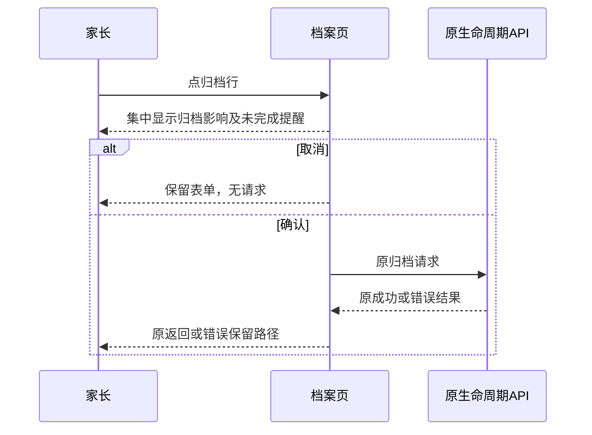
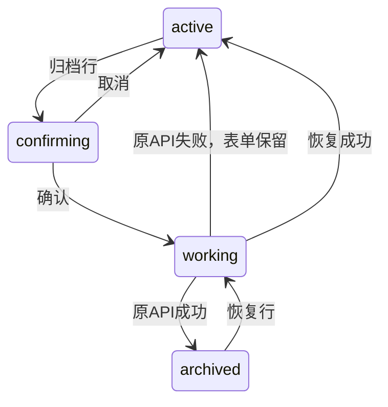

# BUG-033 — 档案归档区层级与文案精简（Spec Lite）

- Status: DONE

## 2026-11-06 开发完成与独立验收

- Development completed: 2026-11-06；依据已批准GOV-002的匹配云交付规则，迁入`specs/completed/`。
- Release authorization: 用户已批准OPS Spec01、确认本次备份/受控窗口，并明确“无需灰度账号，直接发布”（原话“不用配置 直接发布”）。原任务本地实施授权与后续发布授权分别保留。
- Delivered scope: 归档/恢复整行及确认文案由0.1.18交付；三视口21状态和320/390/430确认框视觉/取消完成。
- Source / stages: HEAD`0576ac30464908154c624effed41df6dfa3110cc`＋批准差异，冻结manifest SHA`c96b30d102d2fff317865040bd8b65c419bbb1374689199c41bcebcd0b157f60`；后端040 normal/100%、Schema0027，客户端0.1.18开发上传1,200,417字节。
- Acceptance: 已执行范围见[发布报告](../../docs/deploy/releases/20261106-fullstack-040-client-0.1.18.md)和[新EVD](../evidence/EVD-20261106-FULLSTACK-DELIVERY.md)。家长内容PENDING、线上生成成功率NOT_MEASURED、设备/可访问性及其余业务验收缺项保留原状态；开发DONE不等于完整验收PASS。尚未设体验版、提审或正式发布。备份保留数量因站点安全策略阻断NOT_RUN。
- Closure: Feature/Behavior/Architecture/UI/测试策略/发布入口与索引按实际交付同步；批准设计源、历史失败和各阶段manifest保持。

## 原批准设计与实施时点记录

> 以下保留原修订、各历史运行及当时的“本地/未交付/VERIFYING”结论，不作为当前开发状态；当前交付以上节及新EVD为准，原验收失败不追改。
- Risk: R1；局部可逆的呈现/文案变更，不改数据、API、权限或异步流程。
- Owner: 产品负责人（用户）
- Implementer: Codex
- Reviewer: 实施后独立只读复核，尚未执行。
- Date: 2026-10-24
- Spec revision: `BUG-SPEC-20261024-CHILD-ARCHIVE-UI-01`
- User request: 2026-11-05当前会话“这个进行优化 先输出一个ping 我来审批”；按PNG设计审批稿处理，沿用既有Spec01/DREV01候选，不视为批准。
- User confirmation: APPROVED；用户于2026-11-05当前会话回复“批准”，直接对应上一条展示390×844 PNG并要求“批准 BUG-033 Spec01 + DREV01”的审批请求，批准`BUG-SPEC-20261024-CHILD-ARCHIVE-UI-01 + DREV-20261024-CHILD-ARCHIVE-01`。实施范围仅为本修订局部呈现和文案，不含发布。
- Affected Feature IDs: FEAT-005；FEAT-013仅回归年级表单同页兼容。
- Feature current-state documents: [FEAT-005](../../docs/domain/features/FEAT-005-multi-child-profiles.md)、[FEAT-013](../../docs/domain/features/FEAT-013-annual-grade-promotion.md)。
- Feature baseline revision: 原提案沿用FEAT-STATE-20260906-02-MULTI-CHILD及年级LOCAL-06；本轮实施基线FEAT-STATE-20261025-MULTI-CHILD-UPLOAD-03，年级当前为FEAT-STATE-20261026-ANNUAL-GRADE-DEVELOPMENT-DONE-12。本轮合并后FEAT-005为FEAT-STATE-20261105-CHILD-ARCHIVE-UI-04。
- Feature/UI merge owner: Codex依据已验证实施事实同步，当前不改写已实现语义。

## Frontend Design Impact and Repository-native Approval

- Frontend impact: yes；归档/恢复操作卡、提醒和归档确认文案。
- Frontend engineering impact: yes；页面局部WXML/WXSS及JS文案，操作流程不改。
- Affected UI: [UI-015](../../docs/design/frontend/ui/UI-015-child-profile.md)。
- Baseline: `FDB-20260913-04`（APPROVED）；engineering: `FEC-20261007-NATIVE-GEOMETRY-02`（APPROVED）。
- Quality dimensions: component/state/form/responsive/a11y/i18n/browser/performance/security/privacy/observability。无表格、图表、媒体、AI或新动画。
- Requirements: 保留既有token与纸色风格；正文≥14px、所有触控≥44px、自然换行；FEC-PERF-READ-001..004维持既有有界读取、计数口径和0新增请求。
- Current design: 年级DREV-20261024-ANNUAL-GRADE-PROMOTION-01已批准，其源和57导出不可改。本修订只替代同页归档卡局部视觉。
- Proposed Design Revision: `DREV-20261024-CHILD-ARCHIVE-01`。
- Editable source: [自包含HTML](../../docs/design/frontend/prototypes/DREV-20261024-CHILD-ARCHIVE-01/index.html)。
- Design source SHA-256: `b52125179caf4d795ed9da701f5e5bca12bc400ac73a9e99160051b89aa5f576`，与[候选manifest](../../docs/design/frontend/snapshots/UI-015/DREV-20261024-CHILD-ARCHIVE-01/APPROVAL.md)一致。
- Required exports: 320×568、390×844、430×932；active/unfinished/archived/working/error/confirm/confirm-unfinished共21张。
- Prototype status: APPROVED；Task Spec01及Design DREV01获用户2026-11-05“批准”，源及21张导出冻结。
- UI current-state merge: 实施验证后按真实结果替换相关正文，原生/设备和云交付分别记录。
- Engineering evidence: HTML几何、字体和交互检查单列；生产/原生/真机待批准后验证。
- Approved deviations: none。External design dependency: none。

## 1. Problem and outcome

用户截图中，“归档和恢复都不会删除任何记录”与正文再次说明历史保留；居中长文形成松散的多行，标题“档案状态”却没有实际状态值，红色垃圾桶又与可恢复归档含义不符。

源码可直接复现：child-edit WXML的card-head/c-s、danger-copy和danger-link三层；局部CSS将danger-zone居中，说明及链接字号13px，低于现行正文14px要求。不是日期升级逻辑导致。

期望结果：家长扫到一个明确操作及一句简短说明，点击后才核对完整影响。

## 2. Scope

- 归档卡改为左对齐整行操作：“归档档案”＋“保留全部记录，随时可恢复”＋右箭头。删除“档案状态”泛标题、重复长说明及垃圾桶/常驻危险色。
- 未完成时仅补一条“还有 N 条记录待处理，归档后仍可继续完成。”；未知数量不编造、不阻断。
- 已归档时用同一结构“恢复档案”＋“重新加入孩子列表，继续记录”。
- 归档确认框集中说明隐藏、停止新增、保留历史与可恢复；有未完成数量时补确认和复习反馈可继续，具体文案见[前端合同](../../docs/design/frontend/prototypes/DREV-20261024-CHILD-ARCHIVE-01/FRONTEND-SPEC.md)。
- 进行中禁用重复点击；错误沿用页内错误区并保留表单。

Non-goals：改归档写入许可、归档态顶部说明、保存表单、年级确认、数据库/接口、清理/删除、发布或全局样式。既有“归档资料可编辑”文档与服务active门禁的差异已由年级任务单列，不在本修订中改行为或掩盖差异。

Must not change：manager权限、二次确认、归档/恢复幂等、未完成数量来源、归档后的收尾能力、全家切换回落，以及FEAT-013的touched/version/冲突恢复。

Feature current-state impact：实施后更新FEAT-005/UI-015中危险区提醒/文案结构，替换原长说明约定并引用本Spec与实际证据；Behavior BHV-023/归档BHV-025的业务规则不改，只同步呈现事实；Architecture复核后记录无边界变更，不新增抽象。

## 3. Impact map

- Entry: 设置→学习档案→child-edit编辑态。
- Authoritative presentation: `pages/child-edit/index.wxml` / `index.wxss`；JS仅改unfinishedHint与归档确认文案。
- Existing dependencies: `api.request`、`app.refreshBootstrap`、`children`生命周期服务，全都沿用。
- Existing tests: `tests/frontend/child-profiles.test.js`、`grade-confirmation.test.js`；先复用有效权限/保留草稿/归档恢复断言，必要时更新文案断言，不为纯CSS增加镜像测试。

## 4. Required design views

### Link/call graph

```text
设置档案 → child-edit → 归档操作行 → 原wx.showModal → 原archive/lifecycle
                    → 恢复操作行 → 原restore/lifecycle
                    → 原API → children service → bootstrap切换回落
```

### Sequence diagram



### State machine



只描述既有状态在新呈现中的映射，不新增领域状态。

### Architecture diagram

N/A：无模块、owner、依赖方向、事务、开放点或部署拓扑变化；只修改原页面的权威呈现和文案，不建立组件/工具层。接口/序列closed，其他档案能力deferred。

### Trade-offs

| Option | Benefit | Cost/risk | Decision |
|---|---|---|---|
| 单行操作＋短说明＋原确认框 | 信息集中，减少重复，归档含义准确 | 详细影响需点击后查看，确认前完整展示 | selected |
| 保留大卡仅缩文案 | 改动少 | 泛标题/居中/垃圾桶仍然冲突 | rejected |
| 加开关或自定义弹层 | 可改变展示 | 引入新的状态/组件与误操作风险，超出问题 | rejected |

## 5. Expected file changes and deletion plan

| File | Action | Purpose |
|---|---|---|
| child-edit/index.wxml、index.wxss | modify after approval | 原归档/恢复区域收敛成整行；移除废弃card-head/danger-copy/danger-link局部样式 |
| child-edit/index.js | copy-only after approval | 精简unfinishedHint及modal文案，保留事件/计数/事务/错误逻辑 |
| tests/frontend/child-profiles.test.js | minimal modify if needed | 保留真实行为断言并调整旧长句断言 |
| 本Spec、prototypes/DREV与snapshots/UI-015/DREV | add | 提供可审阅方案、源/SHA与状态矩阵 |
| UI-015、FEAT-005、Behavior、FrontendDesign、Spec/Feature索引、验证证据 | scoped update | 批准/实施/原生/发布事实分别记录 |

最终仍由原child-edit负责；没有备用路径、迁移或数据修复。回滚仅撤回本次局部呈现/文案，不碰年级任务改动。当前共享工作区dirty，保留其他任务全部修改。

## 6. Acceptance criteria

- AC-001：普通在用档案只显示一个归档操作行和一句短说明；左对齐、无垃圾桶、无泛标题与重复段落。
- AC-002：未完成计数真实、未知不显示；提醒不阻断，确认框可理解全部后果，取消不写。
- AC-003：恢复/进行中/错误/权限语义沿用；年级字段、明确意图与冲突草稿路径回归通过。
- AC-004：三精确视口及长提醒/原生确认可读，所有触控≥44px、正文≥14px；没有靠隐藏溢出通过。
- AC-005：文档/证据真实对应；批准设计源不可变；未匹配云交付不DONE，未完成验收独立保留，不把HTML当原生或部署，未来发布仍执行适用门禁（GOV-002）。

## 7. Required test points

| Point | AC | Command / case | Required result |
|---|---|---|---|
| TP-001 | 001/004 | 设计render.py、manifest validator --allow-pending --check-current-policy | 21导出/SHA、无横溢、14px/44px、HTML取消/焦点/禁用通过；不抵扣原生 |
| TP-002 | 002/003 | `node --test tests/frontend/child-profiles.test.js tests/frontend/grade-confirmation.test.js` | 归档/恢复/取消/错误保留、计数汇总/失败降级、年级路径均通过 |
| TP-003 | 001/003/005 | `npm test`、`npm run lint:miniapp`、小程序/architecture/design验证及`git diff --check` | 适用检查通过，无其他任务混入；纯前端无后端测试要求 |
| TP-004 | 001..005 | 原生320×568/390×844/430×932归档/有未完成/恢复/进行中/错误及确认框；iOS/Android、字体放大/读屏 | 原生矩形和截图、操作/标签/焦点记录；未执行明确NOT_RUN，Spec保持VERIFYING |
| TP-005 | 005 | 独立只读复核与逐文档冲突检查 | 无Blocker/Major；只读阶段不修改代码 |

## 8. Plan

1. 生成具体设计与三视口候选；用户批准本Spec01+DREV01后再改业务页面。
2. 在原页面替换呈现与文案，定向/全前端及适用静态检查。
3. 原生/设备验证、只读复核和文档闭合；匹配本增量的客户端开发版本成功上传后按GOV-002设DONE并迁completed。未完成验收独立记录，不将本地设计或preview当成云交付。

## 9. Verification

| Check | Status | Evidence |
|---|---|---|
| 截图及源码定位/同模式检查 | EXECUTED | 用户截图；同页归档/恢复共享danger-zone，未涉及其他页面 |
| TP-001 | PASS / HTML_ONLY | `python3 docs/design/frontend/prototypes/DREV-20261024-CHILD-ARCHIVE-01/render.py`生成21导出；validator `--manifest .../APPROVAL.md --allow-pending --check-current-policy`通过，详见[证据](../../docs/quality/evidence/CHILD-ARCHIVE-UI-DESIGN-20261024.md) |
| 设计脚本Ruff/format及文档空白检查 | PASS | 脚本首轮长行已修正，最终Ruff/format与`git diff --check`通过；不代表生产实现已验证 |
| 2026-10-24 TP-002..005 | 当时NOT_RUN | 当时尚未批准/实施；不借年级任务313项和既有原生证据抵扣新diff。本轮结果如下 |
| 2026-11-05 PNG审批准备（批准前） | HASH_PASS / 当时PENDING_APPROVAL | 重新计算源SHA=`b52125179caf4d795ed9da701f5e5bca12bc400ac73a9e99160051b89aa5f576`并与manifest一致，21张PNG的SHA/签名/尺寸逐项一致；展示既有390×844 active稿，HTML_ONLY |
| 2026-11-05具体批准 | APPROVED | 用户“批准”直接回复Spec01+DREV01审批请求，编码前记录；批准源/导出冻结 |
| TP-001本轮 | PASS / HASH_ONLY | APPROVED manifest校验、21张PNG及源SHA一致；未重跑render.py覆盖冻结导出 |
| TP-002本轮 | PASS | 修改前/后42/42，真实归档/恢复/取消、数量降级及年级路径回归；[Baseline](../evidence/EVD-20261105-BUG033-BASELINE.md) / [实施EVD](../evidence/EVD-20261105-BUG033-IMPLEMENTATION.md) |
| TP-003本轮 | PASS | 349项前端、ESLint、小程序17页、architecture 4 policies/151 modules、设计政策、diff空白检查；命令和对象SHA见本轮EVD，后台检查N/A |
| TP-004本轮 | PARTIAL | 原轮次21组节点及截图超时保持；OPS已补三视口21组节点/PNG。320/390确认框AX与实际取消、430确认框CUA视觉与取消已观察；App下层不算modal视觉，320/390目视归档及设备/大字/读屏/焦点/长内容仍缺，见[后续补证](../../docs/deploy/releases/20261105-fullstack-native-followup.md) |
| TP-005本轮 | PARTIAL | 实施者目标diff/调用链与文档冲突自查完成；独立Reviewer未执行，不能以自查抵扣。既有归档资料编辑合同差异保持显式记录，不扩改业务 |

## 10. Completion

已按用户批准的Spec01+DREV01在原child-edit本地实施：左对齐整行归档/恢复、短提醒与集中确认文案，删除被替代的card-head/danger局部样式；仅更新2个旧文案断言。API/数据/权限/异步流程/年级逻辑未变。本轮验证、首败和未覆盖范围见[实施EVD](../evidence/EVD-20261105-BUG033-IMPLEMENTATION.md)，[Handoff](../../docs/quality/evidence/child-archive-ui-20261105/HANDOFF.md)提供恢复入口。

已同步FEAT-005、Feature索引、归档BHV呈现事实、UI-015、FrontendDesign、Spec索引及[本地发布记录](../../docs/deploy/releases/20261105-child-archive-ui-local.md)；Architecture/FEAT-013/接口/Schema核对为无新增变化。新呈现与文档正文已对齐；既有“归档资料仍可编辑”约定与服务active门禁差异为已列明非目标，未声称全库零冲突。

Spec保留`specs/active/VERIFYING`：OPS同源完整候选已官方preview，仍未上传，旧包不覆盖。三视口21组状态截图、320/390确认框AX/取消与430确认框CUA视觉/取消已补；320/390目视归档、其他设备/可访问性/完整Review仍待补。匹配源码的成功开发上传后才按GOV-002核对DONE，验收缺项独立保留。

- [x] 局部范围、原因、替代方案及设计视图明确。
- [x] 具体Spec01+DREV01批准（用户2026-11-05“批准”）。
- [x] 本地生产源码实施、42项定向/349项前端及适用静态检查。
- [x] Feature/Behavior/UI/Spec/证据与本地发布文档同步；本次无新模块、旧呈现路径或无主抽象。
- [ ] 完整原生/设备验收、独立复核（本轮为PARTIAL/NOT_RUN，不抵扣）。
- [ ] 匹配本增量的云交付，随后按GOV-002 DONE/迁completed。
