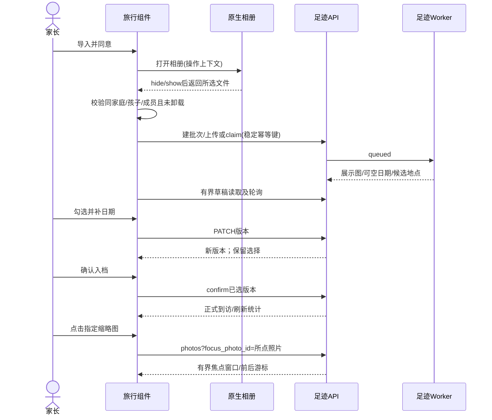
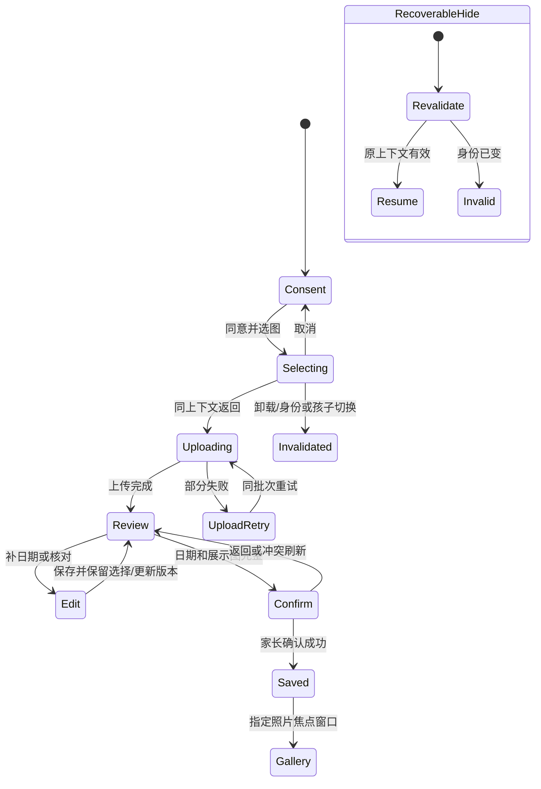
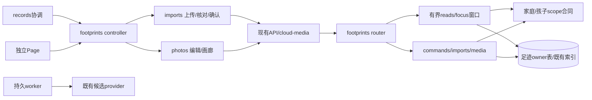

# BUG-035 — 旅行日记真实照片全链路与交互恢复

当前交付：[2026-11-01上传报告](../../docs/deploy/releases/20261101-client-0.1.17-upload.md)记录039 normal/100%后端及0.1.17客户端成功上传1,191,019字节；用户本轮“已完成039照片回看与双账号验收”补齐主路径/分页/双家庭/非owner门禁，记PASS_OPERATOR_CONFIRMED。三尺寸两宿主42组原生、局部动作与微信健康自动证据保持。两端交付已齐，按GOV-002设DONE并归档completed，设备/内容等缺项独立保留，未体验/提审/正式发布。

后续获批[导入精简Spec01/Architecture01/DREV02](FEAT-012-TRAVEL-IMPORT-SIMPLIFICATION.md)仅接管导入说明/勾选/重复AI与选择/上传失败区域，其他BUG-035恢复/日期/编辑/确认/回看合同保持。原347项/42组为2026-10-25基础范围，导入另有349项/15组证据；0.1.17已覆盖并交付，两Spec开发DONE。设备/完整正式确认/内容缺项保留，原验收日志不改为新revision全通过。

- Status: DONE
- Severity: 高；相册返回可能丢失选图结果，缺日期照片核对与回看无法顺畅完成。
- Risk: R2
- Owner: 产品负责人（用户）
- Implementer: Codex
- Reviewer/Verifier: Codex单独只读复核；用户验收真实业务信息及设备效果
- First observed: 2026-10-25；HEAD `0576ac30464908154c624effed41df6dfa3110cc`，已有dirty文档/发布记录保留
- Related incident/ticket: 本会话用户“当前旅行日记的功能是有问题的，全流程走不下来……六六……进行测试……解决全链路和UI交互的问题”
- Spec revision: BUG-SPEC-20261025-TRAVEL-DIARY-E2E-01
- Architecture revision: ARCH-20261025-TRAVEL-DIARY-E2E-01
- User confirmation: 产品负责人（用户），2026-10-25，本会话对call_108ab4e85a7844a6a27df262c36175d0回复“批准 Spec01＋Architecture01＋DREV01，按此实施”；同时提供城市“大连”，未提供拍摄日期
- Affected Feature IDs: FEAT-012；FEAT-005仅回归孩子隔离，FEAT-001仅回归学习记录入口
- Feature current-state documents: `docs/domain/features/FEAT-012-child-photo-footprints.md`
- Feature baseline revision: FEAT-STATE-20261025-PHOTO-FOOTPRINTS-22-UPLOAD
- Feature merge owner: Codex；实现验证后合并正文

### 2026-10-31 后续交付授权

- Approver: 产品负责人（用户）
- Message reference: 本对话“当前效果OK 上传前端准备发布”，随后明确“后端也已经授权”。
- Approved delivery scope: 已批准BUG-SPEC-20261025-TRAVEL-DIARY-E2E-01的两份`footprints/reads.py`、`router.py`兼容增量，从已部署038冻结基线创建不可变后端灰度版本，并准备当前前端上传；不扩大产品或架构修订。
- Delivery evidence: [039兼容后端](../../docs/deploy/releases/20261031-travel-diary-backend-compatibility.md)与[0.1.17客户端上传](../../docs/deploy/releases/20261101-client-0.1.17-upload.md)分别核对；本轮两端已齐、开发DONE归档。用户本轮照片回看/分页及双家庭非owner确认见operator-acceptance.json；原设备/内容缺项保留。

## Frontend Design Impact and Repository-native Approval

- Frontend impact: yes — 相册返回、核对选择、缺日期引导、编辑预览、错误恢复、精确照片回看
- Frontend impact reason: 保持既有视觉与导航；调整上述操作和状态合同
- Frontend engineering impact: yes
- Frontend engineering impact reason: controller/imports/photos状态恢复及WXML/局部样式
- Affected UI IDs: UI-018；UI-001只验记录页嵌入与导航保护
- UI current-state documents: `docs/design/frontend/ui/UI-018-child-photo-footprints.md`；`docs/design/frontend/ui/UI-001-parent-miniapp.md`
- Frontend baseline revision: FDB-20260913-04（既有APPROVED）
- Frontend engineering constraint revision: FEC-20261007-NATIVE-GEOMETRY-02（既有APPROVED）
- Affected frontend quality dimensions: component/state/form/responsive/a11y/i18n/browser/performance/security/privacy/motion-media-AI/observability
- Frontend quality budgets/requirements: 正文≥14px；普通目标≥44px；主CTA≥48px/16px；320×568、390×844、430×932；键盘/安全区内操作可达；列表20/max50、窗口100、预览有界；FEC-PERF-READ-001..004；不存照片/URL/坐标到storage或日志
- Frontend quality verification plan: TP01..TP12；原生节点/PNG与实际点击，不以HTML导出替代
- Approved frontend engineering deviations: none
- Current Design Revision(s): DREV-20261024-RECORD-ENTRY-01 + DREV-20261024-FOOTPRINTS-MINIMAL-01 + DREV-20261024-FOOTPRINTS-TIMELINE-01；其他区域沿用UI-018原有效DREV
- Editable design source path(s): docs/design/frontend/prototypes/DREV-20261025-TRAVEL-DIARY-E2E-01/index.html
- Design source SHA-256: efeeb4319869913ec1294524693a6f6aab6d97ea4e485619efd99f877b2aace2；与对应APPROVAL.md及42张导出绑定
- Proposed Design Revision: DREV-20261025-TRAVEL-DIARY-E2E-01
- Required viewport/state exports: 14态×3视口，共42张；详见FRONTEND-SPEC.md
- Prototype status: APPROVED
- Approved Task Spec revision: BUG-SPEC-20261025-TRAVEL-DIARY-E2E-01
- Approved Design Revision: DREV-20261025-TRAVEL-DIARY-E2E-01
- Design approval evidence: 产品负责人（用户），2026-10-25，本会话上述明确批准；Architecture01一并批准
- Snapshot manifest path: docs/design/frontend/snapshots/UI-018/DREV-20261025-TRAVEL-DIARY-E2E-01/APPROVAL.md
- Permitted implementation deviations: 仅微信系统相册/日期picker/键盘的系统外观；不改变动作、可达性或信息层级
- UI current-state merge owner: Codex
- UI current-state merge evidence: FEAT-012/UI-018/UI-001/BHV/Architecture/设计索引/测试策略与本地交付已同步；旧上传及037冻结明确限定为此前版本
- Frontend visual/a11y/resolution verification: 当前源14态×320/390/430共42组原生节点/PNG通过；430实际隔离选图/补日期/保选/确认/第三张回看与回放通过；真实软键盘/大字/读屏/设备NOT_RUN
- Frontend engineering verification evidence: [当前证据](../../docs/quality/evidence/travel-diary-e2e-20261025/README.md)，含源码SHA、42组原生清单、合成方法流程及真实MySQL5.7摘要
- External design dependency: none

## 1. Symptom and impact

用户反馈旅行日记全流程无法完成。提供的三张JPEG均无EXIF日期/GPS，必须支持补日期再确认；不能从文件名、上传时间、照片画面推断真实日期。

已复现：相册期间onHide/onShow使选择请求过期，返回后没有建立导入；批量修改返回后勾选全部清空；时间线点击指定照片实际打开同到访第一张。后台恢复还清理预览文件却保留旧URL、不重启草稿轮询。编辑面板没有照片预览，缺日期时主动作只报错，用户难以逐图核对。

原生相册是否在每一种微信版本必然触发hide需真实设备验证；当前已证明触发该生命周期时会稳定丢失结果，不能将VM复现扩大成所有设备现象。

- First known good version: UNKNOWN；没有覆盖上述生命周期的历史全链路证据
- First known bad version: 当前源码；0.1.16是已上传开发版本，不据此推断体验/正式版本状态
- Workaround: 隔离API手动补日期可完成；不是家长端可接受的替代

## 2. Reproduction

### Preconditions

- 初始本地完整微信客户端：真实家庭中六六，照片0/草稿0，成员AI开关true。批准后已上传指定三张真实云端草稿，城市“大连”，日期未知；仍0正式照片/到访，未改偏好。
- 三张用户照片保留Downloads原路径；诊断使用临时SQLite、临时私有媒体目录、test provider（零外部AI调用），退出清除。
- UI故障用生产controller/imports/photos和已有harness，只替换transport/系统生命周期。

### Steps / actual / expected

1. 同意后调用choosePhotos；相册期间onHide→onShow→success(tempFiles)。实际imports请求0、pendingFiles空、停在consent；预期在同一孩子/成员上下文接收所选照片，不能因系统选择器正常返回而丢失。
2. 选中照片→批量修改日期→保存。实际回review时selectedCount=0；预期保留选中ID，刷新为服务端最新version后继续确认。
3. 点时间线第三张。实际打开第一张；预期打开点击照片，前后相邻照片/跨页都可访问。
4. review处理中→隐藏→显示。实际删除预览文件却保留URL，已清除timer未重新启动；预期重新取有效预览和最新任务状态。
5. 三张原件上传隔离API→worker。均ready/succeeded、有展示图但日期/地点为空；直接确认409。人工填测试日期/测试坐标后确认成功，summary=3照片/1到访日、timeline/map/playback各1条，另一家庭预览404。预期保持这些服务端规则。

### Reproduction evidence

[诊断证据与边界](../../docs/quality/evidence/travel-diary-e2e-20261025/README.md)。已有前端29/29、后端及元数据20/20通过；不足以证明真实全链路。

## 3. Triage

### Confirmed facts

| Fact | Evidence |
|---|---|
| 三张JPEG无EXIF日期/GPS；均小于10MiB且像素有效 | 本地Pillow读取和真实字节处理 |
| 正常隐藏/返回被当作选择结果过期 | imports.choosePhotos捕获sequence；controller.onHide与onShow/load均推进sequence |
| 修改后选择丢失 | photos.saveEdit调用openDrafts；openDrafts重置selectedCount并decorate为selected=false |
| 点击照片身份没有传递到画廊 | WXML只有visit id；photos.openVisit固定photoIndex=0 |
| 时间线前四与画廊排序不一致 | reads._previews按ordinal/id，photos按id；被点缩略图甚至可能不在首20条 |
| 恢复只刷新首页，不恢复面板媒体/轮询 | controller.onShow只有load；onHide释放预览并取消timer |

### Hypotheses

| Hypothesis | Experiment | Result |
|---|---|---|
| 云端upload-ticket/claim/私有预览也有断点 | 批准后以原客户端真实上传三张，记录状态码/非敏感错误码 | 已执行：通用连接错误后两次原生重试，同批3张收讫/ready/展示图可见，无重复；根因未定位。城市保存409后读取最新、保留输入/选择并成功，0正式写入 |
| AI地点失败影响补日期/确认 | provider失败/拒答注入＋真实可选AI链路单列 | 本地失败/拒答回归通过；真实2张location_unavailable、1张成功但0候选，人工编辑继续；不能宣称AI质量通过 |
| 短屏编辑/键盘挡住保存 | 三视口原生节点、输入聚焦和滚动采集 | 42组原生几何通过，含210px占位；真实软键盘/真机未验 |

### Blast radius

记录页embedded和独立footprints Page共用控制器；图片上传、草稿、编辑、确认、预览、地图和回放。保留family/child/member服务端校验，不触碰learning/planning/travel领域表、数据库迁移、provider协议或生产配置。

### Link/call graph

```text
records → embedded / standalone → footprints controller
  ├─ imports → chooseMedia → cloud-media/API upload → upload-ticket/claim → worker
  ├─ imports → drafts → photos edit → PATCH photo → imports confirm
  └─ timeline(photo_id,visit_id) → photos gallery → bounded photos API → private preview
footprints router → owner reads/service/imports → family/child guards → owned DB/media
worker → metadata subprocess / opt-in provider → editable candidate only
```

## 4. Root cause

单个页面sequence同时承担“家庭/孩子/成员上下文失效”和“临时系统界面隐藏”，导致本可恢复的选图/选点/预览回调被抛弃。恢复没有按当前面板重新加载草稿/正式详情和预览。openDrafts不区分首次打开与编辑回返，破坏选择和下一步意图。时间线只传到访ID，无法精确定位照片；首四排序与画廊首20排序不同，单纯客户端findIndex不足以修复所有规模。

现有测试只验证首文件失败、静态布局和单次动作；没有覆盖相册生命周期、编辑后继续确认、点击非首张及恢复的动作序列。

独立只读复核另发现CR-001：设置保存未完成时隐藏并提前返回，onShow因saving跳过重载，保存完成后又没有恢复已释放的首页缩略图。已退出只读阶段，在同一批准生命周期范围修复前台保存收尾重载；新增两种保存/返回时序，先红后绿41/41，原生方法补验恢复通过。

## 5. Fix contract

1. 同一上下文系统选择器返回可继续；实际切家庭/孩子/成员、注销或卸载后回调无效。选图期间阻止重复打开，取消不产生导入/错误负担；离页/上传中保护继续生效。
2. 上传分阶段显示选图/上传/处理，失败保留批次、原幂等键和已成功部分。重新选图前说明并处理尚未上传文件；不默默覆盖待重试批次。错误可重试，不能仅停在空白面板。
3. 核对显示照片、处理状态、勾选数量；选中存在缺日期时主CTA引导“补拍摄日期”，仅补选中且缺日期条目；保留已知日期，不默认填今天。手动批量修改仍可明确修改整组选中条目。
4. 单张编辑显示所编辑照片；批量保存回核对保留选中ID、更新version与预览；单张保存同样保留核对上下文。批量部分成功记录成功ID/新version，失败保留输入并提供刷新续接，重试不得把旧version重新提交到已成功条目。
5. 确认前有日期和展示图；缺地点仍可入时间线并明确地图未点亮。AI仅候选、可拒答/失败；不识别人脸、不推断日期/精确坐标，不阻塞人工填写。只有确认入档才建立正式到访。
6. 确认失败保留选择；部分批次成功刷新剩余，不重复确认已成功条目；全成功刷新统计/三视图，回看可达。
7. 点击任意缩略图打开该照片；有界画廊保留前后翻页（含焦点在首20条之外）。照片已删除/不属于到访/版本过期时显示可恢复错误，不回退成另一照片的假成功。
8. 相册、地图选点、大图预览、切后台回来，当前表单/勾选可继续；已清理预览必须失效并重新获取；处理中恢复轮询。切孩子/家庭/成员/卸载后的请求和文件不污染新上下文。
9. 显式loading/empty/error/read-only/saving状态；保存期间冻结相关控件；三视口、长地点、键盘和安全区内关闭/主CTA可达。复用既有tokens、胶囊和布局，不扩展设置说明或改底部导航。

### Feature current-state impact

验证后合并FEAT-012/UI-018中“选图可用、批量核对、退出清理、精确回看”正文，明确原合成截图不证明真机全链路；同步BHV-038..041、Architecture、Test Strategy和本地交付记录。UI-001仅同步嵌入恢复/导航验证。其他dirty文档不替代本轮证据。

### Non-goals / State repair

不新增游记写作/AI长文，不推断真实日期或具体场馆，不重做全球底图，不建行程相册，不更改7天/24h保留策略，不自动修复/删除既有真实档案，不迁移Schema。真实照片只写已授权六六的草稿；未得到真实日期/地点和家长确认不创建真实正式到访。隔离测试日期/坐标只用于临时测试库。发布、上传代码包、部署、提交/推送不在本Spec授权范围。

## 6. Fix design

### Selected change

- 原owner内修复：controller负责可恢复显示生命周期及上下文失效；imports负责上传/草稿选择/确认；photos负责编辑/原生地点选择/画廊焦点；不创建全局状态库或新shared抽象。
- 为系统选择器使用局部操作上下文（family/child/member＋操作代次），与页面预览/读取sequence区分；卸载与实际身份切换永久失效，onShow校验身份后恢复。读取仍使用sequence，避免旧response落入新面板。
- 替换无条件清空选择和固定photoIndex=0；释放文件同时清理对应URL，按当前sheet恢复有界读/轮询。表单不被后台load覆盖。
- gallery原接口增加可选`focus_photo_id`，与cursor互斥；family/child/visit/confirmed归属校验后按现有id索引定位，从目标照片起读取至多limit+1。响应增加`previous_cursor`（以及可选focus identity）；旧客户端忽略新增字段，普通首屏及next_cursor不变。previous_cursor编码反向id锚点，DB取id<锚点降序limit+1后反转，界面保持正序。焦点请求不能通过遍历所有分页定位。
- cursor继续绑定family/child/visit/revision，方向属于受验证cursor payload；普通旧cursor默认forward。首个焦点窗口也能向前返回之前照片。每页≤50、常数次查询、现有租户前缀索引，新增规模/查询计划验证；无DDL。
- 原生父页仍只通过既有公开方法/事件协调；仅在实际需要系统操作保护时调整相应canLeave合同。扩展点closed；云媒体与provider既有open合同不变。

### Trade-offs and alternatives rejected

| Alternative | Trade-off |
|---|---|
| 推荐：领域内恢复＋向后兼容有界焦点窗口 | 小范围前后端变动；需SQLite/MySQL和旧cursor验证，但可保证任意缩略图准确打开且前后可达 |
| 只在首20条findIndex | 文件更少；点中不在首屏的缩略图仍失败，不能接受 |
| 循环拉全部照片直到找到目标 | API无需变化；无界请求、延迟/内存不可控，违反FEC与读取合同 |
| 屏蔽全部onHide/全部保留回调 | 改动少；身份切换/离页后可能泄漏旧上下文或文件，不能接受 |
| 重做独立旅行页/状态框架 | 范围和维护成本明显增大；不解决当前owner缺陷 |

### Sequence diagram



### State machine



### Architecture diagram



### Expected file changes

| File/path | Action | Expected change | Why required |
|---|---|---|---|
| apps/miniprogram/pages/footprints/controller.js / embedded.js | modify | 显示恢复/实际上下文失效/面板预览生命周期 | 防止正常选择返回被丢弃，保留租户保护 |
| apps/miniprogram/pages/footprints/imports.js | modify | 选择中、分阶段重试、草稿保选、缺日期CTA、部分确认恢复 | 可继续的上传→核对→确认 |
| apps/miniprogram/pages/footprints/photos.js / presentation.js | modify | 编辑保选/照片预览/选点恢复/焦点画廊 | 确保所改/所看是指定照片 |
| apps/miniprogram/pages/footprints/index.wxml / index.wxss | modify | 状态、字段旁错误、编辑预览、CTA/触控/滚动 | 有效交互与短屏可达 |
| apps/api/src/push_kids/footprints/router.py / reads.py | modify | 可选focus_photo_id/previous_cursor的有界画廊 | 任意缩略图无需扫描历史即可定位 |
| tests/frontend/footprints.test.js / records相关现有测试（如需要） | modify | 真实动作序列和反向场景 | 避免继续只测静态状态 |
| tests/integration/test_footprints.py / test_footprints_mysql.py；tests/performance/test_footprints_reads.py | modify | 焦点归属/双向cursor/查询预算/旧协议回归 | 服务端新增读合同与规模证据 |
| tools/旅行原生采集工具 | add/modify | 禁云隔离三视口、实际点击和节点采集 | 本次diff原生证据 |
| 本Spec/设计/证据/FEAT-012/BHV/Architecture/UI-018/UI-001/Test Strategy/specs索引/本地交付记录 | modify/add | 核对最终事实、状态与验证边界 | mandatory documentation closure |

### Compatibility and rollout

无数据库变更。只新增可选读参数/返回字段，旧客户端普通分页继续；新前端焦点功能需新后端，因此未来发布按后端→前端顺序，部署另授权。回滚客户端及对应后端不可变版本，不删除用户照片。失败/冲突可恢复，不打印原始provider、照片、file_id、私有URL、身份或精确坐标；只记录既有脱敏错误类别/耗时。任何额外云配置/Schema/provider故障须明确修订Spec后实施。

## 7. Regression verification

| Test point | Acceptance / test | Pre-fix evidence | Post-fix |
|---|---|---|---|
| TP01 | chooseMedia success/cancel/fail，多种hide/show回调顺序；同上下文继续、真正离页/切身份拒收；重复点击单一操作 | success/hide/show时imports=0 | PASS：41项专项/347全量；430原生文件选择返回继续，真实云同批三张收讫 |
| TP02 | 三张真实字节上传、worker、展示图/缩略图，无EXIF不伪造日期，缺日期确认409；测试库补日期确认后统计/三视图/私有预览 | 隔离真实照片PASS；不能代验云端 | PASS：最终源码隔离真实JPEG 3/3，缺日期409、合成补全确认200、三视图/第三张focus/跨家庭404；无真实正式写入 |
| TP03 | 单张/批量保存保选和最新version；仅补缺日期；部分保存/确认失败重试不重复成功项 | 批量返回selectedCount=0 | PASS：专项回归和原生三项保选→确认；409刷新最新与部分失败重试通过 |
| TP04 | 隐藏恢复review/edit/photo/confirm，私有文件失效重取、轮询恢复、表单保留；迟到回调不跨scope | 源码与harness已复现 | PASS本地动作回归，含CR-001设置保存前/后返回两时序及原生方法缩略图恢复；真实草稿方法级保选/表单/异步预览恢复通过；实际设备列TP10 |
| TP05 | 任意缩略图精确打开；focus在20条外、前后分页/反向首尾、删除/跨到访/跨家庭/归档/viewer；旧cursor兼容 | 点第三张实际第一张 | PASS：集成/规模及前端回归；原生第三张与向前访问通过 |
| TP06 | 焦点/双向读取SQLite和真实MySQL5.7：50k照片，两种分布，O(1)查询、索引/响应/内存预算；不得扫全历史 | 当前新合同尚未实现 | PASS：最终5项SQLite/真实MySQL5.7.44，焦点40000、前后窗口≤6查询/20条/<64KiB/<500ms/<16MiB，实际gallery索引/无filesort |
| TP07 | 上传首张/中途失败、claim重试、worker失败/AI失败或空候选、版本冲突、弱网/后台均可续接；7天/24h不变 | 既有首文件测试PASS仅基线 | PASS本地故障回归/后端套件；真实通用云错误同批重试、AI失败/空候选人工路径及409保留续接通过；受控弱网/真机后台仍待TP10 |
| TP08 | 原生三视口14态及长地点/处理/空/只读/错误、关闭/主CTA/触控/字体/键盘；实际导入→补日期→确认→回看→地图/回放点击 | 历史截图不用于本diff | PARTIAL：当前42组原生几何PASS，430实际隔离选图→确认→回看/回放PASS；地图夹具初次字符串id失败，修复夹具后方法级地图/回放PASS；真实键盘/地图点击及设备尚缺 |
| TP09 | 完整云客户端对六六三张真实照片上传→处理→编辑→预览；真实日期/地点由家长提供才确认正式档案；可选真实AI另列 | 初始六六0照片/0草稿读取成功 | PARTIAL：真实同批三张上传/claim/ready/展示及城市“大连”保存、409恢复、缺日期错误通过；最终3草稿/0正式，日期null。AI两失败/一空候选，质量未通过。无真实日期/家长正式确认；新focus还需后端优先发布另授权，见cloud-drafts.json |
| TP10 | 真机iOS/Android相册/选点/大图返回、后台、键盘/字体放大/读屏；未具备设备不得宣称通过 | NOT_RUN | NOT_RUN |
| TP11 | 前后端全量、lint/format/mypy、DAG、包体、design SHA/current-policy | 基线29前端＋20后端元数据PASS | PASS：347前端；781后端/46条件skip（最终hint前），最终专项21/3skip及实库5/0skip；Ruff/format/mypy/lint/DAG/设计/小程序预算通过；非上传包验收 |
| TP12 | 单独只读review、代码/文档正文冲突核对、链接/SHA/Spec状态与路径闭合 | 当前仅诊断 | 文档正文已按真实云草稿和CR-001修复更新；闭合检查覆盖12份文档本地链接、42原生SHA/7前端/2后端，批准设计源SHA不变；最终独立只读review结论见本会话末尾；Spec留active/VERIFYING |

Verification commands：`node --test tests/frontend/footprints.test.js`；`.venv/bin/python -m pytest tests/unit tests/integration tests/contract -q`；`npm test`；`npm run lint:miniapp`；`.venv/bin/ruff check .` / `format --check .`；`.venv/bin/mypy apps/api/src`；`.venv/bin/python tools/check_architecture.py`；`tools/validate_miniprogram.py`；`tools/validate_design_evidence.py --check-current-policy`；MySQL配置仅从既有批准secret store读取，命令不回显凭据；新原生采集命令实现后记录准确入口。

`uv run`本轮因用户cache沙箱不可读未运行成功，已使用仓库现有.venv直接运行同套pytest，未安装或更新依赖。

## 8. Review checklist

- [x] 症状、源码与执行复现相互对应；云端未知单列。
- [x] 有调用图/时序/状态机/架构、备选取舍、文件清单与测试点。
- [x] 新增gallery有界与租户合同，无全量拉取定位。
- [x] Spec01 + Architecture01 + DREV01获明确批准（2026-10-25）。
- [x] 修复后测试实际PASS/PARTIAL/NOT_RUN逐项记录；未配MySQL的skip另以真实5.7专项补验。
- [x] Feature/Behavior/Architecture/UI/设计索引/测试/发布事实按diff核对同步，历史批准快照不改。
- [ ] 末尾独立只读review、真实云业务与设备/可访问性及家长验收全部闭合。

## 9. Closure and prevention

Spec01/Architecture01/DREV01获批后已在原owner内实施，生产代码与回归测试已改；新gallery增加可选focus与previous_cursor，旧cursor兼容。真实MySQL5.7规模发现优化器不稳定选择，使用既有索引的MySQL专用hint并验证，无DDL/模块边界/新shared抽象。三张真实字节在隔离API跑通；42组原生几何和隔离实际选图/确认/回看通过。详细失败、修复与结果见[本轮证据](../../docs/quality/evidence/travel-diary-e2e-20261025/README.md)。

当前039 normal/100%后端和0.1.17客户端已交付。用户本轮确认照片回看/分页/双家庭/非ownerPASS，
独立实际应用账号Schema与微信live/ready/me/visits200保持自动化证据。此前六六三草稿/城市“大连”/
未知日期/0正式、409恢复与AI两失败/一空候选保留当时结果；本轮不修改或自动确认儿童正式事实。
未将本次有限用户确认扩张为设备、完整内容或媒体生命周期全部验收。

Development completion: DONE，2026-11-01归档`specs/completed/BUG-035-TRAVEL-DIARY-END-TO-END.md`；
两端交付绑定精确039与0.1.17范围。TP08/09/10未覆盖的真实日期/家长正式确认、AI内容/设备/
可访问性与完整独立评审缺项保持PARTIAL/NOT_RUN/FAIL，后续条件见各验收行；体验/审核/正式发布NOT_RUN。
原dirty文件、失败与批准设计保持，0.1.17不覆盖并行BUG-037两份页脚源或BUG-036生成/缓存增量。
