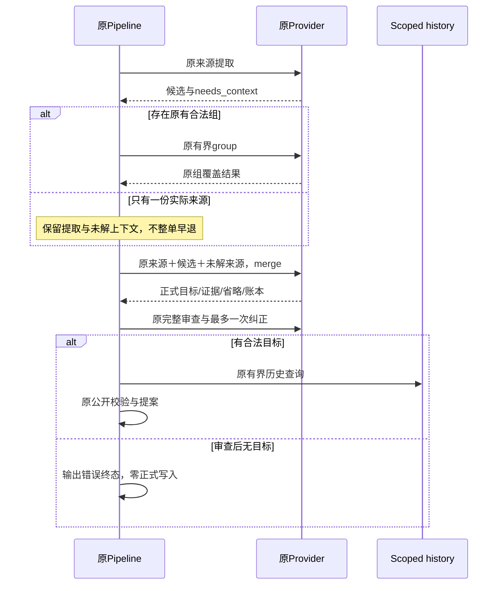
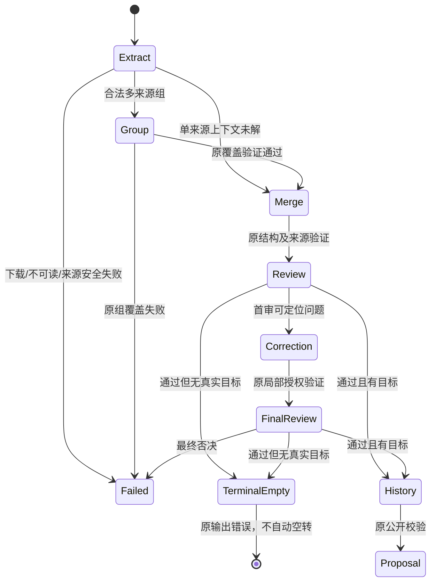
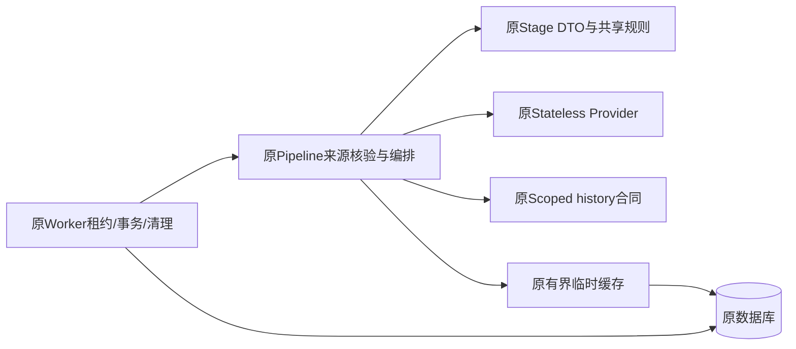

# BUG-036 — 固定40条生成成功率与缺上下文阻断修复

- Status: DONE

## 2026-11-06 开发完成与独立验收

- Development completed: 2026-11-06；依据已批准GOV-002的匹配云交付规则，迁入`specs/completed/`。
- Release authorization: 用户已批准OPS Spec01、确认本次备份/受控窗口，并明确“无需灰度账号，直接发布”（原话“不用配置 直接发布”）。原任务本地实施授权与后续发布授权分别保留。
- Delivered scope: 040覆盖13/16的单份来源核验、技能/对象边界与空结果终态；旧分母/评分和内容结果不追改。
- Source / stages: HEAD`0576ac30464908154c624effed41df6dfa3110cc`＋批准差异，冻结manifest SHA`c96b30d102d2fff317865040bd8b65c419bbb1374689199c41bcebcd0b157f60`；后端040 normal/100%、Schema0027，客户端0.1.18开发上传1,200,417字节。
- Acceptance: 已执行范围见[发布报告](../../docs/deploy/releases/20261106-fullstack-040-client-0.1.18.md)和[新EVD](../evidence/EVD-20261106-FULLSTACK-DELIVERY.md)。家长内容PENDING、线上生成成功率NOT_MEASURED、设备/可访问性及其余业务验收缺项保留原状态；开发DONE不等于完整验收PASS。尚未设体验版、提审或正式发布。备份保留数量因站点安全策略阻断NOT_RUN。
- Closure: Feature/Behavior/Architecture/UI/测试策略/发布入口与索引按实际交付同步；批准设计源、历史失败和各阶段manifest保持。

## 原批准设计与实施时点记录

> 以下保留原修订、各历史运行及当时的“本地/未交付/VERIFYING”结论，不作为当前开发状态；当前交付以上节及新EVD为准，原验收失败不追改。
- Spec revision: `BUG-SPEC-20261101-KNOWLEDGE-SUCCESS-04`
- Architecture revision: `ARCH-20261101-KNOWLEDGE-SUCCESS-04`
- Prompt revision: `KNOWLEDGE-PROMPT-20261101-06`；2026-11-05批准后本地实现为`staged-20261101-13` / `child-aware-history-agent-20261101-16`，冻结12/15作为Red/Baseline。
- Severity / Risk: MAJOR / R2；来源不足处理及可复习技能命名合同改变，API、Schema和前端不改。
- Owner / Implementer / Reviewer / Feature merge owner: Product owner / Codex / 独立只读上下文待补 / Codex。
- Affected Feature IDs: `FEAT-001`；[当前事实](../../docs/domain/features/FEAT-001-push-kids-mvp.md)现为`FEAT-STATE-20261105-KNOWLEDGE-SUCCESS-12`。冻结/诊断基线为12/15及CONTENT-10/11，本轮本地13/16；云039冻结包仍06/10，不混同本地生产源码与已部署包。
- Parent: [内容Spec03](BUG-036-SOURCE-GROUNDED-CONTENT-REPAIR.md)；[缓存Spec02](BUG-036-CHECKPOINT-RETRY-STRATEGY.md)及[受阻发布Spec01](../active/OPS-20261101-BUG036-CACHE02-DEPLOYMENT.md)保留独立状态。
- User request: 2026-11-01当前会话“排查不通过的原因 并修复，要求成功率达标”。
- User confirmation: APPROVED — 产品负责人，2026-11-05，本聊天用户原话“批准，注意我关注成功率和生成效果。你在改完代码之后进行测试，使用真是的信息生成结果，我来review生成质量。同时需要关注生成成功率”。对应上一轮明确链接的本Spec04、Architecture04、Prompt06及已批准缓存Spec02；授权本地修复、测试和真实材料只读生成，不授权部署、生产写入或Git提交。
- Implementation: LOCAL_IMPLEMENTED / VERIFYING。冻结12/15后获得5个预期Red与1PASS，实施13/16。最终源码、测试、固定40、近期18条真实材料及用户质量review状态由[本轮EVD](../evidence/EVD-20261105-BUG036-SUCCESS04.md)独立绑定；无对应云交付，不记DONE。
- Diagnosis: [EVD](../evidence/EVD-20261101-BUG036-FIXED40-DIAGNOSIS.md)；10/13原40为34/40，六条单次诊断独立保留；12/15完整40为33/40（82.5%）、语文60%、数学/英语各86.7%，FAIL，零正式写入；不能与旧PASS拼接。

## Frontend Design Impact and Repository-native Approval

- Frontend impact / engineering impact: no。只改后端提案来源处理和语义规则，不改页面、字段、交互、组件、工具链或资源。
- UI IDs / current state / baseline / FEC / Design Revision / source / viewport / manifest / frontend acceptance: N/A，上述原因不触发前端实现门禁；关闭时核对UI正文是否仍正确。
- Approved Task Spec revision: `BUG-SPEC-20261101-KNOWLEDGE-SUCCESS-04`（2026-11-05）；Approved Design Revision: N/A。
- External design dependency: none。

## 1. 症状、范围及成功标准

受阻发布包10/13的原固定40条实际34/40（85%），各科语文10/15、数学12/15、英语13/15，零基础设施失败、零空/剩余待确认、零正式记录写入。五条耗尽三次Job尝试，一条产生提案但科目不全。原失败和源码清单保留，不替换样本。

本任务修复固定40反映出的通用合同缺口。验收仍是原40条、原顺序、原模型/参数、整体至少38/40、每科至少90%，所有输出/科目失败仍在分母。正确缺材料拒绝也不是该旧门禁的提案PASS。若仍不达标，记录FAIL并继续阻止发布，不能改分数、降低阈值或拼接历史PASS。

最新12/15完整复测七条FAIL：multi-01、zh-04、zh-05、zh-07、zh-09、en-12、multi-04。与旧六条取并集为八条：multi-02本次通过但仍保留原失败；zh-04、en-12本次新增复审失败同样在修复回归范围。没有证明新版本平均成功率下降，两个独立单轮只说明各自实际门禁失败。

原真实30+补充3的内容FAIL独立保留；本任务不声称它们已修复，也不以固定40的科目/证据检查证明真实图像内容忠实。只有40达标仍不足以宣布整体验收或发布标准达标。

## 2. 复现与确认事实

- 10/13六条诊断：原fixture、每条一次完整pipeline attempt，270秒总预算，45/30秒阶段上限，原模型；临时生成合成图，无DB/checkpoint或业务API连接。
- 12/15完整40：冻结153份源码/工具/fixture，六份内容Spec03生产源SHA与其不可变candidate12清单一致；原Worker/临时SQLite/评分/三次持久重试政策保持。
- 日志只保留case短编号、DTO数量、静态失败/问题码及固定科目分类；不存名称、证据、原响应、图像或凭据。

| 确认事实 | 对应证据与限制 |
|---|---|
| zh-05提取为空且needs_context=true，单图在group/m1抛coverage | 10/13一次诊断；不能外推原三次都相同 |
| multi-01已有两个科目候选，但needs_context=true在group/t整单失败 | 10/13一次诊断，尚未进入merge；不是模型没提取数学 |
| multi-02提取/合并均有数学和英语，首审vague_name，纠正后数学被indeterminate_object省略 | 10/13一次诊断最终只剩英语，科目不全；根因是范围/命名决策，不是未配置英语 |
| zh-07两次质量审查均exercise_not_knowledge | 10/13一次诊断，排序技能与纯作答指令的边界不稳定 |
| multi-04三科候选在merge全部省略，review通过后空提案失败 | 10/13一次诊断，数学规则与缺少字词对象一起被丢弃 |
| zh-09诊断通过，而原40中失败 | 随机重跑可能改变结果；不能将此PASS替换原失败或当作修复 |
| 最新12/15的zh-04首审exercise_not_knowledge、复审vague_name；en-12两审均vague_name | 七条失败完整复测的阶段记录；明确标点对象和明示句式结构仍被拒绝 |
| 最新12/15的zh-05/07/09和multi-04均单来源group失败；multi-01审查后空结果失败 | 成功的提取/语义缓存被后续attempt复用，三次失败不等于三次重新生成 |

源码`pipeline.run`对pending来源构组，`len(group)<2`直接失败；该发生点在`_call`外，旧常规日志只能显示coverage。模型同时可能把“学习对象没给全”误写成“要联合另一页”，导致既有可辨目标整单阻断。后续来源账本和完整审查有能力表达有理由的省略，但这个早退绕过了它们。

## 3. 修复合同

### AC-F01 — 明确技能与对象两类证据，不补造

原文明确声明学科核心操作及检查关系时，可整理其实际声明的技能，即使没有提供每个练习实例。名称保留可检查的核心规则/关系，不把“阅读、练习、填空”等活动词当作全部知识含义。证据只说家长明确说明或可见材料中的实际目标。

允许的通用边界包括时间顺序提示与叙事次序、事件发展顺序、主要事件概括、汉字构成词语、明确标点对象的运用、明示句式结构与语义用途、明确命名的运算/关系规则。不能补出未提供的故事题名、词语、句子、运算结果、口诀范围或“某数以内”；不能声称具体对象已经认读/书写。

词表、识字、字母或诗文的对象本身是复习目标时，仍要求具体对象/可识别封闭范围。仅“school objects”“学语文”“阅读练习”之类宽泛主题不能生成猜测词表或占位知识。不是每个旧fixture都必定提案成功；不足仍失败并计原分母。

Review的`exercise_not_knowledge`只用于纯作答布局/无核心学习关系；`vague_name`须指明当前材料确实给出而名称未表达的目标，不能要求模型补出原文没有的范围。同一边界由extract/merge/review/legacy共享一个规则owner，不另写case答案表。

### AC-F02 — 单份来源缺上下文进入原来源核验

仅因没有第二份来源而无法组成group时，保留已验证提取结果、excerpt及needs_context事实，继续原merge。merge接收同一批完整真实来源及有界未解决来源编号，逐项保留充分目标或记录合法省略；source_checks仍对每个实际来源恰好一条。

不生成缺失页、不新增图像读写服务、不增加group/模型轮次，不把unreadable、下载失败或来源SHA改变降级为正常提案。两份及以上材料的原有界group、最多两组/每组最多三图和其覆盖验证保持；本轮不改变多页补齐合同。

只有已审查真实目标才进入历史匹配/公开提案。单材料的缺失实例不能自动让该材料的全部既有目标丢失；也不能为了科目覆盖增加无直接证据目标。

### AC-F03 — 审查后确无目标终态，不重复空转

原来源核验与质量审查完成后，若最终items为空，使用原`coverage / review / empty_proposal`分类但`retryable=false`。不把语义材料不足改成基础设施错误，不把它从40的科目分母移除。

Provider网络/超时的既有恢复、review1否决终态、明确家长retry清语义/留提取、租户/事务/取消/租约政策不改。没有新公开错误码或UI文案。

### AC-F04 — 证据、历史、资源边界保持

正式evidence/confidence owner、候选完整去向、局部纠正保护、source_checks和64KiB验证保持。没有新持久字段、模型服务、自动改名或业务数据修订。

最多33核心调用、18缓存键、64KiB/key、512KiB/job、24小时TTL、两个请求槽、45/30秒执行上限、180秒提取及30秒写回余量保持。参数/规则变化更新pipeline/prompt revision并使旧语义缓存失效；不能用延长超时或增加循环换成功率。

历史仍检查实际对象/范围/技能等价；缺失实例不赋予更广课程范围，更不能复用有不同具体对象集合的旧名称。家长确认仍是唯一正式入档路径。

## 4. 设计与取舍

推荐在现有`stage_contracts`澄清证据/技能规则，在现有`pipeline`修复单来源构组早退和空提案终态；Provider、数据库及worker事务无新增路径。

| 方案 | 取舍 |
|---|---|
| 推荐：技能证据边界＋单来源核验＋空结果终态 | 修复已观察机制，保留质量审查和原40；需要批准新行为合同，仍须真实复测 |
| 回到历史40/40的旧生成规则 | 历史分数不能证明当前修复；已知真实内容不达标，丢失后续来源与质量边界 |
| 改fixture、把正确拒绝计提案PASS或反复重跑取最佳值 | 改变测量对象或标准，不能证明原40成功率达标；本Spec不采用 |

Provider扩展点open并保持原兼容/隔离/安全/观测/契约；本版本语义和来源政策closed；独立OCR、投票、多轮重试deferred。

### Link / call graph

```text
原Worker/Runner → StagedPipeline.run → extract
  → 可组：原group
  → 单份不可组：带未解来源进入原merge
  → 原始来源＋候选＋账本 → review0 → 至多一次correction → review1
  → 有审查通过目标：原scoped history/match → 公开提案
  → 全部无目标：原输出错误终态 → 原清理/明确retry
```

### Sequence diagram



### State machine



### Architecture diagram



### Expected file changes

| 文件 | 动作 | 原因 |
|---|---|---|
| `agent_processing/stage_contracts.py` | modify | 共用技能/对象边界、提取/合并/审查说明及pipeline revision |
| `agent_processing/pipeline.py` | modify | 单来源构组早退、传递未解来源及空结果终态 |
| `agent_processing/prompt.py` | modify | 共用legacy规则与prompt revision，不产生第二个owner |
| `tests/unit/test_staged_analysis.py`、`test_staged_proposal_recovery.py`、`test_provider_evidence.py` | modify | 原行为回归、来源/空结果/共享revision断言 |
| `tests/integration/test_analysis_checkpoints.py` | modify only if needed | 验证新revision恢复、终态清理与明确retry |
| Feature/BHV/Architecture/UI无前端变化说明/Test/Spec/ISS/REG/EVD/索引 | modify/add | 仅合并本revision实际验证事实，保留旧FAIL |
| 原40fixture、评分工具、Provider参数、DB、小程序、worker事务 | no change | 保留原测量对象与边界 |

回滚仅撤销本Spec04 patch并恢复冻结12/15，保留缓存02与其他会话修改。无数据迁移或存量修复。实施批准不授权发布、业务POST、生产reset、Git提交或推送；新发布候选需另更新OPS具体源revision/manifest并完成原门禁。

## 5. 必需验证点与顺序

先在冻结12/15做诚实Red/Baseline；setup故障不算产品Red。单测变更按仓库单测Skill流程，行为探针不镜像源码。

| ID | 必需检查 | 当前结果 |
|---|---|---|
| TP-F01 | 单文字/单图needs_context=true且有独立充分目标：进入merge、保留直接来源、无多余group；冻结基线先失败 | PASS：4个预期Red→Green，最终903全量覆盖 |
| TP-F02 | 单来源确无目标：零历史查询/零提案，原输出错误一次终态；Worker取消/清理/明确retry保持 | PASS：empty retryable预期Red→Green；隔离Worker两动作均通过 |
| TP-F03 | 无候选但可读来源、混合充分与不足目标、unreadable/来源SHA改变、两页组覆盖/上限保持 | PASS：最终全量覆盖；真实不足材料仍独立计失败/缺失 |
| TP-F04 | 来源/局部保护/历史严格等价的确定性行为回归；共享规则只核对唯一owner与既有revision断言，不能用Prompt字符串测试冒称语义通过 | PASS_MECHANISM：最终自动化通过；实际语义有剩余问题，见TP-F07/08及真实18条，不记内容通过 |
| TP-F05 | staged/provider/checkpoint专项＋后端完整`tests/unit tests/integration tests/contract`；每个skip记录原因 | PASS_WITH_SKIPS：初期专项173PASS；最终全量首次902PASS/1FAIL，隔离8PASS后复跑903PASS/52条件skip；首败/skip原因均保留于EVD |
| TP-F06 | Ruff/format、mypy、architecture、`git diff --check`；独立只读代码/文档Review并解决确认问题 | PARTIAL：静态/类型/架构/diff PASS；仅实施者自查，独立新上下文Review NOT_RUN，未冒称独立通过 |
| TP-F07 | 先一次新旧失败并集八条诊断＋至少四条非原fixture边界探针，覆盖明确技能/纯布局/宽泛活动/未枚举词表；执行会话独立对照原素材与最终提案判断，记录各阶段、次数、预算和真实失败；不作最终分母 | EXECUTED_WITH_FINDINGS：两候选各12条；发现误省略/占位后改通用规则，最终8/12产出、三种不足边界无提案、旧8例7产出；源SHA与原失败保留 |
| TP-F08 | 最终源码指纹固定后一次原40完整门禁：整体≥38/40、各科≥90%、空/剩余待确认/正式写0；失败全部保留，另逐条独立核对实际内容/摘要/证据与Spec04边界，不能由科目检查代替 | PASS_SUCCESS_GATE / CONTENT_PARTIAL：39/40＝97.5%，三科14/15＝93.33%，empty/pending/formal0。全部40份首attempt产出，但缺词表样本科目FAIL照计；逐条核对另有1份英文断行名称内容FAIL，不宣布整体内容PASS |
| TP-F09 | 文档正文冲突逐项核对、源码/manifest SHA及引用存在；Spec生命周期与未交付事实明确 | PASS_OWN_SCOPE：本轮18份正文/索引同步，BUG-036引用无缺失、16文件源SHA无差异、私有18条/13图资源齐全；本轮代码/当前文档无新增冲突。共享文档并行BUG-033未完成链接单列，不代验/删除。Spec VERIFYING/active，无匹配云交付，独立Review及用户质量验收仍待补 |

命令使用仓库现有pytest/Ruff/mypy/architecture与`tools/evaluate_analysis_quality.py --provider staged --cases tests/fixtures/analysis_quality/cases.json`。隔离SQLite与临时合成图，不连接生产数据库；只读诊断不是单测Green。

验收观察脚本可以在私有临时目录短暂保留最终公开DTO供执行会话逐条查看；不保留原SDK响应，不修改评分工具或提交完整提案到仓库。结束后清理DTO/图像，只导出case短编号、来源SHA、计数、静态结论和预算。内部review passed、合成Provider断言、自动科目PASS与独立内容判断分开报告；有编造对象、扩大范围或占位知识时不能宣布内容达标。

一次最终40不达标即保留FAIL；只有明确源码修复后的新指纹才允许新的完整门禁，不随机重复同版本取最好。新增流程/预算/验收标准须另批准revision。真实30+3、MySQL发布并发、云定向smoke、容器和原生/真机在此任务未执行时标NOT_RUN/原FAIL，不能由本40代验。

### 2026-11-05真实材料验收补充（用户本轮批准）

- 原固定40例、八条诊断和四条边界探针保持原测量对象、顺序、模型/参数和分母，不以真实样本替换。
- 另对同一授权家庭11月1日至今的全部18条真实学习提交按时间顺序建立固定只读样本；先核对文字/图片是否仍可获取。保留成功、模型失败和素材不可恢复三类实际结果，报告总样本及可执行分母；不静默剔除失败材料。
- 只读获取原材料与有界已确认历史，生成进程不连接生产数据库、不调用业务POST、不创建Job/草稿/正式学习/Review或上传媒体。历史重建的不足明确标记，不冒称原时点完整快照。
- 用户要亲自review：最终可编辑提案与所需原材料只保留于仓库外权限受限的本机review目录，提供本地review报告；普通日志/仓库仅保存短编号、来源摘要、计数、静态问题码及版本。原SDK响应不保存，凭据/下载URL不导出；用户review前暂留私有材料，review结束后清理。
- 分开报告首attempt产出、最多原3次attempt后的产出、耗时/失败类别及内容质量。用户内容验收保持PENDING，不能由模型自审或科目检查代替；11月1日历史30+3结论仍独立保留。
- 本轮实际：18条中15条可执行，首attempt12/15＝80%，最终13/15＝86.67%，总覆盖13/18＝72.22%；3条材料404，2条流程无提案。13份输出至少2份需修改、4份粒度/摘要待review；用户质量验收PENDING。全部原材料/生成结果/失败在私有本机报告逐条展示，[EVD](../evidence/EVD-20261105-BUG036-SUCCESS04.md)保留计数/内容问题码和62/62只读审计一致。新发现match不确定缓存空转已建ISS，未超本批准范围修改缓存/恢复政策。

## 6. Review与文档闭合

- 检查每个改动必要性、唯一owner、阶段/来源/错误边界及原缓存/租约/取消保护，不混入并行内容或前端任务。
- 关闭时逐项核对FEAT-001、BHV-032、Architecture、UI、Test、三个父Spec、ISS内容问题、EVD与发布记录；修正当前正文矛盾，不只追加段落。
- 当前VERIFYING/`specs/active/`，2026-11-05获批范围已本地实施，未云交付；不能DONE。用户内容review、独立代码Review及后续交付各按真实结果保留，不因本地测试通过追认完成；匹配云交付后才迁completed。
- 这份方案旨在达到原成功率门槛；是否实际达标只由TP-F08结果决定。

设计自查：已完成范围、确认事实/模型随机性、三方案取舍、来源安全、唯一owner、预算、设计视图、必需测试点与回滚核对；没有占位字段或未说明的N/A。单页来源处理、技能命名与空结果终态超出原Spec03已批准合同，因此本Spec须明确批准后才实施。知识域与发布证据分别绑定版本，不重复提交Git或扩大OPS部署授权。
