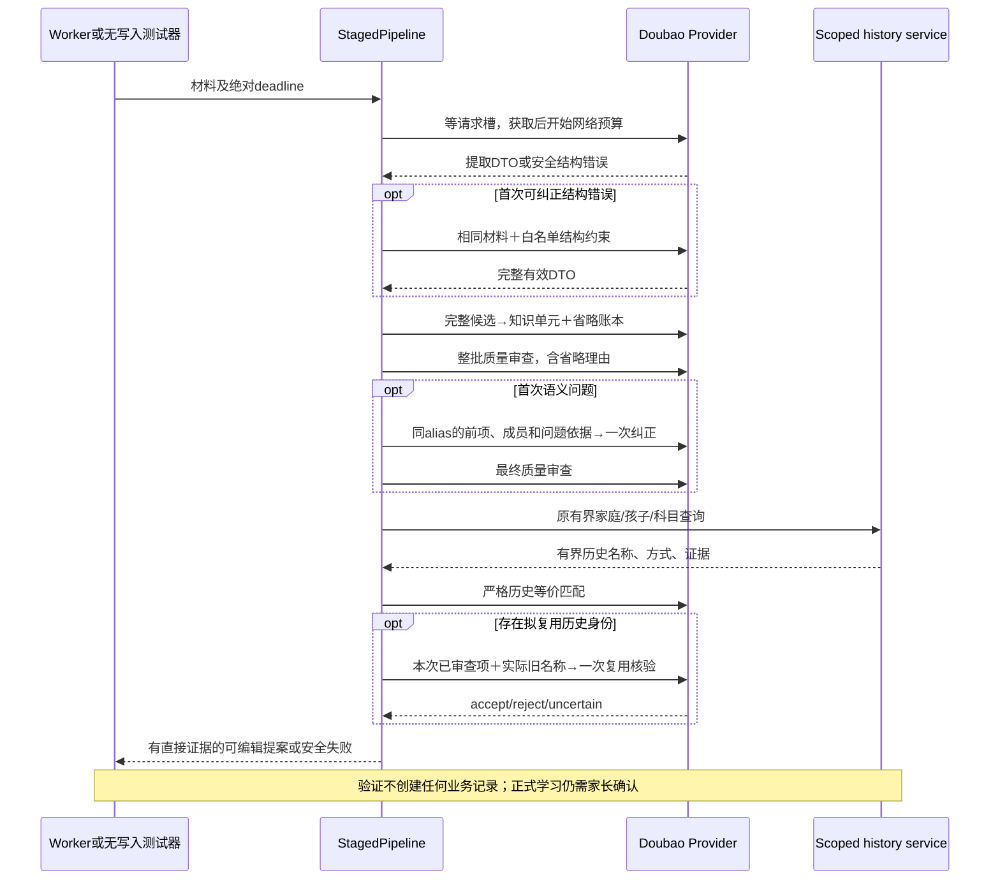
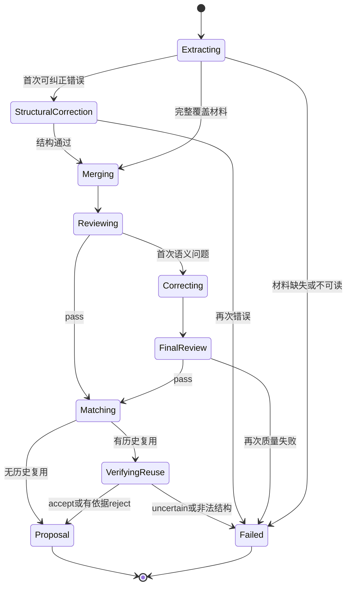
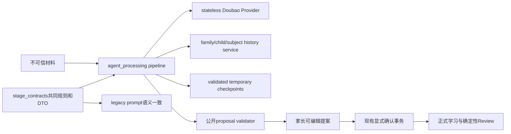

# BUG-036 — 修复知识点提案中断与质量规则冲突

- Status: DONE

## 2026-11-06 开发完成与独立验收

- Development completed: 2026-11-06；依据已批准GOV-002的匹配云交付规则，迁入`specs/completed/`。
- Release authorization: 用户已批准OPS Spec01、确认本次备份/受控窗口，并明确“无需灰度账号，直接发布”（原话“不用配置 直接发布”）。原任务本地实施授权与后续发布授权分别保留。
- Delivered scope: 040继承知识点提案、证据账本、纠正与审查实现；历史07/08/09内容FAIL保持。
- Source / stages: HEAD`0576ac30464908154c624effed41df6dfa3110cc`＋批准差异，冻结manifest SHA`c96b30d102d2fff317865040bd8b65c419bbb1374689199c41bcebcd0b157f60`；后端040 normal/100%、Schema0027，客户端0.1.18开发上传1,200,417字节。
- Acceptance: 已执行范围见[发布报告](../../docs/deploy/releases/20261106-fullstack-040-client-0.1.18.md)和[新EVD](../evidence/EVD-20261106-FULLSTACK-DELIVERY.md)。家长内容PENDING、线上生成成功率NOT_MEASURED、设备/可访问性及其余业务验收缺项保留原状态；开发DONE不等于完整验收PASS。尚未设体验版、提审或正式发布。备份保留数量因站点安全策略阻断NOT_RUN。
- Closure: Feature/Behavior/Architecture/UI/测试策略/发布入口与索引按实际交付同步；批准设计源、历史失败和各阶段manifest保持。

## 原批准设计与实施时点记录

> 以下保留原修订、各历史运行及当时的“本地/未交付/VERIFYING”结论，不作为当前开发状态；当前交付以上节及新EVD为准，原验收失败不追改。
- 2026-11-05后续增量：[成功率Spec04 / Architecture04 / Prompt06](BUG-036-FIXED40-SUCCESS-REPAIR.md)经用户明确批准，本地13/16实施单份未解来源核验、技能/对象边界和审查后空结果终态；[本轮EVD](../evidence/EVD-20261105-BUG036-SUCCESS04.md)分别记录固定40与近期真实18条、用户质量review PENDING。下列09/13和12/15指标均保留历史版本，不冒称本轮通过；无本增量云交付，父Spec仍VERIFYING/active。
- Latest delivery attempt: 已批准OPS缓存10/13灰度发布的fixed40实际34/40（85%）与各科<90%FAIL，停止创建新版本，生产仍039，未匹配云交付。本Spec原09内容FAIL与独立内容Spec03结果分别保留，不能由发布准备或机制PASS改为DONE；见[门禁EVD](../evidence/EVD-20261101-BUG036-CACHE02-RELEASE-GATE.md)。
- 2026-11-01全部失败修复：[内容Spec03 / Architecture03 / Prompt05](BUG-036-SOURCE-GROUNDED-CONTENT-REPAIR.md)已获当前会话批准并本地实施12/15，VERIFYING/active；原图/完整输出审查、正式证据owner与来源局部纠正已接入。两项独立发现经诚实Red修复、第二轮0新确认问题；166专项/896全量PASS、52条件skip。最终原30为20产出/10内容PASS/9严格PASS＋1正确拒绝，原六PASS回退3；补充0/3严格PASS、边界7/10，内容验收FAIL，[12 EVD](../evidence/EVD-20261101-BUG036-CONTENT03-ACCEPTANCE.md)保留每份失败和资源/51/61表审计PARTIAL。旧09/13失败和11诊断保持，缓存Spec02政策不变，无云交付。
- 2026-11-01缓存策略补充：[Spec02 / Architecture02](BUG-036-CHECKPOINT-RETRY-STRATEGY.md)获“批准 BUG-036 缓存 Spec02，开始实施”后本地实施10/13，VERIFYING/active。最终语义否决终态、父母retry刷新语义分支、有效提取/首审纠正恢复已验证，116专项/857全量PASS、52条件skip及隔离MySQL8PASS；全库Ruff范围外缺项及独立Review最终结果见[缓存EVD](../evidence/EVD-20261101-BUG036-CACHE02.md)。未云交付。[原三份/六图只读09/13复测](../../output/BUG036-20261101-FAILED3-RETEST.md)保持2产出/1内容PASS/1FAIL/1NO_OUTPUT、61表一致；词表纠正name超长、拼音归类和备注教学角色反证未由缓存修复解决，原Spec01批准及30条FAIL保持。
- Severity: MAJOR — 真实素材首轮 30 条中 13 条没有最终提案，另 10 条内容不达标。
- Risk: R2 — 调整 Provider 超时与结构恢复、内部阶段 DTO、质量纠正与历史复用核验；公开 API 和数据库 Schema 保持。
- Owner: Product owner
- Implementer: TRAE
- Reviewer/Verifier: `bits-code-guard` 大变更分组规则要求的两组独立只读审查与跨组核对；内容由当前会话模型评测。实现未委派，审查不调用生产写接口或代替内容判定。
- First observed: 2026-10-31，`staged-20261031-06` 的 30 条真实素材回放。
- Related evidence: [原 30 条评测](../../dist/knowledge-generation-evaluation-20261031-30/evaluation-30.md)、[本轮排查](../../dist/knowledge-generation-diagnosis-20261031/diagnosis.md)。
- Spec revision: `BUG-SPEC-20261031-KNOWLEDGE-GENERATION-01`
- Proposed architecture revision: `ARCH-20261031-KNOWLEDGE-GENERATION-01`
- Proposed prompt revision: `KNOWLEDGE-PROMPT-20261031-04`；[完整规则草案及末尾示例](../evidence/KNOWLEDGE-PROMPT-04-DRAFT-20261031.md)。
- Proposed implementation revisions: `PIPELINE_REVISION=staged-20261031-07`、`PROMPT_REVISION=child-aware-history-agent-20261031-11`；Provider 参数指纹加入队列/执行预算及新的 review 输出预算。
- Content-baseline implemented revisions: `staged-20261031-09` / `child-aware-history-agent-20261031-13`已完成该轮本地测试、独立增量审查及固定30源实验；[09EVD](../evidence/EVD-20261031-BUG036-PROMPT09.md)832pass/46skip，109专项与独立71pass。[30条报告](../../dist/knowledge-generation-evaluation-20261031-prompt04/session-evaluation/evaluation-30.md)26产出、C1–C6内容12通过、含输出合同完整10通过，原13无输出12恢复，原PASS18/25回退，内容FAIL。当前源由另批缓存Spec02升级10/13，原内容结果不重标为10；07/08/09各运行独立保留。
- 新假设与有界实验：反证包括圈画被误当唯一教学证据、辨读选项漏失、宽活动省略被前后反判、同编号同code重复issue及共享成员合并未完整执行。09/13仅明确AC-001/002/005既有证据与审查规则，不改DTO、公开行为、模块边界、18/33调用、18缓存或原验收条件。实验预算为一次同30源完整复测、6个合成边界及一轮新假设范围的独立增量审查；不自动追加下一轮。此前三轮审查与各版本评测均保留。
- TP-005/010反馈后的同批准范围提示细化：首个07版本的30条中24条产出、原13条无输出10条恢复；首轮内容核对为13PASS/10FAIL/1PARTIAL/5NO_OUTPUT/1INSUFFICIENT_MATERIAL（摘要错误使case02初判PASS在收尾核对时改为FAIL），原PASS的case25遗漏字母回退。Pp/配套词汇是否同一检查目标按共同规则验证，不以该项的另一份初判替换完整证据。根据已批准C1–C6和AC-005，明确同一实际目标优于页码/题型/粗枚举、部分可辨内容、有限序列范围和短basis，末尾增加2个规则校准例，不更改产品合同、DTO、调用/缓存预算或测试标准。实施版本增至`staged-20261031-08` / `child-aware-history-agent-20261031-12`使旧缓存失效；[首轮07报告](../../dist/knowledge-generation-evaluation-20261031-prompt04/revision07/evaluation-30.md)保留，末轮固定同30复测。
- User confirmation: APPROVED — Product owner，2026-10-31，当前会话用户原话“批准”，直接回应前一BUG-036 Spec01（含Prompt04）的具体批准请求；明确对应 `BUG-SPEC-20261031-KNOWLEDGE-GENERATION-01`、`ARCH-20261031-KNOWLEDGE-GENERATION-01` 和 `KNOWLEDGE-PROMPT-20261031-04`。仅授权本地实施及零写入验证，发布与存量业务数据修改不在范围内。
- Affected Feature IDs: `FEAT-001`
- Feature current-state documents: [FEAT-001](../../docs/domain/features/FEAT-001-push-kids-mvp.md)
- Feature baseline revision: `FEAT-STATE-20261026-DEVELOPMENT-DONE-04`，包含 2026-10-31 Spec03 已交付的增量说明。
- Feature merge owner: TRAE，在本 revision 获批并验证后同步。
- Predecessor: [Spec03](../completed/FEAT-001-KNOWLEDGE-POINT-ABSTRACTION-PROMPT.md) 保持 DONE/completed；其旧交付不覆盖本次增量。

## Frontend Design Impact and Repository-native Approval

- Frontend impact: no — 保留原可编辑提案及错误接口、确认交互与字段形状；本次调整生成内容质量。
- Frontend engineering impact: no — 不修改小程序组件、状态、表单、样式、工具链和资源预算。
- Affected UI IDs / UI current-state documents: N/A，上述原因不触发前端实现门禁。
- Frontend baseline / FEC / Design Revision / design source / SHA-256 / viewport exports / approval manifest: N/A，无前端设计或工程变更。
- Frontend quality verification / deviations / merge owner: N/A，无该端变更；不得把后端内容评测当成真机或可访问性验收。
- Approved Task Spec revision: `BUG-SPEC-20261031-KNOWLEDGE-GENERATION-01`，Product owner，2026-10-31，当前会话“批准”回应Spec01/Prompt04具体批准请求。
- Approved Design Revision: N/A
- External design dependency: none

## 1. Symptom and impact

受影响的是上传文字或图片后等待 AI 学习提案的家长。首轮固定 30 份素材中，17 份有输出、13 份无输出；无输出为 9 份质量拒绝、3 份局部超时、1 份结构验证失败。17 份有输出中，6 份严格通过、10 份不通过、1 份字形歧义待家长核对。旧失败与分母保持不变。

已执行回放的生成代码与原评测源码指纹一致。本轮核验原 19 个产物 SHA-256 和 6 个生成模块 SHA-256，全部匹配。038/100% 是前轮控制平面观察，本轮未重新查询流量或执行业务 API smoke。

安全拒绝阻止了未审查内容进入草稿，但部分失败来自相互矛盾的约束、错误纠正对象和误审。手动录入继续可用；本修复不能以空泛占位项、猜范围、丢失未识别材料或取消审查来提高成功率。

第一已知坏对象为 `staged-20261031-06`；未以历史文本少量成功或旧 40-case 报告宣称当前版本为全量好版本。

## 2. Reproduction

### Preconditions and steps

1. 从授权家庭的原始提交、原图与历史索引中固定选择前轮相同 30 个 source digest，使用生成源码及阶段参数。
2. 数据读取强制 READ ONLY；生成进程不连接数据库、不实例化 Worker、不创建 StageCheckpoints。
3. 原图完整下载到私有临时目录，校验字节数和 SHA-256；Doubao 负责生成，当前 session 模型按 C1–C6 判断内容。
4. 首轮保留全部结果；串行诊断另列，不替换失败，不挑选更容易的素材。

### Current reproduction evidence

- 原 30 条及失败原因：原评测的 Markdown/JSON，19 个产物指纹通过本轮核验。
- 有证据的知识与无学习证据的 UI 候选并存时，纠正删掉 UI 候选会被 `validate_merge` 判 `coverage`；临时确定性实验失败 2 次，未到历史检索。
- 当前质量 issue 使用 `i1`，纠正 `previous_result.items` 为无显式短编号的列表；成员和问题定位缺少同形映射。
- 时间预算实验：总剩余 270 秒、排队 25 秒、模型需 10 秒，但 `_call` 提前只给 30 秒含排队预算，剩余模型时间只有 5 秒，返回 `local_deadline`。
- 原 `case22/m3` 在相同 Doubao、提示词、Schema 下串行重提 3 次：2 次结构通过、1 次 `items[2].name/string_too_long`，超出 120 字符。前轮原响应已清理，不能据此断言前轮具体失败字段也相同；本轮证实同素材存在该失败机制。
- 当前相关单元基线 44 passed。首次临时测试父目录缺失导致 12 个 setup error；修正测试环境后 44 passed，环境失败不算 Red。

## 3. Triage and root cause

| 确认事实 | 因果与证据 |
|---|---|
| 所有候选都必须进入一个知识项 | `ConsolidatedResult` 没有省略账本；`validate_merge` 要求所有 `members` 恰好覆盖候选。审查发现 UI/缺媒体/对象不明候选时，纠正无法合法省略，case14 等会反复失败 |
| 新提案整合与历史等价采用冲突规则 | MERGE 开头禁止合并“相关但不等价”，后文又要求同领域的定义、识别、计数合并。case04/20 拆碎，case17/21/29 分合反转 |
| 审查按动作词、场景词过度拦截 | case26 的分组计数、case27 的真实英语词汇被拦截；缺少教学对象/情境角色的明确优先级 |
| 纠正定位和依据不足 | Review 的短编号在纠正输入里未显式重建，且只有问题码，没有有界违例依据。case07 改动了错误的词表对象 |
| 局部预算从排队前开始 | `_call` 与 Provider 都在排队前计算 30/45 秒，实际完成请求曾排队 25.67 秒；首轮 3 个超时串行重跑均未超时，因果仍受模型随机性影响 |
| 单页结构错误不能局部恢复 | extract/group 仅一次尝试，Provider 丢失 ValidationError 的字段类别。case22/m3 本轮复现名称过长；失败终止整批 |
| 历史匹配缺少判断所需输入 | match 当前只见名称、科目、kind，不见本次或历史证据及具体复习动作；case05/16/19/23 发生范围或规则误复用 |
| 历史装配更换已审查名称 | 质量检查先于历史，最终用旧 `knowledge_name`；case23/28 恢复题型或空泛名称，没有后续核验 |

旧测试主要覆盖流程顺序、拒绝和次数以及提示中存在某些句子；没有证明复杂素材下纠正能合法删去无证据候选，也没有检验旧名称覆盖及审查粒度反转。遥测只留下 `validation/quality`，缺少安全且有用的字段和阶段定位。

尚未确认：原 case22 的原始字段错误、逐个质量误报在新提示下的出现频率、新规则是否能在固定 30 条中全部恢复。必须由后续实际验证回答，不记为已修复。

### Link/call graph

```text
learning submission → worker/runner → StagedPipeline
  → StagedArkProvider（进程两请求槽、绝对 deadline）
  → extract/group → merge → quality review
  → [一次定位准确的 merge correction → final review]
  → family/child/subject history_search → alias match
  → [新增一次最终历史复用核验]
  → 服务端装配 → 公共 proposal validator → 可编辑提案
  → 只有家长确认才进入正式学习/Review 写事务

测试：READ ONLY source/history → 私有原图 → 无 DB/Worker/checkpoint 的相同 pipeline
```

## 4. Fix contract

### AC-001 — 有证据部分可通过合法纠正保留

每个原始候选恰好进入一个知识单元或一个有界的省略记录。省略仅允许没有学习证据、缺失媒体或无法确定具体学习对象；不允许因容量、题型或合并困难丢弃。Reviewer 同时检查省略理由；全部候选被合理省略时仍不能发布空提案。任何原始材料提取失败仍不得发布未覆盖材料的半成品。

### AC-002 — 纠正不会改错对象或无理由反转

Review 与 correction 使用同一显式 alias → item → candidate members 映射。质量问题包含允许的问题码、参与短编号及最多 80 字符的事实依据，不提供替代名称。未受影响且已通过的知识范围、成员和证据不能漂移；新发现的错误要有具体依据。保留一次语义纠正、两次质量审查的上限；不通过即诚实失败。

### AC-003 — 排队与模型执行预算归正确 owner

Pipeline 传递原始阶段绝对 deadline；Provider 在该 deadline 内等待两个进程请求槽，拿到槽后再给实际模型请求最多 45 秒（extract/group）或 30 秒（其余阶段）。提取阶段仍最多 180 秒且不超过 Job lease 可用时间，整体仍保留原五分钟 lease 的 30 秒写回余量。分别定位排队到期、模型超时和整体到期；取消与异常释放槽，未到期的全局预算不会仅因排队侵占固定网络限额而失效。

### AC-004 — 单页结构错误一次有界自纠正

extract/group 的 JSON/Schema/可信引用约束失败可执行一次局部结构纠正。纠正只接收白名单字段路径、静态错误类别和系统已有约束，重读同一原图；不能截断名称伪造合格结果，也不能以模型输出回填缺失内容。第二次错误、不可读材料、网络/认证错误不进入无限自纠正。保留成功兄弟阶段的恢复能力。

### AC-005 — 通用规则先行、末尾示例补充

采用 [Prompt04 草案](../evidence/KNOWLEDGE-PROMPT-04-DRAFT-20261031.md) 的共同规则及阶段职责。新提案按知识域和一次具体复习检查合并，历史严格等价另行定义；明确教学对象与普通情境、实际技能与作答方式、具体范围与未知材料。字形歧义与置信度一致。主体不由输入输出样例串构成；few-shot 只在末尾，不能作为 30 条的答案表。

### AC-006 — 历史输入充分、最终旧名称也受核验

match 获得本次具体范围、复习方式、直接证据，以及同家庭/孩子/科目的历史名称、方式和有界证据。维持每次 20 条历史结果、20 次逻辑查询、100 个不同历史候选；输入去重并设不超过 512 KiB 的序列化请求预算，截断必须显式标注，不能当作完整证据。

历史选中项在身份折叠、同日重复处理和输出前，接受一次 alias-only 复用核验：比较已审查的本次目标/范围/动作与拟展示旧名称/范围/动作/证据。结果逐匹配覆盖：`accept`、有明确范围/规则/动作差异或旧名称违例依据的 `reject`、证据不足的 `uncertain`。accept 才复制旧身份和名称；明确 reject 撤销复用、保留本次已通过审查的名称为新提案；uncertain 仍安全失败，不猜新项。没有替换名称的新增项沿用已有审查，不新增模型改名权。取消服务端“同名便覆盖模型选择”的旁路，名称相同也不得绕过范围与证据核验。

### AC-007 — 明确恢复、容量和遥测

最坏 pipeline 调用上限为 33：12 个 extract/group 位置各最多 2 次、2 个 merge 位置各最多 2 次、2 个 quality review 位置各 1 次、match 最多 2 次、最终复用核验 1 次；实际正常上限 18。已有 optional coverage 至多另 1 次，仍受同一总 deadline，失败不阻断有效提案。

成功阶段最大 18 个唯一 checkpoint key，原 14 行限额随实际阶段数调整至 18；单行 64 KiB、每 Job 512 KiB、24 小时 TTL、家庭/孩子/lease 校验与清理保持。不是新增持久业务表或 raw response 存储。所有失败带 stage/unit；日志仅保留白名单静态字段错误和问题码，不记录名称、词表、图片、原响应、prompt、身份或密钥。

质量 Review 的有界事实依据需要独立输出预算：将 review 上限从 2048 调整为 8192 tokens，最多 20 issues，每条依据最多 80 字符；最终 alias-only 复用核验上限 2048 tokens。网络限额和总 deadline 保持，记录真实 token/耗时增量。增加 pipeline/prompt/Provider 参数 revision，指纹绑定新 Schema 与规则，旧缓存不能复用。公开错误码、家长确认、手动输入、科目同意、occurred_at/created_at 与确定性排期保持。

### AC-008 — 相同 30 条、零业务写入验收

先消除确定性故障，再固定重跑原 30 个 source digest，保持 2 case 并发及生产请求参数。Doubao 生成，当前 session 模型逐条查看原素材并按同一 C1–C6 判断。原来通过的 6 条不得回退；原 13 条无输出逐条证明已恢复或给出真实剩余原因。材料充分的项应生成符合标准的可编辑提案；对象不足的纯文字等项明确需要补材料，仍计入 30 条总分母，不把正确拒绝冒充生成通过。不以外部 judge API、内部 Doubao pass 或单纯“不再报错”证明内容达标。

READ ONLY 前后 61 表行数和内容指纹核对；生成无数据库连接、业务 POST、上传、草稿、Job、checkpoint、正式知识或复习写入。临时原图和身份快照清理。来源缺失或被删除的样本单独记录，不能替换成容易样本。

### Non-goals and state repair

本 revision 不授权生产数据改名/清理/合并、Schema 迁移、前端修改、自动确认、扩大课程范围或云端部署。测试结果与代码变更仅本地验证；现有历史数据保留。仅有原 scope/版本的旧包交付不能将本 revision 标 DONE。

## 5. Fix design

规则仍由 `agent_processing/stage_contracts.py` 拥有：将重复且矛盾的文本替换为共同知识质量规则、独立历史等价规则、阶段合同和末尾示例。legacy `prompt.py` 引用共同规则维持语义一致。先验证 `contracts → stage_contracts → prompt` 实际导入无环，不创建通用 helpers 或第二套生成实现。

`stage_contracts.py` 定义内部省略/核验 DTO；`pipeline.py` 负责成员账本、alias 映射、纠正区域、核验顺序和最终身份装配；`stage_provider.py` 拥有请求槽、网络执行限额和静态 Schema 错误分类；`checkpoints.py` 仍是临时阶段持久化唯一 owner。质量规则没有数据库写权。family/child/subject 查询及正式确认继续走原 services/contracts。

扩展策略：现有 Provider port 保持 open，需既有兼容/隔离/资源/安全/遥测契约测试；本轮质量规则与预算为 closed 的版本化合同；课程模板、任意规则插件、自动语义改写、向量库及多层无限 Review 均 deferred。

### Trade-offs and alternatives

| 方案 | 收益 | 代价与决定 |
|---|---|---|
| 修复有界流程＋通用提示＋一次最终历史核验 | 解决已证实的结构/纠正/排队问题，旧名称也受证据约束 | 增加最多一次核验请求，调整内部预算；推荐 |
| 只加 few-shot 或延长所有超时 | 改动较少 | 不解决省略账本和 alias；容易过拟合且排队仍侵占预算；不选 |
| 删除质量审查或错误即发布剩余材料 | 提高表面输出数 | 可发布未经审查或遗漏材料的草稿；不选 |
| 硬编码学科词表/数学名称重写 | 已知样本更确定 | 无法支持开放材料、可能补造范围；不选 |
| 将整个质量 gate 移到历史后并反复重新查询 | 检查最终结果 | 需要扩大现有查询预算、回路与缓存状态；本轮保留原 gate，再核验替换项 |

### Sequence diagram



### State machine



所有等待/模型调用受绝对 deadline；失败进入原有有界 Job 状态政策，没有新的长期后台进程。

### Architecture diagram



### Expected file changes

| File/path | Action | Expected change / necessity |
|---|---|---|
| `apps/api/src/push_kids/agent_processing/stage_contracts.py` | modify | 共同规则、末尾示例、省略/问题依据/复用核验 DTO、pipeline revision |
| `apps/api/src/push_kids/agent_processing/prompt.py` | modify | 引用共同规则，替换旧重复规则，legacy revision |
| `apps/api/src/push_kids/agent_processing/pipeline.py` | modify | 覆盖账本、同形 alias、局部结构恢复、准确阶段失败、历史证据输入及最终复用核验 |
| `apps/api/src/push_kids/agent_processing/contracts.py` | modify internal projection only | AC-006 的服务端已核验新项不能被同名历史/同日过滤再次删除；仅内部参数，公开 DTO/Schema 和 legacy 默认规则保持 |
| `apps/api/src/push_kids/agent_processing/stage_provider.py` | modify | 区分队列/网络预算、白名单字段错误、Provider 参数 revision |
| `apps/api/src/push_kids/agent_processing/failures.py` | modify | 携带有界静态结构错误类别，不携带 raw payload |
| `apps/api/src/push_kids/agent_processing/telemetry.py` | modify | 新静态字段/问题码 allowlist 和隐私约束 |
| `apps/api/src/push_kids/agent_processing/worker.py` | modify diagnostics only | AC-007 的新 review/reuse unit 和安全结构错误必须进入已有有界 Job diagnostic，不改 Job 状态/重试/租约合同 |
| `apps/api/src/push_kids/agent_processing/checkpoints.py` | modify | 成功唯一 unit 上限 18、缓存恢复/失效，原总字节/TTL/lease合同保持 |
| `tests/staged_analysis_fakes.py`、相关 unit tests | modify | 用失败差异覆盖新行为，避免只断言提示词字符串 |
| `tests/integration/test_analysis_checkpoints.py` | modify | 新省略/核验阶段缓存容量、跨 revision、取消/租户隔离 |
| `docs/quality/regressions/`、`docs/quality/issues/`、`specs/evidence/` | add | 与具体版本绑定的机制回归和实际 Red/Green/评测证据 |
| `docs/domain/features/FEAT-001-push-kids-mvp.md`、`docs/domain/BEHAVIOR-CATALOG.md`、`docs/architecture/ARCHITECTURE.md` | modify after verification | 同步最终已验证规则、预算和阶段顺序，替换冲突当前正文 |
| `specs/README.md`、`specs/STATUS.md`、本 Spec | modify | 当前状态与引用，验收/交付独立记录 |

不更改公开 DTO、数据库迁移或前端。替换旧重复提示段落、旧强制全部候选入项约束及同名旁路；不保留平行生成器、额外 feature flag 或无消费者抽象。若实际实现需要扩大这些边界，先更新具体 revision。

### Compatibility and rollout

本轮实施后保持 active/VERIFYING，记录本地实现与验收结果；没有匹配源码的云端交付则不迁 DONE。后续用户另行要求部署时执行 `docs/deploy/README.md`、不可变冻结包、必需检查与人工门禁；不能在本 Spec 中追认旧 038 smoke 或生产验收。

恢复时回退本轮精确 patch/revision，保留用户已有修改；旧 revision 缓存与新 Schema 均不可混用。不改存量业务记录，无数据恢复或反向迁移步骤。

## 6. Implementation plan after approval

1. 为单页过长字段、排队占用网络预算写行为回归并看到预期 Red；修复正确 owner，验证正常/超时/取消、兄弟阶段保留与无 payload 遥测。
2. 为 UI 候选省略、未知媒体、合法知识被错误省略、纠正错项及未受影响项漂移建立 Red；实现内部账本和显式 alias。替换共同规则并将示例放末尾，验证各阶段语义一致。
3. 为宽窄范围、不同规则/读写、证据缺失、旧空泛名称、名称覆盖及严格等价复用建立 Red；加入必要历史字段和一次复用核验。保持原查询界限并测试最大 payload。
4. 固定正常 18/最坏 33 次调用及 18 个成功 cache key，测试容量、取消、lease、旧 revision 失效与端到端内部恢复；不在生产库写测试。
5. 跑所列门禁和相同 30 条零写入评测，当前会话逐条内容判定；补充示例以外的边界材料作为单独 holdout，不计入 30。
6. 分开执行只读 Review、已验证 Feature/Behavior/Architecture 正文同步及状态/引用核对；任何剩余失败明确保留，不用文档掩盖偏差。

## 7. Regression verification

下表绑定本父Spec01的09/13历史实施及验收时点，当前12/15的166/896与固定30+3/边界结果由页首关联的内容Spec03和12 EVD独立记录。旧数量、失败及清理事实不改标为当前结果。

| Test point | AC / exact case or command | Level | Required result / current status |
|---|---|---|---|
| TP-001 | 原材料同名过长、非法字段/引用、一次纠正成功/二次失败 | unit | PASS：先Red后Green，单页两次上限、同原材料/证据、未知5000位数字字段安全；见EVD |
| TP-002 | 请求先排队再执行、整体 deadline、取消、最大并发 2 | unit | 执行预算/取消/资源PASS；排队与绝对到期同时发生时标签仍可能local_deadline，分类PARTIAL，未发现早到期或槽泄露 |
| TP-003 | 支持的知识＋UI/未知媒体省略；非法省略/全省略拒绝 | unit + semantic boundary | 机制PASS：完整账本、审查省略、全省略拒绝；09holdout03 FAIL，模型将有具体书写目标的缺音频批次交为无法完成的context，不能外推语义保留PASS |
| TP-004 | 同 alias纠正、无关项不可漂移、审查有界与省略复查 | unit | 机制PASS：同i/o→members输入、保留无关项、第二次失败无草稿；真实语义仍出现分合不一致，不能外推全部内容PASS |
| TP-005 | 同领域相关整合、真实对象/技能、缺范围与手写歧义、few-shot末尾 | contract + session semantic | FAIL：共享规则/末尾8例合同通过，09合成5/6；同30仍有粒度、范围、场景、字形、摘要/内部编号问题，内容12/完整10；真实反证保留 |
| TP-006 | 历史范围/规则/技能不等价、明确等价、旧坏名称、uncertain | unit + contract + semantic | 机制PASS：accept/reject/null/uncertain/同名及非法引用回归；实际case06仍复用题型/不具体旧名，语义PARTIAL。两个历史边界holdout通过不外推全部复用正确率 |
| TP-007 | 正常18/最坏33调用、18 cache key、20查询/100结果/512KiB输入 | unit/integration | PASS：18/33实际调用、18 cache全命中0调用、19拒绝、字节与100结果/20查询边界、360跨科目合法输入 |
| TP-008 | `UV_CACHE_DIR=/private/tmp/push-kids-uv-cache uv run --no-sync pytest tests/unit tests/integration tests/contract -q` | local | 当前09 PASS：832passed/46环境skip/108warnings，115.74s；08首2项Worker readiness失败、隔离8pass及832复跑保留，旧例子首fail不覆盖 |
| TP-009 | `UV_CACHE_DIR=/private/tmp/push-kids-uv-cache uv run --no-sync ruff check .`；同环境 `ruff format --check .`、`mypy apps/api/src`、`python tools/check_architecture.py` | static | 09目标lint、全仓format、mypy151、DAG4/151 PASS，执行数量与版本详EVD；全仓Ruff仍FAIL于无关旅行工具103字符行，未修改或冒称全仓PASS |
| TP-010 | 原 30 source digest、同 Doubao参数/2-case并发、当前 session判断 | real source/Doubao | FAIL：同30/68源及源码SHA一致，09为26输出/12内容PASS/10完整PASS/15FAIL/1待核对/3NO_PROPOSAL/1材料不足；原13无输出12恢复，原6PASS的18/25回退。04/16质量、12提取超时、11材料不足；各07/08运行不覆盖 |
| TP-011 | READ ONLY 前后61表行数/指纹；无DB生成、清理原图/身份快照 | production read only | 零测试写入/实际清理PASS；08当前会话61表一致，09为60/61，notification_deliveries38→37并发变化未归因，全部表一致PARTIAL。当前144files/32335675bytes已清理、两目录不存在，独立cleanup留证 |
| TP-012 | 只读 Review、实际diff对应文档正文/版本/状态/引用核对 | review/docs | PASS stated scope：原5问题已修复；09新证据前提范围独立审查71pass/0新增确认缺陷，当前832/46和SHA绑定；Feature/BHV/Architecture/Test/Spec/ISS/REG/EVD/索引按实际diff同步。UI/API/Schema未改，云部署NOT_RUN |

发布固定 40-case、真实 callContainer写入、原生/真机及云部署：本次范围 N/A/NOT_RUN，30 条内容回放不替代发布门禁或用户正式确认。

## 8. Review checklist and closure

- [x] 已有可观察症状、来源指纹及三个确定性机制实验。
- [x] 已在原素材上复现结构失败；保留与原响应未知字段的区别。
- [x] 已明确权威模块、必要文件、边界、预算、替换与不变量。
- [x] 通用提示正文与末尾 few-shot 可直接审阅。
- [x] 已查阅 Feature、Behavior、Architecture、测试与开发规范；完成设计内部一致性核对。
- [x] 具体 Spec/Architecture revision 获用户批准，2026-10-31 当前会话“批准”，明确对应前一Spec01/Architecture01/Prompt04。
- [x] 本地生产源码实施、诚实 Red/Baseline/Green、同30多版独立重测及有界独立Review；各required点实际结果分别记录。
- [ ] 所有required点通过：TP-003/005/010语义FAIL、TP-006历史名语义PARTIAL、TP-002标签与TP-011全表指纹PARTIAL、全仓Ruff无关失败保留。
- [x] 已验证事实合并正文/版本/引用；内容问题另列open，机制REG active。
- [ ] 有匹配本增量源码的云交付证据；当前本地-only，未满足DONE/completed迁移条件。

当前结论：批准范围的本地机制已实现和验证，09/13固定来源实验已完成，但内容与部分输出合同未验收。Spec保留`VERIFYING`于`specs/active/`，无匹配云交付，不能归档DONE；未执行部署、业务数据修订或正式确认。当前源码/测试/审查/报告/清理分别绑定版本，通知表并发差异不伪写通过。已记录新假设实验预算耗尽后不自动增加模型或审查轮次；后续按剩余反证重新检验证据可见性与规则设计，改变批准流程/预算合同须具体revision。未来云交付仍执行既有门禁，旧038不覆盖本增量。
