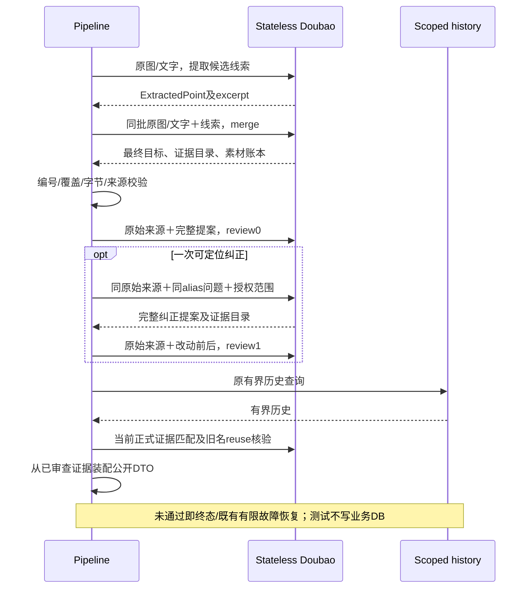
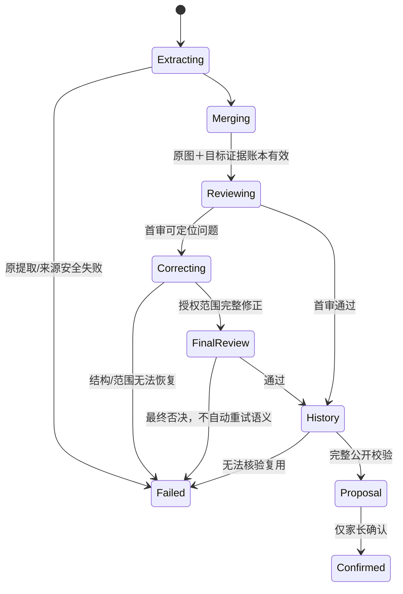
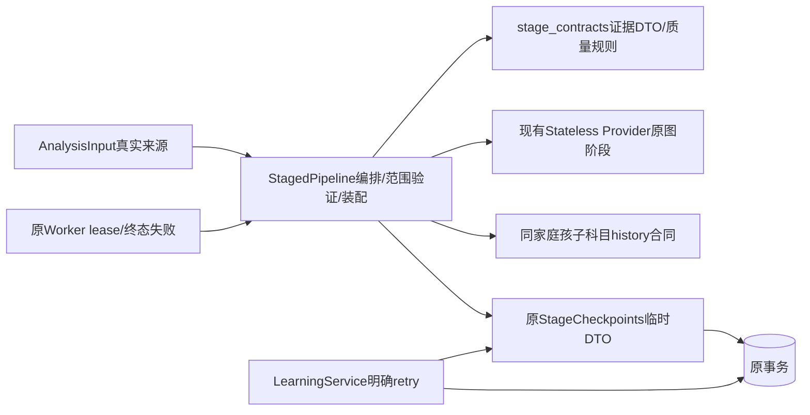

# BUG-036 — 全部未通过素材的原始证据核验与纠正

- Status: DONE

## 2026-11-06 开发完成与独立验收

- Development completed: 2026-11-06；依据已批准GOV-002的匹配云交付规则，迁入`specs/completed/`。
- Release authorization: 用户已批准OPS Spec01、确认本次备份/受控窗口，并明确“无需灰度账号，直接发布”（原话“不用配置 直接发布”）。原任务本地实施授权与后续发布授权分别保留。
- Delivered scope: 040继承原来源核验、正式证据owner及局部纠正合同；原12/15内容FAIL和审计PARTIAL保持。
- Source / stages: HEAD`0576ac30464908154c624effed41df6dfa3110cc`＋批准差异，冻结manifest SHA`c96b30d102d2fff317865040bd8b65c419bbb1374689199c41bcebcd0b157f60`；后端040 normal/100%、Schema0027，客户端0.1.18开发上传1,200,417字节。
- Acceptance: 已执行范围见[发布报告](../../docs/deploy/releases/20261106-fullstack-040-client-0.1.18.md)和[新EVD](../evidence/EVD-20261106-FULLSTACK-DELIVERY.md)。家长内容PENDING、线上生成成功率NOT_MEASURED、设备/可访问性及其余业务验收缺项保留原状态；开发DONE不等于完整验收PASS。尚未设体验版、提审或正式发布。备份保留数量因站点安全策略阻断NOT_RUN。
- Closure: Feature/Behavior/Architecture/UI/测试策略/发布入口与索引按实际交付同步；批准设计源、历史失败和各阶段manifest保持。

## 原批准设计与实施时点记录

> 以下保留原修订、各历史运行及当时的“本地/未交付/VERIFYING”结论，不作为当前开发状态；当前交付以上节及新EVD为准，原验收失败不追改。
- 2026-11-05后续增量：[获批成功率Spec04 / Architecture04 / Prompt06](BUG-036-FIXED40-SUCCESS-REPAIR.md)本地13/16继承本Spec的原来源/正式证据/局部纠正合同，并修正单份未解来源、明示技能与空结果终态；[本轮EVD](../evidence/EVD-20261105-BUG036-SUCCESS04.md)记录独立的固定40与近期真实18条评阅。下列12/15内容FAIL及全部历史证据不追改，无本增量云交付，本Spec仍VERIFYING/active。
- Spec revision: `BUG-SPEC-20261101-KNOWLEDGE-CONTENT-03`
- Architecture revision: `ARCH-20261101-KNOWLEDGE-CONTENT-03`
- Prompt revision: `KNOWLEDGE-PROMPT-20261101-05`；[规则草案](../evidence/KNOWLEDGE-PROMPT-05-DRAFT-20261101.md)。
- Severity / Risk: MAJOR / R2 — 内部提案证据所有权、阶段输入与纠正边界变更；公开API、数据库及前端保持。
- Owner / Implementer / Feature merge owner: Product owner / TRAE / TRAE。
- Reviewer/Verifier: 实施后由新上下文进行只读代码审查；真实素材内容由执行会话直接查看原图/文字判断，不能由生成模型自审或外部judge替代。
- Parent Spec: [内容Spec01](BUG-036-KNOWLEDGE-GENERATION-FINAL-PROPOSAL.md)；保留[已批准缓存Spec02](BUG-036-CHECKPOINT-RETRY-STRATEGY.md)的终态、明确retry、事务、租户和容量政策。
- Affected Feature IDs: `FEAT-001`；[当前事实](../../docs/domain/features/FEAT-001-push-kids-mvp.md)，基线`FEAT-STATE-20261101-KNOWLEDGE-CACHE-08`。
- Source baseline: 本地`staged-20261101-10` / `child-aware-history-agent-20261031-13`；[Discovery源码指纹](../evidence/EVD-20261101-BUG036-CONTENT03-DISCOVERY.md)。批准时最近完整30条内容结果属于09/13，不能追认为10/13结果；最终12/15结果见本Spec验收表。
- User request: 2026-11-01当前会话“修复 9 条严格未通过的样本并重新验收”；澄清后“修复全部未通过样本”。这是全部失败范围及修复意图授权，尚不是本新内部合同revision的批准。
- User confirmation: APPROVED — Product owner，2026-11-01，当前会话用户原话“批准 BUG-036 内容 Spec03（含 Architecture03、Prompt05）”，明确批准`BUG-SPEC-20261101-KNOWLEDGE-CONTENT-03`、`ARCH-20261101-KNOWLEDGE-CONTENT-03`及`KNOWLEDGE-PROMPT-20261101-05`。授权本地实施、隔离验证、固定素材零写入验收及文档同步；不授权部署、存量数据修订或Git提交。
- Local implemented revisions: `staged-20261101-12` / `child-aware-history-agent-20261101-15`；[12 EVD](../evidence/EVD-20261101-BUG036-CONTENT03-ACCEPTANCE.md)166专项/896全量PASS、52条件skip；两项独立Review发现已修复，第二轮0新确认问题。最终原30为20产出/10内容PASS/9严格PASS＋1正确补材料拒绝，原六PASS回退3份；补充0/3严格PASS，边界7/10，内容验收FAIL。历史11/14机制与8份诊断独立保留，没有匹配云交付。

## Frontend Design Impact and Repository-native Approval

- Frontend impact: no — 页面、字段、编辑/确认交互与错误码保持，仍是父母可编辑提案。
- Frontend engineering impact: no — 不改变小程序组件、状态、表单、样式、资源、工具链及设备支持。
- UI IDs、UI current-state、FEC、Design Revision、设计源、视口导出、manifest及前端验收: N/A，上述原因不触发前端实现门禁。
- Approved Task Spec revision: `BUG-SPEC-20261101-KNOWLEDGE-CONTENT-03`，Product owner，2026-11-01，当前会话上述批准消息；Approved Design Revision: N/A。
- External design dependency: none。

## 1. 症状、范围与预期

批准前09/13完整30条生成26条，按C1–C6内容通过12条，含已批准输出合同完整通过10条；剩余15条FAIL、3条NO_PROPOSAL、1条NEEDS_PARENT_VERIFICATION、1条NEEDS_MORE_MATERIAL。[历史逐条结果](../../dist/knowledge-generation-evaluation-20261031-prompt04/session-evaluation/evaluation-30.md)保留，不作为最终12/15结果。

全部原30条进入重新验收，不能只重跑失败后与旧PASS拼接。case11仅有笼统活动标题，正确缺材料拒绝仍计入30总分母，不虚构提案或把它计为生成PASS。原06的六条PASS和各轮后续PASS都检查回退；原失败不覆盖。

补充[2026-11-01三份/六图](../../output/BUG036-20261101-FAILED3-RETEST.md)作为独立回归组，不计入原30分母：failed01两诗已通过；failed02完整词组纠正name过长；failed03韵母归类错误及页底备注被升为教学。两条失败在本次修复范围，已通过项同样复验。

家长会收到错误范围、重复/碎片单元、插图推断、字形错误或无提案。手动录入是保留的独立路径。没有可以证明全部充分材料通过的已知好版本；不能以合成测试、重试命中率或提案产出数宣布质量正确。

## 2. Discovery、复现与根因

批准前10/13的只读AST及源码检查确认以下Discovery事实；表中行号绑定该冻结基线，12/15已修复相应合同缺口，不能把旧描述读成当前代码：

| 批准前确认事实 | 冻结10/13位置及影响 |
|---|---|
| merge/review/correction的images参数均为空 | 基线`pipeline.py`368/398/446行附近；后续阶段无法独立核对提取误读的字母、数量、原教学角色 |
| Review不接收summary和uncertainties | 基线`review_quality`只传candidates、items、omissions、previous_review；错误摘要或短编号泄漏未被整个输出审查 |
| 最终证据和置信度复制自ExtractedPoint | 基线最终装配728行附近；即使名称修正，也可能继续附原错误解释或high |
| validate_merge把提取科目当不可更改的事实 | 同一候选subject错误后，后续不能基于原图纠正为真正科目 |
| 候选成员覆盖只证明DTO编号都有去向 | 完全遗漏的字符/对象未进入candidate编号，账本本身不能证明原图对象完整 |

这些是确定性合同缺口，不代表每次错误都必然产生。原图核验是否能提高实际质量、完整词表分组是否稳定、图像输入增加是否引起超时，均是待验证假设。

来源错误进入候选→merge只见错误描述→review复用同一错误前提→原证据和置信度装配，形成共同误判。旧合成Provider测试证明合法编号、流程、拒绝和容量，不能证明原图忠实。

### Link/call graph

```text
submission → 原Worker/Runner → StagedPipeline
  → extract/group原图候选（线索，不是已确认事实）
  → merge（原图/原文字＋候选线索→最终目标＋正式证据目录＋素材账本）
  → review0（独立原图核验＋完整提案）
  → 若失败：同alias唯一correction（原图）→review1（原图）
  → 既有scoped history→match→实际旧名称reuse
  → 服务端用已审查证据目录装配→公开validator→可编辑提案
  → 仅家长确认进入原事务与确定性排期
```

## 3. 修复合同

### AC-S01 — 原始来源始终可核对

merge、merge-correction、review0、review1接收同一批完整原图和实际原文字、合法科目、素材短编号，以及有界候选/excerpt。原图不可用或完整性改变即拒绝，不能用模型输出补图。

实际图像还是现有Provider images参数；不新增读取账号、模型服务或跨家庭查询。Provider继续stateless、store=false、无SDK重试；源图和原响应不进入日志或仓库。此次不改变图片上传、方向处理、压缩、裁切或媒体持久化政策。

### AC-S02 — 提取是线索，最终证据有唯一owner

保留原`ExtractedPoint`，明确其subject/name/evidence/confidence尚未经后续原图核验。修改`stage_contracts.py`内部ConsolidatedResult：

| 字段 | 合同 |
|---|---|
| evidence | 0–40条正式证据目录；每条唯一`e0..e39`，material为真实`t/m1..m9`，detail为1–160字符 |
| items[].evidence_keys | 1–20个唯一且存在的证据目录编号；最终公开每item仍≤20证据 |
| items[].confidence | high/medium/low，基于实际原图/文字；最终装配使用此处，不复制提取high |
| items[].members | 0–200候选线索编号；已有候选仍须在item或omission中恰好一次，空members仅允许原图新发现对象且已有真实evidence_keys |
| source_checks | 每个实际原素材恰好一条，最多10条；material、disposition（covered/non_learning/indeterminate）、0–20个唯一item_aliases和≤80字符basis |

正式证据目录只由merge/correction输出，Review核对，pipeline验证、装配；不成为第二个数据库事实源。item subject必须在实际允许科目中；不再以提取subject一致性代替原图核验。跨科目改正必须有该item直接来源证据，不能用历史或年级补造。

新增对象必须来自实际提交，任何原始候选继续完整交代去向。source_checks的covered须引用实际item且有该material证据；其余两类须有理由、不能伪装材料充分却遗漏的目标。source_checks只证明结构账本完整，语义完整仍由原图审查和独立验收决定。

提取成功但没有候选时，完整可读原始材料仍可以进入merge的来源核验，不能把“候选为空”当成确定没有学习对象。其最终输出仍必须有真实正式证据；全部原素材确无具体学习对象时拒绝空提案。提取/下载/完整性失败仍沿既有安全拒绝，不因为新增账本发布半份材料；真正unreadable不进入无限重读。

### AC-S03 — 审查完整输出，纠正准确局部

Review输入增加summary、uncertainties、evidence、source_checks和原始来源；仍只返回问题，不改名，不查询历史。

QualityIssue保留现有closed问题码；问题目标短编号允许`i*`/`o*`、真实`m*`/`t`及`q`。`q`仅代表摘要/核对文案；素材编号代表该素材覆盖或教学角色。别名必须来自输入，不能任意生成。

- should_merge至少两个item，列共同具体目标，不允许对q/素材报分合。
- over_merged定位真实独立目标；同组不能无证据反复拆合。
- q问题仅授权摘要/核对文案修改，不改变知识项。
- 素材问题授权修正与该来源关联的item/证据/省略/账本，或补回原图新发现对象；不修改其他来源的已通过目标。
- item/omission问题授权对应成员及证据的必要纠正，未涉及item和被引用证据必须保持。

e别名稳定：保留未受影响条目的编号/内容，新增使用未占用编号；不靠重新编号掩盖漂移。纠正前后成员、来源、证据、科目、范围和置信度可由deterministic validator核对其授权范围。根本无法确认的对象降置信并具体指出待核对位置；不以泛指“有歧义”掩盖错误。

仍为一次语义纠正、两次质量审查；第二次否决按缓存Spec02终态政策结束。不给模型无限循环，也不把“至少一次随机通过”算修复。

### AC-S04 — 对象、粒度、命名与输出忠实

采用[Prompt05](../evidence/KNOWLEDGE-PROMPT-05-DRAFT-20261101.md)阶段职责：

- 枚举词/字/字母集合逐区域核对，数字来自材料本身，不计算待答题结果；插图提及的钟表不自动提供数学规则。
- 教材的教学区/家长明确练习区域提供证据；页脚姓名、批注、备注或装饰不自动成为新教学。
- 相同作品及同组目标跨页去重，认读与书写集合分别保持，不能摘要偷换成所有词均书写。
- 名称写具体规则、条件和范围，不用“按规律观察/填空/看图”等代替。缺规则的材料诚实要求补材料。
- 完整长词表允许按非重叠、能实际短复习的对象组分组，覆盖全集，不因为名称长度省略、截断或用“相关词语”隐藏对象；同一作品或短对象组不逐字拆。
- 摘要是简洁事实句，不写数量、排除说明、内部alias、纠正过程或未学规则；不确定性明确对象。
- 已拟复用旧名称仍受相同命名/规则/范围检查；明确违例则拒绝复用，保留本次已通过名称。

不得用硬编码学科答案、30条名字对照表、服务端自动语义改名或擅自放宽原C1–C6来提高分数。

### AC-S05 — 容量、指纹、缓存和错误保持可验证

- 保留正常18/最坏33核心调用，optional coverage≤1、最多18成功cache键、64KiB/key、512KiB/job、24小时TTL、20逻辑history查询/100候选/512KiB历史请求。
- 新ConsolidatedResult序列化UTF-8必须≤64KiB，缓存与无缓存执行都验证；过大时一次原有结构纠正机会，不能截断正式证据或字符。
- Review纯文本payload含候选和来源账本须≤512KiB；图片另按原最多9张、每张现有`upload_max_bytes`界限读取。记录实际请求字节、token、耗时和内存，不把图片base64当普通文本预算内的免费部分。
- extract/group执行45秒，其余30秒、extract阶段180秒、总lease写回30秒余量、两个进程槽及取消释放不变。没有成功smoke不能自行延长。
- 指纹绑定新DTO、规则、来源SHA及参数；更改pipeline/prompt revision阻止旧缓存复用。缓存Spec02最终否决不复用、明确retry清语义/留有效提取的合同保持。
- 日志只留stage/unit/revision/静态错误码/预算和安全计数；新的证据文本、别名映射和图片不进入遥测。

## 4. 设计、取舍、兼容

推荐直接修改现有stage_contracts、pipeline和共享prompt：将候选事实旁路替换为“原始来源→已审查正式证据→装配”，不新增Provider、领域模块、长期表或多轮自审。

| 备选 | 收益 | 未采用的原因 |
|---|---|---|
| 继续只修改长提示或追加few-shot | 改动小 | 不能补上原图/摘要不可见及证据owner错误；已多轮未验收 |
| 独立OCR服务或新增逐页复读阶段 | 可增加识别证据 | 新外部依赖、数据发送方和调用预算；本轮deferred |
| 删除审查或自动反复完整重跑 | 产出机会更多 | 未证明忠实；破坏33次/一次纠正与缓存终态合同 |
| 本方案同阶段核对原图及正式证据 | 保持调用拓扑，修复共同错误前提 | 增加图像输入、内部DTO和测试成本；模型仍可能误判，真实验收不可省 |

扩展点：原Provider port open并保留兼容/隔离/安全/资源/契约测试；本版本证据/质量政策closed；任意课程插件、独立OCR、多Agent投票、额外循环deferred。

### Sequence diagram



### State machine



### Architecture diagram



### Expected file changes

| 文件 | 动作 | 必要原因 |
|---|---|---|
| agent_processing/stage_contracts.py | modify | 正式证据目录、素材账本、置信度、别名合同及共享规则owner |
| agent_processing/pipeline.py | modify | 原图进入merge/review/correction；范围/覆盖/预算验证，历史及公开装配使用正式证据 |
| agent_processing/prompt.py | modify | 共享规则及revision，对照legacy不成为第二套独立规则 |
| agent_processing/stage_provider.py | modify only if required | 接口保持；实际字节资源校验和安全统计，不能增加阶段/重试 |
| agent_processing/failures.py、telemetry.py | modify | AC-S05所需新增DTO静态诊断字段/字节上限分类与安全字节计数；不记录e别名、内容或图片 |
| tests/unit/test_provider_evidence.py | modify | 共享legacy prompt revision的既有断言迁移，规则仍只有一个owner |
| tests/staged_analysis_fakes.py | modify | fake适配实际内部DTO，不镜像真实视觉答案 |
| tests/unit/test_staged_analysis.py、test_staged_proposal_recovery.py、test_stage_provider.py | modify | 可失败行为、范围/资源/取消回归 |
| tests/integration/test_analysis_checkpoints.py | modify | 新DTO恢复、64KiB/18键及终态政策 |
| Feature/BHV/Architecture/Test/Spec/ISS/REG/EVD/索引 | modify/add | 只合并已验证事实、对象版本和未验状态 |
| 小程序、DB Schema、worker/retry事务 | no change | 当前无该端或事务政策需求，缓存02行为回归保持 |

无部署、业务数据改名/删除/合并、自动确认、存量Job reset或Git提交。旧云端039/staged06不覆盖本增量；云部署需另按发布工作流。回滚是对批准时冻结10/13的本Spec03 patch回退，保留缓存02及其他用户变更；无业务数据修复。

## 5. 验证切片与required点

每片在冻结10/13观察诚实Red；setup错误不是Red。实现后Green、邻界和来源指纹一致再推进下一片。以下为本轮实际结果，历史857通过不冒称新结果。

| 点 | 可失败期望/验证层级 | 命令或真实案例 | 当前 |
|---|---|---|---|
| TP-S01 | review与merge/correction收到同SHA原图/原文字及完整输出；synthetic Provider核对参数 | `uv run pytest tests/unit/test_staged_analysis.py tests/unit/test_staged_proposal_recovery.py -q` | PASS合成/静态；慢文件SHA及完整并发来源边界未验 |
| TP-S02 | 候选科目/置信度误读可基于真实来源改正；最终公开证据来自正式目录而非旧错误线索 | 同上，合成错误候选→审核后的独立期望值 | PASS合成；语义真实性另见TP-S07 |
| TP-S03 | 空候选但有可读原来源可核验；无具体对象仍拒绝空提案。缺失/外来/重复e/material alias，未覆盖来源，空members无证据，非法科目、全省略均拒绝 | 同上；无side effect | PASS合成拒绝/允许路径；真实遗漏另验 |
| TP-S04 | q仅改摘要，素材问题限定该来源，未受影响item/evidence不能漂移；分合代码目标有效 | 同上；Red/Green分别留证 | PASS专项；G1-001经真实Red修复，第二轮独立正/负与恢复邻界通过 |
| TP-S05 | 18/33调用、18缓存键、64KiB DTO/512KiB文本、9张最大媒体/请求字节、取消释放；实际token/耗时/内存 | `uv run pytest tests/unit/test_stage_provider.py tests/integration/test_analysis_checkpoints.py -q`＋隔离资源探针 | PARTIAL：合成预算/取消、真实SDK运输字节PASS；实际三组RSS/token/耗时/字节已留存，失败请求完整成本未知，慢SHA/精确64KiB存储/最大9图SDK及云资源未验 |
| TP-S06 | 缓存02终态不复用、明确retry/锁/租户/回滚保持；新DTO不读旧revision | 原Spec02专项选择器与全量suite；必要MySQL按其隔离入口 | PASS当前SQLite/单元回归；本轮新MySQL并发NOT_RUN，52条件skip不计PASS |
| TP-S07 | 原30/68图固定全部验收，每源一次完整尝试；同2case/2槽、原模型/网络参数；直接看原图判C1–C6和摘要合同 | [逐条安全报告](../evidence/bug036-content03-20261101/evaluation-12.md)，仅只读重新获取，全部失败保留 | FAIL：20产出/10内容PASS/9严格PASS；10FAIL/9NO_PROPOSAL/1家长核对/1正确缺材料；原六PASS仅3保持 |
| TP-S08 | failed01/02/03原6图独立回归；6个旧边界，加泛化字母方向/教学备注/词表长度/摘要技能范围边界 | 各自独立分母；新边界用合成素材，不嵌原30答案表 | FAIL：补充2产出/1内容PASS/0严格PASS；边界7/10严格通过（6提案＋1预期拒绝）、1摘要FAIL、2NO_PROPOSAL |
| TP-S09 | READ ONLY61表前后行数/指纹；0业务POST/Job/checkpoint/上传/确认；原图/身份/响应清理 | 既有只读审计和实际cleanup，任何并发差异PARTIAL/FAIL诚实保留 | PARTIAL：51/61指纹一致、10表变化，外部写入归因未证；schema0025另计保持；Runner零写入；244文件/17目录清理PASS、私有材料0 |
| TP-S10 | 当前完整backend、target Ruff、format、mypy、architecture及新上下文只读Review | 仓库命令，完整EVD；检查缺项明确 | 896PASS/52SKIP、全库及target lint/format、mypy151、architecture4/151 PASS；Review两finding fixed，第二轮0新确认问题；内容/资源限制独立 |
| TP-S11 | 本轮实际diff对应文档正文、revision、引用、源码/产物SHA及Spec生命周期同步 | [闭合矩阵](../evidence/bug036-content03-20261101/document-closure.md)和安全清单；当前UI/API/Schema无变更已核对 | PASS：11源/live及11/12历史清单SHA一致，18文档范围/87任务引用缺失0；正文无本任务冲突；VERIFYING/active、未交付不归档 |

实际命令使用既有venv：`UV_CACHE_DIR=/private/tmp/push-kids-uv-cache uv run --no-sync`；部署、原生/真机、真实Worker/父母确认及生产写入NOT_RUN，本轮不授权。

内容成功条件：29份原材料充分的来源均形成内容和输出合同完整PASS，原case11正确拒绝；完整30分母仍展示29/30生成PASS+1补材料，不能写30/30生成。原六PASS无回退。三份补充独立回归材料充分者都应通过。任何剩余FAIL/无输出/未定位字形歧义均阻止本轮完整内容验收通过。

实验预算：先用各根因的合成边界与适用失败来源做诊断，然后冻结候选版本执行一次完整30和一次补充3份/边界；诊断不替换最终失败。若完整验收仍失败，保留失败与新证据，不自动追加无上限随机整轮，不擅改标准；需要新合同改变时再形成具体revision。

## 6. 审阅与收尾

- [x] 原始请求、完整失败范围、当前内容/缓存版本区分。
- [x] 静态根因、调用链、状态/架构图、备选、文件和验证点完整。
- [x] 新DTO/来源校验/安全资源/纠正/公开兼容边界明确。
- [x] 用户批准Spec03/Architecture03/Prompt05，2026-11-01当前会话“批准 BUG-036 内容 Spec03（含 Architecture03、Prompt05）”。
- [x] 诚实Red/Green、required点、完整源素材验收、新上下文Review已执行/如实记录；内容验收FAIL、资源及审计PARTIAL、条件缺项NOT_RUN，不代表全部通过。
- [x] 文档正文与代码一致性核对、清理及产物SHA；本任务11源、18文档范围和87处任务引用核对通过，私有材料剩余0。
- [ ] 匹配本范围的云交付；本地验收与云交付、DONE归档独立。

当前已批准并完成本地机制实施与一次最终验收，VERIFYING/active；基线与历史11/14证据保留，12/15的166专项/896全量PASS、52skip及独立两轮Review见12 EVD。固定30+3及边界验收FAIL，资源和51/61表审计PARTIAL，未验层级如实记录。私有材料清理与正文闭合PASS，没有本任务代码/当前文档冲突。没有对应云交付，按生命周期规则留active，内容ISS仍open；新合同改变或新验收预算须形成具体revision，不擅自追加随机整轮、放宽标准或部署。
