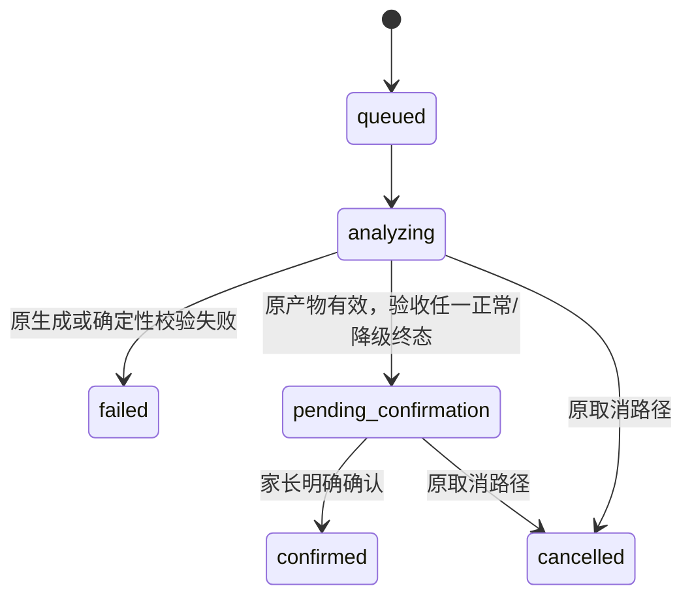
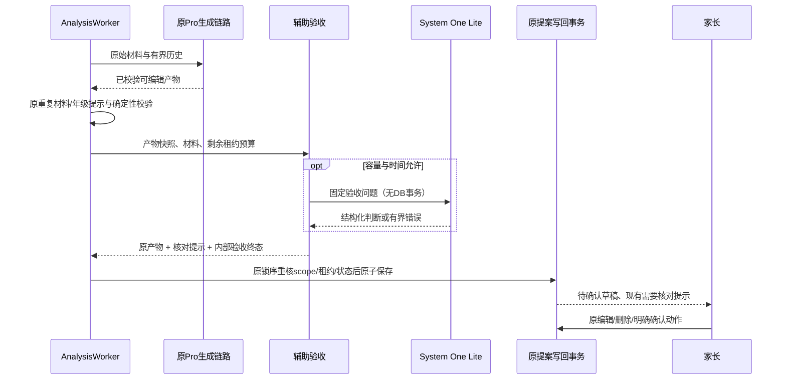
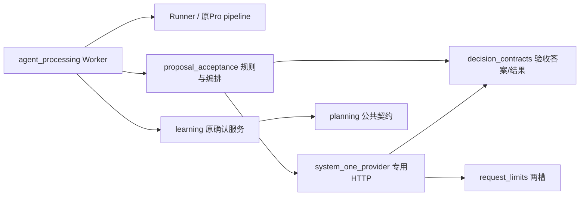

# BUG-036 — System One辅助验收与家长确认

- Status: DONE

## 2026-11-06 开发完成与独立验收

- Development completed: 2026-11-06；依据已批准GOV-002的匹配云交付规则，迁入`specs/completed/`。
- Release authorization: 用户已批准OPS Spec01、确认本次备份/受控窗口，并明确“无需灰度账号，直接发布”（原话“不用配置 直接发布”）。原任务本地实施授权与后续发布授权分别保留。
- Delivered scope: 040覆盖Pro生成后的System One辅助验收，默认true；疑点或不可用保留产物，家长确认合同不变。
- Source / stages: HEAD`0576ac30464908154c624effed41df6dfa3110cc`＋批准差异，冻结manifest SHA`c96b30d102d2fff317865040bd8b65c419bbb1374689199c41bcebcd0b157f60`；后端040 normal/100%、Schema0027，客户端0.1.18开发上传1,200,417字节。
- Acceptance: 已执行范围见[发布报告](../../docs/deploy/releases/20261106-fullstack-040-client-0.1.18.md)和[新EVD](../evidence/EVD-20261106-FULLSTACK-DELIVERY.md)。家长内容PENDING、线上生成成功率NOT_MEASURED、设备/可访问性及其余业务验收缺项保留原状态；开发DONE不等于完整验收PASS。尚未设体验版、提审或正式发布。备份保留数量因站点安全策略阻断NOT_RUN。
- Closure: Feature/Behavior/Architecture/UI/测试策略/发布入口与索引按实际交付同步；批准设计源、历史失败和各阶段manifest保持。

## 原批准设计与实施时点记录

> 以下保留原修订、各历史运行及当时的“本地/未交付/VERIFYING”结论，不作为当前开发状态；当前交付以上节及新EVD为准，原验收失败不追改。

2026-11-05后续[全栈发布检查](../../docs/deploy/releases/20261105-fullstack-update-preparation.md)使用同一156份生产源重新检查：Python987PASS/56SKIP/1FAIL，fixed40为37/40 FAIL，原生及MySQL门禁仍有缺项。下列988PASS及43/45是本Spec先前运行的历史证据，不能替代此次发布结果；未部署，状态仍VERIFYING。
- Risk: R2（异步任务、外部验收依赖、提案写回与失败语义）
- Spec revision: `BUG-SPEC-20261105-SYSTEM-ONE-06`
- Architecture revision: `ARCH-20261105-SYSTEM-ONE-06`
- Acceptance policy revision: `ACCEPTANCE-20261105-SYSTEM-ONE-01`
- Created / Last updated: 2026-11-05
- Template: [FEATURE-SPEC](../_templates/FEATURE-SPEC.md)，相邻栏目合并覆盖设计与验证要求。
- Spec owner: 产品负责人；Implementer / Feature merge owner: Codex。
- Reviewer / Verifier: 独立上下文只读Reviewer已执行代码增量复核；完整文档复核和真实内容家长验收独立记录于本轮EVD。
- User confirmation: APPROVED，产品负责人于2026-11-05在本对话对紧邻展示的Spec06 / Architecture06回复“批准，需要给我新版本的成功率”。批准本修订的本地实现、测试及真实材料配对成功率验证，不包含云部署或Git提交/推送。
- Additional R2 approval: APPROVED，同上述具体修订确认。
- Affected Feature IDs: FEAT-001；FEAT-004只回归正式学习消费者，不改建议策略。
- Feature baseline: [FEAT-001](../../docs/domain/features/FEAT-001-push-kids-mvp.md)，`FEAT-STATE-20261105-SYSTEM-ONE-13`及关闭分支`FEAT-STATE-20261105-KNOWLEDGE-SUCCESS-12`。
- Target release: 本地实现、自动测试与只读真实材料回放；不包含云部署、切流、生产数据修复、Git提交或推送。
- Predecessor: [Spec05](../rejected/BUG-036-SYSTEM-ONE-GENERATION.md)。按本修订批准清退被替代的未交付实验路径并CANCELLED/rejected，保留历史失败证据，不将其标成验收通过。

## 0. 产品标准和事实边界

成功率优先。保留当前Pro生成链路，在已形成可编辑产物之后由System One提供验收提示。有疑问时复用当前“需要核对”与家长编辑、删除、确认流程；未报疑点也仍需家长确认，不自动入库。

| 已验证事实 | 证据/限制 |
|---|---|
| 前次同源生成对照：旧43/45＝95.6%，Spec05新37/45＝82.2% | [Spec05 EVD](../evidence/EVD-20261105-BUG036-SYSTEMONE05.md)。是此前冻结版本实验，不是本修订或当前线上成功率。 |
| 43份旧产物离线验收：35未报问题、8提示复核，全部完成返回 | [本次Discovery EVD](../evidence/EVD-20261105-BUG036-SYSTEMONE06-DISCOVERY.md)。没有人工真值，不能算内容合格率。 |
| 原问题集对3份已知命名错误检出1份；12合成二分类正确11份、误报1份 | 同上；具体问题定位符合预标标准10/12。已知回归不是独立holdout。 |
| 同15份材料调问题后，命名检出3/3，但合成正确10/12、误报2份 | 同上；复用材料诊断，未部署、未重验真实43份，不据此宣布效果改善。 |
| 当前已有提示与人工确认入口 | `apps/miniprogram/pages/submission/draft.wxml`展示`proposal.uncertainties`；`worker.py`成功提案写`pending_confirmation`，只有LearningService确认才产生正式事实。 |

确定决定：System One只做辅助验收，不能覆盖、删除、拦截或自动修正生成产物。原Pro审查、证据/Schema安全校验及真实生成失败恢复保持。

假设：新增有界验收不会降低产出率；须由下文故障注入、原产物保持及实际端到端回放验证，不能因采用辅助结构就预先宣称达标。

## 1. 前端影响与非目标

- Frontend impact: no。使用既有`uncertainties`提示区和相同的家长编辑/确认动作；不新增控件、步骤、状态页或通过标识。
- Frontend engineering impact: no。不修改前端源码、工具链、样式、布局、交互或FEC预算。UI-001只核对API/既有动态提示合同。
- DREV、设计源、视口导出和新设计批准: N/A，未提出可见结构或交互变更。若发现必须新增展示，先修订Spec并完成对应设计门禁。
- 非目标：System One分类、最近40条匹配、自动合并/自动记复习、AI掌握评分、自动入库、自动再生成、更换Pro模型、增加并发、解除既有质量发布门禁。
- 手动录入继续直接走现有人工路径，不被强制调用System One；旧草稿不批量回验或改写。

## 2. 目标行为与状态

| 情况 | 验收结果 | 提案与Job | 家长操作 |
|---|---|---|---|
| 原生成及确定性校验成功，未报疑点 | `no_finding` | 原条目保留，`pending_confirmation` / `succeeded` | 按原流程确认；不显示“内容已合格” |
| 报疑点或低确定性 | `needs_review` | 原条目保留，仅添加有位置的核对提示；不重试/重生成 | 现有提示区核对、编辑、删条目、确认 |
| 验收超时、429/5xx、协议/模型不符、缺答案或配置不可用 | `unavailable` | 保留已生成产物，加通用人工核对提示；不计为生成失败、不消耗新的Job attempt | 现有确认流程；错误细节仅安全内部诊断 |
| 剩余预算不足或超出验收容量 | `skipped` | 保留产物，提示人工核对；不等待到租约失效 | 同上 |
| 验收开关关闭 | `disabled` | 原Pro链路及原确认流程 | 同原流程 |
| 原生成失败、Schema/来源身份校验失败、材料不可用 | 不执行验收 | 继续原有真实失败/恢复机制 | 原重试或手动输入入口 |
| 取消、租约变化、孩子删除冻结/家庭失效 | 丢弃迟到验收结果 | 原锁序及状态重核拒绝迟到写回 | 不覆盖已有人工操作 |

术语勘误（2026-11-05，R2-CR-002）：批准稿上行及TP04的“归档”误称删除冻结。已批准FEAT-005/BHV-025规定归档只拦新增，已有分析/草稿可收尾，本修订非目标也要求原状态机保持；实现未改该合同。测试分别验证删除冻结拒绝迟到、实际active=False归档允许已有Job完成。本项澄清沿用既有权威语义，不以归档阻断新增产品行为，不弱化删除/租约/人工操作保护。



验收状态是服务器内部附属结果，不新增Submission/Job状态。禁止`no_finding -> confirmed`、`needs_review -> failed`以及验收超时触发自动再生成。

## 3. 验收合同

1. 检查原图/原文字与最终生成的条目、摘要及来源信息，不只让模型自查摘要；不把材料中的指令当作系统指令。家长文字和儿童材料不进日志或仓库。
2. 沿用离线第一轮已经冻结的来源、学科、范围/动作、粒度、可操作性、主要目标完整性问题和阈值；阈值仅用于“建议核对”。不启用诊断轮新增的强题名检查或两两关系问题，不把调试集当独立准确率。
3. 只核对产物，不判孩子掌握；不替代现有历史身份、复习/覆盖核验，不修改`todo_matches`或`coverage_matches`。
4. 输出只允许服务器已知的目标编号、标准码、分值；目标不存在、缺答案或非法概率视为验收不可用。服务端将标准码映射为中性提示，例如“第2条：请核对名称及具体表述是否与材料一致”，不能断言该条已错。
5. 同一目标合并提示、去重。公开提示仍遵守最多20项及响应预算；原提示内容保留，容量不足时把新增意见合并成一条有界人工核对说明，不截断或丢弃学习条目。静态提示不含模型名、接口、数据库、异常或工程诊断。
6. 没有正式写入或自动纠正副作用。验收前后的知识名称、科目、技能/范围、复习方法、证据、发生日期及历史关联必须完全一致。
7. 记录有界server-owned验收元数据（策略版本、产物指纹、结果、目标/标准码、耗时、降级原因码），随原`proposal_json`事务写回；不是新的公开确认字段，不信任客户端回传。复用原JSON存储，无新表/迁移。

## 4. 推荐架构、调用与资源边界

权威生成路径继续是`AnalysisAgentRunner -> StagedPipeline -> StagedArkProvider(Pro)`。移除Spec05将`DecisionWorkflow`注入生成、分类、历史判定和硬质量纠正的路由，System One不能因打开验收开关而重新接管这些步骤。共享match uncertain缓存有效性修复保留。

验收编排归`agent_processing`。将`decision_workflow.py`替换为窄职责`proposal_acceptance.py`：拥有固定问题、合法结果和静态提示，不调用生成/历史工具，不依赖Worker。专用HTTP继续由`system_one_provider.py`及其答案DTO负责；共享2请求槽继续由`request_limits.py`拥有，不建立新通用框架。

Worker在原Runner得到有效产物后，先完成重复材料/年级等已有提案处理，再在无数据库事务、无family/child锁时执行一次有界验收；之后按原family→child→job→submission锁序重核scope、租约、attempt、状态与产物并写回。外部调用不能处于写回事务中。

```text
已授权学习提交 / 请求驱动任务
  -> AnalysisWorker
     -> AnalysisAgentRunner -> 原StagedPipeline -> Pro
     -> 原确定性校验及提案准备
     -> proposal_acceptance -> SystemOneDecisionProvider -> 专用System One API
     -> 原写回锁与迟到检查 -> pending_confirmation
  -> 原学习确认API -> LearningService -> 正式学习/确定性复习
```





图中Worker到Learning表示既有提案/确认边界，不新增直接调用或跨域表写入。依赖保持DAG，验收模块不反向引用Worker/pipeline/learning。

- 单次辅助验收最多5秒，排队、分片、读图、HTTP与解析均计入；不得突破原租约写回预留。预算小于0.5秒时跳过，禁止为验收延长租约、提高原生成预算或挤占写回预留。
- 每请求≤128问题、≤9图、≤96KiB问题/文字；响应采用≤64KiB流式读取，超限停止并降级人工。原上传大小、20条目和Pro原33核心调用/18缓存键上限保持。辅助最多2次外呼、总计最多256问题、同一个5秒预算；容量超出降级人工，不丢条目。
- 不增加System One fallback、自动重试、Pro纠正或新Job；不依赖请求结束后的后台CPU，不加线程/永久协程。
- 复用`PUSH_KIDS_SYSTEM_ONE_ENABLED`，批准后本地默认开启且只代表辅助验收，关闭为原Pro流程；生产配置未在本任务变更。策略/模型/协议版本明确记录，不能将新旧开关语义混淆。
- 日志仅允许策略/模型版本、结果/原因码、数量、资源及耗时，不记材料、条目文本、图片或原始判定响应。
- 扩展策略：验收启闭及固定模型配置为现有受限open点；自由文本建议、自动重写、任意第三方Provider和历史决策closed；新的问题集须另行冻结并用独立材料校准。

### 备选与取舍

| 方案 | 取舍 |
|---|---|
| 推荐：原生成后辅助验收，疑点交家长 | 多一次有界依赖与少量等待；保留原产物，不把误报扩大为生成失败；真实成功率仍须实测。 |
| 以System One替代Pro审查，并按它判定自动纠正/拒绝 | 不采用；前次成功率下降且检查器有漏报/误报，没有依据让它成为硬门槛。 |
| 生成写回后再后台验收 | 不采用；会与正在编辑/确认的家长竞争，并增加任务/版本生命周期；当前云托管不能依赖响应后的后台执行。 |
| 全部人工、取消System One | 可作为关闭开关的恢复路径，但没有本次要求的辅助核对。 |

## 5. 预期文件修改与清退

所有清退只针对Spec05本地未交付实验，不还原整文件或覆盖其他任务。实际diff逐块核对；无关工作日/前端/年级增量保留。

| 文件/范围 | 预期动作与必要性 |
|---|---|
| `agent_processing/decision_workflow.py` | 删除被替代的生成/分类/关系/纠正编排；先迁移仍需要的答案校验，不留双权威生成路由。 |
| `agent_processing/proposal_acceptance.py` | 新增窄职责验收编排、固定规则、静态核对提示与降级结果。 |
| `agent_processing/{pipeline,runner,stage_provider}.py` | 修改路由：原Pro生成；System One只作验收能力，不再注入pipeline，不取最近40池。保留共享缓存修复。 |
| `agent_processing/{system_one_provider,decision_contracts,telemetry,worker}.py`、`platform/config.py` | 有界专用调用、验收DTO/安全观测、事务外验收和原子写回、启闭配置；旧错误不穿透成生成失败。 |
| `agent_processing/{context,history_search,contracts,checkpoints}.py`、`learning/{coverage,service}.py` | 清退仅供Spec05实验的新分类/近期池/新覆盖反馈写入分支；保留原历史等价、覆盖及旧草稿兼容，不重新定义确认事务。 |
| `persistence/models.py`、迁移0027及Schema guard | 不倒退已存在的迁移链，不新增或回退生产迁移。近期池索引不再是本验收路径依赖，历史迁移按兼容记录保留。 |
| `tests/unit/test_system_one_workflow.py`及Spec05专用关系/近期池/覆盖测试 | 替换或移除被清退实验的测试；共享历史/缓存/确认保护测试保留。 |
| `tests/unit/test_proposal_acceptance.py`、`tests/integration/test_analysis_jobs.py`及相关确认/lease/缓存/Provider测试 | 新增或修改：原产物保留、全部降级、父母确认、租约取消、隔离与HTTP协议合同。 |
| `tools/benchmark_staged_analysis.py`（仅实际需要时） | 辅助验收与生成结果分列、冻结输入/版本；不修改原固定40标签或评分来补分。 |
| Feature、Behavior、Architecture、UI-001、Test Strategy、ISS/REG、Spec/索引和本地发布说明 | 验证后逐项替换过时的当前正文；记录未云交付与实际缺项，不只追加矛盾说明。 |

新System One覆盖判定版本不再产生；实施前以只读计数核实Spec05草稿。实际计数仅覆盖已授权评估家庭，结果0，不能证明全库没有此类草稿，故沿用批准稿“旧草稿未证清零时保留兼容”的分支，不借清退删除草稿或改历史事实。兼容Owner为agent_processing/learning维护者，2026-11-12复查；移除条件为获授权的全租户有效旧版本草稿计数0并通过旧草稿回归。全局无此类草稿才删除仅供实验的新确认分支。迁移历史及已验证共享缓存修复保留，不产生新版本覆盖元数据。

## 6. 验收与必测点

| Test point | 验收标准 / 层级 | 命令或Case | 当前结果 |
|---|---|---|---|
| TP01 | 有效产物在未报问题、报疑点、阈值边界时保持内容/关联/证据完全相同，仅提示变化；unit，先真实Red | `uv run pytest tests/unit/test_proposal_acceptance.py -q` | PASS，真实接线Red及fixed阈值/保留Green见本轮EVD |
| TP02 | 429/5xx/超时/缺答案/模型不符/超容量/预算不足均有明确终态，0重生成、0新增Job attempt；unit+真实Worker集成 | Provider合同与Worker故障注入 | PASS，77专项/988全量；首次响应容量Red保留 |
| TP03 | 三种验收结果均待家长确认；无正式学习/Review/Todo写入，家长原确认后才写，人工/旧草稿保持 | learning/analysis确认集成、公开API合同 | PASS，实际API家长确认及手工确认竞争；隔离MySQL兼容12PASS |
| TP04 | 取消、删除冻结、scope变化、租约耗尽/被接管及人工已确认时拒绝迟到写回；外部调用无DB事务；实际归档允许已有任务收尾 | Worker lease/tenant/late-write集成 | PASS，focused-final04；文档术语勘误见§2 |
| TP05 | 打开新验收开关也不调用分类/最近40/新历史覆盖决策；关闭回到同一Pro生成路径；原缓存修复有效 | pipeline/runner/Provider路由与checkpoint回归 | PASS，原路由/共享缓存回归及独立代码Review |
| TP06 | ≤20点、9图、128问题/片、2外呼/5秒、原2槽、响应预算与安全日志；原提示20项时仍保留内容 | 单图/9图、最大提案、并发排队、超预算、不可信材料 | PASS（确定性预算/故障注入）；真实九图极限模型/原生验收NOT_RUN；原20提示及64KiB流式Red/Green见EVD |
| TP07 | 43份既有真实产物全部保留；新验收不把疑点/故障变无产物；known3与synthetic12原标签不改 | 只读固定产物回放，比较验收前后产物指纹 | PASS（保持/标签）：58完成、58事实保留，旧43为35未报/8核对；known命名定位0/3、任意触发1/3，synthetic二分类/定位11/12、误报1。检查器漏检保留，不称内容PASS |
| TP08 | 当前代码生成成功率不因新验收回退；不以省略条目或改失败分类造成功率 | 同15份完整材料×3轮×验收启/闭＝90次，同源/同配置/同重试上限配对冻结。先冻结基线与候选SHA、标准、顺序与原图SHA，报告首轮/最终产出、验收完成/提示比例和p50/p95；3份原图失效取消提交单列。新最终产出率目标≥同期关闭分支，原生成成功后被验收丢弃数必须0；报告小样本不确定性，不宣称统计非劣效。 | 本轮样本PASS：开启首轮/最终43/45＝95.6%，关闭42/45＝93.3%，验收0丢弃，43/43事实保留；开启p50/p95=23.107/84.793秒，关闭22.740/65.436；验收0.833/1.714秒。只读回放，不是线上率/独立45材料或统计非劣效 |
| TP09 | 生成效果由家长review独立决定，不能以no_finding充当内容PASS；命名/范围/漏目标等问题逐条核对 | 交付仅有生成条目、验收意见的结果表，不附原始输入/图片 | 结果表已交付；家长PENDING，未将28无疑点改为内容合格 |
| TP10 | Python/前端相邻回归、lint/type、架构DAG与当前设计政策 | `uv run pytest tests/unit tests/integration tests/contract -q`；`uv run ruff check .`；`uv run ruff format --check .`；`uv run mypy apps/api/src`；`npm test`；`uv run python tools/check_architecture.py`；`uv run python tools/validate_design_evidence.py --check-current-policy`；`uv run python tools/validate_miniprogram.py` | PASS：988PASS/56条件SKIP、前端359、Ruff/format/mypy/architecture/design/miniprogram通过；SDK deadline首败保留，未通过一次重跑宣称稳定 |
| TP11 | 原生页面仍可呈现有疑点草稿并编辑/确认；不宣称新设计或云交付 | 现有页面的本地兼容验收；独立只读Review含文档/必要性/放置位置 | PARTIAL：独立代码/文档Review PASS，0未解决问题；公开API与确认回归PASS；无前端源码改动，原生/真机动态提示NOT_RUN，不以静态/HTML结果表代验 |

TP08的90次为生成配对总量，不包含TP07的既有产物验收；实际次数、失败和重试逐项记录，原43/45不冒充本修订同期基线。所有网络回放只读，不创建真实草稿、Job、正式学习记录或生产缓存。

## 7. 实施顺序、恢复与文档闭合

1. 获得Spec06 / Architecture06明确批准，记录批准原话、日期与版本，再开始产品代码/测试变更。
2. 固定实际工作树与相关源/测试/文档SHA，保护并行修改；先写可在旧实现真实失败的验收保留/降级测试。
3. 保留原Pro链路，清退被替代Spec05运行路由；接上事务外有界验收、原提示区与安全写回。
4. 运行全部必测点，保留失败和NOT_RUN。独立Review另列，不能用本上下文自查冒充。
5. 更新FEAT-001、BHV-003/032及Spec05实验行为、Architecture、UI-001、测试/ISS/REG和发布说明的当前正文；保留Spec05历史结果与新旧版本区别。
6. 关闭辅助验收开关可立即恢复同一原生成/确认路径；不回滚Schema，不擦草稿，验收元数据缺失的旧草稿照常确认。
7. 本地完成后为VERIFYING/active；仅匹配本Spec实现范围的云交付后按仓库规则DONE并迁`completed/`。验收缺项独立保留，未部署/上传不写完成。

本修订已获具体批准并完成本地实现，当前VERIFYING/active。代码/测试、真实同期90次生成、既有产物验收、独立Review与文档闭合分别见[本轮EVD](../evidence/EVD-20261105-BUG036-SYSTEMONE06.md)。没有对应云交付，不标DONE；家长内容验收独立PENDING，不因模型无疑点而改PASS。Spec05被替代实验归档rejected，原FAIL证据保持。生产配置、数据库和Git均未变更。
