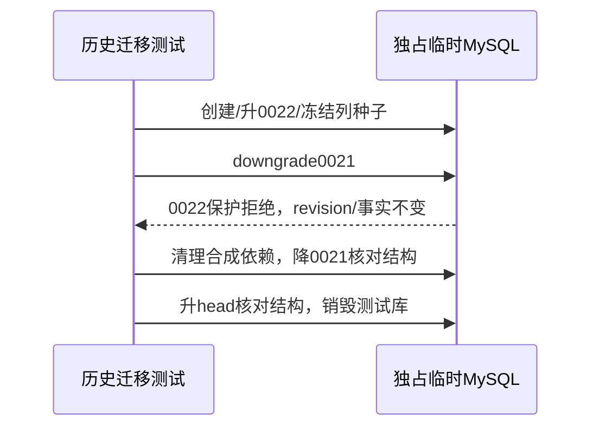

# BUG — MySQL永久替代历史迁移测试隔离

- Status: DONE
- Risk: R1；Severity: 必需发布检查失败，已定位测试夹具冲突
- Spec revision: BUG-SPEC-20261024-MYSQL-SUPERSESSION-MIGRATION-ISOLATION-01
- Owner / Approver: 用户；Implementer / Verifier: Codex
- Date / baseline: 2026-10-24 / 26714b9 / 一次性MySQL5.7.44
- User confirmation: 用户于2026-10-24回复`call_03070dc082b34cb39ef36113c56aeaca`：「批准该测试修订，验证后继续部署」，明确批准本Spec01。
- Affected Features: FEAT-001永久替代状态、FEAT-013年级保护（仅回归）
- Current-state: `docs/domain/features/FEAT-001-push-kids-mvp.md`、`FEAT-013-annual-grade-promotion.md`；只合并本轮测试事实
- Context: [已批准OPS Spec01](../active/OPS-20261024-LATEST-BACKEND-TEST-DEPLOYMENT.md)

## 1. 症状、根因与预期

MySQL专项12通过/1失败。`test_supersession_mysql.py::test_mysql_guarded_downgrade_and_reupgrade`使用最新head0025 app/child夹具，新API创建孩子建立年级确认；直接downgrade0021先触发0025的年级保护，实际异常`Cannot discard shared grade confirmation facts; preserve data first`，未到预期0022的永久状态保护。只放宽regex仍会令后续最新API/ORM访问历史Schema，不能有效验证迁移。

推荐只替换该测试的夹具：创建任务独占临时库，固定升0022，以冻结列SQL种入合成孩子/科目/知识/复习及永久状态；验证派生queue不可用、降0021被0022拒绝、revision/事实守恒。仅清理临时库合成依赖，再降0021检查字段/表移除，升当前head检查结构，finally销毁测试库。参考已有SQLite冻结迁移测试，不使用最新API跨历史Schema。

原app夹具及其他12项行为测试保留。不修改生产代码、迁移、依赖、配置、UI或真实数据，不弱化0025保护，不skip。Frontend design/engineering与Architecture变化均N/A：纯单测试隔离，无模块边界、依赖方向、共享抽象、扩展点变化。

## 2. 必需设计视图

Link/call graph：MySQL历史用例→独占库/固定0022→冻结列合成种子→保护拒绝/守恒→清理合成依赖→0021结构→head结构→销毁测试库。

State machine：EMPTY→0022_SEEDED→REJECTED_UNCHANGED→SYNTHETIC_DATA_REMOVED→0021_VERIFIED→HEAD_VERIFIED→DROPPED。

Architecture diagram：N/A，仅测试夹具，不改生产架构。

| 方案 | 收益 | 代价/风险 | 决定 |
|---|---|---|---|
| 独占历史库/冻结列种子 | 精确验证0022，独立于后续功能 | 少量测试编排/清理 | 推荐 |
| 放宽regex/skip | 改动少 | 掩盖未测合同 | 拒绝 |
| 放松0025保护/清除年级事实 | 绕过首个异常 | 越权改业务/数据风险 | 拒绝 |

## 3. 文件、验收与验证

预期仅修改`tests/integration/test_supersession_mysql.py`该用例及必要导入，合并测试策略、Feature验证事实、本轮部署/质量记录、Spec与索引。冻结生产源码/迁移manifest不变；设计快照不改。

| ID | 必需检查 | 验收 |
|---|---|---|
| T01 | 实际MySQL5.7永久状态专项 | 原失败保留，修改后全文件13项无skip通过；保护、守恒、清理后降级/重升完整 |
| T02 | MySQL年级4项及SQLite年级迁移 | 保护仍通过，生产0025不变 |
| T03 | 冻结迁移包base→0025/current/check及0022→0025 | 真实5.7结构与既有事实守恒 |
| T04 | Ruff/format、DAG、diff、冻结SHA | 仅单测试/文档变化，无生产修改 |

## 4. Approval / completion

本具体Spec01已批准并完成。T01：MySQL5.7.44全文件13 passed/0 skipped；T02：MySQL年级4 passed、SQLite年级/永久替代迁移4 passed；T03：冻结包base→0025/current/check、0022→0025及既有年级/计划守恒通过；T04：Ruff/format、DAG150、git diff --check通过，生产源/迁移SHA不变。原失败及修复后记录见[发布证据](../../docs/quality/evidence/latest-backend-release-20261024/README.md)。已核对Feature、Behavior、Architecture、UI：只改历史测试，无生产行为/结构/UI合同变化；Feature与测试策略合并本轮验证事实，其余无须改合同。

完成门禁通过，迁completed并修索引。纯测试修复不重复已通过的全前端/全量业务；本修订不代替OPS、备份、云端smoke、用户业务/真机验收。
