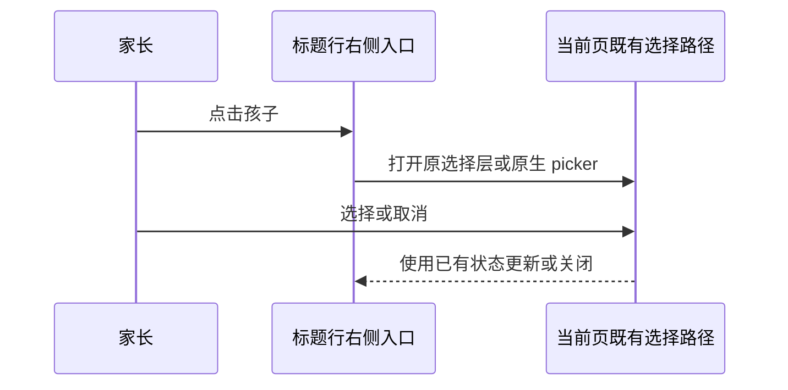

# DESIGN-005 — 标题行右侧的孩子切换 (Spec Lite)

- Status: DONE
- Risk: R1，共用页头布局调整，沿用现有业务状态和调用。
- Owner / reviewer: 产品负责人。Implementer: Codex。
- Date: 2026-11-08
- Spec revision: `DESIGN-005-SPEC-01`
- User confirmation: APPROVED。产品负责人于 2026-11-08 在查看最终背景修订后直接回复“可以 按照这个方式落地”，确认 DESIGN-005-SPEC-01 与 DREV-20261108-CHILD-SWITCH-01 的本地实施。
- Affected Feature IDs: FEAT-001 的五个主 Tab 和 FEAT-012 的独立孩子足迹呈现。
- Feature baseline: [FEAT-001](../../docs/domain/features/FEAT-001-push-kids-mvp.md) 的 `FEAT-STATE-20261107-THEMES-03`，[FEAT-012](../../docs/domain/features/FEAT-012-child-photo-footprints.md) 的足迹宿主和作用域合同。
- Feature/UI merge owner: Codex。验证后更新相应 UI 正文、Feature、测试证据和版本状态。

## Frontend Design Impact and Repository-native Approval

- Frontend impact: YES。调整页头孩子切换入口的位置。
- Frontend engineering impact: YES。共享页头布局、主题、响应式和触控。
- UI IDs: [UI-001](../../docs/design/frontend/ui/UI-001-parent-miniapp.md)、[UI-018](../../docs/design/frontend/ui/UI-018-child-photo-footprints.md)。
- Frontend baseline / constraint: `FDB-20261107-05` / `FEC-20261107-AGENT-DEVICE-MATRIX-03`。六种风格，390×844、430×932，加做 320×568 窄屏。
- Current Design Revision: `DREV-20261107-HEADER-BLEND-01` 与原足迹合同。新版本只接管重叠的标题和孩子入口布局。
- Proposed Design Revision: `DREV-20261108-CHILD-SWITCH-01`。
- Editable design and source SHA-256: [自包含 HTML](../../docs/design/frontend/prototypes/DREV-20261108-CHILD-SWITCH-01/index.html)，源哈希和导出哈希见[批准清单](../../docs/design/frontend/snapshots/UI-001/DREV-20261108-CHILD-SWITCH-01/APPROVAL.md)。
- Required viewport/state exports: 六主题 × 三档 × 14 个页面或状态，共 252 张。覆盖主 Tab、记录双类型、独立足迹、无/单档案、长昵称、大字、记录菜单、保存中和缺图。
- Approved Task Spec revision / Design Revision: `DESIGN-005-SPEC-01` / `DREV-20261108-CHILD-SWITCH-01`。Engineering deviation: none。External design dependency: none。
- Quality: 44×44 CSS px 触区、原生层级与标签、对比度、三档无溢出、无运行时依赖、资源和网络新增。私有昵称保持在既有数据流，验证使用合成值。

## 1. 问题与范围

设置页把孩子切换排在标题下面，今日、日程、报表和记录各有自己的页头排列。独立足迹把切换放在工具栏。统一为页内标题左、孩子胶囊右。仅覆盖已有孩子入口的宿主，保留详情、编辑、确认页各自的固定孩子上下文。

根据评审反馈，原始风格的日程台历和报表插画放在页头右下角，作为浅色背景装饰。插画不参与排版和触控。日期范围与报表说明正常排版，标题与孩子切换仍同行。

记录的学习和旅行分支使用已有 picker 与数据源。足迹独立页将现有工具栏改为标题行，嵌入模式沿用记录页的唯一入口。无档案时没有孩子控件。单档案保留宿主当前行为，设置页继续支持管理档案。

## 2. 链路与设计取舍

```text
Tab WXML 或独立足迹 WXML → 共用标题行和孩子胶囊几何 → 既有 openChildSheet 或原生 picker
记录标题类型触发器 → 既有类型菜单 → 学习 / 旅行分支 → 对应 picker
```



状态机 N/A，保留各页已有空态、禁用、弹层和选择合同。架构图 N/A，页头仅复用现有呈现层样式，不引入模块边界或依赖。

| 方案 | 取舍 |
|---|---|
| 同一两列标题行 | 采用。稳定右对齐，标题可换行，宿主保留控制器和弹层 |
| 绝对定位右上角 | 长标题、系统字号和菜单难以保持可靠的避让与点击 |
| 抽象通用业务切换组件 | 不同宿主的档案管理、保存保护和旅行作用域各有合同，本轮只共享布局 |

## 3. 预计文件和验证

- 调整 `today/calendar/records/reports/settings/footprints` 的 WXML，统一右槽与标题行。清理被替代的纵排 CSS，只保留页面特有插画、菜单和弹层规则。共享规则归 `styles/theme.wxss`，沿用主题 token 和孩子胶囊的样式。
- 局部更新原生主题探针和 UI/Feature 证据。业务 handler、权限、API、Schema 和发布状态继续按现有合同执行。

| 点位 | 必需证据 |
|---|---|
| TP-01 | 六主题三档原生节点和截图。右缘对齐，切换与标题行同高起点，无溢出，标准报表标题单行。原始风格的日程和报表背景显隐不改变标题、切换、说明或页头尺寸 |
| TP-02 | 长昵称、大字、缺图、无/单档案和只读抽查。完整名字可被读出，触区 ≥44×44，主题对比和菜单层级合格 |
| TP-03 | 各宿主打开、取消和选择，覆盖记录双模式、保存中禁用、类型菜单开合、独立足迹及嵌入页无双入口 |
| TP-04 | 前端回归、lint、miniapp 静态、六主题合同、批准设计及架构检查；记录资源和源码变化 |

## 4. 实施与交付

已按批准修订本地实现，Feature、UI、行为目录、架构和发布手册已按当前源码核对。冻结设计和本地实施证据分别记录。前端 370 项和三档 270 组原生布局通过。交互和未运行的真机、系统辅助功能及产品 Review 见[本轮验证](../evidence/design005-20261108/README.md)。

2026-11-08，微信确认 0.1.20 开发版上传，包体 1,254,616 字节，候选摘要与原生证据一致。按 GOV-002 迁入 `completed/` 并设为 DONE。独立验收为 PARTIAL，真机、系统辅助功能、旅行分支和独立足迹的完整系统选择及产品 Review 待验。平台阶段为开发版。[版本交付](../evidence/client-0.1.20-upload/README.md)
