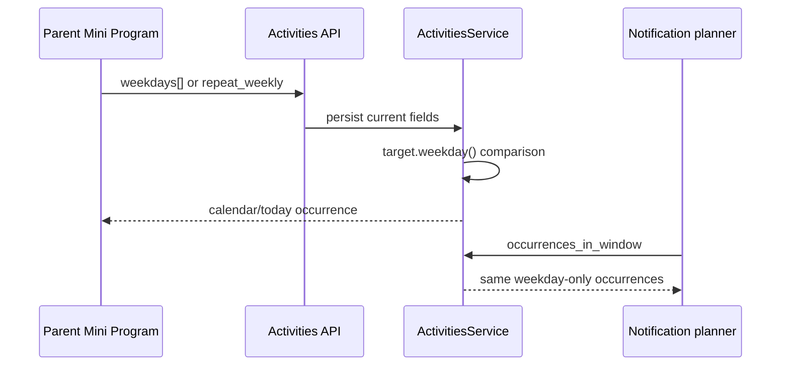
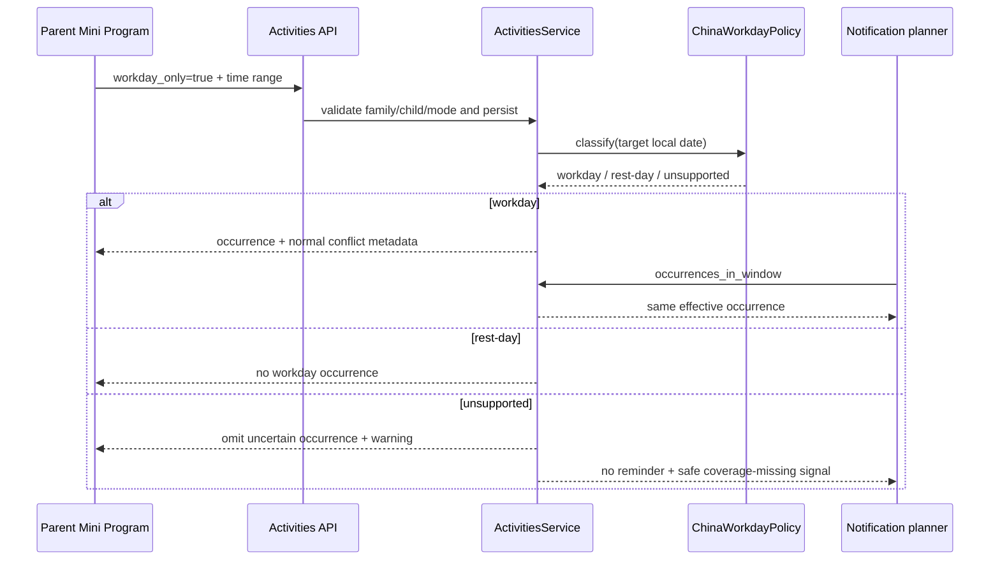
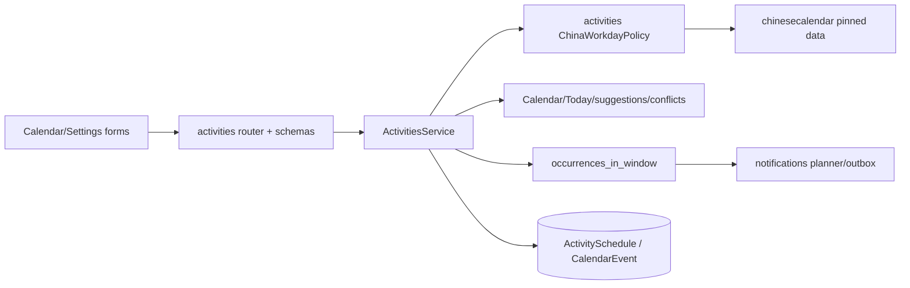
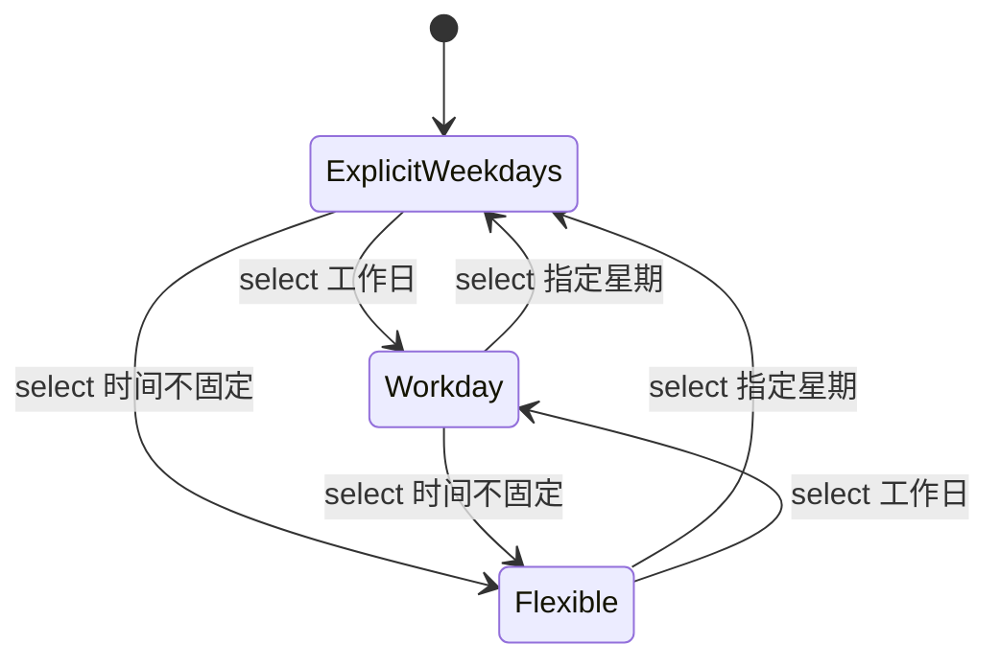
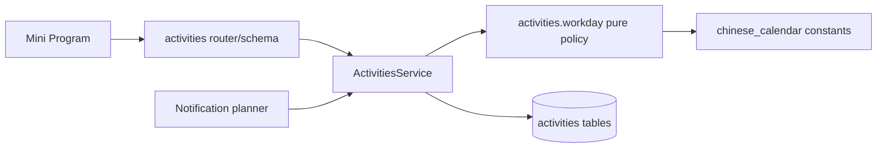

# FEAT-001 / FEAT-003 — 中国工作日日程

- Status: DONE

## 2026-11-06 开发完成与独立验收

- Development completed: 2026-11-06；依据已批准GOV-002的匹配云交付规则，迁入`specs/completed/`。
- Release authorization: 用户已批准OPS Spec01、确认本次备份/受控窗口，并明确“无需灰度账号，直接发布”（原话“不用配置 直接发布”）。原任务本地实施授权与后续发布授权分别保留。
- Delivered scope: 工作日实现由040/0027及0.1.18两端交付；原生两处实际保存/回填/摘要/来源跳转完成，未发送真实提醒。
- Source / stages: HEAD`0576ac30464908154c624effed41df6dfa3110cc`＋批准差异，冻结manifest SHA`c96b30d102d2fff317865040bd8b65c419bbb1374689199c41bcebcd0b157f60`；后端040 normal/100%、Schema0027，客户端0.1.18开发上传1,200,417字节。
- Acceptance: 已执行范围见[发布报告](../../docs/deploy/releases/20261106-fullstack-040-client-0.1.18.md)和[新EVD](../evidence/EVD-20261106-FULLSTACK-DELIVERY.md)。家长内容PENDING、线上生成成功率NOT_MEASURED、设备/可访问性及其余业务验收缺项保留原状态；开发DONE不等于完整验收PASS。尚未设体验版、提审或正式发布。备份保留数量因站点安全策略阻断NOT_RUN。
- Closure: Feature/Behavior/Architecture/UI/测试策略/发布入口与索引按实际交付同步；批准设计源、历史失败和各阶段manifest保持。

## 原批准设计与实施时点记录

> 以下保留原修订、各历史运行及当时的“本地/未交付/VERIFYING”结论，不作为当前开发状态；当前交付以上节及新EVD为准，原验收失败不追改。
- Risk: `R2`（跨 API、Schema、活动投影、通知与原生小程序表单）
- Spec owner: 产品负责人（用户）
- Implementer: Codex
- Reviewer: 独立只读 Review（NOT_RUN；作者自查不计独立Review）
- Verifier: Codex + 产品负责人原生视口验收
- Created: 2026-09-07
- Last updated: 2026-11-05
- Target release: 本地实现与验证；部署/上传不在本次默认授权内
- Spec revision: `SPEC-20261105-WORKDAY-02`
- Supersedes: `SPEC-20260907-WORKDAY-01`（未批准/实施；本修订明确辅导课时间选择和日程两处交互，并对齐当前逐星期时段能力）
- User request: 2026-11-05当前会话“这个需要在选择辅导课时间以及日程这里有体现。”；明确需求落点，不追认为本新修订或设计批准。
- User confirmation: `APPROVED — 用户2026-11-05在本Spec02进度说明后明确要求“完成这个方案的落地”，依据AGENTS命名Spec实施授权规则批准SPEC-20261105-WORKDAY-02及其ARCH-20261105-WORKDAY-02，编码前记录。不存在的DREV02未追认为已批准；先补具体设计证据再审批。部署/上传不在本次授权内。`
- Additional R2 approval: `APPROVED — 同一指令批准本修订R2范围与架构；DREV02具体视觉待审。`
- Affected Feature IDs: `FEAT-001`（活动与日程）、`FEAT-003`（日程提醒消费者）
- Feature current-state documents:
  - `docs/domain/features/FEAT-001-push-kids-mvp.md`
  - `docs/domain/features/FEAT-003-notification-channel.md`
- Feature baseline revisions:
  - `FEAT-STATE-20261101-KNOWLEDGE-CONTENT-10`（本轮读取的FEAT-001当前正文；并行知识点增量不属于本任务）
  - `FEAT-STATE-20261026-NOTIFICATION-DEVELOPMENT-DONE-03`
- Feature merge owner: Codex（仅合并本轮已验证事实，独立Review与交付缺项明确保留）

## Frontend Design Impact and Repository-native Approval

- Frontend impact: `yes` — 设置中的辅导课/课外活动时间选择、日程新建/编辑均新增“中国工作日”规则，并在设置摘要与日程条目中体现。
- Frontend engineering impact: `yes` — 表单状态、校验、恢复、响应式和可访问名称发生变化。
- Affected UI IDs: `UI-001`
- UI current-state document: `docs/design/frontend/ui/UI-001-parent-miniapp.md`
- Frontend baseline revision: approved `FDB-20260913-04`
- Frontend engineering constraint revision: approved `FEC-20261007-NATIVE-GEOMETRY-02`
- Affected quality dimensions: `component/state/form/responsive/a11y/i18n/browser/performance/security/privacy/observability`
- Applicable requirements: 原生 WXML/WXSS、服务端权威、失败保留表单、防重复提交、44px 触控、
  320×568 / 390×844 / 430×932、Asia/Shanghai、无新增客户端网络依赖、不记录孩子内容。
- Frontend quality verification plan: `npm test`、`npm run lint:miniapp`、
  `uv run python tools/validate_miniprogram.py`、三个原生视口的活动/日程工作日态与错误态截图、
  DevTools 编译和代表性 iOS/Android smoke。
- Approved frontend engineering deviations: `none`
- Current Design Revision: 现有UI-001各表面沿用各自已批准设计；旧工作日候选`DREV-20260907-WORKDAY-01`未批准，不能替代本修订设计证据。
- Editable design source path(s): `docs/design/frontend/prototypes/DREV-20261105-WORKDAY-02/index.html`
- Design source SHA-256: `b3bde16a5013c1325cdb1f1bb90a2f5bdef1c778985f58f4c948621b24677ee9`
- Proposed Design Revision: `DREV-20261105-WORKDAY-02`
- Historical candidate: [DREV01](../../docs/design/frontend/prototypes/DREV-20260907-WORKDAY-01/index.html)，仅作历史参考；Spec02需覆盖当前逐星期时间、两处编辑和日程结果态。
- Required viewport/state exports: 320×568、390×844、430×932；辅导课安排的指定星期同一时间/逐星期不同时间/工作日/不固定/只读/保存中/失败，日程的新建工作日/编辑工作日/条目摘要/放假日空态/调休命中态，以及两处数据覆盖警告。完整manifest按两宿主和各状态逐项绑定，不用HTML替代原生验收。
- Prototype status: `APPROVED — 用户2026-11-05明确回复“批准此设计并继续前端实施”；20态×3视口共60导出先生成后批准`
- Approved Task Spec revision: `SPEC-20261105-WORKDAY-02，2026-11-05用户“完成这个方案的落地”`
- Approved Design Revision: `DREV-20261105-WORKDAY-02`
- Design approval evidence: 当前会话具体DREV02问题之明确回复“批准此设计并继续前端实施”。
- Snapshot manifest: `docs/design/frontend/snapshots/UI-001/DREV-20261105-WORKDAY-02/APPROVAL.md`
- Permitted implementation deviations: `none`
- UI current-state merge owner/evidence: Codex / `pending`
- Frontend visual/a11y/resolution verification: `pending`
- External design dependency: `none；实现前仍需仓库原生 DREV、导出、hash manifest 与明确批准`

## 0. Executive summary

### Problem

当前固定活动只按星期集合投影，日程只支持一次或每周重复，后端直接使用 `date.weekday()`。
因此中国法定假期中的周一至周五仍会错误出现，而周末调休上班日不会出现；今日活动与课前提醒也会继承同一错误。

### Intended outcome

家长在添加/编辑活动安排或日程时可以选择“工作日”。系统按中国大陆国务院公布的全国统一放假调休安排，
跳过法定放假日，并在周末调休上班日照常生成日程、冲突提示、今日活动与课前提醒。

2026-11-05明确的两个必需入口：①“设置 → 课外活动 → 辅导课/活动的安排”中的时间规则；②“日程 → 加日程/编辑日程”中的重复规则。保存后的设置摘要、日程条目和重新编辑必须能识别该规则；只在后端过滤日期不满足需求。

### Why now

当前星期规则无法表达中国调休，是家庭日程的高频准确性缺口；将规则放在服务端可保证日程、今日和通知一致。

## 1. Facts, decisions, assumptions, questions

### Confirmed facts

| ID | Fact | Evidence |
|---|---|---|
| `F-001` | 当前ActivitySchedule使用canonical `time_slots`/ActivityScheduleSlot支持逐星期不同时间，并保留旧`weekdays`与统一时间字段兼容；设置弹层为“固定时间/时间不固定”，固定态可选择星期与逐日时间。 | `activities/schemas.py`、`activities/service.py::_replace_slots`、`settings/index.js::openActivitySchedule/saveSchedule`、`settings/index.wxml` |
| `F-002` | CalendarEvent 只有 `repeat_weekly: bool`，每周规则比较起始日与目标日的 weekday。 | `activities/schemas.py`、`activities/service.py` |
| `F-003` | 日程提醒消费 `ActivitiesService.occurrences_in_window`；若只改日程页会造成展示与通知不一致。 | `notifications/planner.py`、`activities/service.py` |
| `F-004` | 2026 年国务院通知明确列出法定放假区间和周末调休上班日。 | 中国政府网 `国办发明电〔2025〕7号` |
| `F-005` | 实施前核验PyPI 1.11.0（2025-11-04、MIT、2004–2026整年），已精确锁定并以国务院2026通知独立核对全部365天；1.10.0历史候选未采用。 | `uv.lock`、`activities/workday.py`、`test_china_workday_policy.py`、年度维护runbook |
| `F-006` | 现有 FEAT-001 前端 baseline、FEC 和仓库原生设计证据规则已批准。 | `FRONTEND-DESIGN.md`、`FRONTEND-ENGINEERING-CONSTRAINTS.md`、`ARCHITECTURE.md` |

### Approved decisions（2026-11-05用户“完成这个方案的落地”）

| ID | Decision | Owner/date | Rationale |
|---|---|---|---|
| `D-001` | “工作日”指中国大陆全国统一法定工作日；不包含学校寒暑假、校历、地方/民族假日、单位自定义工作日。 | 产品负责人 / 2026-11-05 | 与“解决中国放假”直接对应且边界可验证。 |
| `D-002` | 法定放假日跳过，不顺延；周末调休上班日生成 occurrence。 | 产品负责人 / 2026-11-05 | 调休的核心语义，不凭星期猜测。 |
| `D-003` | 服务端使用离线、版本化的 `ChinaWorkdayPolicy`，锁定已核验的`chinesecalendar==1.11.0`；客户端不调用第三方 API。 | 产品负责人 / 2026-11-05 | 确定、低延迟、隐私安全、离线可测试。 |
| `D-004` | 对库未覆盖年份不按周一至周五静默猜测：工作日 occurrence 不生成，日程/今日返回可显示警告，通知 planner 跳过并记录安全错误码。 | 产品负责人 / 2026-11-05 | 宁可显式缺失也不制造错误日程或提醒。 |
| `D-005` | 数据模型加法新增 `workday_only`，保留 `weekdays` 与 `repeat_weekly` 兼容字段，不创建通用 recurrence 框架。 | 产品负责人 / 2026-11-05 | 当前只有一个新增规则，避免过度设计与破坏旧客户端。 |
| `D-006` | 辅导课安排使用“指定星期/工作日/时间不固定”；指定星期保留当前逐星期不同时间，工作日首版使用统一起止时间，不按调休日猜测对应哪天课程。 | 产品负责人 / 2026-11-05 | 保留现有FEAT-009能力，清楚表达工作日规则与星期课程的差异。 |
| `D-007` | 日程新建/编辑使用“不重复/每周/工作日”；工作日下日期标为“起始日期”，列表/时间线及设置摘要显示“工作日 · 起止时间”。 | 产品负责人 / 2026-11-05 | 两处都能配置、保存、回看；不能只改变后台日期计算。 |

### Assumptions

| ID | Assumption | Risk if wrong | Validation | Owner/due |
|---|---|---|---|---|
| `A-001` | 用户说的“工作日”不是孩子实际上学日。 | 寒暑假/学校调休日仍可能与国家工作日不同。 | 本 Spec 明示边界；若要校历，另立 Feature。 | 产品负责人 / approval |
| `A-002` | 首版仅需中国大陆单一区域，不需要地区选择。 | 港澳台/海外家庭会得到错误含义。 | UI 明写“中国大陆法定安排”；多地区另立 Spec。 | 产品负责人 / approval |

### Open questions

Spec02/Architecture02已获实施授权，随后具体DREV02的可编辑源、60张三视口状态导出和SHA manifest先生成后获“批准此设计并继续前端实施”。依赖已核验，migration从0025新增20261105_0026。原生截图、设备与独立Review仍需取得各自实际证据，不由批准或自动测试替代。

## 2. Current behavior and evidence

- 当前法定假日和调休没有数据源、策略或错误状态。
- 现有跨来源冲突检测在 occurrence 投影之后执行；该顺序可复用。
- 现有 ActivitySchedule 不设星期代表“时间不固定”；不能直接用空星期表示工作日。
- 当前`time_slots=[]`对应不固定语义；新增工作日模式必须有独立标识，并在读写、投影、摘要和回填中优先按该标识区分，不能伪造周一至周五时段。

## 3. Target behavior

### Primary sequence diagram

### Behavior matrix

| Case | Input/action | Expected result | Forbidden result |
|---|---|---|---|
| Ordinary weekday | 工作日活动/日程命中普通周一至周五 | 按时间出现 | 被当成休息日 |
| Statutory holiday | 工作日规则命中法定放假日 | 不出现、不冲突、不提醒 | 仅因 weekday 为 0–4 而出现 |
| Adjusted workday | 工作日规则命中周六/周日调休上班日 | 出现、参与冲突并可提醒 | 仅因 weekend 而跳过 |
| Start boundary | 工作日日程目标日早于 `event_date` | 不出现 | 向过去无限投影 |
| Unsupported year | 目标日超出政策覆盖 | 工作日项不出现；日程/今日显示数据待更新；通知不入队 | 伪装成准确的周一至周五 |
| Invalid mixed mode | `workday_only=true` 且又选择 weekdays/weekly/flexible null time | 422，原数据不变 | 隐式选一个模式或部分写入 |
| Legacy row | 所有现存记录 | 行为与当前完全一致 | 自动转成工作日 |

### 两处用户入口与结果反馈

本节为Spec02批准时的原方案；其编辑表单规则/覆盖备注与未知结果呈现，现由另行获批并本地实施的[备注减法Spec01 / DREV03](FEAT-001-WORKDAY-COPY-CLEANUP.md)接管：删除表单两种备注，真实缺覆盖只在结果区表达一次短状态。以下原方案与DREV02冻结资产仅保留批准历史，不再作为当前备注呈现要求；其余模式、时间、权限和恢复合同继续有效。

| 位置 | 可配置内容 | 保存、回看与异常要求 |
|---|---|---|
| 设置 → 课外活动 → 某辅导课/活动的“安排”弹层 | 在时间选择前呈现“指定星期/工作日/时间不固定”；工作日填写统一开始/结束时间，附一句“按中国大陆法定安排，放假跳过，调休照常” | 活动行摘要显示“工作日 · 18:00–19:00”；重新打开回填工作日与时间；原指定星期的逐日不同时间不改写。它不是实际练习记录页的“练习时间”。 |
| 日程 → 加日程/编辑已有自建日程 | “重复”呈现“不重复/每周/工作日”；工作日模式显示“起始日期”和同一句法定安排说明 | 保存后时间线/条目摘要显示工作日规则；重新编辑保持模式/日期/时间，系列编辑说明覆盖工作日系列；放假日不出现，周末调休日出现。 |
| 日程 → 来自辅导课的固定安排 | 沿用已有来源路由，点击回到该辅导课的安排入口 | 不能把投影成的某一天当成独立日程另存，或仅在设置显示工作日而日程误标为“不重复”。 |
| 两处的错误/只读/切换态 | viewer仅可查看；保存中防重；失败保留输入；在模式间切换可恢复本次尚未保存的星期/逐日时间草稿 | 不静默转换已有星期课程、不丢不同星期时间。保存模式转换会替换原规则；如需丢弃不同时间须明确确认，不自动取首行覆盖。覆盖数据缺失使用服务端警告，不显示错误的“本日无安排”结论。 |

## 4. Scope

### In scope

- 活动安排支持 `指定星期 / 工作日 / 时间不固定` 三种互斥方式。
- 日程编辑器支持 `不重复 / 每周 / 工作日` 三种互斥方式。
- 两处均覆盖创建、编辑回填、保存摘要、失败恢复与只读；辅导课安排保留现有逐星期不同时间，日程展示与来源跳转能识别工作日规则。
- 工作日规则统一影响 Calendar、Today、activity suggestions、冲突和 schedule reminder。
- 2026 官方放假调休数据、覆盖范围错误处理、年度更新 runbook。
- 加法 migration、旧 API/数据兼容、前后端与通知回归测试。

### Out of scope / non-goals

- 学校校历、寒暑假、地方/民族节日、家长自定义例外日。
- 将出行安排改为工作日；出行仍由 FEAT-007 的星期集合管理。
- 节假日顺延、补课建议、AI 推断、自动联网同步、后台管理页面。
- 部署、数据库升级、上传体验版、提审或正式发布。

### Invariants / must not change

- 家庭/孩子隔离、manager/editor 写权限、viewer 只读保持不变。
- 相交区间仍是 `[start,end)`；工作日只决定 occurrence 是否存在。
- AI 不参与日期判断；Review 计划不受影响。
- 现有活动/日程、幂等、20 项容量和删除行为保持不变。
- `Asia/Shanghai` 是日期解释时区。

### Feature current-state impact

- FEAT-001：更新固定活动、CalendarEvent、Today/Calendar 和 limitation/quality。
- FEAT-003：更新 schedule reminder 的 occurrence 来源与 coverage-missing 行为。
- UI-001：更新活动安排、日程编辑器、卡片摘要和警告态。
- FEAT-007：只作为冲突消费者回归，不修改正文语义。

### Link/call graph

## 5. Domain and data design

### Terms

| Term | Meaning | Do not confuse with |
|---|---|---|
| 中国工作日 | 国务院全国统一安排下应工作的自然日，含周末调休上班日 | 周一至周五、孩子上学日 |
| 法定休息日 | 官方安排下不工作的自然日 | 所有周六/周日 |
| coverage | 当前离线数据能权威判定的日期区间 | 代码可表达的任意 Python date |

### Entities and invariants

| Entity | New field | Invariant |
|---|---|---|
| `ActivitySchedule` | `workday_only: bool=false` | true时无星期slots，统一start/end必填；false时保持当前canonical time_slots与旧字段兼容，空slots且无时间仍为flexible；不能由空slots单独判断模式 |
| `CalendarEvent` | `workday_only: bool=false` | true 时 `repeat_weekly=false`；`event_date` 是含首日边界 |

### State machine

CalendarEvent 使用同构的 `OneOff / Weekly / Workday` 三态；任一时刻只能有一种 recurrence mode。

### Schema/data changes

- Migration：实施前确认head20261024_0025，新增20261105_0026；两表新增non-null boolean、server default false，未改旧迁移。生产Schema仍0025，本任务未执行云迁移。
- Backfill：server default 使全部旧行保持 false；不改 weekdays/repeat_weekly。
- Existing data compatibility：旧记录逐字保持现有投影。
- Read/write order：先 migration，再发布能读写两字段的新后端，最后上传新小程序。
- Retention/deletion：字段随所属行删除，无新个人信息。
- Rollback：不 downgrade Schema；若已有 workday rows，代码回滚必须使用仍理解字段的 forward-fix 版本。

## 6. Interfaces and errors

| ID | Contract | Additive change | Validation / error | Compatibility |
|---|---|---|---|---|
| `API-001` | ActivitySchedule create/update/view | `workday_only: bool=false` | mixed mode → 422 | omitted = false on create; omitted = preserve on PATCH |
| `API-002` | CalendarEvent create/patch/view | `workday_only: bool=false` | true + repeat_weekly true → 422 | same; retain repeat_weekly |
| `API-003` | daily schedule/dashboard/activity-schedules list | `workday_calendar_warning?: {code, coverage_end}`；日程项补原始`event_date`用于系列回填 | 目标日期超覆盖且该家庭孩子存在工作日规则时警告；设置按当前本地日期 | old clients ignore additive fields |
| `JOB-001` | schedule reminder planner | consumes only supported effective occurrences | unsupported → skip, safe code `workday_calendar_coverage_missing` | non-workday rules unchanged |

- `workday_only` is never null.
- CalendarEvent PATCH omission preserves current mode; explicit false clears workday mode.
- ActivitySchedule workday mode requires same-day start/end and keeps current limits.
- ActivitySchedule工作日请求显式提交`workday_only=true`与统一start/end，不提交星期`time_slots`或`weekdays`；非工作日新客户端继续使用当前`time_slots`合同。true与非空slots或星期混用返回422，不能走旧schema的legacy自动归一化并丢失工作日时间。PATCH未传模式保持原值；模式转换必须完整校验目标模式并在一个事务内替换。
- All dates are Shanghai local calendar dates; stored times remain SQL `Time`.
- Idempotency fingerprint includes `workday_only` for event creates；false模式兼容迁移前不含该字段的持久化fingerprint，true模式不能复用旧key。

## 7. Authorization, security, and privacy

- Existing trusted family context and active-child write gate remain authoritative.
- Workday data contains no user/child information and is never fetched with family context.
- Third-party runtime network calls are forbidden; no request leaks schedule dates.
- Errors/logs contain only safe policy code, coverage boundary and source row IDs, never child name or schedule name.
- Dependency version and hashes are locked by `uv.lock`; official 2026 boundary dates have local contract tests.

## 8. Architecture and implementation boundaries

### Chosen approach

Add a pure, owned `activities/workday.py` policy that wraps the pinned offline calendar library and returns a
three-way result (`workday`, `rest_day`, `unsupported`). ActivitiesService remains the single occurrence authority;
Calendar, Today, suggestions and notifications continue to consume it rather than implementing their own date rules.

### Modules and dependency direction

| Module | Responsibility | Must not own/do |
|---|---|---|
| `activities/workday.py` | pure date classification, coverage metadata | DB, FastAPI, network, family state |
| `activities/service.py` | validate modes, persist, project effective occurrences | hard-code holiday lists in service branches |
| `notifications` | consume occurrences and expose safe skip result | reimplement workday logic |
| Mini Program pages | capture mode and render result/warnings | decide whether a date is a workday |

### Purpose/domain and file decomposition

- Policy is split from `service.py` because it has an independent annual data-change axis and pure contract.
- No generic `utils` or cross-domain calendar module is introduced; current consumers are all owned through activities.
- If a future Feature needs business-day arithmetic beyond occurrence filtering, revisit ownership rather than deep-importing private policy.

### Dependency DAG / architecture diagram

- Enforced by `tools/check_architecture.py` plus focused import/unit tests.
- Forbidden: policy → SQLAlchemy/FastAPI/settings/network; notifications → library/private data.
- No legacy cycle exists or is introduced.

### Shared abstractions

| Concept | Owner | Consumers | Why extract/not extract | Contract tests |
|---|---|---|---|---|
| China workday classification | activities | activity/day projections and notification occurrence path | stable same date semantics; narrow owned policy, not generic helper | official holiday, adjusted weekend, normal days, unsupported boundary |

### Trade-offs and alternatives rejected

| Alternative | Benefit | Why rejected | Revisit condition |
|---|---|---|---|
| Runtime public holiday API | automatic data updates | availability/privacy/supply-chain dependency; no approved official stable API | authoritative SLA/API becomes available |
| Treat Monday–Friday as workday | zero dependency | does not solve Chinese holidays or weekend adjustments | never for label “中国工作日” |
| Vendor hand-written dates | strongest local control | easy to omit a date; duplicates maintained OSS dataset | dependency becomes unmaintained or license changes |
| Generic RRULE/recurrence engine | broad future flexibility | excessive migration/API/UI complexity for one rule | multiple approved recurrence types require it |
| Persist every occurrence | easy querying | unbounded rows, annual reconciliation and idempotency complexity | occurrence-specific editing/reminders become a requirement |

### Extensibility policy

| Axis | Status | Mechanism | Revisit condition |
|---|---|---|---|
| Workday region | `closed` to CN mainland | one policy contract | approved multi-region requirement |
| Annual calendar data | `open` only by dependency/version update | lockfile + official boundary tests + runbook | every official annual notice |
| User/school exceptions | `deferred` | none | explicit school calendar Feature |
| Recurrence types | `closed` after this addition | booleans + invariants | third recurring mode beyond weekly/workday |

Annual data updates must verify official source, package coverage, normal/holiday/adjusted-day cases, dependency license,
safe unsupported boundary and full occurrence/reminder regression. Removal requires replacing the policy and tests in the same release.

### Architecture confirmation

- Recommended design: additive booleans + one pure activities-owned policy + shared occurrence path.
- Architecture revision: approved `ARCH-20261105-WORKDAY-02`，保留activities-owned纯策略与共享occurrence方向，对齐既有time_slots及当前迁移链。
- User/architecture-owner confirmation: `APPROVED — 2026-11-05用户“完成这个方案的落地”，明确对应本Spec02及其推荐架构/替代方案/取舍`.
- ADR required: `No` — no deployment topology or long-lived cross-capability ownership changes; decision is bounded in this Spec and Architecture revision.

## 9. Expected file changes, replacement, and deletion plan

| File/path | Action | Expected change | Why |
|---|---|---|---|
| `pyproject.toml`, `uv.lock` | modify | pin offline calendar dependency | deterministic official-data-derived classifier |
| `apps/api/src/push_kids/activities/workday.py` | add | pure policy and coverage contract | single authority |
| `activities/schemas.py` | modify | additive fields and mode validation | API contract |
| `activities/service.py` | modify | shared effective-day predicate in all four projection paths | consistent behavior |
| `activities/router.py` | modify | expose field and warning metadata | clients need mode/status |
| `persistence/models.py` | modify | two boolean fields | durable mode |
| `apps/api/migrations/versions/20261105_0026_china_workday_schedules.py` | added after head verification | additive migration；禁止复用旧0010 | cloud schema |
| `reporting/service.py` | modify if required | propagate schedule warning to dashboard | Today transparency |
| `notifications/planner.py` | checked, unchanged | consumes existing ActivitiesService occurrence contract | no duplicate date policy |
| `platform/database.py` | modify | local SQLite additive readiness, workday rows excluded from weekly backfill, expected cloud head0026 | old local restart and cloud fail-closed |
| `apps/miniprogram/pages/settings/index.{js,wxml,wxss}` | modify | 辅导课安排三模式、统一工作日时间、原逐日时间草稿/回填/摘要 | visible activity flow |
| `apps/miniprogram/pages/calendar/index.{js,wxml,wxss}` | modify | 日程三模式、起始日期、工作日系列/条目摘要、来源跳转和警告 | visible calendar flow |
| `apps/miniprogram/pages/today/index.{js,wxml}` | modify | existing notice displays coverage warning, opens activity section and avoids reliable-empty claim | approved coverage state |
| focused backend/frontend tests | add/modify | all required test points | regression evidence |
| `tools/check_architecture.py` | modify | enforce new pure policy imports | acyclic policy boundary |
| `tools/prepare_workday_native.py`, `tools/workday_geometry.js` | add | isolated write-rejecting fixture copy and native node evidence | no live business writes |
| `docs/operations/CHINA-WORKDAY-CALENDAR.md` | add | annual source/update/coverage procedure | operational ownership |
| Architecture/Behavior/Feature/UI docs | modify after verification only | merge final facts and evidence | current-state truth |
| Spec/index/Test strategy/release/evidence | modify/add | actual local results and pending acceptance/delivery | honest lifecycle closure |

No production path is deleted. Existing switch-only UI is replaced in-place by one three-mode selector; no duplicate recurrence control remains.

## 10. Non-functional requirements

| ID | Requirement | Target | Failure response |
|---|---|---|---|
| `NFR-001` | workday classification | local pure lookup, no network, effectively O(1) | fail focused performance/unit test if unbounded/networked |
| `NFR-002` | consistency | Calendar/Today/suggestions/reminder agree for same date | release blocker |
| `NFR-003` | coverage honesty | zero guessed workday reminders outside coverage | skip + visible/safe warning |
| `NFR-004` | package | remain below 1.5 MiB initial Mini Program budget | no client calendar dataset; measure package |

## 11. Acceptance criteria

### AC-001 — 活动支持中国工作日

- Given 家长选择活动安排“工作日”并设置 18:00–19:00
- When 查看 2026-02-17（春节假期）与 2026-02-28（周六调休上班）
- Then 前者无该活动，后者有该活动
- And Today、Calendar、suggestion 的 `scheduled_today` 一致
- And not 基于 weekday 猜测。

### AC-002 — 日程支持中国工作日

- Given 工作日日程 `event_date=2026-09-01`
- When 查看 2026-09-20（周日调休上班）与国庆放假日
- Then 调休日生成 occurrence，放假日不生成
- And occurrence 正常参与冲突、历史态和课前提醒
- And not 向起始日期之前投影。

### AC-003 — 互斥、兼容与幂等

- Given 新旧活动/日程 payload 与既有数据
- When create/patch/retry
- Then 旧数据行为不变；合法 mode 持久化；冲突 mode 返回 422；相同幂等键返回同一 event
- And not 部分写入或重复占用容量。

### AC-004 — 覆盖缺失显式且安全

- Given 目标日期超出 pinned calendar coverage
- When Calendar/Today 和通知 planner 计算工作日项
- Then 不生成不确定 occurrence/提醒，UI 得到可显示 warning，日志仅含安全 code/coverage
- And not 静默降级为周一至周五。

### AC-005 — 原生表单完整

- Given 320/390/430 视口与 manager/viewer、保存中和失败态
- When 切换活动三模式或日程三模式并保存/重试
- Then 当前选择、时间和错误保持；模式有文字与可访问名称；所有操作可达且不横向溢出
- And not 仅靠颜色表达选择，不新增客户端节假日网络请求。

### AC-006 — 辅导课时间选择与日程两处均可配置、识别

- Given 家长从设置打开某辅导课安排，或从日程新建/编辑自建日程
- When 选择工作日、设置时间、保存并重新打开
- Then 两处均有明确工作日选项、法定安排说明和时间回填；设置摘要及日程时间线条目显示“工作日 · 起止时间”，日程日期标明起始日期
- And 辅导课投影条目沿原来源入口返回安排表单，工作日系列的修改提示真实准确
- And not 仅后端支持、日程误标不重复，或把工作日实现为周一至周五快捷勾选。

### AC-007 — 逐星期不同时间不回归

- Given 既有辅导课周一18:00–19:00、周三19:00–20:00
- When 打开编辑、切至工作日再切回且未保存，或取消/保存失败
- Then 原逐日时间草稿保持，服务端旧记录不变；保存指定星期时仍使用原time_slots合同
- And 工作日只使用明确选定的统一时间；模式转换涉及舍弃差异时间时先确认
- And not 静默把原课程统一成第一行时间，或为调休日伪造“对应星期课表”。

## 12. Verification plan

| TP | Acceptance/risk | Level | Case/command | Expected evidence |
|---|---|---|---|---|
| `TP-001` | AC-001/002 | unit | `tests/unit/test_china_workday_policy.py` | official normal/holiday/adjusted/unsupported cases |
| `TP-002` | AC-001/002/003 | integration | focused activities/reporting tests | both row types, start bound, conflict, family scope, old rows |
| `TP-003` | AC-002/004 | integration | notification channel/resilience focused tests | no holiday/unsupported reminder; adjusted reminder once |
| `TP-004` | AC-003 | migration/contract | SQLite upgrade + Alembic check + API contract tests | defaults false, additive API, idempotency fingerprint |
| `TP-005` | AC-005 | frontend unit/static | `npm test`; lint; miniapp validator | mode state, payload, labels, recovery, no overflow rule violation |
| `TP-006` | architecture | static | ruff, format, mypy, architecture checker | clean dependency direction |
| `TP-007` | regression | full local | repository full Python and JS commands | all applicable checks pass |
| `TP-008` | AC-005 | native/manual | DevTools + 320/390/430 + iOS/Android | retained screenshots/geometry/device notes |
| `TP-009` | dependency provenance | operational | runbook annual update drill/read-only review | official notice link, coverage and boundary tests recorded |
| `TP-010` | AC-006 | frontend/integration/native | 设置辅导课→安排→工作日→保存/回填→日程条目；日程自建/编辑→工作日→保存/回填 | 两条实际入口、摘要、来源跳转、假期/调休结果及三视口节点/PNG绑定 |
| `TP-011` | AC-003/007 | unit/integration/frontend | canonical time_slots、旧字段兼容、逐日草稿恢复、模式转换确认/取消、混合payload与旧客户端PATCH | 原每周不同时间不丢失、工作日不被空slots误判为flexible、原子写入与失败恢复 |

Red已实际执行：后端9例中6失败、前端6例全部失败，分别见`EVD-20261105-WORKDAY-RED-01`和`EVD-20261105-WORKDAY-FRONTEND-RED-01`。后续Green及最终对象版本单独记录，不覆盖原首败。
Existing weekly/activity/calendar/notification tests prove regression behavior. Real native/device evidence cannot be replaced by Node/WXML tests;
if unavailable it must remain `NOT_RUN` and blocks claiming viewport/device completion, not local code completion.

## 13. Rollout, migration, rollback

### Rollout

1. Freeze clean release commit and back up managed MySQL.
2. Apply the approved additive migration from the verified current head; never reuse old `0010`.
3. Deploy new backend; verify health, policy coverage and old-client CRUD.
4. Upload new Mini Program development version; complete experience-version acceptance.
5. Only after acceptance proceed through existing manual review/production gates.

### Compatibility window

- Backend accepts old omitted fields; old rows default false.
- New frontend is never released before new backend.
- After workday rows exist, an old client may display them imprecisely but PATCH omission must preserve the mode;
  attempts to send a conflicting legacy mode fail rather than corrupting data.
- No feature flag; migration is additive and mode is explicit.

### Observability and release gates

- `workday_calendar_coverage_missing` count must be zero for current-year production windows before release.
- Any disagreement between day projection and reminder occurrence is an abort condition.
- Public production remains subject to all existing repository design/native/privacy/channel gates.

### Rollback / restore

- Frontend can roll back after disabling workday creation through a forward-compatible backend release.
- Backend rollback must retain code that understands existing workday rows; do not downgrade Schema or deploy pre-workday semantics over such rows.
- Boolean data is reversible only after confirming zero true rows or explicitly converting them with product approval.

## 14. Implementation plan

### Step 1 — Deterministic policy and durable modes

- Add dependency lock, pure policy, migration, models/schemas and official boundary tests.
- Validate old data and API compatibility before changing projections.

### Step 2 — One effective-occurrence path

- Refactor only repeated predicates needed to call the policy from day projection, window occurrence and suggestions.
- Preserve conflict/capacity/idempotency behavior; add integration and notification tests.

### Step 3 — Approved native interaction

- Replace the settings辅导课安排 and calendar controls with approved three-mode controls.
- Add settings/day-item summaries, edit hydration and coverage warning; preserve existing per-weekday times, mode drafts, input on failure and viewer/read-only behavior.

### Step 4 — Verify, review, and merge facts

- Run focused then full checks, independent read-only Review, native evidence when available.
- Merge FEAT-001, FEAT-003, UI-001, Behavior Catalog and Architecture only from verified final facts.

## 15. Review plan

- Review correctness of official dates, unsupported-year safety and every occurrence consumer.
- Review necessity and placement of each changed file; reject generic recurrence abstractions or notification-owned date logic.
- Review API/migration mixed-version behavior, family scope, idempotency and absence of runtime network calls.
- Review tests for independence from the implementation helper and for explicit adjusted-weekend cases.

## 16. Implementation and verification record

2026-11-05：Spec02/Architecture02由“完成这个方案的落地”批准；具体DREV02先生成60张导出及SHA manifest，后获用户“批准此设计并继续前端实施”，才开始界面编码。前后端、0026加法迁移、离线依赖与年度维护runbook已本地实现。后端Red6/9失败、前端Red6/6失败保留；最终版本与原始日志见[EVD](../evidence/EVD-20261105-WORKDAY-IMPLEMENTATION-01.md)和[证据目录](../../docs/quality/evidence/china-workday-20261105/README.md)。

| TP | 实际结果 | 证据与限制 |
|---|---|---|
| TP-001 | PASS | 官方2026通知独立期望核对365天，覆盖上下界与2027拒绝猜测 |
| TP-002 | PASS | 两来源、开始下界、day/window、建议/冲突、family隔离、停用活动可见性及旧规则专项 |
| TP-003 | PASS（本地） | 真实planner合成队列：假期0、调休1且幂等、覆盖外0；真实微信发送NOT_RUN |
| TP-004 | PARTIAL / SQLITE_GLOBAL_CHECK_FAIL | 旧行默认false、SQLite升级/保护降级/本地重启、API与fingerprint兼容PASS；SQLite四个旧索引漂移保持。OPS后续隔离MySQL5.7.44新库/0025→0027 upgrade/current/check PASS；工作日业务特定MySQL和云DDL仍NOT_RUN，不扩大为生产索引故障 |
| TP-005 | PASS（自动化） | 最终359项前端、ESLint、小程序validator通过；独立工作日前端10项覆盖交互/状态 |
| TP-006 | PASS | Ruff/format、mypy152源、架构5 policies/152 modules、设计policy通过 |
| TP-007 | PASS_WITH_CONDITIONAL_SKIPS | 最终全Python919 passed/52 skipped，145.32s（未配置隔离MySQL，保留126 warnings）；新增旧fingerprint/停用活动回归及增强window断言后已重跑全量，首轮917PASS独立保留；最终专项16 passed、全前端359 passed |
| TP-008 | PARTIAL | 原截图超时保持；OPS在解锁及官方重连后补三视口双宿主48组节点/PNG，errors0、SHA/解码及联系表观察完成；设备/读屏/大字/最低基础库仍NOT_RUN，见[后续EVD](../evidence/EVD-20261105-FULLSTACK-NATIVE03.md) |
| TP-009 | PASS（本地维护演练） | 精确依赖/锁SHA/官方来源、2027安全边界与年度更新runbook；云演练NOT_RUN |
| TP-010 | PARTIAL | 设置/日程Page方法、payload/摘要/回填/来源跳转自动化PASS；三视口48组节点/PNG及呈现已补，完整实际保存/回填/来源跳转及真机仍缺，不能以状态fixture代替 |
| TP-011 | PASS（自动化） | 逐日草稿、转换确认/取消、旧PATCH保留、混合输入422原子性、幂等兼容 |

当前Feature/UI/Behavior/Architecture正文已合并本轮已验证行为并消除“未实施/未批准”等冲突；测试策略与发布记录保留独立验收、历史证据和生产0025。作者自查不能计独立Review，R2仍NOT_RUN。工作区有原有并行任务修改，本轮仅改列明文件，不提交或打包整个脏工作区。

Production implementation: LOCAL_IMPLEMENTED / VERIFICATION_PARTIAL；OPS已冻结当前160/168源并完成隔离MySQL迁移/check、988 Python/56条件skip及全栈独立只读Review，生产源无新增确认代码缺陷；本Spec完整产品/原生验收仍PARTIAL，SQLite四索引与云端检查独立保留。没有本任务后端部署或小程序上传，保持VERIFYING/active；补齐适用原生/设备及发布门禁，前后端取得匹配云交付后才迁移DONE/completed。

## 17. Completion gate

- [x] `SPEC-20261105-WORKDAY-02` + `DREV-20261105-WORKDAY-02` approved，设计源/导出/SHA及依赖/迁移准备齐全。
- [x] Architecture revision approved.
- [x] Migration/API/policy/UI implemented without scope expansion.
- [x] Every required test point executed or recorded `NOT_RUN` with risk.
- [ ] Independent Review has no Blocker/Major findings.
- [x] FEAT-001, FEAT-003, UI-001, Behavior Catalog and Architecture verified current facts merged；Review限制保留。
- [x] 本任务清单限定实际修改；原有并行工作区改动保留，未打包/提交。
- [ ] 本任务前后端对应范围均有匹配云交付后设DONE并移completed；仅本地实现/preview不归档DONE，验收缺项独立保留真实结果。

Final status: `VERIFYING`，路径保留`specs/completed/FEAT-001-CHINA-WORKDAY-SCHEDULES.md`；无云交付，不迁移DONE。

## 18. Revision history

| Date | Revision | Change | Approved by |
|---|---|---|---|
| 2026-09-07 | `SPEC-20260907-WORKDAY-01` | Initial design: additive mode, offline CN calendar policy, unsupported coverage safety, native interaction. | N/A |
| 2026-11-05 | `SPEC-20261105-WORKDAY-02` | 辅导课与日程双入口、原逐星期不同时间兼容、AC-006/007与TP-010/011；依赖和0026迁移落实，DREV02先生成后获批，本地实施/验证及文档闭合，保留未交付与验收缺项。 | 产品负责人“完成这个方案的落地”批准Spec02/Architecture02；随后“批准此设计并继续前端实施”批准DREV02 |
