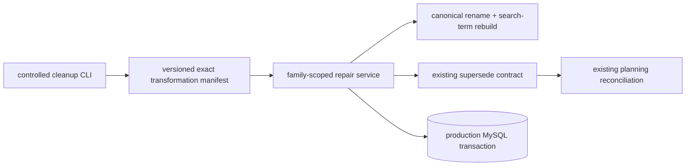
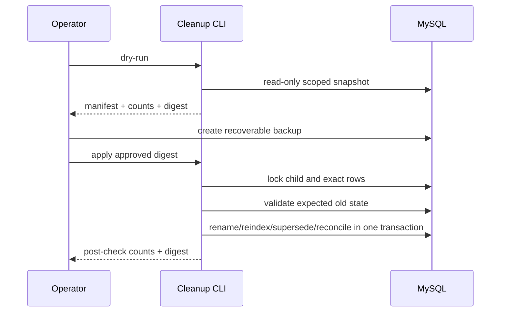

# SPEC-20261031-HISTORICAL-KNOWLEDGE-CLEANUP-01 — 存量知识点修订与等价合并

- Status: DONE
- Risk: R3 — production data rewrite; reversible only through backup/manifest rollback
- Owner: Product owner
- Implementer: Codex
- Date: 2026-10-31
- Spec revision: `SPEC-20261031-HISTORICAL-KNOWLEDGE-CLEANUP-01`
- User confirmation: approved by the user's 2026-10-31 reply "批准"
- Affected Feature IDs: `FEAT-001`
- Feature baseline: `FEAT-STATE-20261026-DEVELOPMENT-DONE-04`
- Frontend impact: no — existing normal/superseded presentation is reused
- Frontend engineering impact: no
- Approved Task Spec revision: `SPEC-20261031-HISTORICAL-KNOWLEDGE-CLEANUP-01`
- External design dependency: none

## 1. Problem and outcome

The production read-only audit found 243 confirmed Knowledge rows. Some names retain worksheet actions, ordinary story scenes or vague labels, while semantically equivalent fragments own separate Knowledge/Review identities. The target is a controlled, family/child/subject-scoped repair that keeps every LearningRecord, KnowledgeOccurrence and ReviewFeedback, exposes one canonical normal Knowledge item per approved equivalence cluster, and never creates a review event or changes a review date/count.

## 2. Scope and invariants

In scope:

- Rename an approved canonical Knowledge row and rebuild only its deterministic search terms.
- Mark approved duplicate rows `superseded` through the existing `knowledge.supersession.supersede` contract and reconcile their future planning projection.
- Retain old Knowledge rows, occurrences, learning records, feedback events and evidence for audit/source history.
- Produce a dry-run manifest with exact IDs, expected old values, target values, counts and a digest before apply.
- Apply all rows in one transaction after an operator-confirmed production backup; abort on any baseline mismatch.

Out of scope:

- Hard-delete or move occurrences/feedback between identities.
- Infer missing audio, unit vocabulary or worksheet context. Vague rows without enough stored evidence remain unchanged and are listed for parent supplementation.
- Mark anything reviewed today, manufacture mastery, change review curves, schema or API.
- Deploy the prompt change; data repair and code deployment remain separate operations.

## 3. Approved candidate transformation set

The apply manifest must resolve full IDs by exact family/child/subject/old-name and reject zero or multiple matches. The table below is the proposed semantic decision; no additional cluster may be added during apply.

| Subject | Current rows/cluster | Canonical result | Action |
|---|---|---|---|
| 数学 | 加减混合运算解决年龄问题；小鸟/上下车等加减混合场景 | 加减法混合运算应用题 | rename oldest suitable canonical; supersede equivalent scene rows only |
| 数学 | 识别不同类物品；按不同标准对物体分类（重复两条） | 物体的分类与分类标准 | rename + supersede duplicates |
| 数学 | 认识钟表与时刻认读；认识时钟并识别时针 | 钟表的认识与时刻认读 | rename + supersede duplicate |
| 数学 | 6条线段定义、判断、分点/简单/组合图形计数和添画记录 | 线段的定义、识别与数量计算 | rename + supersede cluster |
| 数学 | 10以内连加结果比较；10以内连减结果比较 | 10以内连加、连减算式结果的大小比较 | rename + supersede duplicate |
| 数学 | 已知总数和一部分求另一部分（看图/情境两条） | 用减法解决部分与整体关系的应用题 | rename + supersede equivalent row |
| 数学 | 连加购买/看图求总数 | 连加运算应用题 | rename + supersede equivalent row |
| 英语 | 小写j；jar、juice、jellyfish | 字母Jj的字母名、字母音及相关词汇 | rename + supersede cluster |
| 英语 | Nn字母名/音；听读Nn；nine/newt/nut | 字母Nn的字母名、字母音及相关词汇 | rename + supersede cluster |
| 英语 | Ll、Mm字母名/音；leaf/ladybug/milk/mango | 字母Ll、Mm的字母名、字母音及相关词汇 | rename + supersede duplicate |
| 英语 | Oo字母名/音；on/orange/octopus | 字母Oo的字母名、字母音及相关词汇 | rename + supersede duplicate |
| 英语 | 《A Happy Outing》阅读理解；朗读表演 | 《A Happy Outing》阅读理解与表达 | rename + supersede duplicate |
| 英语 | 两条高度重叠的think/fireworks/...词表 | 指定英语词汇的认读与词义理解 | keep the broader evidenced row; supersede contained duplicate |
| 英语 | Bossaball听读；短文判断Yes/No | Bossaball运动短文的阅读理解 | rename + supersede only if stored evidence includes visible text; otherwise leave unchanged |
| 语文 | 常见/常用拟声词的认识与运用 | 拟声词的认识与运用 | rename + supersede duplicate |
| 语文 | 掌握/练习正确握笔姿势 | 正确握笔姿势 | rename + supersede duplicate |
| 语文 | ie、üe、er认读；ie、üe与声母拼读 | 复韵母ie、üe、er的认读与拼读 | rename + supersede duplicate |
| 语文 | 弯弯的搭配；给事物搭配形容词 | 形容词与事物的搭配 | rename + supersede equivalent row |
| 语文 | 近义词/反义词定义、判断、连线和具体配对共7条 | 近义词和反义词的概念、判断与运用 | rename + supersede cluster |
| 语文 | 在括号内书写指定词语 | stored evidence required | no automatic change when the underlying words/rule cannot be recovered |
| 语文 | 拼音；进行词语相关学习；田字格书写指定汉字 | stored evidence required | no automatic change when evidence remains vague |
| 英语 | Unit5/6/7主题词汇与句子；中国发明；听读Bossaball | stored evidence required | do not invent specifics; unresolved rows remain editable by parent |

## 4. Architecture and flow

### Link/call graph



### Sequence



### State machine

```text
normal duplicate → superseded → permanent historical/audit visibility
normal canonical → renamed normal canonical
any baseline mismatch → rollback whole transaction → unchanged
```

### Architecture decision and trade-offs

| Option | Benefit | Risk | Decision |
|---|---|---|---|
| Delete duplicates and move facts | Visually clean storage | Destroys identity/audit history and can corrupt feedback provenance | Rejected |
| Update every old row to the same name | History appears uniform | Violates unique identity and obscures original confirmed fact | Rejected |
| Rename one canonical + supersede equivalents | Reuses current product semantics, preserves facts and rollback clarity | Old source history still shows original names when explicitly viewing superseded records | Selected |
| Model-driven unrestricted migration | Broad automation | Unreviewed false merges | Rejected |

No new module boundary or extension point is introduced. The manifest is closed to the table above; future cleanup requires a new revision.

## 5. Expected files

| Path | Change |
|---|---|
| `tools/repair_historical_knowledge.py` | add dry-run/apply CLI with digest, exact preconditions and aggregate-only output |
| `apps/api/src/push_kids/knowledge/` | add or minimally extend a transaction-owned rename operation; reuse existing supersession |
| `tests/unit/`, `tests/integration/` | rename/reindex, supersession, rollback, zero-feedback-write and tenant isolation tests |
| `specs/evidence/` | retain approved dry-run and post-apply aggregate manifests without secrets/evidence payloads |
| Feature/Behavior/issue/release docs | record actual local/apply/deploy facts separately |

## 6. Acceptance and required tests

- AC-001: every applied source row matches exact family/child/subject/name/status preconditions.
- AC-002: canonical normal count decreases only by the approved superseded count; no row is deleted.
- AC-003: LearningRecord, KnowledgeOccurrence and ReviewFeedback counts and ownership are unchanged.
- AC-004: ReviewItem last-reviewed/count/feedback history is unchanged; superseded reviews stop automatic future scheduling through existing policy.
- AC-005: canonical normalized identity and search terms match the new name; old canonical terms are removed.
- AC-006: no cross-family/child/subject write; duplicate retry is idempotent or aborts cleanly.
- AC-007: unresolved/vague rows are reported, not guessed.
- AC-008: apply requires the exact approved dry-run digest and an operator-confirmed backup; any mismatch rolls back.

Required test points: SQLite unit/integration; isolated MySQL 5.7 transaction/locking/unique-index test; production dry-run; backup gate; production apply; immediate post-check plus application read smoke. Full backend gates are required before any code deployment, but this data repair does not itself authorize deployment.

## 7. Recovery and release

- Before apply, create a new recoverable production backup under `docs/deploy/BACKEND-RELEASE.md` §4.2.
- The dry-run manifest records canonical/source IDs, expected values and row counts; no evidence text or secret is persisted.
- On tool failure, transaction rollback is mandatory. After a committed semantic mistake, stop writes and restore from the operator-confirmed backup; do not attempt ad-hoc reverse supersession.
- Spec remains active until code is cloud-delivered per repository policy; production data apply and acceptance are recorded independently.

## 8. Approval gate

The user approved `SPEC-20261031-HISTORICAL-KNOWLEDGE-CLEANUP-01` on 2026-10-31. Production dry-run found 15 same-child/subject equivalence clusters, 15 canonical renames, 30 supersessions and 9 unresolved vague rows across 243 Knowledge items; digest `cdeff9d569eb22cec2b6b786a9b4d52838878fe7297d86b49de6c781a3964310`. Three proposed semantic groups (mixed-operation scenes, clock knowledge and grip posture) do not form a same-child cluster and are correctly excluded. The operator subsequently confirmed the standardized database-backup gate, and the approved production apply completed as recorded below.

## 9. Implementation and production verification

- User confirmed the required production backup on 2026-10-31 before apply.
- Full backend gate before apply: `793 passed, 46 skipped`; the first run exposed one stale checkpoint-count assertion and one isolated readiness timing failure. The checkpoint expectation was updated for the approved Review stage; targeted re-run passed, readiness passed in isolation, and the complete re-run passed.
- Pre-apply production dry-run reproduced the exact approved digest and counts: 15 clusters, 15 renames, 30 supersessions, 9 unresolved, 243 Knowledge items, 243 occurrences, 112 learning records and 455 feedback events.
- Apply committed in one transaction. Post-apply dry-run returned zero remaining approved clusters. Production now has 213 normal and 30 superseded Knowledge rows; all 30 superseded rows link to a canonical row; all 15 canonical targets have search terms.
- Formal fact counts remained exactly 243 Knowledge items, 243 occurrences, 112 learning records and 455 feedback events. No reviewed-today or mastery fact was created.
- Evidence: `docs/quality/evidence/HISTORICAL-KNOWLEDGE-CLEANUP-20261031.md` and `docs/deploy/releases/20261031-historical-knowledge-cleanup.md`.
- Cloud delivery: the runtime support and paired prompt/review increment were delivered in immutable gray backend `flask-ik19-038`, which reached `normal` on 2026-10-31. The repair apply was not repeated and Schema remained `20261024_0025`.
- Lifecycle: development is DONE under `GOV-SPEC-20261026-CLOUD-DELIVERY-DONE-01` and this Spec is archived in `specs/completed/`. Traffic-directed smoke remains NOT_RUN and does not alter the already verified production data conservation result.
