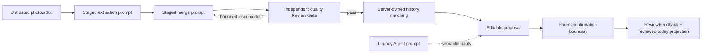

# SPEC-20261031-KNOWLEDGE-POINT-PROMPT-03 — 知识点质量 Review 与历史等价合并

- Status: DONE
- Risk: R2 — 新增一次有界模型质量审查及一次受限纠正回路，改变外部 Provider 调用序列。
- Owner: Product owner
- Implementer: Codex
- Reviewer: independent review after implementation
- Date: 2026-10-31
- Spec revision: `SPEC-20261031-KNOWLEDGE-POINT-PROMPT-03`
- User confirmation: Spec02 was approved and implemented locally; Spec03 approved by the user's 2026-10-31 instruction "好的，你来修改这个生成逻辑，然后使用历史的记录进行测试"
- Affected Feature IDs: `FEAT-001`
- Feature current-state documents: `docs/domain/features/FEAT-001-push-kids-mvp.md`
- Feature baseline revision: `FEAT-STATE-20261026-DEVELOPMENT-DONE-04`
- Feature merge owner: Codex after verification

## Frontend Design Impact and Repository-native Approval

- Frontend impact: no — confirmation UI and proposal data shape do not change.
- Frontend impact reason: only provider instructions and their contract tests change.
- Frontend engineering impact: no — no Mini Program code, state, accessibility, performance or resource contract changes.
- Frontend engineering impact reason: N/A; existing editable proposal renders the same fields.
- Affected UI IDs: N/A
- UI current-state documents: N/A
- Frontend baseline revision: N/A
- Frontend engineering constraint revision: N/A
- Affected frontend quality dimensions: N/A
- Frontend quality budgets/requirements: N/A
- Frontend quality verification plan: N/A
- Approved frontend engineering deviations: none
- Current Design Revision(s): N/A
- Editable design source path(s): N/A
- Design source SHA-256: N/A
- Proposed Design Revision: N/A
- Required viewport/state exports: N/A
- Prototype status: N/A
- Approved Task Spec revision: `SPEC-20261031-KNOWLEDGE-POINT-PROMPT-03`
- Approved Design Revision: N/A
- Design approval evidence: N/A
- Snapshot manifest path: N/A
- Permitted implementation deviations: none
- UI current-state merge owner: N/A
- UI current-state merge evidence: N/A
- Frontend visual/a11y/resolution verification: N/A
- Frontend engineering verification evidence: N/A
- External design dependency: none

## 1. Problem and outcome

- Problem: current staged and legacy analysis prompts already reject ordinary story decoration and ask for coarse merging, but production proposals still frequently preserve exercise commands (`打√`、`连线`、`填空`、`听读`), unavailable audio tasks, concrete story scenes, vague unit/theme labels, and multiple fragments of one knowledge domain. Prompt-only generation has no independent final quality check, so instruction misses flow directly into an editable draft.
- Intended observable outcome: generated `name` values describe concrete, reusable knowledge rather than the question form; expose specific words/rules when supported; abstract ordinary story scenes; omit unknown audio/video-dependent tasks; and merge closely related definitions, examples and exercise forms into one reviewable knowledge unit. A separate bounded Review Gate checks these minimum standards before any history lookup or proposal publication.
- Evidence/current behavior: read-only production audit on 2026-10-31 found examples including `判断...音节书写正误并打√`, `用加减混合解决上下车...`, `听读...短文`, vague `Unit...主题词汇与常用句子`, and separate letter/word or segment-definition/counting items. The current rules in `stage_contracts.py` and `prompt.py` do not state these decisions precisely enough.

## 2. Scope

### In scope

- Update the authoritative staged extraction and consolidation instructions.
- Add an independent structured quality-review stage after consolidation and before history matching.
- Permit at most one merge correction using reviewer issue codes, followed by one final review; a second failure rejects the analysis attempt.
- After quality review, use the existing server-owned bounded history search and match stage to check whether each final item is semantically equivalent to confirmed same-day, today-plan or historical knowledge.
- Collapse multiple final candidates that resolve to the same historical Knowledge identity into one review proposal while preserving all direct evidence.
- Only explicit parent confirmation records the existing historical knowledge as reviewed today; analysis alone performs no formal write.
- Keep the legacy Agent prompt semantically aligned because it remains a supported comparison/fallback path.
- Increment both prompt/pipeline revisions so temporary stage cache and prompt evidence cannot be mistaken for the previous behavior.
- Add contract tests that assert the complete rule set and representative positive/negative examples.

### Non-goals

- No deterministic semantic rewriter or hard-coded subject taxonomy. Deterministic code validates reviewer structure, coverage and bounded control flow only.
- No automatic rewrite/backfill of the 243 existing formal Knowledge rows.
- No broad “similarity” merge for merely related, prerequisite, superseding, broader or narrower knowledge.
- No live Ark acceptance run, cloud deployment, database migration, API change or frontend change in this Spec.
- No grading, mastery judgment, future lesson recommendation or model-produced review date.

### Must not change

- AI output remains an editable proposal; only parent confirmation creates formal facts.
- Direct evidence, family/child scope, subject catalogue, history matching, 20-item/1–5-minute bounds and deterministic review scheduling remain unchanged.
- The model must not invent missing media contents, words, rules, numbers, answers or steps.
- Review output cannot create, rename or delete knowledge directly; only the bounded merge correction produces a revised candidate set.
- Historical matching cannot mark a review complete during analysis; it only emits an editable `today_review` or `history_item` proposal.

### Feature current-state impact

- Current Feature sections affected: FEAT-001 analysis provider/prompt behavior around the current `stage_contracts.py` and legacy `prompt.py` revisions.
- Final facts to merge after verification: exact new revision IDs, new extraction/consolidation rules and test evidence.
- Superseded Feature statements to replace/remove: update the old prompt/pipeline revision references only; preserve historical evidence.
- Change Reference to add: `SPEC-20261031-KNOWLEDGE-POINT-PROMPT-02`.

## 3. Impact map

- Entry/caller: learning photo/text submission → analysis worker.
- Existing authoritative path to modify: default staged provider instructions/contracts in `agent_processing/stage_contracts.py` and orchestration in `agent_processing/pipeline.py`; legacy parity rules in `agent_processing/prompt.py`.
- Dependencies/callees: staged extraction → consolidation → server-owned history matching → editable proposal → parent confirmation.
- Existing tests: `tests/unit/test_staged_analysis.py`, `tests/unit/test_provider_evidence.py`, `tests/unit/test_analysis_context_contract.py`.
- Behavior/architecture docs: FEAT-001 and `docs/domain/BEHAVIOR-CATALOG.md` BHV-032/BHV-014 after verification.

## 4. Required design views

### Link/call graph

```text
POST learning material
→ analysis worker
→ StagedAnalysisPipeline
→ EXTRACT_INSTRUCTIONS (candidate learning targets)
→ MERGE_INSTRUCTIONS (final reusable knowledge units)
→ REVIEW_INSTRUCTIONS (independent minimum-quality check)
→ [issues: one bounded merge correction → final review]
→ server-owned history retrieval and semantic-equivalence matching
→ deterministic collapse by historical Knowledge identity
→ editable proposal
→ parent confirmation boundary
→ confirmed historical item receives today's ReviewFeedback/projection update

Legacy comparison/fallback
→ ArkAnalysisProvider
→ ANALYSIS_RULES
→ same final knowledge-name semantics
```

### Sequence diagram

```mermaid
sequenceDiagram
    participant P as Parent
    participant W as Analysis worker
    participant E as Extract stage
    participant M as Merge stage
    participant R as Quality reviewer
    participant H as Server history match
    P->>W: photos/text
    W->>E: bounded material + subjects
    E-->>W: evidence-backed candidate targets
    W->>M: all candidates
    M-->>W: concrete, abstracted, merged knowledge units
    W->>R: merged units + evidence-backed candidates
    alt reviewer reports issues
        R-->>W: bounded issue codes + affected aliases
        W->>M: one correction request
        M-->>W: corrected complete units
        W->>R: final quality check
    else pass
        R-->>W: pass
    end
    Note over W,R: second failure rejects attempt; no low-quality draft
    W->>H: server-owned bounded lookup
    H-->>W: new/today/history equivalence decision
    W-->>P: editable proposal
    Note over P,W: No formal write until explicit parent confirmation
    P->>W: confirm proposal
    Note over P,W: Only now may an existing Review be marked reviewed today
```

### State machine

```text
merged
  → review_passed → history_matching
  → review_failed_once → correction_merge → final_review
  → final_review_passed → history_matching
  → final_review_failed → StageFailure(quality) → existing bounded Job retry/failure
```

Submission states, parent confirmation and ReviewItem transitions remain unchanged.

### Architecture diagram



### Required knowledge-name decisions

1. **Knowledge, not exercise command:** remove `判断/打√/连线/填空/圈选/抄写/听读/表演` when it only describes how the worksheet is answered. Infer the taught rule or capability only when direct evidence supports it; otherwise omit and record material uncertainty.
2. **Unavailable media:** when a task depends on audio/video not present in the supplied material, do not generate an item. Visible transcript, word list or rule may still support that visible knowledge, but the unknown recording content must never be guessed.
3. **Reusable abstraction:** remove ordinary story settings such as boarding a bus, shopping, animals, age characters or hide-and-seek. Retain the transferable mathematical/language target, e.g. `加减法混合运算应用题`.
4. **Concrete enough to review:** unit/theme labels such as `Unit 5主题词汇与常用句子`, `中国发明`, `拼音` or `词语学习` are invalid unless the name identifies the supported vocabulary, sentence pattern, characters or rule. If evidence cannot make it concrete, omit it.
5. **Merge a knowledge domain:** definitions, examples, question forms and closely related subskills that a parent would review together use one knowledge unit. Examples: letter name/sound + its related words; `ie/üe/er` recognition + supported spelling/tone rules; synonym/antonym definitions + judgment/application; line-segment definition/recognition/counting. Examples remain in evidence rather than the name when the domain label is sufficient.
6. **Do not over-merge:** different subjects never merge; independent rules requiring different review actions remain separate; one item must still be independently reviewable in 1–5 minutes.
7. **Historical equivalence, not loose similarity:** an existing item is reusable only when subject and core learning target are the same and the scope is compatible. Different examples, worksheet formats or ordinary story scenes may still be equivalent. Related, prerequisite, broader, narrower or successor knowledge is not equivalent.
8. **Reviewed today only after confirmation:** analysis labels the editable proposal as `today_review` or `history_item`; parent confirmation writes the review event and updates the existing Review projection. Cancellation/editing creates no reviewed-today fact.

### Review Gate contract

- Input: complete `ConsolidatedResult`, original candidate aliases and their evidence. It receives no database IDs and performs no history lookup.
- Output: strict `QualityReviewResult` with `passed` plus zero or more issues. Each issue contains only an allowed code and one or more affected final item aliases.
- Allowed issue codes: `exercise_not_knowledge`, `missing_media_dependency`, `ordinary_scene`, `vague_name`, `should_merge`, `over_merged`, `unsupported_by_evidence`.
- The reviewer does not propose replacement prose and cannot mutate the result. This preserves the merge stage as the sole naming owner.
- `passed=true` requires an empty issue list; `passed=false` requires at least one valid issue. Unknown aliases, duplicate issue identities or inconsistent pass state are rejected deterministically.
- First failure: rerun the merge stage once with the original candidates, previous complete result and bounded reviewer codes/aliases. The corrected merge must still cover every original candidate exactly once.
- Second review failure: raise safe `StageFailure("quality")`; classify it as retryable invalid analysis output under the existing bounded Job-attempt policy. It never reaches history matching or `pending_confirmation`.
- Review-stage schema/validation failure is not retried inside `_call`; the attempt fails safely. Product decision: worst case is generation failure and the parent supplements material or uses manual input, rather than accepting an unchecked result.
- Call/deadline budget: add at most two `review` calls and one correction `merge` call. The local ceiling is 18, covering 9 images + optional parent-text extraction, 2 groups, merge, review, correction merge, final review and the existing bounded match correction. All calls remain inside the persisted five-minute lease and existing absolute deadline.

### Trade-offs

| Option | Benefit | Cost/risk | Decision |
|---|---|---|---|
| Prompt-only, versioned rule improvement | Small and reversible | A single generation miss still reaches the parent | Rejected after product-owner feedback |
| Independent model reviewer + one bounded correction | Separates generation from checking; catches semantic quality issues without hard-coded curriculum rules | Adds latency/cost and another provider failure point | Selected |
| Deterministic name linter/rewriter | Strong syntactic enforcement | Chinese/English subject semantics are open-ended; high false-positive risk and a new policy engine | Rejected for semantic decisions; retain structural validation only |
| Hard-coded subject templates | Predictable for known worksheets | Brittle, curriculum-specific and violates open-ended capture | Rejected |
| Backfill existing Knowledge rows | Cleans current data | Persistent destructive/merging semantics require separate R2 migration and parent review | Deferred to `SPEC-20261031-HISTORICAL-KNOWLEDGE-CLEANUP-01` |
| Reuse existing history search/match and deterministic identity collapse | Preserves one Knowledge/Review fact, tenant scope and confirmation boundary | Semantic equivalence remains model-assisted | Selected for Spec03 |
| Add a vector database or global similarity service | Broader recall | New infrastructure, privacy, cost and false-merge risk | Rejected |

## 5. Expected file changes and deletion plan

| File/path | Action | Intended change | Why required |
|---|---|---|---|
| `apps/api/src/push_kids/agent_processing/stage_contracts.py` | modify | bump `PIPELINE_REVISION`; add authoritative extraction/merge rules and examples | default production path |
| `apps/api/src/push_kids/agent_processing/stage_contracts.py` | modify | add strict quality review DTO, issue enum and review instructions | reviewer contract owner |
| `apps/api/src/push_kids/agent_processing/pipeline.py` | modify | review before history; one correction loop; deterministic review validation and bounded calls | enforce the gate |
| `apps/api/src/push_kids/agent_processing/stage_provider.py` | modify | bounded `review` output-token budget | execute the new stage safely |
| `apps/api/src/push_kids/agent_processing/contracts.py` | modify | classify terminal `quality` failure as retryable invalid output | preserve public failure semantics |
| `apps/api/src/push_kids/agent_processing/prompt.py` | modify | bump `PROMPT_REVISION`; align legacy knowledge-name rules | avoid semantic drift between supported providers |
| `apps/api/src/push_kids/agent_processing/stage_contracts.py` | modify | define strict historical-equivalence criteria in match instructions | “similar” must not become loose relatedness |
| `apps/api/src/push_kids/agent_processing/pipeline.py` | verify/minimal modify | retain deterministic collapse of candidates resolving to one Knowledge ID; add a final invariant if current code is insufficient | one historical identity, one proposal |
| `tests/unit/test_staged_analysis.py` | modify | assert staged instruction contract and revision | prevent default-path regression |
| `tests/staged_analysis_fakes.py` | modify | support pass/fail review fixtures and correction outcomes | deterministic pipeline tests |
| `tests/unit/test_provider_evidence.py` | modify | assert legacy parity and new revision | prevent fallback/comparison drift |
| `tests/unit/test_analysis_context_contract.py` | modify if needed | deployed prompt contract assertions | end-to-end prompt construction coverage |
| `docs/domain/features/FEAT-001-push-kids-mvp.md` | modify after verification | merge verified final facts and revision | current-state closure |
| `docs/domain/BEHAVIOR-CATALOG.md` | modify after verification | update BHV-032/BHV-014 behavior/evidence | behavior index closure |

Final authoritative path: staged rules in `stage_contracts.py`; legacy parity in `prompt.py` is retained only because that provider path remains supported.

Old path/logic to delete or retain:

- Retain existing non-conflicting evidence, safety, scope and history rules.
- Replace, rather than duplicate, the old short knowledge-name/merge paragraphs in both prompts.
- No new helper, configuration or feature flag.

## 6. Acceptance criteria

### AC-001 — Exercise commands become knowledge

- Given: visible worksheet tasks such as judging syllables, drawing lines, filling blanks or circling choices.
- When: extraction and consolidation instructions are built.
- Then: the contract directs the model to emit the supported phonics/vocabulary/mathematical rule, not the answer action.
- And not: invent a rule when direct evidence is insufficient.

### AC-002 — Missing audio/video is omitted

- Given: `听录音并填写数字` without transcript or supplied recording content.
- When: extraction runs.
- Then: the contract requires omission rather than an audio-task knowledge point.
- And not: guess the recording content.

### AC-003 — Abstract but concrete knowledge names

- Given: an ordinary story problem or a vague unit/theme label.
- When: final units are consolidated.
- Then: ordinary scenes are removed and the transferable target is named; supported vocabulary/rules are concrete enough for a parent to know what to review.
- And not: emit only `Unit主题词汇`, `中国发明`, `拼音`, `词语学习` or an equivalent vague label.

### AC-004 — Merge related fragments

- Given: letter name/sound plus related words, or several definition/example/exercise fragments for synonyms/antonyms or line segments.
- When: candidates are consolidated.
- Then: they form one 1–5 minute knowledge unit when subject, knowledge domain and review action align.
- And not: merge different subjects or independent rules requiring different review actions.

### AC-005 — Existing safety and confirmation invariants remain

- Given: any model proposal.
- When: the prompt contract changes.
- Then: evidence, subject, bounds, history, uncertainty, no-grading and parent-confirmation rules remain present.
- State remains: no formal record or deterministic review schedule is created before parent confirmation.

### AC-006 — Independent quality gate blocks bad output

- Given: consolidation returns an exercise command, missing-media dependency, vague theme, ordinary scene or incorrectly split/merged domain.
- When: the reviewer runs.
- Then: history lookup is not called before the item set passes review.
- And: one bounded correction is attempted; a second failure becomes safe retryable `analysis_output_invalid` without a partial draft.

### AC-007 — Review gate is bounded and recoverable

- Given: up to nine materials and two context groups.
- When: initial review fails once and correction succeeds.
- Then: the pipeline stays inside its explicit call/deadline budget and checkpoint fingerprints include the new pipeline revision.
- And not: loop indefinitely, persist raw model content, or leak child content into telemetry.

### AC-008 — Equivalent history is reused and collapsed

- Given: one or more reviewed final candidates have the same subject and semantically equivalent core target as one scoped historical Knowledge item.
- When: history matching completes.
- Then: output one `today_review` or `history_item` proposal referencing that existing Knowledge/Review identity and preserve the union of direct evidence.
- And not: create a duplicate new Knowledge proposal.

### AC-009 — Related but non-equivalent history stays separate

- Given: historical knowledge is only related, prerequisite, broader, narrower or a successor target.
- When: history matching completes.
- Then: it is not selected as an equivalent historical item.
- And not: silently merge distinct knowledge merely because terms overlap.

### AC-010 — Reviewed-today fact requires parent confirmation

- Given: analysis proposes a same-day or historical review match.
- When: the parent has not confirmed, cancels or edits it away.
- Then: no ReviewFeedback/count/date/projection write occurs.
- When: the parent explicitly confirms the matched proposal.
- Then: the existing review path records today's review without creating a duplicate Knowledge occurrence.

## 7. Required test points

| Test point | Acceptance criterion | Test level | Command/case | Required result |
|---|---|---|---|---|
| TP-001 | AC-001/002 | unit | focused staged instruction contract test | pre-change Red; post-change pass |
| TP-002 | AC-003/004 | unit | staged merge rule/examples test | pre-change Red; post-change pass |
| TP-003 | AC-001..004 | unit | legacy prompt parity assertions | pre-change Red; post-change pass |
| TP-004 | AC-006 | unit | review pass, fail→correct→pass, fail twice, invalid aliases/state; assert history search ordering | pre-change Red; post-change pass |
| TP-005 | AC-007 | unit | max-material call budget/deadline/checkpoint revision tests | pass |
| TP-006 | AC-005 | unit | `uv run pytest tests/unit/test_staged_analysis.py tests/unit/test_provider_evidence.py tests/unit/test_analysis_context_contract.py -q` | pass |
| TP-007 | architecture/docs | static | `uv run ruff check . && uv run ruff format --check .` | pass |
| TP-008 | architecture/docs | static | `uv run python tools/check_architecture.py` | pass |
| TP-009 | AC-008/009 | unit + integration | equivalent aliases collapse; related/broader/narrower fixtures do not match | pre-change characterization/Red as applicable; post-change pass |
| TP-010 | AC-010 | integration | analysis-only zero writes; confirmation updates existing Review once; cancellation/edit-away zero writes | pass |

No live Ark call is required for implementation correctness; prompt/reviewer contract tests prove orchestration and deployed instruction text, not live semantic quality. A later live quality evaluation may be run only with explicit scope/cost authorization and must not be reported as deterministic proof.

## 8. Plan

1. Preserve the completed local Spec02 Review Gate implementation and evidence.
2. Add Spec03 Red/characterization tests for historical equivalence, same-ID collapse and confirmation-only reviewed-today writes.
3. Tighten the existing match contract and add only the minimum deterministic invariant needed; do not add another history store or automatic write.
4. Run focused unit/integration tests, Ruff, Mypy and architecture check; inspect tenant scope, false merges and zero-write analysis paths.
5. Perform read-only review, merge verified facts into FEAT-001/Behavior Catalog, and keep the Spec active until cloud delivery.

## 9. Verification

| Test point / command | Result | Evidence/notes |
|---|---|---|
| TP-001..006 / `uv run pytest tests/unit/test_staged_analysis.py tests/unit/test_provider_evidence.py tests/unit/test_analysis_context_contract.py -q` | PASS | 49 passed; Red first recorded as 3 expected failures before implementation |
| broader unit / `uv run pytest tests/unit -q` | PASS | 402 passed, one Starlette deprecation warning |
| TP-007 / focused `ruff check` | PASS | changed agent-processing and test paths passed |
| TP-007 / focused `ruff format --check` | PASS | 27 files formatted after formatting two changed files |
| Mypy / `uv run mypy apps/api/src` | PASS | no issues in 150 source files; one existing untyped-body note |
| TP-008 / `uv run python tools/check_architecture.py` | PASS | policies=4, modules=150, runtime/lazy DAG valid |
| Spec03 TP-009/010 | PASS | same historical identity collapse, related/broader/narrower separation, confirmation-only reviewed-today writes covered by focused unit/integration suite |
| full server suite on exact frozen release | PASS | 793 passed, 46 skipped; Ruff/format/Mypy and container live/ready/SIGTERM passed |
| cloud delivery | PASS | immutable gray `flask-ik19-038` normal at 2026-10-31 11:40:08 +08:00; Schema0025 unchanged |
| live Ark semantic acceptance / directed 038 smoke / cutover | NOT_RUN | residual model-quality and gray-traffic acceptance remains independent of development completion |

## 10. Completion

- Changed behavior: the delivered implementation reviews consolidated knowledge before history lookup, permits one correction, fails closed after a final rejection, requires strict historical equivalence and collapses multiple candidates resolving to one historical Knowledge identity.
- Deleted/replaced behavior: replaced the prior unchecked merge→history transition; no legacy path deleted because the legacy provider remains supported and received semantic parity rules.
- Files changed: staged contracts/pipeline/provider, failure classification, legacy prompt, focused tests, FEAT-001, Behavior Catalog, issue learning record and this Spec.
- Review findings: CR-001 confirmed that generic retries could permit four review calls; fixed so each review position has exactly one attempt. Recorded in `docs/quality/issues/ISS-20261031-REVIEW-STAGE-RETRY-BOUND.md`.
- Residual risk: generation and review are both model-based and can agree on a bad result; added calls increase latency/cost; live Ark semantic quality and directed 038 production smoke are not verified.

- [x] Scope/non-goals preserved.
- [x] Spec03 AC-008..010 implemented and verified locally; cloud-delivered in backend038.
- [x] Required local commands ran.
- [x] No duplicate naming owner introduced; legacy provider intentionally retained with parity rules.
- [x] Docs updated with verified local facts and explicit not-run stages.
- [x] FEAT-001 current state and Behavior Catalog merged.
- [x] No unrelated task files intentionally modified; repository contained substantial pre-existing user changes.

## 11. Development completion

The approved server scope was cloud-delivered as immutable gray version `flask-ik19-038`, which reached `normal` on 2026-10-31. Under `GOV-SPEC-20261026-CLOUD-DELIVERY-DONE-01`, development is DONE and this Spec is archived in `specs/completed/`. Directed gray smoke, traffic takeover and live semantic acceptance remain NOT_RUN and are not converted to PASS by this lifecycle transition.
