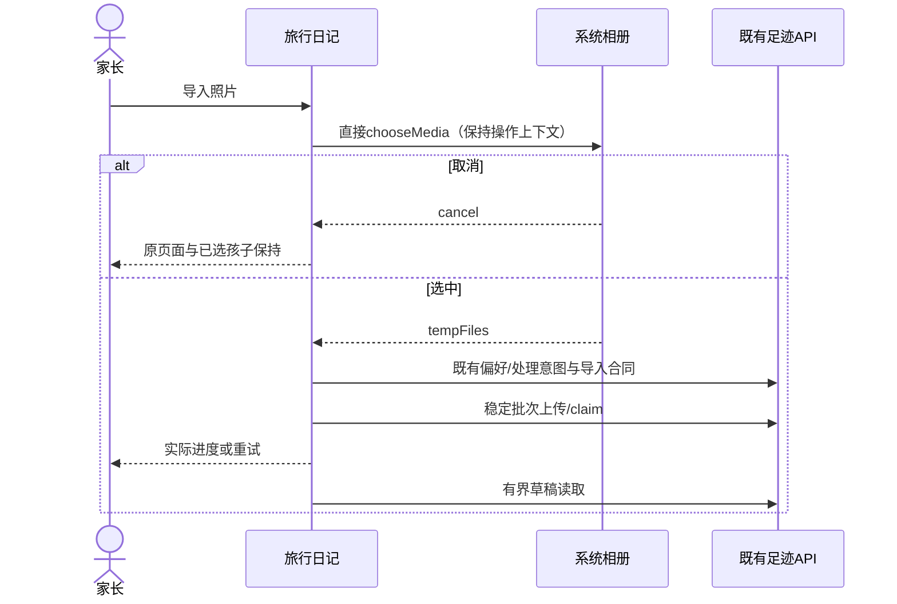
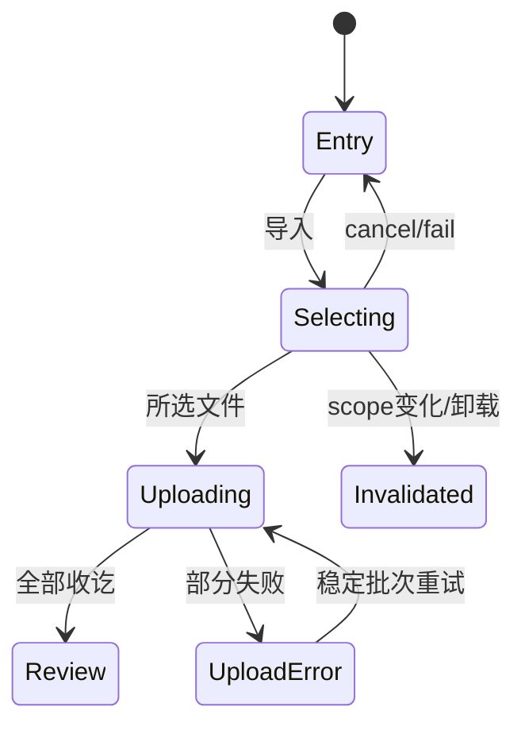
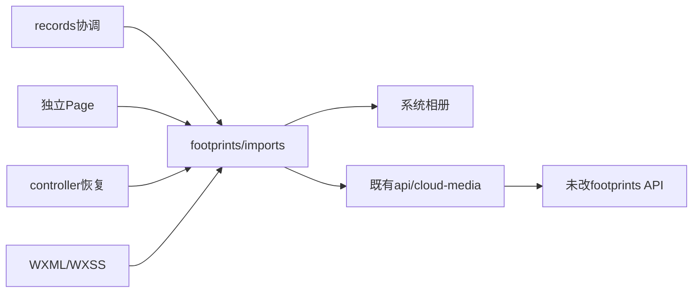

# FEAT-012 — 旅行日记导入精简

当前交付：[2026-11-01上传报告](../../docs/deploy/releases/20261101-client-0.1.17-upload.md)记录0.1.17开发版本成功上传1,191,019字节；用户补齐039照片回看/分页及双家庭/非owner门禁，记PASS_OPERATOR_CONFIRMED。原导入15组/349项与本轮原生局部取消恢复保持，设备/EXIF/完整内容缺项独立。客户端交付已完成，DONE/completed；体验/提审/正式发布NOT_RUN。

- Status: DONE
- Risk: R2（更改照片选择/异步状态及首次导入交互）
- Spec owner: 产品负责人（用户）
- Implementer: Codex
- Reviewer: Codex单独只读复核阶段（同一代理，无第二名reviewer签字）
- Verifier: Codex自动化/原生；用户产品验收
- Created: 2026-10-25
- Last updated: 2026-11-01
- Target release: 0.1.17开发版本已上传；16:15:08成功/1,191,019字节，基准已bump0.1.17。体验、提审、正式发布和Git提交/推送NOT_RUN。
- Spec revision: SPEC-20261025-TRAVEL-IMPORT-SIMPLIFICATION-01
- Architecture revision: ARCH-20261025-TRAVEL-IMPORT-SIMPLIFICATION-01
- User confirmation: APPROVED；产品负责人于2026-10-25回复request_user_input_async/call_b44b8ace4cbe466886ae287d8a6e6051：“批准导入精简 Spec01＋Architecture01＋DREV02，按此实施”
- Additional R2/R3 approval: 同上，具体Spec/Architecture/Design一并获批
- Affected Feature IDs: FEAT-012；UI-001仅内嵌回归
- Feature current-state documents: docs/domain/features/FEAT-012-child-photo-footprints.md
- Feature baseline revision: FEAT-STATE-20261025-PHOTO-FOOTPRINTS-24-E2E-CLOUD-DRAFT
- Feature merge owner: Codex

## Frontend Design Impact and Repository-native Approval

- Frontend impact: yes
- Frontend impact reason: 删除截图整块导入说明/勾选面板，导入按钮直接进入系统相册；AI使用已有设置入口
- Frontend engineering impact: yes
- Frontend engineering impact reason: controller/imports状态、WXML入口与上传状态、旧consent逻辑和测试删除/替换
- Affected UI IDs: UI-018；UI-001内嵌回归
- UI current-state documents: docs/design/frontend/ui/UI-018-child-photo-footprints.md；docs/design/frontend/ui/UI-001-parent-miniapp.md
- Frontend baseline revision: FDB-20260913-04（APPROVED）
- Frontend engineering constraint revision: FEC-20261007-NATIVE-GEOMETRY-02（APPROVED）
- Affected frontend quality dimensions: component/state/form/responsive/a11y/i18n/browser/performance/security/privacy/motion-media-AI/observability
- Frontend quality budgets/requirements: 320×568、390×844、430×932；正文≥14px，触控≥44px，主CTA≥48px/16px；不新增长文说明或中间确认；不引入依赖/存储/日志媒体；列表/接口预算不变
- Frontend quality verification plan: TP01..TP07；设计导出单列，实施后原生节点与实际操作重验，不引用旧证据代验
- Approved frontend engineering deviations: none
- Current Design Revision(s): DREV-20261025-TRAVEL-DIARY-E2E-01及UI-018既有有效区域
- Editable design source path(s): docs/design/frontend/prototypes/DREV-20261025-TRAVEL-IMPORT-02/index.html
- Design source SHA-256: 4761538253e21b85f4ac255b36576cfb3e1620c40589367931350427a641e918
- Proposed Design Revision: DREV-20261025-TRAVEL-IMPORT-02
- Required viewport/state exports: entry/selecting/uploading/upload-error/settings × 三视口，15张
- Prototype status: APPROVED
- Approved Task Spec revision: SPEC-20261025-TRAVEL-IMPORT-SIMPLIFICATION-01
- Approved Design Revision: DREV-20261025-TRAVEL-IMPORT-02
- Design approval evidence: 产品负责人2026-10-25针对call_b44b8ace4cbe466886ae287d8a6e6051的明确批准回复
- Snapshot manifest path: docs/design/frontend/snapshots/UI-018/DREV-20261025-TRAVEL-IMPORT-02/APPROVAL.md
- Permitted implementation deviations: 系统相册自身外观；不得在产品内重加授权说明面板
- UI current-state merge owner: Codex
- UI current-state merge evidence: 已同步Feature/UI-001/018及设计索引；导入区域由DREV02接管，旧DREV01其他区域继续有效
- Frontend visual/a11y/resolution verification: 设计HTML15张/当前原生15组通过，430实际取消/选图/部分失败/重试通过；真机/大字/读屏/家长验收NOT_RUN
- Frontend engineering verification evidence: docs/quality/evidence/travel-import-simplification-20261025/README.md；当前349前端及原生15组，不复用旧347/42代验
- External design dependency: none

## 0. Executive summary

用户指出导入面板整块为无效防御性信息，要求删除。推荐删除整层中间面板：家长点击“导入照片”直接选图；取消回原页面；选中后显示实际上传进度，失败可重试。AI开关继续由已有足迹设置管理，导入不再重复显示。沿用操作型页面、暖纸/松绿与既有按钮，不新增替代说明。

## 1. Facts, decisions, assumptions, questions

修改前基线：截图包含四段说明、处理同意勾选和AI开关；当时beginImport打开consent，choosePhotos先检查photoConsent并写偏好，再打开相册。AI开关已有独立设置，手动记录已有空态入口。上轮全链路修复已实施；本增量现已按用户批准实施，状态见第16节。

本Spec将“这些”解释为截图整块，包含勾选面板和重复AI设置；用户批准本具体revision时已明确确认。删除四段文案：读取照片时间和地点/核对后入档；仅保存浏览版/不备份；7天未确认清理；火山方舟/设置关闭。保留规则在服务端执行，不迁到其他流程复述。真实六六三张草稿不修改、不删除、不确认。

## 2. Current behavior and evidence

当前链路：导入→说明/勾选/可选AI→同意并选择→系统相册→上传→核对。

代码：apps/miniprogram/pages/footprints/{controller,imports}.js与index.wxml。BHV-038/041；FEAT-012/UI-018。用户截图及DREV01的consent态为直接证据。API保留现有preferences/imports的consented字段；不扩展后端、数据或权限。

## 3. Target behavior



| State | Contract |
|---|---|
| entry | 原导入按钮，无说明/勾选层；手动入口保留 |
| selecting | 同一按钮显示正在选择，防重入；正常hide/show可返回 |
| cancel/fail | 取消静默返回；无法打开相册显示短错误及可重试入口 |
| uploading | 只显示进度/真实数量，固定主操作忙态，禁止关闭与重复上传 |
| upload-error | 保留成功部分/批次与文件；重试剩余照片 |
| settings | 已有AI开关与保存；现有用户值不因导入自动开启或关闭 |

## 4. Scope

包含截图整块删除、导入直接选图、进度状态与旧consent UI/state/handler清理；更新相关测试和当前文档。其余缺日期/核对保选/确认/回看、三视图、退出保护沿用BUG-035。

不含重做上传/云配置/服务端同意数据模型、AI默认策略、照片保留期、正式确认、部署发布。手动记录、家庭/孩子/成员隔离、viewer与归档限制、固定7天/24h、缺日期未知、AI不生成正式事实保持。

Feature/UI实施后须替换当前“首次说明/必须勾选/同意并选择”的正文，明确“导入直接相册、AI在设置”，旧批准设计源保持冻结，仅添加Superseded by指针。

### Link/call graph

```text
records / standalone → footprints.beginImport → choosePhotos → wx.chooseMedia
  → 既有preferences/imports/upload-ticket/claim → openDrafts
more actions → 既有settings/saveSettings（AI成员偏好）
```

## 5. Domain and data design



删除consent显示状态；服务端consented字段继续由用户显式选图导入动作在既有POST imports提交，不预勾或添加隐形开关；导入不再调用PATCH preferences。无Schema、回填、媒体删除或历史数据转换。取消选择不创建批次/不保存偏好；AI值从成员偏好读取，导入不覆盖未改变的偏好。

## 6. Interfaces and errors

API/event/job合同不变。仅前端UI与调用时机调整。POST imports保留count/child_id/consented与幂等键；有照片才写。选择失败与取消区分；上传失败复用现有重试；401/403/404继续清理失效scope，409继续原恢复。不得以删除文案为由绕开家庭/孩子鉴权。

## 7. Authorization, security, and privacy

用户明确选图动作表示本次照片导入意图；系统权限弹窗仍由微信提供，不代点授权、不弱化平台校验。AI仍独立成员设置，默认/已有值不变，不因导入启用。无新增外部服务/传输目的、日志、storage；真实儿童图片/原始模型/URL不进入证据仓库。现有速率/尺寸/类型/到期约束不变。

## 8. Architecture and implementation boundaries

Architecture01推荐：在原imports owner更改beginImport/choosePhotos，controller只保存选择/上传生命周期；模板移除consent block，上传使用明确uploading状态；settings沿用原owner。records协调不增加业务逻辑，无新共享抽象、模块、依赖或扩展点，扩展策略closed。DAG仍为records→footprints→api/cloud-media。



| Option | Benefit | Cost/risk | Decision |
|---|---|---|---|
| 删除整层，直接相册；AI在设置 | 去掉截图整块和一次多余确认，操作直接 | 必须重验取消/失败/恢复及AI值不变 | 推荐 |
| 仅删四段说明，保留勾选与重复AI | 代码变动最少 | 仍保留用户指出的阻断面板 | 不选 |
| 把说明塞到设置/新提示 | 少改逻辑 | 转移冗余内容，增加新入口 | 不选 |

ADR N/A：没有持久架构决策或模块变更。Architecture01待随本Spec确认。

## 9. Expected file changes, replacement, and deletion plan

| Path | Action | Necessary change |
|---|---|---|
| apps/miniprogram/pages/footprints/imports.js | modify | 直接选图，取消零写入，选中后既有导入，删除consentChange/photoConsent门禁 |
| apps/miniprogram/pages/footprints/controller.js | modify | 删除photoConsent初始/重置状态，保留上下文/恢复 |
| apps/miniprogram/pages/footprints/index.wxml / index.wxss | modify | 删除截图整块与同意CTA，直接导入忙态，上传进度面板；仅删除无消费者局部样式 |
| tests/frontend/footprints.test.js / record-types.test.js | modify | 替换旧consent假设，验证直入相册/取消/错误/恢复/AI不变 |
| tools/旅行原生夹具 | modify if needed | 用新entry/selecting/uploading状态取证，不保留旧consent假成功 |
| Feature/BHV/Architecture/UI/Frontend Design/Test Strategy/本Spec/索引/交付证据 | modify/add | 已验证事实正文同步及Spec生命周期闭合 |

最终权威仍在原footprints owner，已删除旧consent空壳/handler/state及无消费者样式；旧批准HTML/manifest只作历史设计证据，本范围添加Superseded by，其他区域继续有效。

## 10. Non-functional requirements

布局/字体/触控按FDB/FEC；系统相册负责原生授权与选择。选择中防重、上传中离开保护，取消恢复当前孩子/视图。无新依赖/请求扇出/日志字段；查询预算沿用。AI/地图/照片清晰度验证仍按原Spec范围，不把删文案当作旧未验项通过。

## 11. Acceptance criteria

AC01：点击导入直接系统相册；截图所有内容及勾选面板在该流程消失，不迁移复述。AC02：取消无导入/偏好写入，原页面/孩子不变，失败可再选。AC03：有选图时稳定批次上传，进度/中途失败/重试与hide/show成立。AC04：导入不改变成员AI值，已有设置可显式切换/保存。AC05：手动输入、viewer/归档、scope失效、缺日期与正式确认规则不退化。AC06：三视口关闭/主CTA/触控可达，原生实际选择/取消/上传/错误与设置操作分别取证。

## 12. Verification plan

| Point | Level / command | Expected |
|---|---|---|
| TP01 | 前端动作：直入相册、重复点击、取消/失败、0偏好/批次写 | 原代码必须失败，新实现通过 |
| TP02 | 前端hide/show顺序与真实scope/卸载、成员AI false/true两值 | 恢复继续/失效拒收，AI不改变 |
| TP03 | 既有上传首/中途失败、claim续接、保选/缺日期/409/确认/回看 | 全链路回归通过 |
| TP04 | npm test；npm run lint:miniapp；validate_miniprogram.py；check_architecture.py；git diff --check | 通过，记录实际数量/源字节 |
| TP05 | 设计5态×3视口，SHA/DOM/点击；current-policy设计校验 | 提案导出通过，非原生结果 |
| TP06 | 批准后最终源原生5态×3视口节点/PNG及实际选图/取消/重试/设置 | 逐项通过；设备缺口明确NOT_RUN |
| TP07 | 独立只读review，正文/链接/SHA/发布状态/Spec路径核对 | 无未解决阻断；未验不能DONE |

后端没有改动，不重复全套后端/实库性能；若出现服务端变更先修订Spec。真实照片已在草稿，本次优先合成transport验证，不再次上传或修改三张真实草稿。

## 13. Rollout, migration, rollback

仅本地。旧/新客户端使用相同API，无DDL/数据迁移/清理。回退本UI改动不会删除照片。上传代码包/部署/体验/审核/正式发布不在本次授权，另走发布门禁。

## 14. Implementation plan

确认本Spec/Architecture01/DREV02后，在原owner删除旧入口与状态，完成动作回归、当前源原生矩阵/实际操作、文档同步；最后单独只读复核。不得提前把设计提案写成已实施事实。

## 15. Review plan

单独只读检查直接选择/取消零写、AI偏好、恢复/切scope、旧逻辑残留、文件职责和每项改动必要性。自动化结果不能替代调用链/Spec核对。

## 16. Implementation and verification record

用户明确批准后已本地实现，生产前端4文件、动作测试2文件及隔离取证工具调整。当前前端349/专项58通过，原生15组、430实际相册取消/多选3张/第2张失败/重试进入核对通过；设置两值往返为原生方法级结果。取消/失败返回预览恢复覆盖两种时序，导入不写preferences。Feature/Behavior/Architecture/UI/设计/测试/发布记录及索引已同步；无既有真实草稿操作。真机/可访问性/家长验收未执行，不能DONE。完整命令、SHA及缺口见docs/quality/evidence/travel-import-simplification-20261025/README.md。

2026-10-25提案阶段历史检查：15张设计导出/HTML交互PASS，0浏览器错误/0外部请求；pending设计校验及diff检查通过。随后用户明确批准，最终实施后设计校验不再带allow-pending且通过。旧DREV01设计源SHA仍为`efeeb4319869913ec1294524693a6f6aab6d97ea4e485619efd99f877b2aace2`，仅manifest的Superseded by调整。当前Spec/索引、Feature/Behavior/Architecture/UI/发布事实已同步本地实现，无冲突；设备/产品验收未完成，不能迁DONE。

## 17. Completion gate

- [x] 用户确认具体Spec01＋Architecture01＋DREV02
- [ ] AC01..06与TP01..07按实际通过/缺口记录
- [x] 旧consent生产路径/handler/state/样式无残留
- [x] Feature/Behavior/Architecture/UI/Spec/证据/发布文档核对同步
- [x] 匹配本增量的0.1.17客户端成功上传，按GOV-002开发DONE并迁completed；验收缺项独立保留

Development completion: DONE，2026-11-01归档`specs/completed/FEAT-012-TRAVEL-IMPORT-SIMPLIFICATION.md`；
本增量由精确168份前端0.1.17成功上传交付。实际iPhone/Android、可访问性、EXIF与完整家长验收缺项保持；
本轮照片回看/双账号确认仅补齐适用上传门禁。上方2026-10-25“不能DONE”是历史未交付判断，
不将开发DONE描述为全部验收或正式发布；批准设计源/快照和原证据保持。

TP07单独只读阶段已完成，PASS、无可执行发现，见docs/quality/evidence/travel-import-simplification-20261025/READONLY-REVIEW.md；同一代理分阶段执行，不冒称第二名reviewer签字。代码/当前文档核对无冲突，311个本地链接存在，7份源码SHA与15组原生匹配；设备/产品缺口仍保留。

## 18. Revision history

| Date | Revision | Change | Approval |
|---|---|---|---|
| 2026-10-25 | Spec01 / Architecture01 / DREV02 | 用户截图整块删除，直入相册，AI设置归已有入口 | APPROVED；产品负责人明确批准具体三revision，见User confirmation |
