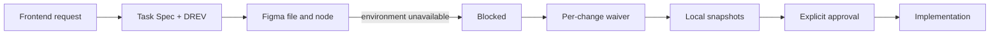
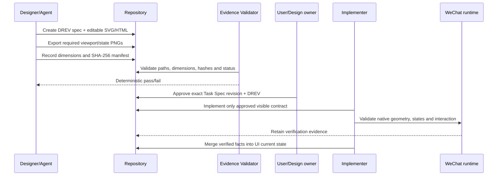
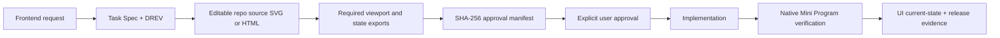
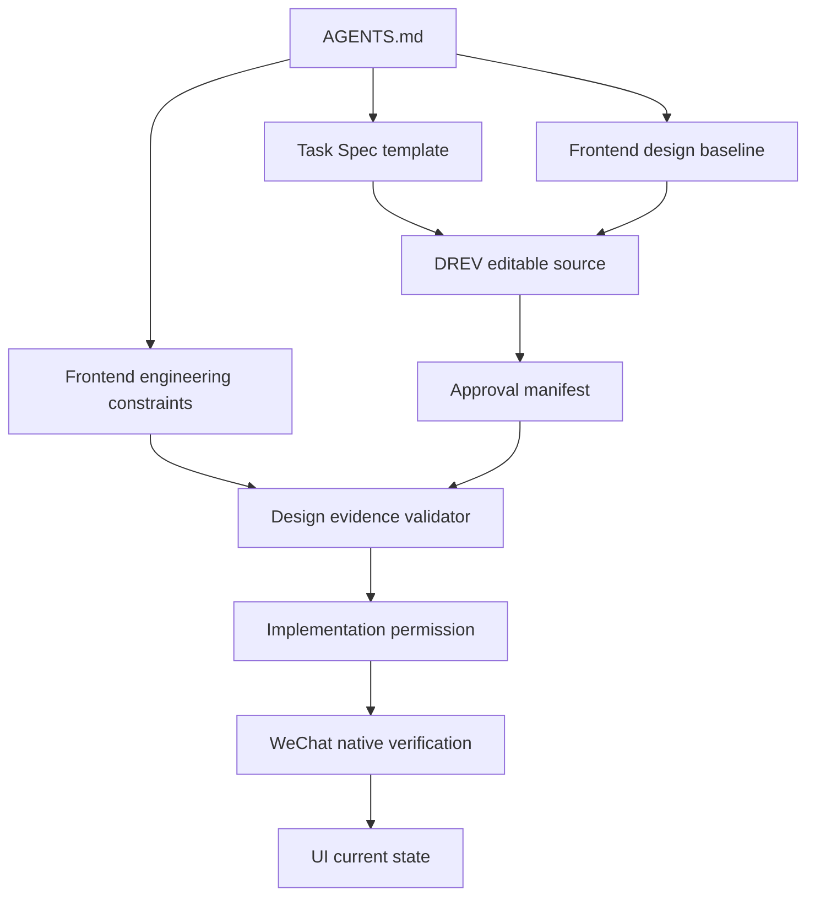
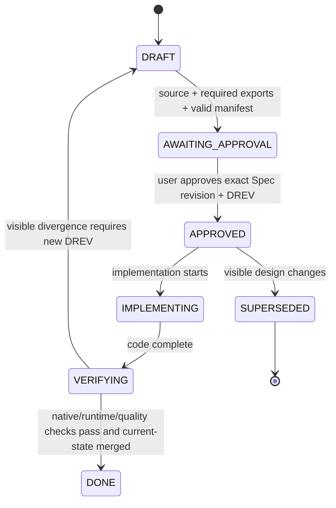
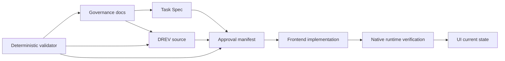
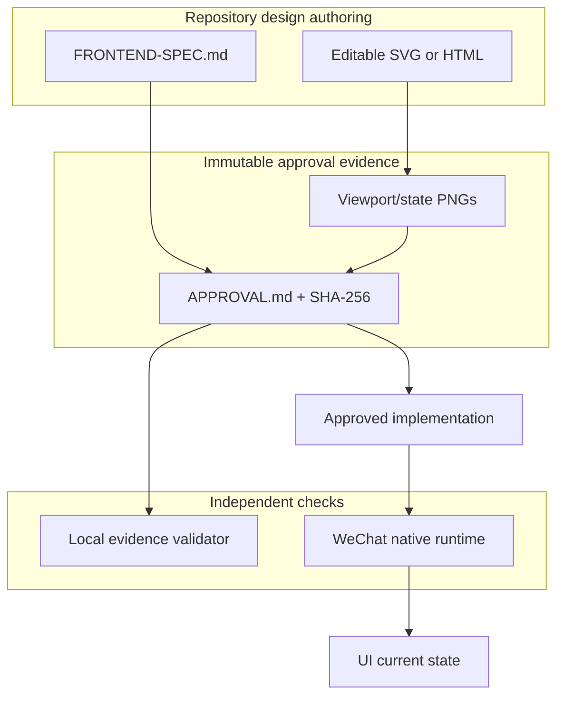

# GOV-001 — 移除 Figma 依赖，采用仓库原生前端设计证据

- Status: `DONE`
- Risk: `R2`
- Spec owner: 产品负责人（用户）
- Implementer: `Codex（批准后）`
- Reviewer: `Codex + 用户`
- Verifier: `Codex + 用户设计验收`
- Created: 2026-09-13
- Last updated: 2026-09-13
- Target release: `在 Mini Program development version 0.1.8 前生效`
- Spec revision: `GOV-SPEC-LOCAL-DESIGN-EVIDENCE-20260913-01`
- Architecture revision: `ARCH-LOCAL-DESIGN-EVIDENCE-20260913-01`
- User confirmation: `APPROVED；产品负责人于 2026-09-13 回复“好的按照这个方案落地”，明确批准 GOV-SPEC-LOCAL-DESIGN-EVIDENCE-20260913-01`
- Additional R2/R3 approval: `APPROVED；同一消息批准 ARCH-LOCAL-DESIGN-EVIDENCE-20260913-01`
- Affected Feature IDs: `FEAT-001 及未来所有有前端影响的 Feature`
- Feature current-state documents: `docs/domain/features/FEAT-001-push-kids-mvp.md（仅在本次 FEAT-001 前端完成后合并真实 UI 状态）`
- Feature baseline revision: `FEAT-STATE-20260913-BOUNDED-REVIEW-BACKEND-01-LOCAL`
- Feature merge owner: `Codex`

## Frontend Design and Engineering Impact

- Frontend impact: `no — 本变更不修改终端用户看到的页面或交互`
- Frontend impact reason: `仅替换设计证据、审批和工程治理方式`
- Frontend engineering impact: `yes — 修改所有前端任务的设计输入、验证工具和门禁`
- Frontend engineering impact reason: `后续实现不再调用 Figma，也不再需要 Figma URL、node ID 或 waiver`
- Affected UI IDs: `治理适用于所有 UI；当前待实现对象为 UI-001`
- UI current-state documents: `docs/design/frontend/ui/*`
- Frontend baseline revision: `FDB-20260913-04；保留 FDB-20260906-03 的视觉/交互/视口内容，仅迁移设计证据方式`
- Frontend engineering constraint revision: `FEC-20260913-LOCAL-DESIGN-EVIDENCE-01；保留 FEC-20260911-READ-PERF-01 的全部质量预算`
- Affected frontend quality dimensions: `design-source/state/responsive/a11y/toolchain/verification/observability`
- Frontend quality budgets/requirements: `原有质量预算不降低；原生小程序三视口 320×568、390×844、430×932 继续必验`
- Frontend quality verification plan: `本地设计证据校验 + 三视口渲染 + 原生微信开发者工具几何/交互验证`
- Approved frontend engineering deviations: `none`
- Current Design Revision(s): `DREV-20260913-UNIFIED-REVIEW-01（待按新门禁审批）`
- Design source paths: `docs/design/frontend/prototypes/<DREV>/`
- Required editable artifact: `SVG 或自包含 HTML；必须能在仓库内直接修改和复现导出`
- Required viewport/state exports: `项目基线定义的全部视口与状态；原生小程序至少三档视口`
- Prototype status: `AWAITING_APPROVAL`
- Approved Task Spec revision: `PENDING`
- Approved Design Revision: `PENDING`
- Design approval evidence: `PENDING`
- Snapshot manifest path: `docs/design/frontend/snapshots/<UI-ID>/<DREV>/APPROVAL.md`
- External design tool requirement: `none`
- Figma URL/node/waiver: `不再要求；历史证据只读保留`

## 0. Executive summary

### Problem

当前仓库把 Figma 文件、node-specific URL 和可用工具环境设为所有可见前端工作的强制门禁。当前不具备
该环境，导致已经可以用仓库内 SVG/PNG 明确表达和审阅的 UI 仍需申请一次性 waiver，也使每次前端变更
依赖不可控的外部额度和连接状态。

### Intended outcome

从当前及未来研发流程中删除 Figma 的使用。设计仍需先于实现并由用户明确批准，但权威输入改为仓库内
版本化的可编辑 SVG/HTML；审批证据为精确视口/状态 PNG、SHA-256 清单、Task Spec revision 与 Design
Revision 的绑定。实现后继续用微信开发者工具验证原生节点几何、交互和三档视口。外部 Figma 文件、URL、
node ID、MCP 调用和 waiver 均不再是门禁。

### Why now

UI-001 的统一 Review 前端正在等待设计批准和发布。先完成治理迁移，才能避免继续为不可用环境做临时
豁免，并让 0.1.8 及后续版本使用同一套可执行、可审计的流程。

## 1. Facts, decisions, assumptions, questions

### Confirmed facts

| ID | Fact | Evidence |
|---|---|---|
| `F-001` | 当前根合同要求用户可见前端必须有 Figma node-specific URL | `AGENTS.md` |
| `F-002` | 架构约束只允许 FEAT-001 的临时 Starter-limit waiver | `docs/architecture/ARCHITECTURE-CONSTRAINTS.md` |
| `F-003` | 前端设计基线、审批模板和 8 个任务模板含 Figma 必填项 | `docs/design/frontend/*`、`specs/_templates/*` |
| `F-004` | UI-001 已有仓库内 DREV 说明、可编辑 SVG、PNG 和审批清单候选 | `docs/design/frontend/prototypes/DREV-20260913-UNIFIED-REVIEW-01/`、`snapshots/UI-001/...` |
| `F-005` | Figma 工具当前因环境/额度不可用 | 2026-09-13 工具调用结果与用户确认 |
| `F-006` | 原生小程序视口验收和 FEC 质量门禁不依赖 Figma | `FRONTEND-ENGINEERING-CONSTRAINTS.md`、`TEST-STRATEGY.md` |

### Decisions

| ID | Decision | Owner/date | Rationale |
|---|---|---|---|
| `D-001` | 从当前研发、验证和发布规则中删除 Figma 工具、URL、node ID 和 waiver 要求 | user / 2026-09-13 | 当前环境不具备 Figma，外部可用性不应阻断项目 |
| `D-002` | 仓库内可编辑 SVG 或自包含 HTML 是 Design Revision 的权威设计源 | proposed / 2026-09-13 | 可版本化、可审阅、可复现，无外部依赖 |
| `D-003` | PNG 只作为不可变审批快照，不替代可编辑设计源 | proposed / 2026-09-13 | 截图不可编辑，单独使用会丢失可维护性 |
| `D-004` | 审批必须精确绑定 Task Spec revision、DREV、视口/状态清单与每个导出文件哈希 | proposed / 2026-09-13 | 防止“看过类似图”被误当成批准当前设计 |
| `D-005` | 保留 FDB、FEC、UI current-state、显式用户批准及原生运行时验收 | proposed / 2026-09-13 | 删除工具依赖不等于删除设计和质量门禁 |
| `D-006` | completed/rejected Spec 和旧快照中的 Figma 引用不重写，仅标记为历史证据 | proposed / 2026-09-13 | 保持审计历史真实，避免伪造当时流程 |
| `D-007` | 当前 active Spec 和所有模板迁移为仓库原生字段；不允许继续新增 Figma 必填项 | proposed / 2026-09-13 | 当前权威入口必须一致，防止旧模板复发 |
| `D-008` | 新增确定性 design-evidence 校验器并进入文档/架构检查 | proposed / 2026-09-13 | 用机器检查文件、尺寸、哈希和状态，减少人工遗漏 |
| `D-009` | 重新引入 Figma 为 `deferred` 扩展点，必须通过新的已批准治理 Spec | proposed / 2026-09-13 | 禁止未来静默恢复外部强依赖 |

### Assumptions

| ID | Assumption | Risk if wrong | Validation | Owner/due |
|---|---|---|---|---|
| `A-001` | “删除 Figma 的使用”指删除本项目流程依赖，不是卸载 Codex 全局插件 | 若理解错误，全局工具仍存在 | 本 Spec 明确范围；用户批准 | user / approval |
| `A-002` | SVG/HTML 足以承载当前原生小程序页面的布局、状态和交互说明 | 复杂动效可能表达不足 | DREV 评审；必要时补状态序列，不恢复外部依赖 | design owner / per DREV |

### Open questions

无。批准本 revision 即确认 `A-001` 的范围。

## 2. Current behavior and evidence

### Current flow

### Current evidence

- `AGENTS.md` 把 Figma node-specific URL 设为强制前端 gate。
- `docs/design/frontend/README.md` 把 Figma 定义为唯一可编辑设计源。
- `docs/design/frontend/snapshots/APPROVAL-TEMPLATE.md` 要求 Figma file key/node URL。
- `specs/active/FEAT-001-UNIFIED-ITEM-REVIEW-STRATEGY.md` 当前因 Figma waiver 待审批而没有实现前端。
- 历史 completed/rejected 文档记录旧流程，不是未来任务的权威模板。

## 3. Target behavior

### Primary sequence diagram

### Target flow

### Behavior matrix

| Case | Preconditions/action | Expected result | Forbidden result |
|---|---|---|---|
| valid visible change | DREV contains editable source, required exports, matching hashes and approval | implementation may start after exact approval | Figma call or URL requirement |
| missing editable source | only PNG exists | validator fails; implementation remains blocked | treating screenshot as maintainable source |
| missing viewport/state | baseline-required export absent | validator reports exact missing evidence | silent pass |
| hash mismatch | export changed after manifest | validator fails; create/update DREV and re-approve | mutate approved evidence silently |
| non-visible refactor | Spec records frontend impact `no` with reason | no DREV required; relevant FEC checks still run | inventing a visual approval gate |
| historical record | completed/rejected record contains Figma URL | retain as immutable historical evidence | bulk rewrite or deletion of audit history |
| reintroduce Figma | future request wants Figma integration | new governance Spec and explicit approval required | silently making it mandatory again |

## 4. Scope

### In scope

- 删除所有当前权威规则、active Spec 和模板中的 Figma 工具/链接/node/waiver 必填依赖。
- 定义仓库原生 DREV、可编辑设计源、导出清单、哈希和用户审批合同。
- 添加确定性校验器与测试，并接入项目检查命令。
- 将 UI-001 当前 DREV 迁移到新合同，批准后继续 FEAT-001 前端实现与 0.1.8 上传。

### Out of scope / non-goals

- 不卸载或修改用户机器上的 Codex/Figma 插件。
- 不删除历史 completed/rejected Spec、历史审批记录或旧 Figma 链接。
- 不降低视觉、交互、响应式、无障碍、安全、隐私、性能或原生运行时验收标准。
- 本治理 Spec 不直接改变小程序页面，也不授权发布生产版。

### Invariants / must not change

- 用户可见变化仍须在编码前得到 Task Spec revision + Design Revision 的明确批准。
- AI 输出、儿童数据隔离、家长确认和发布人工 gate 不受影响。
- 三档原生视口和 FEC 受影响质量维度仍必须验证。
- 已批准 manifest 不可原地篡改；可见变化必须创建新的 DREV。

### Affected areas

| Area | Current dependency | Change | Compatibility action |
|---|---|---|---|
| root governance | Figma node + waiver | local design evidence gate | 同次替换所有权威文字 |
| architecture constraints | FEAT-001 Figma waiver | no external design dependency | 保留历史说明 |
| frontend governance | Figma editable source | repo SVG/HTML editable source | 迁移字段与流程 |
| Spec templates | Figma URL/node/waiver fields | source/export/hash fields | 更新全部 8 个模板 |
| active Specs | per-change Figma pending state | repository-native pending/approved state | 逐份语义迁移 |
| historical Specs | historical Figma evidence | unchanged | 搜索校验只排除历史路径 |

### Link/call graph

## 5. Domain and data design

### Terms

| Term | Meaning | Do not confuse with |
|---|---|---|
| Design Revision / DREV | 一次可批准的可见设计版本 | Task Spec revision |
| editable design source | 仓库内可直接修改的 SVG 或自包含 HTML | PNG 审批截图 |
| approval snapshot | 某 DREV 的不可变导出与哈希清单 | 运行时验收截图 |
| historical Figma evidence | 旧流程当时真实使用的链接/字段 | 当前有效依赖 |

### State machine

### Schema/data changes

`N/A`：不修改生产数据库、API 或用户数据。设计证据全部是版本控制文件。

## 6. Interfaces and errors

### Design evidence contract

| Contract | Required input | Output | Errors | Compatibility |
|---|---|---|---|---|
| `DREV source` | `FRONTEND-SPEC.md` + `*.svg` or self-contained `*.html` | editable design definition | missing/unsupported source | new DREVs only |
| `approval manifest` | UI ID, DREV, Spec rev, viewports/states, files, dimensions, SHA-256 | immutable approval identity | missing file/hash mismatch/dimension mismatch | old manifests remain readable |
| `validator` | active authoritative docs + DREV path | deterministic pass/fail report | non-zero with path-specific errors | ignores completed/rejected historical records for current-policy scan |

- 路径必须位于 `docs/design/frontend/prototypes/<DREV>/` 和
  `docs/design/frontend/snapshots/<UI-ID>/<DREV>/`。
- manifest 中 absent、空字符串和 `PENDING` 均不能充当已批准值。
- PNG 必须记录像素尺寸；SHA-256 使用小写 64 位十六进制。
- 验证器只读，不修改设计源或清单。

## 7. Authorization, security, and privacy

- 批准者：用户/产品设计负责人；Agent 不得自我批准。
- 设计源和快照不得包含真实儿童姓名、图片、学习正文、token 或平台密钥。
- 校验日志只输出文件路径、尺寸、哈希和结构化错误，不输出敏感素材。
- 外部 URL 不再是设计流程输入，降低第三方访问与持久性风险。

| Threat/failure | Impact | Mitigation | Evidence |
|---|---|---|---|
| 修改已批准 PNG 而不重审 | 实现与批准内容漂移 | SHA-256 校验失败 | unit/fixture test |
| 只有截图没有源文件 | 设计不可维护 | editable source 必填 | validator test |
| 假审批或模糊审批 | 未经授权编码 | 精确绑定 Spec rev + DREV + approver/date | manifest test |
| 快照含儿童数据 | 隐私泄露 | 仅合成内容；review checklist | fixture + manual review |
| 历史 Figma 文本触发假失败 | 无法迁移 | current-policy 与 historical 路径分开扫描 | compatibility test |

## 8. Architecture and implementation boundaries

### Chosen approach

采用“仓库原生设计证据”架构：Markdown 说明交互和状态，SVG/自包含 HTML 作为可编辑权威源，PNG
作为审批时的像素快照，manifest 绑定身份与哈希，Python 校验器执行确定性结构/完整性检查；微信开发者工具
继续负责最终原生行为和几何证明。该门禁不访问网络，不调用生成式模型或外部设计服务。

### Modules and dependency direction

| Module | Responsibility | Public contract | Must not own/do |
|---|---|---|---|
| `docs/design/frontend` | 设计基线、DREV、UI 当前态 | Markdown/SVG/HTML/PNG manifest | 生产运行逻辑 |
| `specs/_templates` | 所有变更的审批字段 | local evidence fields | 外部工具强依赖 |
| `tools/validate_design_evidence.py` | 只读校验结构、尺寸、哈希和当前政策 | CLI exit code + errors | 修改文件、批准设计、联网 |
| Mini Program tests/tools | 验证实现行为和原生几何 | retained reports/screenshots | 反向决定设计批准 |

### Dependency DAG

- 校验器不被生产应用导入；生产代码也不读取设计文件。
- 禁止 `docs -> production code` 或 `validator -> provider/network` 边。
- 架构检查确保生产模块 DAG 不因本变更发生变化。

### Shared abstractions

| Concept | Owner | Consumers | Decision | Contract tests |
|---|---|---|---|---|
| design evidence manifest | frontend governance | Specs, validator, reviewers | 只抽取稳定身份/文件/哈希字段，不做通用 artifact 框架 | valid/missing/tampered/legacy fixtures |

### Architecture diagram

### Trade-offs and alternatives rejected

| Alternative | Benefit | Why rejected | Revisit condition |
|---|---|---|---|
| 保留 Figma 强制门禁 | 成熟协作界面 | 当前环境不可用且引入外部阻塞 | 不自动 revisit；需新治理 Spec |
| 每次申请 Figma waiver | 改动最少 | 重复摩擦，规则长期自相矛盾 | rejected |
| 删除所有设计审批 | 最快 | 可见行为失去基线、责任和回归证据 | rejected |
| 只保存 PNG | 简单 | 不可编辑、不可维护、难以复现 | rejected |
| repo source + exports + hashes | 无外部依赖、可版本化、可审计 | 仓库体积略增，需维护导出工具 | chosen |

### Extensibility policy

| Variation axis | Status | Mechanism | Requirements | Revisit condition |
|---|---|---|---|---|
| editable formats | `open` | allowlist: SVG, self-contained HTML | offline, deterministic render, no secret/external asset, validator fixture | 新格式有真实需求 |
| external design tools/Figma | `deferred` | none in active workflow | 新 Spec、兼容/安全/离线降级/测试、明确非强制策略 | 用户主动要求恢复 |
| viewport matrix | `open` by FDB revision | named exact dimensions | explicit approval and regression evidence | supported devices change |
| approval identity | `closed` | Spec rev + DREV + manifest hashes | cannot weaken or omit | only via new R2 governance approval |

### Architecture confirmation

- Recommended technical design: `仓库原生 SVG/HTML + PNG + SHA-256 manifest + deterministic validator`
- Alternatives and trade-offs: `见上表`
- Long-term maintainability rationale: `权威源、批准证据和运行时验证职责分离，且全部可离线审计`
- Architecture revision: `ARCH-LOCAL-DESIGN-EVIDENCE-20260913-01`
- User/architecture-owner confirmation: `APPROVED；产品负责人 / 2026-09-13 / “好的按照这个方案落地”`

### ADR required?

- Yes: `docs/architecture/decisions/ADR-20260913-REPOSITORY-NATIVE-DESIGN-EVIDENCE.md`
- Reason: `替换仓库级外部设计依赖和所有未来前端工作的审批边界`

## 9. Expected file changes, replacement, and deletion plan

| File/path | Action | Expected change | Replacement/authority |
|---|---|---|---|
| `AGENTS.md` | modify | 删除 Figma gate/waiver；写入 local evidence gate | root project contract |
| `docs/architecture/ARCHITECTURE-CONSTRAINTS.md` | modify | 删除当前 Figma 例外，新增 repo-native 约束 | enforced architecture |
| `docs/architecture/ARCHITECTURE.md` | modify | 新规则作为当前架构；旧 Figma 只标历史 | architecture current state |
| `docs/architecture/decisions/ADR-20260913-REPOSITORY-NATIVE-DESIGN-EVIDENCE.md` | add | 记录选择、替代方案与回退边界 | architecture decision |
| `docs/design/frontend/README.md` | modify | 重写 authoring/approval workflow | frontend governance index |
| `docs/design/frontend/FRONTEND-DESIGN.md` | modify | 保留设计基线，删除 Figma 作为当前 source | design baseline |
| `docs/design/frontend/FRONTEND-ENGINEERING-CONSTRAINTS.md` | modify | 删除 waiver，加入 evidence validator | frontend engineering policy |
| `docs/design/frontend/UI-CURRENT-STATE-TEMPLATE.md` | modify | URL/node 字段替换为 source/manifest/hash | UI state template |
| `docs/design/frontend/snapshots/APPROVAL-TEMPLATE.md` | modify | 新 local evidence schema | approval template |
| `specs/_templates/*.md` | modify | 8 个当前模板统一移除 Figma 字段 | future task authority |
| `specs/active/*.md` | modify | 只迁移当前仍有效的 Figma gate/waiver | active intent |
| `specs/completed/**`, `specs/rejected/**` | retain | 不改旧事实 | immutable history |
| `tools/validate_design_evidence.py` | add | 确定性校验器 | automated gate |
| `tests/unit/test_validate_design_evidence.py` | add | valid/failure/legacy cases | regression evidence |
| `docs/design/frontend/prototypes/DREV-20260913-UNIFIED-REVIEW-01/*` | modify if needed | 满足新 source contract | current UI-001 design source |
| `docs/design/frontend/snapshots/UI-001/DREV-20260913-UNIFIED-REVIEW-01/APPROVAL.md` | modify before approval | 移除 Figma waiver，补完整清单 | current approval evidence |

### Temporary coexistence

- Authoritative path: 当前规则只在根合同、current architecture/design docs、active Specs 和模板中生效。
- Legacy consumers: completed/rejected Specs 与已批准旧快照保持原样，只作为历史证据。
- Removal condition: 当前权威路径搜索不再出现 Figma 必填/waiver；仅允许“历史记录”“deferred”说明。
- Guard: validator unit test + current-authority policy scan。

## 10. Non-functional requirements

| ID | Requirement | Target | Measurement | Failure response |
|---|---|---|---|---|
| `NFR-001` | offline/deterministic | validator 零网络、同输入同结果 | tests + code review | block merge |
| `NFR-002` | performance | 100 个证据文件冷启动校验 < 2s（本机） | timed test | optimize bounded scan |
| `NFR-003` | integrity | 任何导出字节变化必须导致 hash failure | unit test | block implementation/release |
| `NFR-004` | privacy | design artifacts 无真实儿童内容或 secret | review + secret/privacy scan | remove artifact, rotate if needed |
| `NFR-005` | compatibility | 历史 Figma evidence 保留且不阻断当前校验 | fixture/search test | fix scope rules |

## 11. Acceptance criteria

### AC-001 — 当前流程不再依赖 Figma

- Given: 本 Spec 已批准并实现。
- When: 新建一个用户可见前端 Task Spec/DREV。
- Then: 当前权威文档和模板不要求 Figma 调用、file URL、node URL 或 waiver。
- And: 仓库本地可编辑源、导出、哈希与精确批准是完整门禁。
- And not: 不因 Figma 不可用阻塞实现。
- Evidence: current-authority search + template tests。

### AC-002 — 设计质量门禁没有被删除

- Given: 一个 UI 变更缺少可编辑源、必需视口、匹配哈希或明确批准。
- When: 运行校验。
- Then: 校验失败并报告具体路径/字段。
- State must remain: Task/DREV 不得进入 `APPROVED/IMPLEMENTING`。
- Evidence: validator failure tests。

### AC-003 — 历史证据保持真实

- Given: completed/rejected Spec 中存在旧 Figma 链接。
- When: 迁移和校验完成。
- Then: 历史文件未被批量重写，当前工作也不受其阻断。
- Evidence: git diff path audit + legacy fixture test。

### AC-004 — UI-001 可沿新门禁继续

- Given: `DREV-20260913-UNIFIED-REVIEW-01` 有本地源、三档状态导出和有效 manifest。
- When: 用户批准对应 FEAT Spec revision + DREV。
- Then: 可以实现前端、执行原生小程序验收并上传 0.1.8。
- And not: 不再申请 Figma waiver。
- Evidence: manifest validator + frontend tests + release record。

## 12. Verification plan

| Test point | Acceptance/risk | Level | Case/command | Expected evidence |
|---|---|---|---|---|
| `TP-001` | AC-001 | static/contract | scan active authority/templates for prohibited mandatory Figma fields | zero prohibited matches |
| `TP-002` | AC-002 | unit | valid local DREV fixture | exit 0 |
| `TP-003` | AC-002 | unit | missing editable source | exact non-zero error |
| `TP-004` | AC-002 | unit | missing required viewport/state | exact non-zero error |
| `TP-005` | AC-002 | unit | modified PNG/hash mismatch | exact non-zero error |
| `TP-006` | AC-002 | unit | `PENDING` approval used as approved | exact non-zero error |
| `TP-007` | AC-003 | compatibility | historical Figma fixture/path | retained and ignored by current gate |
| `TP-008` | AC-004 | integration/manual | UI-001 manifest then native three-viewport verification | retained report/screenshots |
| `TP-009` | regression | project | `uv run python tools/check_architecture.py` | pass |
| `TP-010` | regression | project | `uv run python tools/validate_miniprogram.py && npm test` | pass |
| `TP-011` | hygiene | static | `git diff --check` | pass |

- Pre-change failure: `TP-001` 当前会发现根合同、模板和 active Spec 的强制 Figma 字段。
- Old behavior proof: FDB/FEC、DREV explicit approval 和原生三视口检查仍存在。
- Forbidden side effect proof: 历史路径 diff audit；校验器只读测试。
- Real wiring: `TP-008` 使用真实 UI-001 artifacts 和微信开发者工具，不只使用 mock。
- Manual-only: 用户对视觉/交互语义的批准与真机体验不能自动化；记录精确消息和截图。

## 13. Rollout, migration, rollback

### Rollout

1. 批准本治理 Spec/architecture revision。
2. 同一变更集更新根合同、架构、前端治理、模板和 active Specs，避免双重权威。
3. 添加并运行 local evidence validator/tests。
4. 用新模板迁移 UI-001 DREV/manifest，并请求用户批准 FEAT Spec revision + DREV。
5. 实现并验证 FEAT-001 前端，再执行 0.1.8 发布流程。

### Compatibility window

- 不设 active 双轨期；当前权威入口一次切换。
- 历史文件永久可读，但不能复制为新任务模板。
- 无生产 API、数据库或客户端版本兼容问题。

### Rollback / restore

- 可回滚治理文档、模板和校验器，不涉及数据恢复。
- 回滚不自动恢复 Figma 使用；若确需恢复，必须先获得用户对新治理 revision 的批准。
- 已批准的 local DREV/manifest 仍可作为历史证据保留。

## 14. Implementation plan

### Step 1 — 切换当前权威治理

- Modify: `AGENTS.md`、architecture/design current docs、全部 Spec/UI/approval 模板。
- Delete/replace: 删除当前强制 Figma 字段与 waiver 路径；用 local evidence contract 替代。
- Tests: `TP-001`、`TP-007`、`TP-011`。
- Stop condition: 任一当前权威入口同时声称 Figma 必填和 local evidence 足够。

### Step 2 — 建立确定性证据校验

- Add: validator 与 unit fixtures/tests。
- Tests: `TP-002`..`TP-006`、`TP-009`。
- Stop condition: 校验器联网、修改文件或接受 hash/dimension/PENDING 缺失值。

### Step 3 — 迁移当前 active work

- Modify: active Specs、UI-001 DREV/manifest。
- Retain: completed/rejected 历史文件。
- Tests: `TP-001`、`TP-003`..`TP-008`。
- Stop condition: 历史证据被重写或 UI-001 设计仍需要外部工具。

### Step 4 — 继续 FEAT-001 前端与发布

- Approval gate: 用户另行批准精确 FEAT Spec revision + DREV。
- Implement/verify: 前端状态、原生三视口、a11y/交互、回归测试。
- Release: 按 `docs/deploy/README.md` 上传开发版 0.1.8；不扩大生产发布权限。

## 15. Review plan

- Required reviewers: 用户（范围/设计审批规则）、Codex（架构/测试）。
- Domain question: 删除的是 Figma 工具依赖，不是设计先行与显式审批。
- Security/data question: local artifacts 是否全部为合成数据且不含 secret。
- Compatibility question: 历史记录是否原样保留，active authority 是否单一。
- Test validity: validator failure fixtures 必须真实篡改文件/字段，不只 mock 返回值。

## 16. Implementation and verification record

### Changed behavior

- 当前及未来前端工作使用仓库原生 editable SVG/self-contained HTML、精确视口 PNG、SHA-256
  manifest 与 Task Spec revision + DREV 明确批准；不再调用或依赖 Figma。
- UI-001 当前 DREV 已迁移为两份 editable SVG 和六张 320/390/430 候选图，状态仍为
  `AWAITING_APPROVAL`，没有被治理迁移自动批准。

### Deleted/replaced behavior

- 已从根合同、current architecture/design docs、全部当前模板、active Specs 和 UI current-state
  中删除 Figma URL、node ID、tool availability 与 waiver 作为当前门禁的行为。
- completed/rejected Specs 和旧 approved snapshots 原样保留为历史证据。

### Files changed

- `AGENTS.md`、`docs/architecture/*`：根合同、ARC-016 与 ADR。
- `docs/design/frontend/*`：FDB/FEC、工作流、UI/approval 模板和当前 UI 元数据。
- `specs/_templates/*`、`specs/active/*`：当前任务入口迁移到 repository-native 字段。
- `tools/validate_design_evidence.py`、`tests/unit/test_validate_design_evidence.py`：离线校验与 9 个回归测试。
- `docs/design/frontend/prototypes/DREV-20260913-UNIFIED-REVIEW-01/*` 与对应 snapshots：
  UI-001 editable sources、三视口候选图和 hash manifest。

### Evidence

| Command/case | Environment | Result | Evidence | Notes |
|---|---|---|---|---|
| repository policy audit | local / 2026-09-13 | pass | 本 Spec `F-001..F-006` | 仅只读审计 |
| `uv run pytest tests/unit/test_validate_design_evidence.py -q` | local / Python 3.12 | pass | `9 passed` | 含 missing source/viewport、tamper、pending、path isolation、history compatibility |
| `uv run ruff check ...` + `uv run ruff format --check ...` | local | pass | `All checks passed` | 仅本次新增 Python 文件 |
| `uv run python tools/validate_design_evidence.py --check-current-policy --manifest ... --allow-pending` | local | pass | `DESIGN_EVIDENCE_VALID` | UI-001 候选只校验完整性，不冒充批准 |
| `uv run python tools/check_architecture.py` | local | pass | `ARCHITECTURE_VALID checked=3` | production module DAG/forbidden imports unchanged |
| `uv run python tools/validate_miniprogram.py` | local | pass | `MINIPROGRAM_VALID pages=15 source_bytes=656671` | production frontend unchanged |
| `npm test` | local / Node | pass | `161 passed, 0 failed` | frontend regression |
| `git diff --check` | local | pass | no output | whitespace integrity |
| native UI-001 geometry/iOS/Android | WeChat runtime | not run | pending FEAT-001 implementation | governance does not authorize/implement visible UI |

### Deviations from approved Spec

- None。澄清：UI-001 的 DREV 批准与原生验收是 FEAT-001 的独立实施门禁，不阻塞本治理迁移归档；
  这与本 Spec 的 non-goal“治理 Spec 不直接改变小程序页面”一致。

### Review

- Initial gate: `BLOCK`；发现 export 可通过 `../` 引用仓库内其他 DREV 图片，违反证据目录隔离。
- Remediation: 强制 export resolve 后仍位于 manifest 目录，并增加真实 traversal fixture；同时把
  `ARCHITECTURE.md` 纳入 current-policy scan。
- Re-review: `PASS`；9 个校验器测试、真实 UI-001 manifest 和 current-policy scan 均通过。

## 17. Completion gate

- [x] 用户明确批准 `GOV-SPEC-LOCAL-DESIGN-EVIDENCE-20260913-01`。
- [x] 架构 revision 同时批准。
- [x] 无 blocking question。
- [x] link graph、sequence、state machine、architecture diagram 和 trade-offs 完整。
- [x] 修改/替换/保留范围已列出。
- [x] 所有当前权威入口完成迁移且只有一个有效规则。
- [x] validator 和全部 governance required test points 完成；native UI-001 检查作为 FEAT-001 后续门禁记录为 not run。
- [x] completed/rejected 历史证据未被改写。
- [x] UI-001 已迁移到新证据合同；其单独设计批准与原生验收保持 pending，不被本治理 Spec 冒充完成。
- [x] 治理事实已合并回 architecture、frontend baseline/FEC、UI current-state 和 test strategy。

Final status: `DONE`

## 18. Revision history

| Date | Change | Reason | Approved by |
|---|---|---|---|
| 2026-09-13 | 建立仓库原生设计证据替代 Figma 的治理方案 | 用户明确要求当前环境不再使用 Figma | 产品负责人批准落地 |
| 2026-09-13 | 完成根合同、架构、前端治理、模板、active work 和 UI-001 候选证据迁移 | 9 个校验器测试、current-policy、架构、小程序与 161 个前端测试通过 | 按已批准 revision 实施 |
