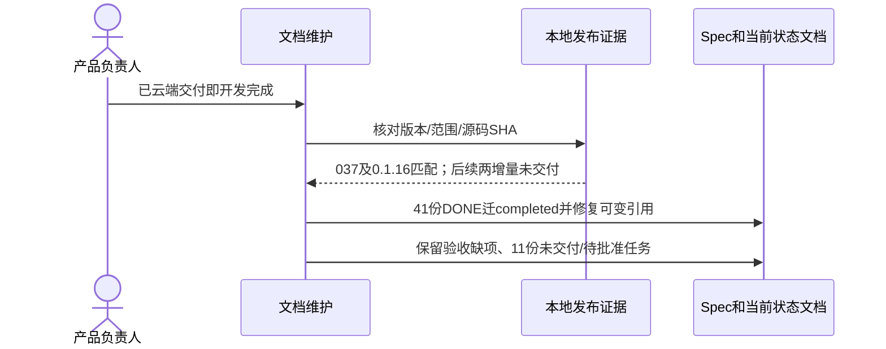

# GOV-002 — 云端交付作为需求开发完成依据（Spec Lite）

- Status: DONE
- Risk: R1；仅生命周期和文档，不修改产品代码、测试语义、数据或云端。
- Owner / Implementer / Reviewer: 产品负责人（用户） / Codex / Codex文档复核
- Date: 2026-10-26
- Spec revision: GOV-SPEC-20261026-CLOUD-DELIVERY-DONE-01
- Approved scope: 已有匹配范围的云端交付即认定开发完成，归档对应Spec，验收和发布阶段独立记录。
- Approved by / Approval date: 产品负责人（用户） / 2026-10-26
- User confirmation / message reference: 本对话用户明确要求“如果已经发布到云端就认为需求已经开发完成，你来更新”。这是本次具体规则的直接批准，无需重复确认；没有新增生产实施授权。
- Affected Feature IDs: FEAT-001/002/003/004/005/006/007/010/011/012/013及FEAT-009已交付实现；只更新开发状态和引用，产品合同不变。
- Feature baseline: 当前工作区各Feature/UI文档及发布证据，Git HEAD 0576ac304649加原有dirty增量。
- Frontend design / engineering impact: N/A；无界面、源码、设计源、质量阈值或测试矩阵变更。既有FDB/FEC、批准快照和发布门禁继续有效。

## 1. 问题与结果

此前把全部验收完成作为DONE门槛，导致已云端交付的实现长期保留active。用户确认DONE按需求开发完成管理：已交付范围可归档，未验收事实独立保留。本规则取代“缺真机/真实内容/独立评审即阻止已交付Spec归档”的开发生命周期判断，不把这些检查改成通过。

## 2. 范围与完成规则

- 后端正常部署、小程序开发版本成功上传均可作为相应端的云端交付；涉及两端时分别核对范围及源码。保留灰度/全量、开发上传/体验/审核/正式发布的实际阶段。
- 只构建、preview、dry-run、本地实现或部署失败不满足；旧冻结包不包含的后续增量继续active。
- 以发布记录、冻结源码/manifest及版本对应关系为据，已交付的41份Spec改为DONE并迁completed；FEAT-009此前IMPLEMENTING也按实际已交付代码归档，缺失设计批准不因此得到追认。
- BUG-035与旅行导入精简均在037/0.1.16之后本地新增，保留active/VERIFYING；9份草案/待批准候选没有对应完整交付证据，不关闭。
- 原Spec revision、批准范围和测试结果保留，新增的是本治理revision及开发完成结论。原生命周期过程判断明确转为历史记录；待验清单进入[状态索引](../STATUS.md)。
- 非目标：新部署/上传、开关启用、补造验收、公开发布、追认设计/实施批准、修改测试或删除代码。未来发布仍执行原必需检查和人工门禁。

## 3. 必需设计视图

Link/call graph：用户规则 → 发布记录/源码manifest → 对应Spec开发DONE → completed/与可变引用 → 独立验收清单。

State machine：`VERIFYING/IMPLEMENTING + 已交付对应范围 → DONE/completed`；`未交付或候选 → 保持原active状态`。验收状态独立，NOT_RUN/PARTIAL/FAIL不随开发DONE变化。

Architecture diagram：N/A；无模块边界、依赖方向、共享抽象、扩展点或运行拓扑变更。

| 方案 | 收益 | 代价/取舍 | 决定 |
|---|---|---|---|
| 云端交付定义开发DONE，验收独立记载 | 符合用户管理口径，可辨开发与验收 | 需保留范围/源码证据与待验清单 | 用户明确批准 |
| 继续等待全部验收才DONE | 单一完成门槛 | 已发布开发任务长期留active | 被本规则替代 |
| 所有已写代码一律DONE | 操作少 | 会误关未交付/未批准任务 | 不采用 |

## 4. 文件变更与清理

| 文件范围 | 动作 | 必要性 |
|---|---|---|
| 41份active Spec | move/modify | 新增开发完成和交付依据，将旧执行/验收记录明确为历史 |
| 本治理Spec、AGENTS、Spec README/STATUS、开发协议、发布/测试说明 | add/modify | 持久化用户批准的定义与状态索引 |
| Feature/UI/Architecture/Behavior/设计索引及可变文档引用 | modify | 修复归档路径、纠正“因待验保留active”的当前正文 |
| 代码、测试、工具、冻结设计源/批准快照 | retain | 本次不修改，保留原有工作区增量 |

旧路径：41个旧active文件删除，不保留重定向Spec。冻结设计/manifest与历史哈希库存的原路径不改写，由状态索引提供当前归档入口。

## 5. 验收与必需检查

| ID | 本次文档维护验收 | 验证方式 |
|---|---|---|
| TP-001 | 云端范围与源码匹配，后续两本地增量不误归档 | 168份客户端及152份后端源码/依赖与发布manifest逐项SHA核验 |
| TP-002 | 41份迁移、治理Spec完成，目录/索引/状态一致 | 三目录计数、所有Spec索引覆盖及本地链接核验 |
| TP-003 | 产品代码、测试、工具及冻结设计未改 | 与本任务开始时2496份文件SHA基线对比 |
| TP-004 | 当前正文与新生命周期一致，历史验收无追认 | 文档diff/引用复核，架构与设计政策检查、git diff --check |

## 6. 验证与完成

TP-001..004均PASS：0576ac304649的168份客户端文件及152份后端源码/依赖匹配已交付清单；41份DONE迁移、126份索引和102/11/13目录状态一致；可变文档1680处Markdown链接无缺失文件；2496份保护文件SHA未变。41份原需求与验收正文完整保留，仅调整标题层级、历史生命周期标签和归档引用。已核对当前开发/发布正文；架构检查为ARCHITECTURE_VALID（4 policies/150 modules），设计政策检查为DESIGN_EVIDENCE_VALID，git diff --check通过。完整记录见[状态清单](../STATUS.md)。后端/前端产品测试、原生/真机、实库、Ark和云端查询/写入NOT_RUN：本轮无产品代码或发布操作，既有结果只引用原证据。

Status为DONE，最终位于specs/completed/；本次用户批准的生命周期规则已经应用。尚未执行的产品验收保留在41份归档Spec及状态清单中，未改为PASS。无需为相同完成口径再次请求批准；如后续改变产品或验收范围，按对应Spec revision另行管理。
