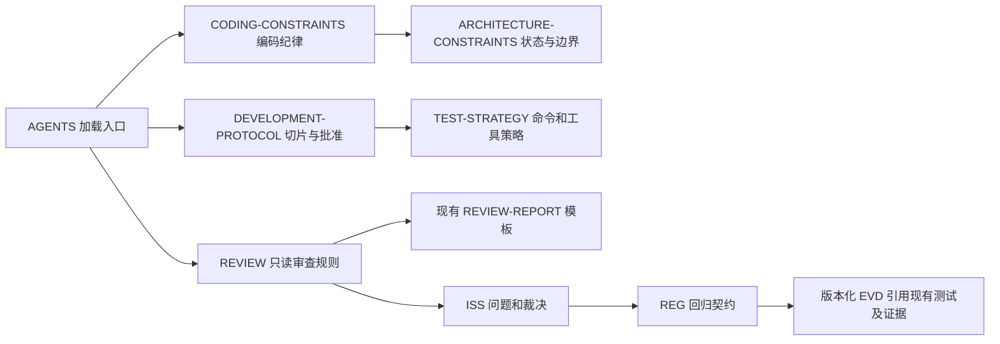
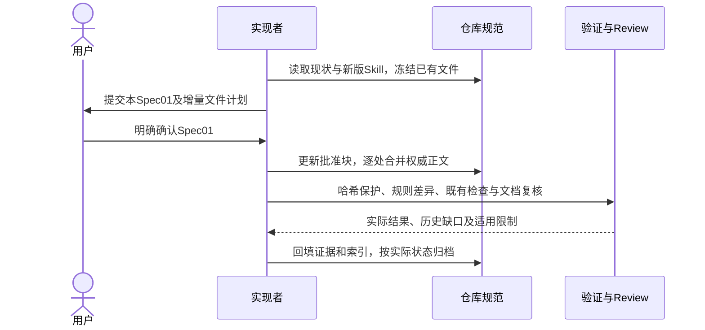

# GOV-003 — 增量合并新版 AI Native Skill 的 TDD、编码与 Review 规范

- Status: DONE
- Risk: R1；仅仓库治理文档和模板，不改变产品行为、生产代码、测试实现、依赖或发布配置。
- Owner: 产品负责人（用户）
- Implementer: Codex
- Reviewer: Codex 文档复核；本次不冒称独立上下文 Review。
- Date: 2026-10-28
- Spec revision: GOV-SPEC-20261028-TDD-CODING-REVIEW-MERGE-01（简称 Spec01）
- Architecture policy revision: ARCH-GOV-20261028-TDD-CODING-REVIEW-01；只增补工程约束，运行架构 revision 不变。
- User confirmation: APPROVED；产品负责人（用户）于2026-10-28明确回复“批准 Spec01，按方案合并”。
- Approval message reference: 本对话对 GOV-003 Spec01 范围确认问题的明确答复；批准本Spec及其中治理设计，不授予业务修改、工具安装或发布权限。
- Affected Feature IDs: N/A；跨工程开发流程，不改变 FEAT-001..013 产品合同。
- Feature current-state documents: 已检查 [Feature 索引](../../docs/domain/features/README.md)；正文无需更新。
- Feature baseline revision: 当前工作区；HEAD `0576ac30464908154c624effed41df6dfa3110cc` + 原有 182 项 dirty 状态。
- Feature merge owner: Codex；本次应核对而非批量改写 Feature/UI 正文。

## 1. Problem and outcome

用户更新了个人 `create-ai-native-project` Skill，希望在 Push Kids 验证新版规则的实际效果；明确要求增量合并，保留已有修改，不删除前端 Spec。

来源：[Skill](/Users/bytedance/.agents/skills/create-ai-native-project/SKILL.md)，本地 SHA-256 为 `ee732a4cc5440b1f1d746254d68f812e00c70ce73a41a9b9923dd3b1ed43f3d4`。此路径用于来源定位，不作为其他机器执行项目任务的必要依赖；合并后规则应在本仓库内可读。

当前工程已具备领域分层、依赖 DAG、Spec/设计批准、原生三视口、MySQL 5.7、发布门禁和 Feature/UI 文档闭环。已有 Review 模板也已经包含逐文件必要性、位置及冗余检查；这些是现有能力，不能把保留它们算作新增成果。

实际差距：开发协议 Gate E 仍为“先修改、后写测试”；缺少真实 Red/Baseline 分支、共享前提连续两次失败后的复查、编码约束中的最小必要修改与根因要求、质量工具适用策略、根 REVIEW、联合文档审查及问题回归闭环。

目标是沿用现有权威文档补入上述差异，使后续已批准任务可以按同一流程执行并保留可核查证据。规则落地只证明试用准备完成；不能据此声称缺陷率已下降或 TDD 效果已经得到产品验证。

## 2. Scope and preservation

### In scope

1. 手工增量合并 TDD、编码、状态/数据及中断恢复原则，修正冲突正文而非只追加。
2. 建立本项目的根 `REVIEW.md`，补强现有 Review 模板；保留全部前端审查内容。
3. 建立最小 ISS/REG 模板与版本化 Evidence 入口，复用现有测试及 `docs/quality/evidence/` 历史证据，不复制历史事实源。
4. 记录试用方法、真实基线、未配置工具及历史校验缺口；同步本治理任务索引。

### Must not change / non-goals

- 不改 `apps/`、`packages/`、`tests/`、数据库、生产依赖、工具实现、云端或 Git 状态；不提交、推送、安装 hook、部署或上传。
- 不执行安装器 `--apply`，不批量覆盖模板，不创建目标业务代码目录；保留当前 monorepo manifest。
- 不删除、搬迁或改写任何已有任务 Spec；只允许增量更新明确列出的通用模板与目录索引。
- 保留 `docs/design/frontend/` 全部内容和哈希、前端 Spec 内设计/FEC 章节及原生验证规则。无需新设计图，不变更 FDB/FEC/DREV 批准。
- 不把 174 个历史校验错误通过改写旧 Spec、删字段要求或假造批准来消除。
- 不强制安装 Crapper/Dryer/Mutator 或等价工具，不新设复杂度、重复率、变异分数或覆盖率门槛，不把未配置工具写成已执行。
- 不批量创建历史 ISS/REG；没有核实坏/好版本和实际重放的案例保持 draft，不冒称 active/closed。

### Frontend Design Impact and Repository-native Approval

- Frontend impact: no；无可见界面或交互变化。
- Frontend engineering impact: yes，限通用开发/Review 流程；不改变前端专项规范、预算、实现或测试矩阵。
- Affected UI IDs / UI current-state documents: N/A；没有具体 UI 状态变化。
- Frontend baseline revision: 保持 `FDB-20260913-04`。
- Frontend engineering constraint revision: 保持 `FEC-20261007-NATIVE-GEOMETRY-02` 及已批准文案附加条款。
- Affected quality dimensions: 开发、测试及审查证据；原 component/state/form、a11y、privacy、performance 等要求保持。
- Quality budgets/requirements: 沿用现有 FEC；不新增或调整阈值。
- Frontend quality verification plan: TP-001/004/005，冻结文件哈希、既有前端测试、设计及结构校验。
- Current / proposed Design Revision: N/A；没有新设计。
- Editable source / SHA-256 / viewport exports / snapshot manifest / prototype approval: N/A；原设计资产逐文件保护。
- Approved deviations: none。
- External design dependency: none。

### Feature current-state impact

无产品事实改变。核对 Feature、Behavior Catalog、Architecture、UI 和发布文档不与本次流程规则冲突；没有实际事实差异的正文保持原样，不增加无必要的变更引用。

## 3. Current-state discovery and baseline

- Profile: monorepo；API 为 FastAPI/SQLAlchemy，原生小程序在 `apps/miniprogram`，测试继续位于 `tests/`。
- Git branch/base: `main` / `0576ac30464908154c624effed41df6dfa3110cc`。
- 开始时工作区已有 182 项变更状态，包括用户已有代码、测试和 Spec 归档迁移。不得 reset/stash/回退或将这些差异混成本任务改动。
- 已保存 4584 个存在文件的 SHA-256 基线，其中 `specs/` 136 个、前端设计资产 1959 个。临时清单：`/tmp/push-kids-skill-20261028-baseline.json`；完整清单不含文件正文或密钥。
- Skill 安装器 governance-only dry-run 返回 2，表示已有文件冲突且未写入；已有 manifest 完全相同。
- 新版通用 validator 基线：174 ERROR、101 WARN。缺失根 REVIEW/ISS/REG 为本次可解决部分；多数历史 Spec 字段缺口是既有债务。完整差异比较使用 `/tmp/push-kids-skill-20261028-validation-baseline.json`，不能报告全仓通过。
- 基线临时审计：`/tmp/push-kids-skill-20261028-discovery.md`。

## 4. Target design and decisions

### Link/call graph

### Sequence diagram

### State machine

本任务 `DRAFT → APPROVED → IMPLEMENTING → VERIFYING → DONE`；缺少批准保留 DRAFT，检查未完成保留 VERIFYING。产品任务继续执行 GOV-002 的云端交付完成规则，不因本次治理更新退回旧完成定义。

TDD 新增/修复路径：`已批准 → 诚实行为 Red → 最小实现 Green → 必要重构/无必要则 N/A → 行为复验`。纯重构路径：`已批准 → 现有行为 Baseline → 重构 → 行为保持验证`。编译/依赖/夹具错误不是 Red。

### Architecture diagram / dependency DAG

治理依赖如 Link/call graph；运行时架构图 N/A：没有改变服务、模块边界、依赖方向、共享抽象或扩展点。现有运行 DAG 继续由 `tools/check_architecture.py` 验证，不增加未经实现的自动检查声明。

### Rule ownership and collision handling

| 规则 | 唯一权威位置及合并方式 |
|---|---|
| TDD/Baseline、切片证据和两次共同前提失败复查 | 开发协议 Gate E/Failure policy；替换旧顺序，其他文件引用 |
| 最小必要修改、先减后加、一项决定一处、根因修复 | 现有编码约束相关章节；不复制一份 ub-mode 或新增 Skill 依赖 |
| 可变状态隔离和逻辑写入权、边界解析和合法状态 | 追加项目规则 `ARC-017`、`ARC-018`；不得覆盖现有 `ARC-014` 有界读取或 `ARC-015` MySQL 兼容 |
| 中断恢复幂等 | 增补既有 `ARC-008`，说明重复、并发和副作用检查点恢复的测试责任 |
| 复杂度/覆盖、重复、变异分析 | 测试策略中列范围、工具/版本、命令、预算、Owner 与真实状态；本次均不自动引入新工具 |
| 审查五维、文档联合核对、稳定 finding ID、默认三轮收敛 | 根 REVIEW；任务模板承接逐文件清单和实际结论，不能删现有前端章节 |
| 文档语义冲突 | ISS 专项模板：原/新提交、Spec、提交人、证据及推荐统一方案；人工答复须应用并复验 |
| 历史证据与新 EVD | 历史材料保留在原路径；新 EVD 只建立版本化索引，记录 spec_revision/subject_revision/结果和 stale 条件 |
| DONE 与发布阶段 | 继续由 GOV-002、AGENTS 及开发协议 Gate H 定义；开发/验收/发布分开记录 |

现有架构约束的部分早期编号重复属于既有情况，本次不整体重编号；新条款使用未占用编号与标题定位。

### Alternatives, trade-offs and architecture confirmation

| 方案 | 收益 | 成本/风险 | 选择 |
|---|---|---|---|
| 在当前权威文档逐处手工合并，补缺少的审查/证据入口 | 保留项目积累、前端门禁和用户修改，可逐项核验 | 需要人工处理编号与生命周期差异 | 推荐；确认本 Spec01 即确认此治理设计 |
| 全量复制 Skill 模板或执行 installer apply | 表面一致 | 覆盖前端章节及产品约束，制造规则冲突 | 拒绝 |
| 只在 AGENTS 追加大段文字 | 文件少 | Gate E 仍相反、多处规则漂移、缺少任务输出机制 | 拒绝 |
| 同时改造业务代码并强制质量工具 | 可扩大试验 | 超出本次已知范围和批准，难区分治理与功能收益 | 延后独立 Spec |

Shared abstraction plan: N/A；不增加生产抽象，治理规则按职责引用而非复制。

Extensibility policy: 治理文档增量合并为 open（Owner 为用户；兼容、隐私、版本和复核按本 Spec）；生产结构/依赖改造为 closed（本次范围）；质量工具、CI/hook/定时审查及真实任务效果评估为 deferred，需真实范围、预算及适用批准后实施。

## 5. Expected file changes and deletion plan

| 路径 | 动作 | 必要修改 |
|---|---|---|
| `AGENTS.md` | modify | 只补编码/审查权威入口和不可省略的责任；保留现有全部项目批准及发布规则 |
| `docs/ai/DEVELOPMENT-PROTOCOL.md` | modify | Gate E、G、Failure policy 与交接证据；保留 Gate H 云交付口径和全部前端门禁 |
| `docs/ai/CODING-CONSTRAINTS.md` | modify | Work/Right/Practice、单决策权威、类型/状态、诚实测试和根因修复；保留项目性能和微信云托管约束 |
| `docs/ai/MAINTENANCE-PLAYBOOK.md` | modify | 保留有效知识、问题回归与审查质量观察、工作区回收边界；不创建周期任务 |
| `docs/architecture/ARCHITECTURE-CONSTRAINTS.md` | modify | 增补 ARC-017/018 及 ARC-008 恢复要求；不误用 Skill 通用编号 |
| `docs/quality/TEST-STRATEGY.md` | modify | TDD证据、工具适用/未配置状态及试用观察；保留全部既有专项与发布必需检查 |
| `REVIEW.md` | add | 实例化 Push Kids 敏感路径、排除范围、审查维度、文档核对、发现处理与三轮规则 |
| `specs/_templates/REVIEW-REPORT.md` | modify | 增量补文档核对表、稳定ID/轮次、编码证据和版本绑定；保留完整前端审查章节及逐文件清单 |
| `docs/quality/issues/README.md`、`ISSUE-TEMPLATE.md`、`DOC-AMBIGUITY-TEMPLATE.md` | add | 问题来源、状态、Owner、根因/漏检层、人工裁决与真实关闭条件 |
| `docs/quality/regressions/README.md`、`REGRESSION-TEMPLATE.md` | add | 关联真实 testRoots、坏/好版本、行为/审查器正负例，未执行不算覆盖 |
| `specs/evidence/EVIDENCE-TEMPLATE.md`、`EVD-20261028-GOV-003-BASELINE.md` | add | 新证据模板与本轮命令/版本索引；引用历史证据而非搬迁 |
| `specs/README.md`、`specs/STATUS.md` | modify | 仅维护本治理任务索引/数量、EVD入口，保留已有产品状态和历史 |
| 本 Spec | add/modify/获批实施验证后 move | 需求、批准、检查结果；最终路径见第9节 |

不新增 DLV 平行台账，不更改 `.ai-native/project.json` 或其他 Spec 模板。`specs/deliveries/` 缺失作为通用校验器与本项目既有状态体系的差异记录；本次不为通过结构检查制造无用台账。

Deletion / legacy exit plan: 无文件删除、无生产迁移；只替换本次已批准范围内过期或冲突的流程文字。已有前端 Spec、设计源、批准快照及用户变更全部保留。禁止用 `git restore/reset/clean/stash` 回滚整个工作区；撤销只能撤回本任务精确增量。

## 6. Acceptance criteria and required test points

| ID | 验收标准 | Required test point / 实际验证方法 |
|---|---|---|
| AC-001 / TP-001 | 既有前端 Spec、设计资产、业务代码、测试及无关文件未变 | 与开始时4584文件SHA清单逐项对比；仅允许本Spec列出的治理文件变化；检查新增/删除及原有dirty状态 |
| AC-002 / TP-002 | TDD/编码/架构规则在正确位置且无相反流程 | 人工逐节对照Skill；确认Gate E旧顺序已替换、Baseline/例外/恢复/两次前提失败规则完整，ARC编号无新增冲突 |
| AC-003 / TP-003 | Review可实际执行且不削弱前端要求 | 逐项审查根REVIEW、任务模板、ISS/REG/EVD之间链接与状态；前端章节与原始模板核对 |
| AC-004 / TP-004 | 原有工程结构、设计和前端基线继续成立 | `uv run --offline --no-sync python tools/check_architecture.py`；`uv run --offline --no-sync python tools/validate_design_evidence.py --check-current-policy`；`uv run --offline --no-sync python tools/validate_miniprogram.py`；`npm test` |
| AC-005 / TP-005 | 文档可追溯，真实暴露校验与证据缺口 | `git diff --check`；对本任务所有新增/修改Markdown检查本地链接、索引/计数；运行Skill validator JSON并按code/path/message比较基线，不把历史缺口算作本次新引入 |
| AC-006 / TP-006 | 试用结果不造假 | 记录本轮治理就绪/未验证效果，质量工具/CI/reviewer重放真实状态；下次用户批准的行为任务才收集Red/Green/返工/误报等证据 |

产品后端全套、MySQL/Ark、容器构建、原生/真机及云端发布为 N/A/not run：本次无产品、SQL、依赖或部署变更；不得引用历史PASS冒充本轮执行。若本次diff意外影响这些范围，停止并更新Spec，不能仅沿用本表。

## 7. Trial and verification plan

1. 先取得Spec01确认，再按文件责任增量合并；每完成一组核对与原项目规则的冲突。
2. 执行TP-001..006；保留原始失败和后续结果，适用检查只跑所需范围，不靠重复重跑伪造稳定性。
3. 复核本次逐文件必要性、放置位置、冗余和相关文档；R1本次为文档自复核，不能声称新上下文独立审查。后续R2/R3仍要求独立Review。
4. 真实效果观察在后续获批任务中记录：Red是否为目标行为差异、Green/重构后证据、首轮有效发现/误报、修复轮数、人工投入及发布后回归。样本和观察窗口不足时保持未验证，不做因果收益承诺。

### Executed baseline evidence（仅合并前）

以下保留获批前的执行时点记录；“尚未批准/未合并”为当时状态，最终结果见第10节。

| Command / case | Result | Evidence / limit |
|---|---|---|
| Skill `inspect_project.py . --format markdown` | PASS，exit0 | 只读审计临时文件；不是产品验收 |
| Skill `install_ai_native.py . --profile monorepo --governance-only` | CONFLICT，exit2 | dry-run；没有写入，manifest相同 |
| Skill `validate_ai_native.py .` | FAIL，174 ERROR / 101 WARN | 合并前结构基线；不隐瞒，不改历史Spec凑绿 |
| `UV_CACHE_DIR=/tmp/push-kids-skill-uv-cache uv run --offline --no-sync python tools/check_architecture.py` | PASS | `ARCHITECTURE_VALID policies=4 modules=150 (runtime/lazy DAG)` |
| 同环境 `uv run --offline --no-sync python tools/validate_design_evidence.py --check-current-policy` | PASS | `DESIGN_EVIDENCE_VALID` |
| 同环境 `uv run --offline --no-sync python tools/validate_miniprogram.py` | PASS | 17 pages / 1234867 source bytes |
| `npm test` | PASS | 349 passed / 0 failed / 0 skipped；日志 `/tmp/push-kids-skill-20261028-frontend-tests.log` |
| 草案保护及链接复核 / `git diff --check` | PASS | 原有4584个文件均未改变；草案本地链接缺失0；validator相较合并前新增/移除发现均0。当前只新增本待批准Spec，治理正文与索引尚未应用 |
| TP-001..006合并后验证、规则效果、后端/MySQL/原生/云端 | NOT_RUN | 尚未批准/尚未合并；产品相关范围本轮N/A |

## 8. Risks, compatibility and rollback

- 主要风险为治理文字覆盖项目已有约定、重复事实源、误把通用工具门槛变成已生效规则，或把旧证据追认为新版本。
- 以精确文件清单、SHA保护、根入口引用、权威正文合并、无新增工具门槛及版本绑定控制。
- 保留云端交付即开发DONE规则；Review缺项独立保留，不追认缺失批准，也不降低未来发布必需门禁。
- 基线全仓validator失败尚未解决：Owner为项目维护者；范围外历史清理由后续明确Spec处理，本次报告剩余code/path及数量，不得宣布全仓AI Native验证通过。
- API/Schema/数据/部署兼容：N/A；本次无运行变化。回退只撤本任务治理增量，不恢复任何原有用户dirty文件。

## 9. Completion and documentation closure

- 当前状态：DONE；2026-10-28已按用户明确批准的Spec01应用规范增量，完成本地适用检查和文档自复核，纯治理交付归档至 `specs/completed/GOV-003-TDD-CODING-REVIEW-INCREMENTAL-MERGE.md`；真实任务效果未验证。
- 批准与实施后核对：Feature、Behavior Catalog、Architecture、UI current-state、Spec、测试证据及发布文档；无新事实者不强行改动。
- 本任务为纯治理文档，产品端云交付为N/A；依照已有GOV-002纯治理任务先例，Spec01获批、增量规范应用且必需验证完成后开发DONE，并迁至 `specs/completed/GOV-003-TDD-CODING-REVIEW-INCREMENTAL-MERGE.md`。真实TDD/Review效果仍独立为NOT_RUN，不能冒充已验收。
- 若批准未到或开发验证未完，保留active并记录具体恢复条件；已完成合并不得为等待未来效果样本而长期留active。
- 最终回复应说明同步文档、Spec状态/位置、冲突核对、保留范围、实际检查、全仓validator剩余失败及未验证效果。

## 10. Implementation, verification and final closure

- 已修改9份原治理/索引文档；新增根REVIEW、ISS三份、REG两份、新EVD模板及本证据；本任务Spec为唯一新增并归档的任务Spec。总计18个文档，未改业务代码、测试、依赖、工具、云端或Git提交状态。
- Feature current-state document merge: N/A；本次没有产品合同改变；Feature/Behavior/Architecture/UI与发布文档已按无改动范围核对，原正文和批准保持。
- Change Reference: 本治理Spec、`specs/README.md`、`specs/STATUS.md`及[EVD-20261028-GOV-003](../evidence/EVD-20261028-GOV-003-BASELINE.md)相互关联。
- Verification: TP-001..006在声明的治理范围内验证；前端349通过/0失败/0跳过，架构4policies/150modules、设计证据、小程序17页/1234867源字节及diff空白检查通过。133份原Spec/模板、1959份设计资产及其他无关文件均由原SHA清单保护。
- 文档冲突核对：Gate E旧顺序已替换；Review模板原前端章节逐字相同；新增状态规则避开ARC-014/015；已有GOV-002开发DONE及前端/发布门禁保持。R1同上下文文档自复核，未冒称独立Review。
- 通用validator：合并前174ERROR/101WARN，当前165ERROR/98WARN，消除12条、无新增；历史字段及Delivery目录差异保留，不能声称全仓通过。最终本地链接、状态/索引及对象hash核对的精确结果见EVD。
- 开发完成：纯治理规范已在本仓库交付，无产品端云部署适用；状态DONE，已迁completed并修复索引。未来产品任务仍须符合各自范围的云端交付条件。
- 尚未验收：真实行为任务上的TDD/Review收益、审查器正负例重放均NOT_RUN；无案例伪造为active/closed。后端/实库/Ark/容器/原生/真机/发布未执行，因无相应改动。恢复条件为后续具体获批任务与足够样本，不因等待效果样本让本次已交付治理Spec留active。
- 无超出批准范围的变化，无额外用户批准或发布人工操作待办。
