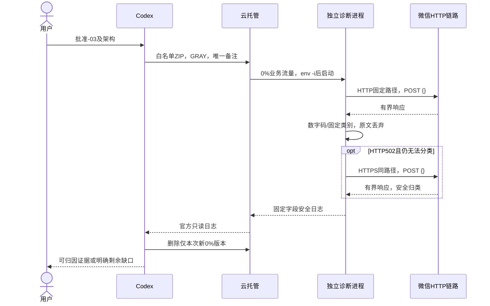
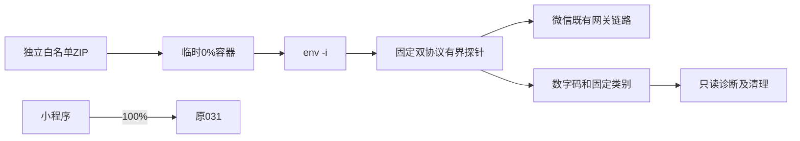

# OPS-20261017 — 微信接口502的有界错误分类与协议对照

- Template: specs/_templates/BUGFIX-SPEC.md
- Status: DONE
- Risk: R2
- Owner / Reviewer: 用户
- Implementer: Codex
- Spec revision: OPS-SPEC-20261017-NOTIFICATION-HTTP-DIAGNOSIS-03
- Architecture revision: ARCH-20261017-NOTIFICATION-502-DETAIL-03
- User confirmation: 用户于2026-10-17明确回复“批准-03，继续细化排查（推荐）”，对应审批问题call_c72df312de1446299ccfe9fc496ad2e6；批准本revision及架构中的有界安全分类、必要时一次固定HTTPS空请求对照、env -i、0%灰度、取码和清理，031保持100%。
- Affected Feature IDs: FEAT-003
- Current-state baseline: [FEAT-003](../../docs/domain/features/FEAT-003-notification-channel.md)，FEAT-STATE-20261017-NOTIFICATION-HTTP-DIAGNOSIS-02。
- Parents: [诊断-01](OPS-20261017-NOTIFICATION-HTTP-DIAGNOSIS.md)、[部署-02](OPS-20261017-NOTIFICATION-GRAY-DEBUG-DEPLOYMENT.md)。

## 1. 问题与所需范围修订

获批-02的032已normal/0%运行，空请求实测HTTP502/HTTPError、platform_errcode=null，随后已删除；031始终normal/100%、配置未变。
原探针只提取顶层整数errcode。null不表示响应没有其他错误结构，因此不能从这次输出确认白名单、代理或上游具体原因。
旧30条业务HTTPError也没有状态码，不能回溯认定全部502。

本revision允许改进独立诊断程序，读取有界响应并在内存中提取已知位置的数字码、识别固定错误类别。
若HTTP仍返回502且无法分类，最多增加一次相同路径的HTTPS空请求作协议对照；不能发送业务消息。
这超出-02“probe.py逐字节不变、固定一次HTTP请求”的批准范围，故需本revision明确批准。

## 2. 推荐设计、备选和权衡

| 方案 | 收益 | 限制/风险 | 决策 |
|---|---|---|---|
| 新0%版本，有界数字码/固定类别，必要时HTTP与HTTPS空请求对照 | 不依赖业务身份，分辨更多502错误结构和协议路径差异 | 最多2次无收件请求；平台配置临时继承；仍可能需要平台内部日志 | 推荐 |
| 管理员只读检查控制台开放接口/白名单及平台代理日志 | 可直接确认平台配置 | 当前自动站点访问受限，需管理员操作；不能由配置单独解释所有502 | 备选 |
| 仅重复原探针 | 无新诊断代码 | 仍只得到502/null，不解决证据缺口 | 不采用 |
| 修改生产provider/白名单或真实补发 | 可能改变现象 | 未明确根因，改变业务/权限并产生副作用 | 不批准 |

### Link/call graph

```text
新冻结白名单ZIP -> 官方上传 -> SubmitServerRelease(GRAY)
 -> 新0%版本(平台配置继承) -> env -i -> 独立标准库探针
 -> 固定HTTP路径 POST {}
 -> 有界解析 -> 数字码/静态类别
 -> 仅当HTTP502且无法分类：固定HTTPS同路径 POST {}
 -> 安全日志 -> 官方tcbr日志API -> 删除仅本次新版本
031始终100%
```

### Sequence diagram



### State machine

approved -> frozen -> local_verified -> gray_created -> http_probed -> reported /
https_compared -> reported -> cleaned -> facts_merged。
每进程HTTP最多一次，HTTPS最多一次，无重定向、无自动重试；健康请求不触发探针。
无法归类必须保留unclassified，不用关键词猜测根因。业务delivery状态机N/A：不读写该表。

### Architecture diagram



独立运维目的、Owner Codex、closed扩展点：不引入业务依赖、共享抽象、可配置URL或客户端输入。
Frontend/UI/FDB/FEC/Design Revision/原生视口：N/A，无前端或用户可见交互变化。

## 3. 精确诊断与安全合同

- HTTP固定为http://api.weixin.qq.com/cgi-bin/message/subscribe/send；对照仅换为https，同路径。
- body严格为{}，无touser/template_id/正文/token；不读取业务变量、文件凭据、数据库或业务模块。
- 每请求5秒、读取最多8192字节；不重定向、不重试。第二请求只在第一请求502且无法分类时允许。
- 保留HTTP状态、整数errcode；新增仅白名单位置的整数code/ret/error_code/base_resp.ret/error.code，值限有符号32位范围；字段来源输出为固定枚举。
- 可在内存中识别错误文本对应的固定类别：allowlist_rejected/token_rejected/upstream_connect_failed/upstream_timeout/platform_busy/unclassified。
  只在明确代码或已知错误格式匹配时分类，模糊匹配不得写为已确认根因；未知信息丢弃。
- 可以输出响应格式枚举empty/json_object/json_array/non_json与协议枚举http/https；不输出原始字段名、errmsg、body、headers、URL查询、请求ID或任意字符串。
- 解析/读取/异常意外分支只输出固定失败枚举与允许异常类。包含凭据、身份、儿童内容的虚构测试夹具必须证明原文不会进入日志。
- 环境继承与env -i、非root、8000、健康端点、配置不变量、0%版本及031为100%的合同同-02。
- 官方StartVersionInstance只可在确认新版本normal且没有Running实例时调用一次。不得重启031或通过业务路由触发实例。
- 取结果或明确无法获得后删除仅本次版本；保留所有原版本、镜像和服务。不能因根因未明长期保留继承变量的诊断版本。
- 原始响应只在进程内存中处理，不保存到仓库、临时文件或聊天。不得绕过受限控制台站点。
- 不改白名单、开放接口开关、权限、业务代码、重试、记录、授权、额度、Schema、流量或正式发布状态。

## 4. Expected file changes

| 文件 | 变更 |
|---|---|
| tools/diagnostics/notification_gateway_probe.py | 有界错误分类及固定HTTPS对照，保留独立用途 |
| tests/unit/test_notification_gateway_probe.py | 新格式/代码/分类/隐私/调用次数/对照条件测试 |
| /private/tmp下新-03冻结目录及发布脚本 | 新白名单manifest/ZIP/摘要；旧-01/-02冻结目录不变 |
| 本Spec、父Spec、specs/README.md | 审批、证据、真实生命周期 |
| FEAT-003、质量证据、诊断发布记录、运维说明 | 合并新实测事实，替换过期当前正文 |
| 通知Behavior/Architecture/UI/批准设计快照 | 核对，无业务变化则不改 |

## 5. Required test points

| ID | 必需检查 | 当前 |
|---|---|---|
| D-001 | 原专项回归；固定URL/body/无身份/超时/上限/禁重定向与禁重试 | PASS；专项63 passed/1 warning；原21项已保留并适配安全新增字段 |
| D-002 | 各白名单数字字段、非整数/超范围、嵌套限制、empty/nonJSON/读取失败 | PASS；数字位置/边界/格式/读取异常测试 |
| D-003 | 已知格式分类/未知保留unclassified；凭据和身份虚构夹具不进入日志 | PASS；精确格式、冲突/未知、虚构凭据/身份与双日志隐私测试 |
| D-004 | HTTP非502或已归类不发HTTPS；502未知才发一次HTTPS；健康重复不重发 | PASS；1/2次分支、HTTPS异常保留首结果、不重试及健康测试 |
| D-005 | 完整后端pytest、Ruff check/format、架构；npm基线未变仍记录实际是否重跑 | PASS；581 passed/19 skipped/62 warnings，47.16s；npm244 passed；Ruff check/format529文件、Mypy103、架构、miniapp lint/validator、设计证据政策通过 |
| D-006 | 冻结白名单/摘要/秘密扫描；断网只读非root容器、env -i、健康与SIGTERM | PASS；3729字节ZIP，SHA256 cdcf4b484ac398d9e6839016c392ab0a92c8b739e8f4ba9b75b193c32931a7f1；镜像sha256:d57cabaa8153fcccb28776bf2b5920348b08d3cf142efb8add3a2d9949e3070b；仅两个Python变量、UID10001、4次200/未知404、日志1条、exit0、测试容器已清理 |
| D-007 | 官方上传/GRAY，新版本normal/0%，031 normal/100%，环境及服务配置不变量 | PASS；上传200，flask-ik19.zip/1792227155；清理032遗留GRAY任务后提交2383674，033 normal/0%，包及继承摘要匹配；031 normal/100%，changedServiceFields=[] |
| D-008 | 云日志取得安全分类，区分探针实测与旧日志；归因不足不写已确认 | PASS；HTTP502/json_object，无白名单位置数字码、category=unclassified；HTTPS URLError，无HTTP响应；同版本21条日志格式扫描未命中。后续截图确认必要权限缺口，-04修复后-05单条原链路sent/ok完成运行验证，不回溯断言所有旧失败原因 |
| D-009 | 删除仅新版本，复核031/全部原版本/配置；文档当前事实及引用检查 | PASS；033已删除、其任务已停止；032遗留任务已停止；原020—026与031保留，031 normal/100%、受保护配置不变；Feature/证据/发布/索引同步及本地链接/diff检查见证据 |

Schema/新增备份/前端及真机业务发送N/A；未改依赖声明/锁，安装依赖NOT_RUN理由须记录。
任何检查失败停止创建或继续部署；本轮已经清理032，批准后不得重复删除或复用旧版本。

## 6. Approval and closure

依据[AGENTS.md](../../AGENTS.md)“Wait for explicit user confirmation of the specific Spec revision before production implementation”，
本revision与架构已按上述用户回复获明确批准；在实施前记录批准并置APPROVED。
诊断执行成功不等于通知修复；若没有可归因证据，清理版本后记录剩余缺口，不能谎报明确根因。
明确根因、全部适用验收与文档闭环满足后，核对父Spec并将达到门禁的Spec置DONE移至completed；否则保留真实active状态与恢复条件。

## 7. 实际结果与恢复条件

- 033已按本revision部署、运行并清理，未发送真实通知或读写业务数据。
- HTTP固定空请求实测502/HTTPError、json_object，六处批准数字字段均未提取到有效码；安全文本格式未匹配，category=unclassified。
- 因条件满足，HTTPS同路径空请求执行一次，结果URLError/transport_unavailable，无HTTP响应或错误码；不能从URLError断言DNS、TLS或具体网络原因。
- 官方CLS窄窗口返回21条、均含033元数据，未达到100条上限；只输出既定网关错误格式计数，均0。未命中不等于平台没有错误或白名单必定正确。
- 首次发布被ResourceInUse拒绝，因为已删除032的管理任务2383541仍running；仅取消该诊断遗留任务，确认stopped后同一上传包重提一次成功（2383674）。
- 16:58 CST收尾确认033已删除，其任务2383674为stopped；原版本与031 normal/100%、服务和031冻结摘要不变。没有删除镜像或服务。
- 用户随后提供prod云调用只读截图：总开关已开启，微信令牌权限列表为空；结合provider固定路径及官方前提，确认缺少必要发送路径权限。
  截图来源、SHA-256及因果限制见[证据](../../docs/quality/evidence/NOTIFICATION-HTTP-DIAGNOSIS-20261017.md#管理员只读截图证据)。
- 后续管理员按获批-04添加唯一精确发送路径，修复后截图及官方只读版本/配置核验通过；031正常/100%、PUBLIC关闭，无新版本。
  后续独立获批[单条验收-05](OPS-20261017-NOTIFICATION-SINGLE-EVENT-SMOKE.md)创建唯一0F58，当前账号于18:49:19 CST sent/ok，额度1→0/expired，随后临时日程停用204、当日匹配0；最终031及配置不变。
  结合必要权限缺口及修复后原链路成功，诊断门禁已满足，-01/-02/-03均DONE迁至completed；不继续盲目部署原探针。用户随后在call_5b80efd7f9504c4ca286e2df7e031c75明确确认已收到0F58，补齐该次收件。旧30次精确状态/平台代理内部码仍未知，不宣称全部历史502完全归因，全成员/类型不代验。
- [单接口修复Spec-04](OPS-20261017-NOTIFICATION-OPENAPI-PERMISSION-FIX.md)已完成配置验收并DONE；-05补齐受限运行证据后本诊断完成，不重复部署/配置或补发。-03本身不授权修改白名单、权限或真实发送，分别以-04/-05批准为准。
  既有控制台站点安全拒绝仍有效，不通过其他浏览器/CDP/WebShell绕过；不要求操作者提供密钥或原始日志。
- 变更及测试事实已合并[质量证据](../../docs/quality/evidence/NOTIFICATION-HTTP-DIAGNOSIS-20261017.md)、FEAT-003与运维/发布说明。
  通知Behavior/Architecture/UI合同无本轮新增冲突；本次只有独立工具、测试与事实文档变化。
