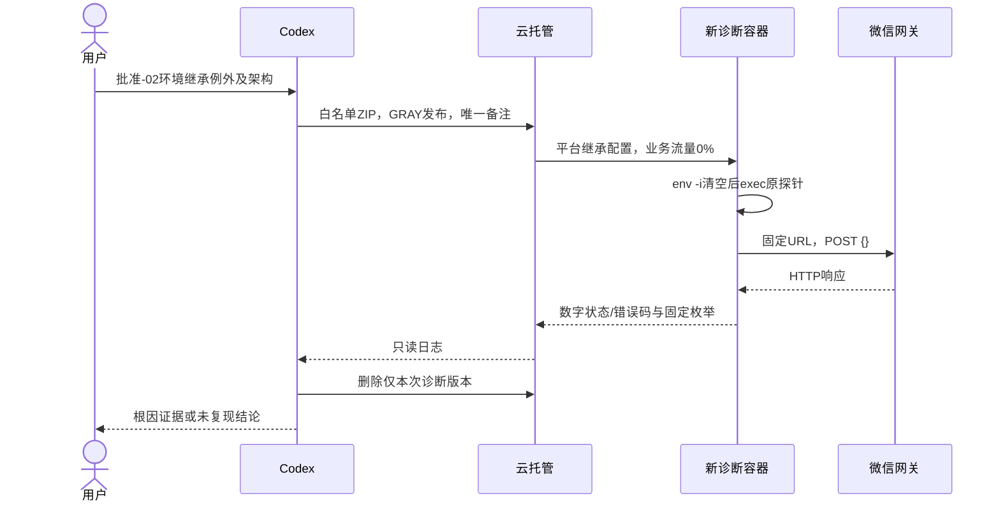
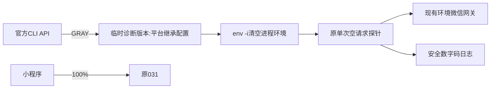

# OPS-20261017 — 通知诊断包经现有灰度发布链路部署

- Template: `specs/_templates/BUGFIX-SPEC.md`（仅诊断部署范围修订）
- Status: DONE
- Risk: R2
- Owner / Reviewer: 用户
- Implementer: Codex
- Spec revision: `OPS-SPEC-20261017-NOTIFICATION-HTTP-DIAGNOSIS-02`
- Architecture revision: `ARCH-20261017-NOTIFICATION-GRAY-PROBE-02`
- User confirmation: 用户于2026-10-17明确回复“批准-02，按该方案部署并排查（推荐）”，对应审批问题`call_facaedb2b45c480ebfa2134f1423fe05`；批准本revision与架构中的平台环境继承例外、env -i清空探针环境、GRAY部署、取码与清理，031保持100%。
- Affected Feature IDs: `FEAT-003`
- Feature current state: [FEAT-003](../../docs/domain/features/FEAT-003-notification-channel.md)，实施基线revision `FEAT-STATE-20261017-NOTIFICATION-HTTP-DIAGNOSIS-01`，后续-03合并后的当前事实revision `FEAT-STATE-20261017-NOTIFICATION-HTTP-DIAGNOSIS-03`。
- Feature merge owner: Codex
- Parent: [已批准的-01](OPS-20261017-NOTIFICATION-HTTP-DIAGNOSIS.md)；本文环境继承例外已获批准，其余-01诊断边界继续适用。

## 1. 已验证问题与批准差异

现有代码包上传成功，但直接`CreateCloudBaseRunServerVersion`持续返回
`InvalidParameter: package detail param is missing`；按微信官方cloudapi补充AccessType=4仍被拒绝。
这是-02批准前的历史阻塞。-02批准后已通过GRAY创建032，运行探针并清理；031始终normal/100%。
腾讯云[官方更新记录](https://cloud.tencent.com/document/product/876/34816)列出2026-03-02移除公开的旧创建接口。
此事实说明不能继续依赖旧公开合同，不足以单独证明本环境报错的内部原因。
现有官方CLI实际使用`SubmitServerRelease`，其输入没有EnvParams覆盖字段，正常路径继承服务配置。

-01要求诊断容器完全没有业务密钥，并禁止修改服务默认变量。因此不能直接换用常规发布路径。
本revision已批准一个例外：**允许平台为新诊断版本继承现有环境配置，但在启动探针前使用`env -i`
清空进程环境，探针进程只保留两个无秘密的Python标志**。继承值不进入源码、镜像层、命令参数或本地文件。
环境值仍保留于平台版本配置；这部分控制面暴露在诊断版本删除前存在，不能宣称平台已清除这些值。

本轮不批准探针读取这些环境值或任何工具输出这些值；仅G-006所需控制面内存摘要比较获准。
不批准业务代码或数据库访问，不改变白名单、权限、通知额度、
历史记录或真实通知发送；其余-01约束继续适用。

## 2. 推荐设计、备选与权衡

| 方案 | 好处 | 代价/限制 | 选择 |
|---|---|---|---|
| 现有服务GRAY版本，平台继承配置，env -i后启动同一探针 | 使用既有发布链路；网关环境相同；031保持100%；程序不持有业务环境变量 | 平台临时版本配置仍继承现有值，需本revision明确批准并及时删除 | 推荐 |
| 操作者在控制台创建空变量版本 | 完全符合-01隔离要求 | 当前受保护站点不能自动访问，需人工逐项配置 | 可选 |
| 新建另一诊断服务 | 可单独配置空环境 | 扩大资源与入口范围，且服务间网关配置差异可能影响复现 | 本轮不采用 |
| 修改服务全局变量后再恢复 / 业务包调试 / 全量切流 | 无 | 超过本次诊断边界 | 不采用 |

精确启动变更：仅将冻结Dockerfile的CMD改为：

```dockerfile
CMD ["/usr/bin/env", "-i", "PYTHONDONTWRITEBYTECODE=1", "PYTHONUNBUFFERED=1", "/usr/local/bin/python", "/app/probe.py"]
```

保留UID10001、python:3.12-slim、8000、原probe.py逐字节内容与固定空请求合同。
已生成独立-02冻结目录与新manifest/ZIP，未改写-01冻结包。清空环境不改变容器网络命名空间或平台网关配置；
是否复现原HTTPError必须以实际错误码判断，不能把理论相同当作复现通过。

### Link/call graph

```text
冻结-02白名单ZIP -> 官方上传API -> SubmitServerRelease(ReleaseType=GRAY)
 -> 新版本(0%业务流量，平台继承原服务环境) -> env -i -> 原probe.py
 -> 固定微信URL+{} -> 安全数字码日志 -> 官方日志API -> 清理仅该新版本
031 -> 原有100%业务流量
```

### Sequence diagram



### State machine

已批准 -> 冻结/本地验证 -> 上传 -> GRAY创建 -> 核验0%/031为100% -> 取码 -> 清理 -> 文档验收；上述部署链路已完成，明确根因门禁仍未完成。
创建失败不得盲目重复；先查是否已有相同备注的新版本。未知版本不自动删除。
新版本若未启动，只能使用官方StartVersionInstance启动该版本；不向业务路由或dispatch发请求。
业务delivery状态机N/A：不读写delivery、quota或grant。

### Architecture diagram



临时运维工具边界closed，不新增业务模块、共享抽象、任意URL、客户端输入或调试API。
Frontend/UI/FDB/FEC/Design Revision/原生视口验收：N/A，无前端或用户可见交互变化。

## 3. 发布参数与配置边界

- Target：`wx5d2e0014690bf285 / prod-d2g14rwoycac6b45d / flask-ik19`。
- SubmitServerRelease：DeployType=package，ReleaseType=GRAY，HasDockerfile=true，
  Dockerfile=Dockerfile，BuildDir=.，Port=8000，备注=`OPS-20261017-NOTIFICATION-HTTP-DIAGNOSIS-02`。
- 不使用CLI的noConfirm选项（该选项会强制FULL），不调用UpdateServerBaseConfig、流量发布或权限写接口。
- 继承现有CPU0.25/Mem0.5以及当前扩缩容配置；0%业务流量下不主动压测或扩容。
- 平台可能将本次提交的构建字段Port/HasDockerfile/Dockerfile/BuildDir保存为默认构建元数据；
  仅允许这些字段与上述值对齐，以及平台生成的时间/发布元数据变化。
  EnvParams、入口集合、资源、权限、业务开关与031冻结配置不得被本次控制面请求改写。
- 默认min=0时可能需启动新版本的一个实例；探针每进程最多一次、不自动重试，取得结果后即清理。
- 读取日志只保留数字HTTP状态、整数errcode、异常类与固定枚举，不保留原始响应、Header或凭据。
- 清理须核对唯一备注、新增版本名和0%流量；保留所有原版本和031正常/100%。

## 4. Expected file changes

| 文件/发布物 | 预期改动 |
|---|---|
| 临时-02冻结目录的Dockerfile/manifest/ZIP | 仅启动命令清空环境；新摘要；原probe.py不变 |
| tools/diagnostics/notification_gateway_probe.py、原测试 | 不改；复用-01已验证源码 |
| 本Spec / 原-01 / specs/README.md | 审批、当前阶段与最终生命周期 |
| FEAT-003、诊断质量证据、诊断发布记录 | 合并实际版本、错误码、根因或未复现、清理事实，替换过期当前正文 |
| Behavior Catalog / Architecture / UI / 已批准设计快照 | 核对合同；无业务变化则不改 |

## 5. Required test points

| ID | 检查 | 必需结果 / 当前 |
|---|---|---|
| G-001 | -02文件白名单、逐文件摘要与秘密格式扫描 | PASS；2495字节ZIP，SHA-256 619717eb41aee87c524c7ce0afbff51990131073dc75340ba66bffd79feb544b；源码等于-01 |
| G-002 | 断网容器注入虚构测试变量，核对exec后的PID1环境 | PASS；仅两个Python标志，虚构变量已清除；UID10001 |
| G-003 | 断网容器健康重复200、未知404、仅一次探针日志、SIGTERM exit0 | PASS；断网/只读，4次健康200、未知404、日志1条、exit0，测试容器已清理；镜像sha256:a14fcd45a99a76e833cdd3a56eeb7770e8796be00ad86ef99bf042359dba6abf |
| G-004 | 原21项单测与源码一致性；差异质量检查 | PASS；21 passed / 1 warning，Ruff check/format、architecture及diff检查通过；既有539/19 skipped、244等只属于-01证据，本次未重跑 |
| G-005 | 上传回执和发布任务 | PASS；HTTP200，flask-ik19.zip/1792226140，任务2383541；032 normal/0%，031 normal/100% |
| G-006 | 版本环境/服务配置安全核对 | PASS；继承摘要相符、包标识匹配；服务changedServiceFields=[]，031冻结摘要不变 |
| G-007 | 官方日志API | PASS（取码范围）；1条日志HTTP502/HTTPError，platform_errcode=null，reason=http_error；具体平台原因仍未确认 |
| G-008 | 清理后官方API复核 | PASS；16:39 CST032已消失，020—026与031全部保留，031 normal/100% |
| G-009 | 文档闭环 | PASS；Feature/证据/发布/Spec索引已同步，通知合同/Architecture/UI无本轮新增冲突；根因未确认单独列明 |

Schema、MySQL迁移/新增备份、业务双账号及前端发布：N/A，无相应变更且诊断包无业务/数据库依赖。
依赖安装：N/A，未修改依赖声明或锁。若发现源码变化或质量失败，再运行受影响门禁。

## 6. Approval and closure

本revision已于2026-10-17按上述用户回复获批准。依据[AGENTS.md](../../AGENTS.md)的
“Wait for explicit user confirmation of the specific Spec revision before production implementation”，
不得把一般“部署”授权自动解释为放宽-01的无业务密钥约束。
批准内容必须明确包括本Spec与架构的环境继承例外、env -i启动、GRAY部署、取码与清理。
已在实施前记录approver/date/message并置APPROVED；同一范围没有重复请求确认。

部署取码与清理已完成；本地镜像、冻结包和完整执行事实见[证据](../../docs/quality/evidence/NOTIFICATION-HTTP-DIAGNOSIS-20261017.md)及[发布记录](../../docs/deploy/releases/20261017-notification-diagnosis.md)。
本次探针复现HTTPError并取得502，但未取得整数errcode；后续用户截图独立确认prod总开关开启、微信令牌权限列表空，缺少必要发送路径权限。
探针本身不证明业务恢复；后续必要权限缺口按-04修复，再由独立获批-05取得当前账号单条原链路sent/ok及测试日程清理证据，已满足诊断闭环，置DONE迁至completed。
改变探针分类或增加请求不得在-02“probe.py不变”范围内静默扩展。
后续[获批-03](OPS-20261017-NOTIFICATION-502-DETAIL-DIAGNOSIS.md)已部署033并清理：HTTP仍502且未提取有效数字码，HTTPS对照URLError；其后截图配置证据见[证据](../../docs/quality/evidence/NOTIFICATION-HTTP-DIAGNOSIS-20261017.md#管理员只读截图证据)。
032遗留管理任务2383541已核实归属后取消并确认stopped；033及其任务也已清理，031始终normal/100%、受保护配置不变。
后续[单接口权限修复-04](../completed/OPS-20261017-NOTIFICATION-OPENAPI-PERMISSION-FIX.md)已获明确批准并由管理员完成，配置Spec为DONE，修复后截图与官方只读版本/配置不变量核验通过；没有待批准的额外诊断包。
后续[单条验收-05](OPS-20261017-NOTIFICATION-SINGLE-EVENT-SMOKE.md)的0F58于18:49:19 CST达到sent/ok，日程授权1→0/expired，临时日程DELETE 204且当日匹配0；最终031 normal/100%、配置摘要不变、原版本保留。
本Spec的部署/隔离/取码/清理原检查已通过，加上权限缺口及修复后原链路运行证据，父诊断及本Spec完成归档。用户随后在call_5b80efd7f9504c4ca286e2df7e031c75明确确认已收到0F58，补齐该次收件；旧30次精确状态/平台代理内部码仍未知，其他成员/类型不代验，不把单次成功推广为全通道可靠性保证，不重复配置或补发。
