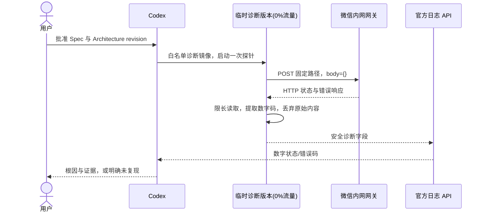
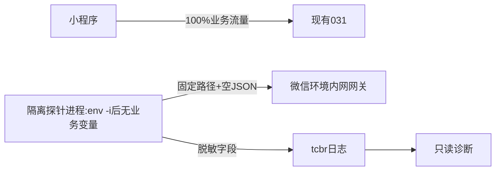

# OPS-20261017 — 通知 HTTP 拒绝原因的隔离诊断

- Template: `specs/_templates/BUGFIX-SPEC.md`（诊断阶段；尚不批准产品修复）
- Status: DONE
- Severity: 修复前当前账号通知持续失败；必要权限补齐后单条日程提醒sent/ok
- Risk: R2（在生产云环境创建临时诊断版本；不切业务流量）
- Owner / Reviewer: 用户
- Implementer: Codex
- First observed: 2026-10-17；现有失败记录覆盖 2026-10-13 至 2026-10-17
- Spec revision: `OPS-SPEC-20261017-NOTIFICATION-HTTP-DIAGNOSIS-01`
- Architecture revision: `ARCH-20261017-ISOLATED-NOTIFICATION-PROBE-01`
- User confirmation: 用户于 2026-10-17 明确回复“批准临时诊断版本并继续排查（推荐）”，对应本 revision 与架构方案的审批问题（`call_89b76542b77c4fd6baf3af244f44c16e`）；批准临时0%版本、无收件人/模板的空请求、脱敏错误码读取与清理，031保持100%。
- Affected Feature IDs: `FEAT-003`
- Feature current-state document: `docs/domain/features/FEAT-003-notification-channel.md`
- Feature baseline revision: `FEAT-STATE-20260919-MYSQL57-WORKER-06-LOCAL`
- Feature merge owner: Codex；仅在诊断证据验证后同步事实。

## Frontend Design Impact and Repository-native Approval

- Frontend impact: no；不改页面、文案、授权、交互或视觉。
- Frontend engineering impact: no；不改小程序代码、工具链或质量预算。
- UI IDs、UI current-state、FDB/FEC、Design Revision、设计源、哈希、视口导出、manifest、设计审批、前端验收: N/A，原因同上。
- External design dependency: none。

## 1. Symptom and impact

修复前核验当前账号最近10条提醒全部为 `failed / transport_error`，`sent_at` 为空。核验时日程与复习提醒开关已开，
服务端订阅为 accepted、一次性额度各为 1，模板绑定存在。以上只证明应用配置与订阅记录状态，
不等于已经证明微信权限和实际送达可用。

只读运行日志显示：2026-10-13 至 2026-10-17 共 30 条
`notification_send_transport_error type=HTTPError`，时间与 10 条通知的三次尝试对应。
最新一条为北京时间 2026-10-17 09:04:55。

## 2. Reproduction and evidence

- 真实 AppID 的 `wx.cloud.callContainer`：GET `/api/v1/notifications/settings` 与 `/deliveries` 均 200，
  使用服务端当前成员/家庭边界，仅在内存读取；不保留接收人或正文。
- 官方只读日志 API：`tcbr / 2022-02-17 / SearchClsLog` 可读，输出仅保留时间与异常类名。
- CLI 原有 `tcb / 2018-06-08 / SearchClsLog` 返回 `ResourceNotFound.TopicNotExist`；不是没有发送尝试。
- 当前 `flask-ik19-031` 为 normal、100% 流量；本轮没有执行流量变更。
- `notifications/providers.py` 把 HTTPError（URLError 子类）统一转为 transport_error，
  只记录异常类名，不读取/保留 HTTP 状态码和平台错误码，因此无法从旧日志恢复具体拒绝原因。
- 浏览器对 `https://cloud.weixin.qq.com` 的站点安全门禁拒绝访问；不得通过替代浏览器、
  原始 CDP、抓取控制台页面或其他间接 UI 访问绕过。

## 3. Triage

| Hypothesis | Evidence | Required discriminator |
|---|---|---|
| 开放接口路径未加入白名单 | 官方示例要求该路径；用户后续prod截图显示总开关开、接口列表空 | 配置缺口已确认；修复后调用及送达待验证，未取得85107 |
| 网关鉴权或初始化拒绝 | 同样可能生成 HTTPError | 仅解析数字平台错误码；尚未确认 |
| 微信网关/上游 HTTP 5xx | 032隔离空请求实测HTTP502/HTTPError | 已确认本次5xx；具体代理/权限/上游原因未确认 |
| 超时、DNS 或 JSON 解析失败 | 这些异常类与实际 30 条 HTTPError 不符 | 已排除为这 30 条日志的直接异常类型 |

### Link/call graph

```text
现有: scheduler -> NotificationsService.dispatch -> WeChatSubscribeSender.send
      -> urllib.urlopen -> HTTPError -> retry/transport_error -> 三次尝试后 failed
诊断: 临时 0% 流量版本启动 -> 标准库诊断程序 -> 同一微信内网网关与目标路径
      -> 有界读取 -> 数字状态码/数字平台码/固定原因枚举 -> tcbr 日志 API
```

## 4. Root cause

已证实的失败机制是 HTTP 错误响应被当作通用 transport_error 重试，最终通知失败。
获批-02部署的032在同一路径固定空请求实测HTTP502/HTTPError、platform_errcode=null、reason=http_error，
随后已清理。该结果复现HTTP错误类型；旧30次只有异常类，不能回溯认定全部502。
探针单独未证实具体原因；后续用户prod云调用截图已独立确认接口权限为空，缺少该调用方式必需的白名单路径。
进一步明确获批-03的033扩展数字码/固定分类后，HTTP仍502/json_object且unclassified，HTTPS对照URLError、无HTTP响应；
21条同版本可读日志未命中固定网关错误格式，也不能据此排除平台配置或推断某种网络根因。
033及其灰度管理任务已清理，032遗留管理任务也已停止；截图已补齐配置缺口证据，但修复后验证尚缺。
本 Spec 的完成目标就是补齐这个缺失证据，不包含猜测性修复。

## 5. Diagnosis contract

### In scope

1. 在现有云环境与服务下创建一个临时不可变诊断版本，始终保持 0% 业务流量；031 保持 100%。
2. 诊断镜像使用与 031 相同 Python 基础镜像与微信网关接入开关；不加载业务应用，不连接数据库，
   不复制数据库、Ark、通知加密等业务密钥进入源码或镜像。后续明确获批-02仅允许平台版本配置继承既有变量，
   通过env -i清空后exec探针，进程只保留两个Python标志；未批准的其他权限或密钥仍停在门禁前。
3. 启动后至多向固定目标 `http://api.weixin.qq.com/cgi-bin/message/subscribe/send` 发一次空 JSON
   请求：内容严格为 `{}`，无 touser、模板、正文或真实身份，因缺少必需接收人与模板不可能发出通知；
   timeout 5 秒，最多读取 8192 字节，不自动重试，不修改真实 delivery 或授权额度。
   后续明确获批-03允许仅在HTTP502且未分类时增加一次同路径HTTPS空请求作对照，每进程各协议最多一次；
   这是独立协议对照，不是业务重试，不增加收件人/模板/正文。
4. 只输出 HTTP 状态、可解析的整数 errcode、异常类型和固定原因枚举；原始 body/header、
   errmsg、令牌、OpenID、请求 ID 等均不输出、不落盘。健康检查只返回固定状态。
5. 通过已验证的官方日志 API 取结果，核对线上 031 的流量未变，输出有证据的根因；
   若探针无法复现，则明确保留未确认状态，绝不宣称完成根因诊断。
6. 诊断结束停止并清理本次临时诊断版本；不得删除或修改现有业务版本。

### Non-goals / data repair

不改生产 provider、重试策略、API、Schema、小程序提示、微信白名单/权限或正式发布状态；
不发送真实订阅消息、不重置/补发历史失败记录、不扣减授权额度、不调用 dispatch。
这些修复或补发如有必要须形成后续明确范围。

## 6. Design

### Sequence diagram



### State machine

诊断程序：created -> probing -> reported / unavailable -> idle -> removed。
同一进程只 probe 一次，失败不重试。业务 delivery 状态机 N/A：诊断不读写该表。

### Architecture diagram



临时工具为独立运维目的，Owner 为 Codex，不与领域模块互相依赖，不抽公共层；扩展点 closed：
域名、路径、body、超时、读取上限固定，不接受任意 URL、身份、payload 或客户端参数。

### Trade-offs

| Option | Benefit | Cost/risk | Decision |
|---|---|---|---|
| 隔离0%版本+空请求探针 | 无业务流量/数据访问，立即获取网关错误码 | 一次云镜像构建与临时资源，需要明确批准 | recommended |
| 修改正式 provider 补错误日志 | 后续故障更易定位 | 改正式代码并需发布；下一次真实发送前仍无新证据 | deferred |
| 浏览器读取控制台 | 可直接查看白名单 | 站点安全策略禁止，不能绕过 | unavailable |
| 直接改白名单或补发 | 可能恢复提醒 | 根因未证实，扩大权限或发送消息，超出排查范围 | rejected |

### Expected file changes

| Path | Action | Purpose |
|---|---|---|
| `tools/diagnostics/notification_gateway_probe.py` | add after approval | 固定目标、无身份、单次脱敏探针与健康服务 |
| `tests/unit/test_notification_gateway_probe.py` | add after approval | 证明无真实收件字段、限长、脱敏、单次运行 |
| 临时冻结目录内 Dockerfile / manifest | generate after approval | 独立诊断发布物，禁止业务文件与秘密进入镜像 |
| `docs/quality/evidence/NOTIFICATION-HTTP-DIAGNOSIS-20261017.md` | add after verification | 安全证据与未验证项 |
| `docs/domain/features/FEAT-003-notification-channel.md` | modify after verification | 替换“云端未配置”等已过期事实，保留真实送达未验收状态 |
| `docs/operations/WECHAT-CLOUD-HOSTING.md` | modify after verification | 仅同步已验证的只读日志入口与本次诊断方式 |
| `docs/deploy/releases/20261017-notification-diagnosis.md` | add after verification | 临时版本、0%流量、清理与031未变的证据 |
| `specs/README.md` / 本 Spec | update / relocate | 审批、验收、索引与生命周期 |

不修改业务生产模块；清理后保留诊断源码与安全证据，不保留原始日志或响应。

## 7. Acceptance and required test points

| ID | Acceptance / command | Required result | Current result |
|---|---|---|---|
| TP-001 | 单测检查目标与请求体 | 固定 HTTP 目标+`{}`，无 touser/template_id，未 import 业务/DB | PASS，固定请求与模块边界用例通过 |
| TP-002 | 200带errcode / HTTPError带JSON / 非JSON / 超时 / 超长响应 | 数字码准确；最多8192字节；禁止原始内容/headers泄露 | PASS，含非法码类型、限长、关闭响应与脱敏 |
| TP-003 | 重复健康探测与异常启动 | 原HTTP最多一次，-03获批后条件HTTPS最多一次，健康不触发请求 | PASS；-03专项分支/隐私/无重试测试；断网容器仍仅一次，云033条件触发共2条日志 |
| TP-004 | 专项pytest、Ruff、架构与适用门禁 | 按实际diff记录，不拿历史冒充 | PASS；原-01专项21/完整539及19 skipped/前端244；-03专项63、完整581及19 skipped、前端244和静态门禁；详情见证据 |
| TP-005 | 镜像清单、秘密扫描、非root/8000/启动停止 | 无业务/秘密/DB文件，有界请求 | PASS；-01/-02/-03为2400/2495/3729字节；UID10001、env -i、健康200、SIGTERM exit0、测试容器清理通过 |
| TP-006 | 云版本及日志API | 诊断0%、031100%；HTTP码及安全分类 | PASS；032/033 HTTP502，033 HTTPS URLError，无有效平台码；后续截图确认必要权限缺口，-04修复后-05单条原链路sent/ok补齐运行验证，不回溯断言旧30次均502 |
| TP-007 | 临时版本清理复核 | 仅诊断资源移除，031正常，业务数据不变 | PASS；032/033及各自GRAY任务已清理，原020—026与031保留，031 normal/100%、受保护配置不变；无业务/额度写入 |

## 8. Approval and rollout gates

`AGENTS.md` 要求“Wait for explicit user confirmation of the specific Spec revision before production implementation”。
只有用户明确批准本 revision 与 Architecture revision 后才编写诊断程序、测试或创建云版本。
本批准仅涵盖临时0%诊断与清理，不覆盖业务切流、平台权限配置或真实消息发送。
若平台无法保证新诊断版本0%流量，不创建版本，记录恢复条件。

2026-10-17历史阻塞（-02批准前）：已上传最小诊断包，直接创建API返回
`InvalidParameter: package detail param is missing`，没有创建新版本；没有改用会继承业务密钥的发布路径。
031仍normal/100%，未调用业务写入、全局配置或流量变更。配置摘要的入口数组顺序问题已改按集合比较。
用户要求再次上传后，11:17:26（北京时间）重新上传同一冻结ZIP，官方上传响应HTTP 200，
包标识`flask-ik19.zip` / `1792207046`；上传前本地SHA-256一致，上传后版本列表、服务配置语义与031流量均未变。
本次未重试版本创建、未运行云内探针，上传成功不解除TP-006阻塞。
当时建议操作者在控制台按获准范围创建空业务变量的0%版本；该建议已由后续获批-02替代，
不是当前待执行门禁。最新实际状态见[发布记录](../../docs/deploy/releases/20261017-notification-diagnosis.md)。

用户进一步要求由Codex部署后，补充官方AccessType=4仍返回相同包参数拒绝。
16:20:36再次上传原包获HTTP 200（`flask-ik19.zip / 1792225235`），031 normal/100%，无新版本。
另拟[revision-02部署方案](OPS-20261017-NOTIFICATION-GRAY-DEBUG-DEPLOYMENT.md)，
允许GRAY路径的平台环境继承例外、env -i后启动同一探针；该revision已获用户明确批准
（`call_facaedb2b45c480ebfa2134f1423fe05`）。此后平台版本配置可临时继承业务变量，
探针进程经env -i后只保留两个Python标志；本-01其余边界保持有效。
已上传新2495字节包，GRAY任务2383541已创建032（creating/0%），031保持normal/100%；
旧创建接口阻塞解除。后续032达到normal/0%，探针实测HTTP502/HTTPError，未提取整数errcode；
16:39 CST032已删除，原版本均保留，031始终normal/100%，服务与031受保护配置不变。
原人工创建恢复路径已失效，不要求操作者重复创建诊断版本。

## 9. Closure

- 用户已批准-01及-02；-01专项21、完整Python539/19 skipped、前端244及静态门禁通过。
  -02重新执行专项21/1 warning、Ruff与架构，env -i断网容器验收通过；未冒充重跑-01全仓检查。
- 云端部署、HTTP502取码与032/033版本及关联GRAY管理任务清理已完成；后续截图确认必要接口权限缺口，-04修复后经独立获批-05取得原链路单条sent/ok及临时日程清理证据，诊断闭环DONE，已迁至completed。
- 已同步：FEAT-003替换“云端未配置”等过期正文；运维手册同步可用日志入口；
  [测试证据](../../docs/quality/evidence/NOTIFICATION-HTTP-DIAGNOSIS-20261017.md)、发布记录与Spec索引记录真实阶段。
- 文档冲突核对：本轮代码与相关Feature、Behavior Catalog、Architecture、UI及发布当前事实无新增冲突。
  Behavior/Architecture/UI业务合同和已批准设计快照未改；available或accepted不视作成功送达。
- 完成门禁复核：原适用检查通过、已取得平台HTTP502及必要权限缺失截图，隔离资源全部清理，-04修复后-05验证当前账号单条微信受理成功；当前事实及引用同步。
- 完成后置DONE迁移至specs/completed/；旧创建API不再阻塞。后续-03已获批执行，用户截图确认必要接口权限缺口；不再盲目发布相同探针。
  后续[单接口修复Spec-04](../completed/OPS-20261017-NOTIFICATION-OPENAPI-PERMISSION-FIX.md)已明确批准并由管理员完成，配置Spec为DONE；修复后截图显示唯一精确路径，官方只读复核031正常/100%、PUBLIC关闭、受保护配置不变。
  -01本身不授权改权限或真实发送，分别以-04及-05批准为准。后续[单条验收-05](OPS-20261017-NOTIFICATION-SINGLE-EVENT-SMOKE.md)的0F58于18:49:19 CST sent/ok，额度1→0/expired，临时日程DELETE 204且不再列出；最终031及受保护配置不变。
  这满足受限原链路修复后运行验证，故归档诊断；用户随后在call_5b80efd7f9504c4ca286e2df7e031c75明确确认已收到0F58，补齐该次实际收件。旧30次精确HTTP状态/平台代理内部码仍不可恢复，不能宣称所有历史失败均已完全归因；其他成员及其他模板未代验，不再盲目部署原探针或补发旧通知。
