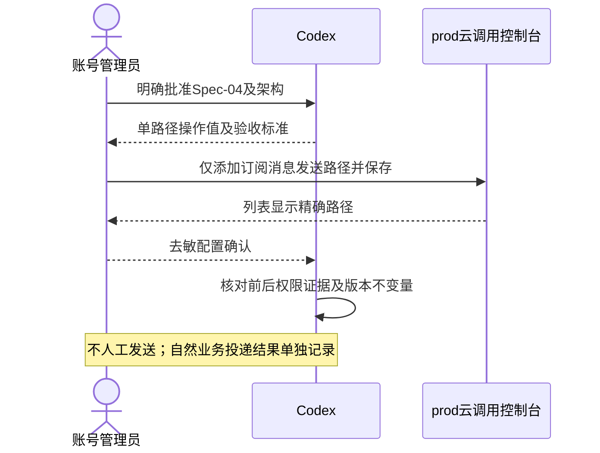
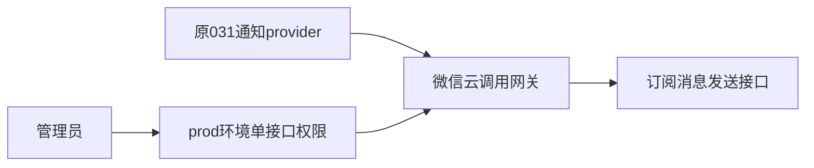

# OPS-20261017 — 补齐订阅消息接口的微信令牌权限

- Template: specs/_templates/BUGFIX-SPEC.md（平台配置修复，无生产代码变更）
- Status: DONE
- Execution phase: CONFIG_VERIFIED；单接口配置、版本不变量及文档闭环验收完成，不代表真实送达通过。
- Severity: 当前账号通知持续失败；云调用必要接口权限缺失
- Risk: R2（生产环境的单一微信开放接口权限）
- Owner / Reviewer / Verifier: 用户
- Implementer: 账号管理员执行控制台操作，Codex核对证据
- Spec revision: OPS-SPEC-20261017-NOTIFICATION-OPENAPI-PERMISSION-FIX-04
- Architecture revision: ARCH-20261017-NOTIFICATION-OPENAPI-PERMISSION-04
- User confirmation: 用户于2026-10-17明确回复“批准 Spec-04，仅添加订阅消息接口权限（推荐）”，对应审批问题call_2314cfc8076f40f88ec0cb8d595c6134；批准本revision及架构中的管理员单接口权限增量、后续只读核验，不改代码/重新部署/补发。实施前已记录批准并置APPROVED，不重复请求审批。
- Affected Feature IDs: FEAT-003
- Feature current state: [FEAT-003](../../docs/domain/features/FEAT-003-notification-channel.md)
- Feature baseline: FEAT-STATE-20261017-NOTIFICATION-CONSOLE-EVIDENCE-03
- Related diagnosis: [已批准-03](OPS-20261017-NOTIFICATION-502-DETAIL-DIAGNOSIS.md)；后续独立获批[单条运行-05](OPS-20261017-NOTIFICATION-SINGLE-EVENT-SMOKE.md)取得当前账号sent/ok并完成清理，本-04仍仅代表配置验收。

## 1. Symptom, reproduction and confirmed facts

当前账号最近核验的10条通知均failed/transport_error；旧业务日志为30次HTTPError。
032/033的无收件人探针在相同路径实测HTTP502，临时版本及其灰度任务已清理，031保持normal/100%。

用户于2026-10-17先提供prod环境“服务管理 / 云调用”的修复前截图：

- 开放接口服务开关已开启。
- 微信令牌权限列表为空，显示“暂无 API 接口，请点击‘配置接口’进行添加”。
- 页面说明未配置的接口无法使用云调用。
- 截图SHA-256及来源见[证据](../../docs/quality/evidence/NOTIFICATION-HTTP-DIAGNOSIS-20261017.md#管理员只读截图证据)。

现有provider固定调用`http://api.weixin.qq.com/cgi-bin/message/subscribe/send`，没有自行获取/传入access_token。
[TCloudBase官方订阅消息示例](https://github.com/TCloudBase/wxcloudrun-wxapp-subscribe)明确要求开启开放接口服务，
并配置`/cgi-bin/message/subscribe/send`白名单。这证明修复前缺少该调用方式的必要权限。

## 2. Root cause and limits

已确认的配置缺陷：修复前总开关已开，但未授予订阅消息发送路径的微信令牌权限，与现有免token调用方式冲突。
用户按批准范围添加后，新截图确认列表包含唯一精确路径、总开关保持开启；必要权限的配置验收通过。
本-04配置验收时仍缺业务结果；后续独立获批-05已取得当前账号单条sent/ok，用户随后明确确认微信已收到0F58。不能从这些证据回溯旧30次精确HTTP状态或平台代理内部码。
不能将旧30次HTTPError全部回溯为502，也不能声称已经排除所有其他发送失败原因。
本修复不改provider的通用transport_error记录方式；可观测性增强若需要另立范围。

## 3. Fix contract

推荐仅由管理员在prod环境的云调用页面添加**一个精确路径**：

`/cgi-bin/message/subscribe/send`

若界面以名称选择，选中发送小程序订阅消息且对应以上路径的项；若以路径填写，仅填写路径，不填域名或查询参数。
保存前核对选中项与以上路径一致，无法确认时停在保存前，不选通配、全部接口或更宽前缀。
若保存时发现该项已存在，不重复添加；复核当前列表及环境，记录事实。

- 本revision只批准这一接口权限的增量；既有总开关保持开启。
- 不更改业务代码、环境变量、入口、资源、令牌挂载配置、流量或数据库。
- 不重新上传/部署/重启版本；031继续100%，032/033保持已清理。
- 不触发dispatch、创建测试通知、重置旧failed记录、补发、修改授权或额度。
- 权限生效后，原有调度器可能按既有偏好和授权自然发送未来到期提醒；这不是本操作人工触发的测试。
- 本次不要求或收集令牌、密钥、OpenID、消息正文、原始日志。
- 保存前后的配置由管理员确认；Codex不绕过控制台站点安全限制。

## 4. Design and trade-offs

| 方案 | 权衡 | 决策 |
|---|---|---|
| 单接口微信令牌权限 | 修复已确认缺口，权限范围最小，不引入新密钥或代码 | 推荐 |
| 开全部接口/宽路径前缀 | 扩大权限，当前功能不需要 | 不采用 |
| 改为自行维护access_token | 增加凭据、缓存、刷新与故障路径，未针对当前配置缺口 | 不采用 |
| 再次重复原探针部署 | 不会补齐权限，增加无必要版本操作 | 不采用 |

### Link/call graph

```text
既有通知调度 -> NotificationsService.dispatch -> WeChatSubscribeSender.send
 -> HTTP固定订阅消息路径 -> 云调用按精确路径授权 -> 微信订阅消息接口
管理员 -> prod云调用 -> 微信令牌权限 -> 添加唯一精确路径
```

### Sequence diagram



### State machine

READY_FOR_REVIEW -> APPROVED -> ADMIN_CONFIGURATION_PENDING -> CONFIG_VERIFIED -> DONE。
保存失败/路径不明确 -> BLOCKED，记录原因；未审批不修改。
配置验证通过可关闭本配置修复Spec，但不代表真实送达验收通过；父诊断Spec按各自完整门禁单独评估。
历史delivery状态机不变，failed不会由本操作重置为pending。

### Architecture diagram



生产模块、共享抽象、依赖方向、扩展点不变；仅恢复现有provider要求的平台运行权限。
Frontend/UI/FDB/FEC/Design Revision/视口验收：N/A，不改产品界面、前端工程或已批准设计快照。

## 5. Expected files and state changes

| 对象 | 预期变化 |
|---|---|
| prod云调用微信令牌权限 | 从截图所示空列表增加唯一精确接口路径 |
| 本Spec、specs/README.md | 审批、实施证据、真实生命周期 |
| FEAT-003、诊断证据、发布记录、运维说明及父Spec | 合并配置修复前后事实，区分配置验收与真实送达 |
| 业务/诊断源码、测试、Schema、前端、Architecture/Behavior/UI合同 | 不改；核对无新增冲突 |

回滚：若本次选中项与批准路径不一致，管理员删除仅本次新增项，恢复原权限列表并停止；不扩大权限尝试修复。
旧failed记录不修复；若之后需要补发，先定义独立的去重、授权、时间与用户意图范围并获批准。

## 6. Required verification

| ID | 检查与期望 | 当前 |
|---|---|---|
| F-001 | prod截图、provider固定路径、官方白名单前提相互核对 | PASS；2026-10-17只读证据 |
| F-002 | 本具体Spec revision及架构明确批准，实施前记录 | PASS；2026-10-17用户明确批准，审批问题call_2314cfc8076f40f88ec0cb8d595c6134 |
| F-003 | 保存后列表包含唯一精确路径，总开关仍开；保留其他既有配置 | PASS；用户新截图444b0e3b显示唯一精确路径及开启开关；截图SHA-256见证据 |
| F-004 | 官方只读API复核031 normal/100%、PUBLIC关闭、无新版本；无需读取密钥 | PASS；配置前后preflight均为031 normal/100%、PUBLIC关闭，仅020—026与031；配置后status确认原版本保留、受保护配置摘要不变、服务字段无变化 |
| F-005 | 文档当前正文、Spec状态/位置、链接及diff检查，源码无新增差异 | PASS；9份文档54个本地链接存在、无尾随空白、git diff --check通过；Feature/运维/发布/证据/索引及父Spec已同步，通知Behavior/Architecture/UI合同无本轮新增冲突，未改源码/测试/批准设计快照 |

本-04阶段真实发送/成功收件：NOT_RUN；配置验证不能冒充微信受理或收件成功。若用户随后提供自然投递结果，按只读证据记录；
没有自然投递结果时保留FEAT-003的真实通道验收缺口，不把它写成配置测试失败。
源码/依赖/Schema未改，Python/npm全套回归与数据库备份、迁移、前端发布门禁N/A；不以历史测试冒充本次执行。

## 7. Approval and closure

依据[AGENTS.md](../../AGENTS.md)要求：
“Wait for explicit user confirmation of the specific Spec revision before production implementation”。
已批准-03另明确禁止改白名单或权限；本-04已按上述用户回复取得单接口增量的明确批准。
管理员已完成配置，F-001至F-005全部适用检查通过；2026-10-17置DONE并移至specs/completed/，索引及引用同步。
真实送达不属于本配置Spec的DONE门禁；在本-04完成时由FEAT-003及父诊断Spec单列未验收。随后独立获批-05已验证当前账号单条日程提醒sent/ok、额度正常消耗及临时日程清理；用户又于2026-10-17明确确认微信已收到0F58（call_5b80efd7f9504c4ca286e2df7e031c75）。不声称所有历史HTTPError均已完全归因。
