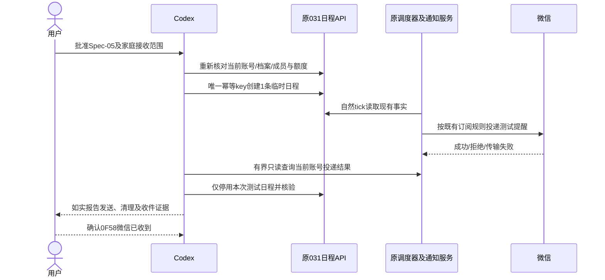
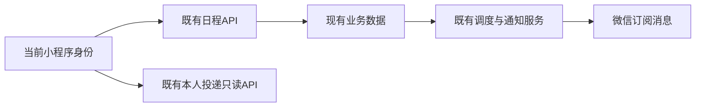

# OPS-20261017 — 用一条临时日程验证真实通知投递

- Template: specs/_templates/BUGFIX-SPEC.md（受控运行验收，不改生产代码）
- Status: DONE
- Risk: R2（创建一条生产测试日程，可向当前家庭订阅者发出真实微信通知）
- Owner / Reviewer: 用户
- Implementer: Codex
- Spec revision: OPS-SPEC-20261017-NOTIFICATION-SINGLE-EVENT-SMOKE-05
- Architecture revision: ARCH-20261017-NOTIFICATION-EXISTING-SCHEDULER-SMOKE-05
- User request: 2026-10-17“你可以模拟测试一条记录”；随后通过下列明确答复批准Spec-05及家庭范围，未把最初准备请求自动解释为向其他成员发消息的许可。
- User confirmation: APPROVED；用户于2026-10-17通过call_5c6ba23a5eed4910bb493dabb8aa6dd2明确答复“批准 Spec-05，允许家庭范围测试”，批准本revision及架构和现有家庭接收范围。
- User receipt confirmation: 2026-10-17，用户在明确询问“通知测试0F58”是否收到的问题call_5b80efd7f9504c4ca286e2df7e031c75中答复“已收到”；该次当前账号实际微信收件验证通过，未采集精确收件时间。
- Affected Feature IDs: FEAT-003；FEAT-001（日程临时数据）
- Baselines: [FEAT-003](../../docs/domain/features/FEAT-003-notification-channel.md)，FEAT-STATE-20261017-NOTIFICATION-PERMISSION-CONFIGURED-04；[FEAT-001](../../docs/domain/features/FEAT-001-push-kids-mvp.md)，仅沿用当前日程API，不改其业务或历史发布状态。
- Prior fix: [单接口权限修复-04](OPS-20261017-NOTIFICATION-OPENAPI-PERMISSION-FIX.md)，DONE；本测试开始前只有配置证据，现已补齐下述单条sent/ok结果。

## 1. Problem, outcome and preparation evidence

需用一条实际经过当前日程、通知outbox、后台调度及微信发送链路的测试记录验证配置修复效果。
本地RecordingSender/伪造sent记录不能证明微信可用，不作为此验收的替代。

2026-10-17本轮只读准备已执行：

- 开发者工具原自动化端口未连接；用官方CLI按仓库测试策略恢复该项目本地自动化连接，未改源码、未上传或发布。
- 真实AppID的callContainer读取me、家庭成员、children、通知settings，均200；只输出计数、布尔值及额度。
- 当前账号已绑定，有日程写权限；家庭成员3名（仅1名is_self），活跃档案2个，当前所选档案仍有效。
- 当前账号日程提醒enabled、订阅accepted、remaining_quota=1，模板存在、channel.available=true。
- 生产基线只读确认031 normal/100%、PUBLIC关闭，仅020—026及031；commit仍8f3c5b04e61c96d4c19cf9eefd26514a8a095e1a，现有未提交诊断改动保留。
- 代码核对：POST calendar-events支持Idempotency-Key；日程planner面向家庭成员，不提供仅向当前账号发送的选项；POST notifications/dispatch会处理全局队列，不适合本次单条验收。
- 首次恢复前通知settings/deliveries复查因AUTOMATION_CONNECTION_FAILED未执行成功；恢复后仅上述4个只读接口通过，不声称已读取配置后的投递结果。

## 2. Proposed scope and observable result

推荐在**用户明确允许家庭范围接收后**，走现有API建立1条非重复的临时日程，使用当前所选的既有活跃档案。
日程名为“通知测试”加本次唯一短标识；开始时间取执行时北京时间约15分钟后，持续5分钟。
消息内容按既有日程模板生成，包含所选档案名称、测试名称和时间；不伪造学习记录或更改复习计划。

收件人按现有产品规则为当前家庭中开关开启、已订阅且有额度的成员；核查时家庭共3人。
这是一条测试日程，**可能产生多个成员各自的投递记录和真实微信提醒**，不能称为只发给当前账号。
每个实际成功的接收者消耗1次既有一次性授权；不补写、重置或伪造额度，不修改他人偏好。
若用户仅允许自己收件，停止本方案，在创建之前修订为单人方案并重新明确具体实现范围。

目标证据分层：

1. 创建201并在当前档案日程中确认唯一测试事件。
2. 当前账号出现与唯一测试标识明确匹配的schedule_reminder，记录真实state/result_code/sent_at。
3. sent/ok代表现有provider得到微信成功业务码；实际手机收件仍由用户确认，不能仅凭sent替代收件事实。
4. 失败或超时如实报告，不写入假的sent，不自动另建测试记录或重置旧失败行。

## 3. Execution contract

- 通过当前真实小程序身份及既有family-scoped API操作；不伪造身份、不读取OpenID/密钥或直连数据库。
- 创建前重新核对目标AppID/env/service、账号family/member/所选档案、成员范围和当前账号授权额度；家庭上下文变化、额度不足或无法确认范围时停在创建之前。
- 名称和待显示headline按现有截断规则预核，确保唯一测试标识完整可见；否则不创建，不能靠相似正文猜测投递对应关系。
- 只POST一次业务创建，固定完整payload及一个稳定Idempotency-Key；返回不确定时先用同一家庭/档案当天日程核对，不改key盲重试或创建第二条。
- 不调用全局dispatch，不增加任何测试API，不重启、上传、部署、切流或调整调度开关；由原调度器处理测试事件。
- 当前账号投递历史按现有有界API读取，每30秒最多一次，至多20轮/约10分钟；唯一匹配才记录结果，有歧义不宣称成功。
- 允许同一delivery按现有策略最多3次HTTP尝试（既有60/300秒退避），不修改重试策略；不是重复创建测试记录。
- 当前账号达到终态或观察超时后，通过DELETE calendar-events/{本次event_id}停用仅本次日程，再读当日日程确认不再列出。
- 该DELETE按现有实现只是active=false，保留幂等与投递审计；不物理删除业务表，也不保证撤销已入队/在途通知。其他符合条件成员的投递可能继续按既有策略完成；此事实须纳入家庭范围确认。
- 清理不触碰旧业务日程、历史failed记录、授权、额度或其他成员设置；若创建结果未知，先恢复本次唯一事件身份后清理，不能批量按模糊名称删除。
- 仅在内存处理姓名、family/member/child标识及响应正文；证据仅输出唯一测试标识、时间、状态、数字/固定结果码与计数。短期恢复状态可保留本次event_id、幂等key及合成时间字段，不保存OpenID、令牌、儿童名称或原始响应。
- 微信真实通知无法通过删除日程撤回；成功发送后不为恢复额度而伪造再次授权。

## 4. Design and trade-offs

| 方案 | 收益 | 限制 | 决策 |
|---|---|---|---|
| 现有临时日程+原调度链路 | 验证真实业务链路，不改代码或部署 | 按家庭接收规则发送，需明确允许该范围；会消耗实际额度 | 已获具体范围批准并执行 |
| 新增仅本人测试接口 | 可精确限定单账号 | 需要新的API、安全/限流/幂等设计、代码测试与发布，当前未批准 | 仅用户选择单人后另修订 |
| 直接调全局dispatch | 不需等待tick | 会影响其他到期消息，超出单条测试意图 | 不采用 |
| 单元测试RecordingSender | 无真实发送 | 无法证明生产微信链路可用 | 不作为真实投递验收 |

### Link/call graph

```text
当前账号 -> POST /calendar-events（唯一key，当前档案）
 -> 原NotificationScheduler.tick -> NotificationPlanner.plan_schedule_reminders
 -> 家庭订阅受众 -> NotificationOutbox -> NotificationsService.dispatch_due
 -> WeChatSubscribeSender -> 微信订阅消息
当前账号 -> GET /notifications/deliveries（唯一标识匹配）
 -> DELETE /calendar-events/本次event_id -> GET 当前档案当日日程
```

### Sequence diagram



### State machine

READY_FOR_REVIEW -> APPROVED -> PREFLIGHT -> EVENT_CREATED -> OBSERVING -> TERMINAL/TIMED_OUT -> EVENT_DISABLED -> FACTS_MERGED。
创建前范围/额度不满足 -> BLOCKED且不写业务数据；发送失败不自动重新建事件。
投递沿用pending -> sending -> sent/failed/skipped/cancelled及既有退避，不增加新状态。

### Architecture diagram



模块/共享抽象/依赖/扩展点不变。Frontend engineering、UI/FDB/FEC/Design Revision/视口导出：N/A，不改产品界面或前端工程；临时测试数据不构成UI改版。

## 5. Expected changes and verification

| 对象 | 预期 |
|---|---|
| 当前家庭日程数据 | 仅1条合成非重复事件；结束后按API停用 |
| 当前家庭通知数据及额度 | 仅现有调度产生的测试投递；成功接收者正常消耗一次性额度 |
| /private/tmp受控执行/恢复状态 | 唯一key、测试标识、状态；不保留身份或响应原文 |
| 本Spec、索引、FEAT-003/FEAT-001相关验收、证据及发布记录 | 合并实际创建/投递/清理结果，区分sent与手机收件 |
| 生产源码/测试/Schema/权限/流量/其他日程/设计快照 | 不改 |

| ID | 必需检查 | 当前 |
|---|---|---|
| S-001 | 路由、幂等、planner受众、投递/重试、DELETE软停用、只读前置核对 | PASS；本Spec上述代码核对及4个200、成员3/档案2/额度1、031基线；未读取配置后投递结果 |
| S-002 | 具体Spec及架构/家庭接收范围明确批准 | PASS；2026-10-17用户明确批准Spec-05及家庭范围，见User confirmation |
| S-003 | 执行前账号/档案/家庭范围/额度/测试标识可识别复核 | PASS；既有只读bootstrap同步后4个200、bound/写权限/家庭及所选档案一致，成员3、日程额度1/accepted，channel可用，0F58完整可见、旧匹配0 |
| S-004 | 唯一日程创建、去重识别、原调度有界观察及真实结果 | PASS；仅1次POST 201，日程精确匹配1；第1轮30秒观察到唯一schedule_reminder sent/ok，sent_at=2026-10-17T10:49:19Z，额度1→0/expired |
| S-005 | 仅本次事件停用并核验；不误删旧数据；不伪造通知/额度 | PASS；DELETE仅本次event_id 204，再查同档案当日ID/合成名称匹配0；不重置旧失败或授权，不宣称物理删除或撤回在途通知 |
| S-006 | 官方只读复核031/入口/原版本，文档及链接/生命周期闭环 | PASS：031 normal/100%、PUBLIC关闭、productionConfigUnchanged=true、changedServiceFields=[]、原版本保留、033不存在且任务stopped；11份文档76个本地链接存在、无尾随空白、git diff --check及DONE/迁移检查通过；相关业务/Architecture/UI合同无本轮新增冲突 |
| S-007 | 用户确认当前账号本次真实微信收件 | PASS；2026-10-17在call_5b80efd7f9504c4ca286e2df7e031c75明确答复“已收到”，仅补齐既有Spec第2节的收件证据，不增加发送或实施范围 |

无新增生产代码、依赖、Schema、配置或前端发布，完整Python/npm回归、构建发布及数据库迁移/备份N/A；不拿先前测试结果冒充本次真实发送。
本Spec完成需真实投递结果（成功或明确失败）及测试事件清理证据、文档闭环；观察超时但没有明确终态时保持active并记录缺口。
成功手机收件需用户确认；若只取得sent则仅记录微信已受理，不声称手机收件已验证。

## 6. Approval and lifecycle

依据[AGENTS.md](../../AGENTS.md)“Wait for explicit user confirmation of the specific Spec revision before production implementation”，
本方案创建前已取得用户对Spec-05及家庭受众范围的明确批准。
已按本合同完成1条真实日程创建、原调度投递及软停用，状态DONE并移至specs/completed/；未调用全局dispatch、重新部署、补发旧消息或创建第二条日程。
唯一合成名称“通知测试0F58”，日程2026-10-17 19:05—19:10 CST；scheduled_at=10:49:18Z，sent_at=10:49:19Z（18:49:19 CST），当前账号sent/ok。
本机连接失败与首次账号上下文未同步均在创建前被守卫拦截；恢复官方CLI及只读bootstrap后沿用同一标识/key，只有1次POST创建。
批准家庭接收范围不等于取得全部成员结果；本API只核验当前账号。用户随后明确确认微信已收到0F58，补齐本次当前账号实际收件证据；其他成员/通知类型未逐一验收。不再发送第二条测试或更改授权额度。
证据见[质量记录](../../docs/quality/evidence/NOTIFICATION-HTTP-DIAGNOSIS-20261017.md)。Feature/Behavior/Architecture/UI及发布合同已按实际影响核对：只增加已验证运行事实，业务合同及批准设计快照未改，无本轮新增代码/文档冲突。
