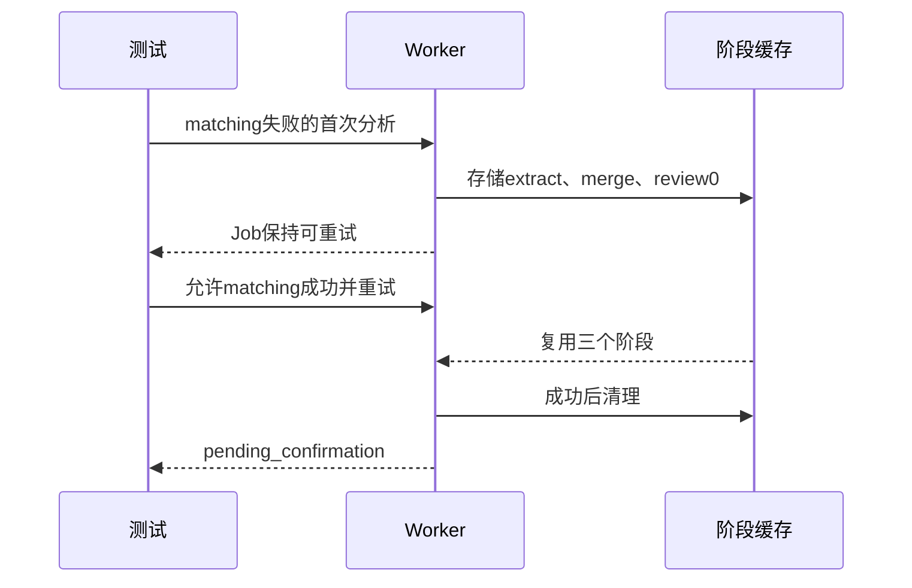

# OPS-20261031 — 发布阶段缓存测试维护（Spec Lite）

- Status: DONE
- Risk: R1；单个集成测试与验证记录维护，无运行时变更
- Owner: 产品负责人（用户）
- Implementer: TRAE
- Reviewer: TRAE，实施后新上下文独立只读复核；[Review01](../../docs/quality/evidence/client-release-20261031/backend-authorized/test-maintenance01/review01.md)
- Date: 2026-10-31
- Spec revision: SPEC-20261031-RELEASE-STAGE-CACHE-TEST-01
- User confirmation: APPROVED；产品负责人（用户），2026-10-31 Asia/Shanghai，本轮明确回复“批准测试维护 Spec01”，对应 `SPEC-20261031-RELEASE-STAGE-CACHE-TEST-01`
- Affected Feature IDs: FEAT-001；FEAT-012 仅为受阻发布对象
- Feature current-state documents: `docs/domain/features/FEAT-001-push-kids-mvp.md`、`FEAT-012-child-photo-footprints.md`
- Feature baseline revision: 以当前正文为准；后端发布对象为 `staged-20261031-06`
- Feature merge owner: TRAE

## Frontend Design Impact and Repository-native Approval

- Frontend impact: no；不改变界面、交互或设计
- Frontend engineering impact: no；不改变前端源、工具链或质量门槛
- Affected UI IDs / baseline / FEC / Design Revision / editable source / SHA / exports: N/A；本Spec仅维护后端集成测试
- Frontend verification: 原旅行Spec的原生三视口、主路径、设备及权限门禁继续适用；本批准不豁免
- Approved deviations: none

## 1. Problem and outcome

精确兼容后端候选沿用已部署038的知识点质量流程，仅叠加BUG-035两份足迹源。真实MySQL5.7测试
`test_mysql_stage_recovery_and_indexes`在matching失败时观察到3份阶段结果，但仍断言2份。
已批准且开发DONE的[知识点Spec03](../completed/FEAT-001-KNOWLEDGE-POINT-ABSTRACTION-PROMPT.md)
规定 extraction → merge → quality review → matching；首次quality review为`review0`，理应参与持久化恢复。
这是测试与已批准合同的不一致，不能删去quality阶段来通过发布。

目标：测试精确核验提取、合并、质量审查三个成功缓存的身份、恢复复用及成功后清理，避免仅放宽数量。
原失败证据保留：[实库失败](../../docs/quality/evidence/client-release-20261031/backend-authorized/mysql57-isolated-staged_mysql.log)。

## 2. Scope

- 仅修改上述既有集成测试：断言三个`unit_key`及绑定的family/job，保留索引计划检查。
- 重试时核验extract、merge、review不重复调用，matching按既有重试合同执行，成功后临时阶段清空。
- 原pipeline、模型、provider、API、Schema、确认边界、日志与发布包保持不变。
- 不包含BUG-036的后续生成行为、测试豁免、数据修改、流量切换或最终发布。
- Feature当前正文仅归并已运行测试证据，不修改产品事实或将云smoke写成PASS。

## 3. Impact map

`pytest → test_mysql_stage_recovery_and_indexes → AnalysisWorker → StagePipeline → StageStore / MySQL5.7`

## 4. Required design views

### Link/call graph

沿用上述调用路径；没有新增依赖或跨域访问。

### Sequence diagram

### State machine

`queued → retryable failure + 3 scoped caches → retry → pending_confirmation + zero caches`。
非法：重跑已有效review、错误family/job缓存被复用、分析直接形成正式记录。

### Architecture diagram

N/A：仅测试断言，既有模块边界和依赖方向不变。

### Trade-offs

| 方案 | 收益 | 代价/风险 | 决定 |
|---|---|---|---|
| 精确阶段身份和调用次数断言 | 证明新增review真的可恢复且不重复调用 | 维护一个既有集成测试 | 推荐 |
| 将数量放宽为≥2 | 容易通过 | 可能掩盖多余缓存或缺少review | 拒绝 |
| 删除review或跳过测试 | 无有效收益 | 违反已批准合同与发布门禁 | 拒绝 |

## 5. Expected file changes and deletion plan

| 路径 | 动作 | 目的 |
|---|---|---|
| `tests/integration/test_staged_mysql.py` | modify | 精确缓存身份、review复用及清理断言 |
| 本Spec、发布报告与测试证据 | modify/add | 记录Red/Green与真实发布阶段 |
| FEAT-001/FEAT-012、测试策略和Spec索引 | modify | 合并已验证事实并检查正文一致性 |

Final authoritative path: 原测试函数；不建平行测试或兼容跳过分支。生产发布payload不包含测试。

## 6. Acceptance criteria

- AC-001：matching失败后恰有extract/merge/review0三个已验证结果，均属于本family/job；没有matching成功缓存。
- AC-002：重试复用三阶段，provider相应调用各一次；最终pending_confirmation，阶段缓存清空。
- AC-003：索引计划、MySQL5.7、家庭隔离和分析只产生可编辑提案的原断言保持。
- AC-004：原必需检查全部通过才部署；前端仍待兼容后端、定向健康/主路径、适用双账号及三视口证据。

## 7. Required test points

| 编号 | 验证 | 必需结果 |
|---|---|---|
| TP01 | 精确冻结后端＋独立utf8mb4 MySQL5.7，运行原函数 | 修订前保留FAIL，修订后PASS且精确身份/复用/清理成立 |
| TP02 | 同文件两项实库测试、其余独立MySQL矩阵 | PASS，skip逐项解释 |
| TP03 | 精确候选完整unit/integration/contract及足迹五万规模 | PASS；生产源与manifest仍匹配 |
| TP04 | 改动测试Ruff/format、文档引用和当前正文冲突检查 | PASS |

命令：受控runner仅从本机临时库安全注入URL，执行
`pytest -o pythonpath=. tests/integration/test_staged_mysql.py -q -rs`。
不得把数据库URL写在命令参数、聊天或报告中。

## 8. Plan

1. 获得本修订批准；读单测维护技能并按其强制流程执行。
2. 保留已观测FAIL，按精确已批准合同修订原测试。
3. 从相同候选补齐TP01..04，复核发布门禁，继续已授权后端与前端交付。

### Approval record

- Approver: 产品负责人（用户）
- Date: 2026-10-31 Asia/Shanghai
- Message reference: 本轮用户消息“批准测试维护 Spec01”
- Approved revision: SPEC-20261031-RELEASE-STAGE-CACHE-TEST-01
- Scope: 原集成测试的精确三阶段身份、复用与清理断言及必要验证；既有前后端交付授权继续有效，平台人工门禁不变。

## 9. Verification

- TP01：FAIL_BASELINE保留原1 PASS / 1 FAIL（预期2、实际3）；批准后两轮实库均2 PASS。最终精确身份、queued/attempt1、三阶段各调用一次、matching两次及成功清理全部通过。
- TP02：PASS；同文件两项及10模块独立utf8mb4 MySQL5.7矩阵全部通过；公平复习13 PASS / 1 SQLite参数skip。
- TP03：PASS；精确冻结后端完整789 PASS / 46条件skip，实库另验；足迹五万规模5 PASS。154后端/168前端清单与源码SHA仍匹配，生产源未因本Spec改变。
- TP04：PASS；第一轮Ruff PASS / format FAIL仅修正换行；第二轮Ruff/format PASS。新上下文只读复核0确认发现，最终文档链接、生命周期和冲突检查见[闭合证据](../../docs/quality/evidence/client-release-20261031/approved-delivery-closure.json)。
- 证据：[测试及七步流程](../../docs/quality/evidence/client-release-20261031/backend-authorized/test-maintenance01/README.md)、[最终发布阶段](../../docs/deploy/releases/20261031-travel-diary-backend-compatibility.md)。无运行时变更、测试豁免或生产数据修改。

## 10. Completion

开发完成：批准范围内单个测试维护与TP01..04已完成，Status DONE，2026-10-31迁至
`specs/completed/OPS-20261031-RELEASE-STAGE-CACHE-TEST-MAINTENANCE.md`。本Spec没有运行时交付物，测试不包含于生产payload；其验证的精确兼容后端已由039正常部署交付，不将此描述为“测试上传”。

独立发布验收：039 normal / 0% / 1副本，038 normal / 100% / 1副本，PUBLIC关闭。
实际运行账号本地只读Schema探针FAIL_ENVIRONMENT（OperationalError），未证明039定向ready/业务smoke；
服务健康200只覆盖部署前既有路由。前端preview成功但未upload/bump，入口两宿主320七态通过，
390/430、完整动作/设备及新focus双账号/非owner仍未验。这些事项不追记PASS或豁免。
BUG-035两端交付未齐、导入和入口精简客户端未上传，三项继续VERIFYING于active；其恢复条件见发布报告。
