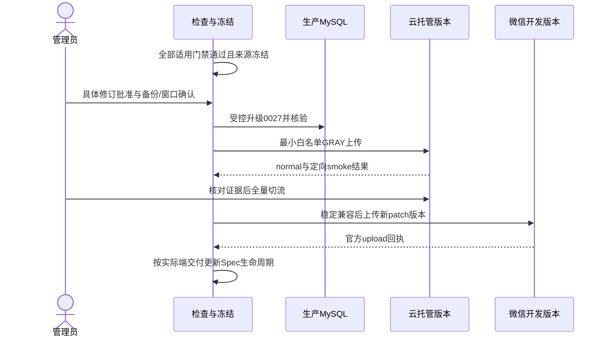
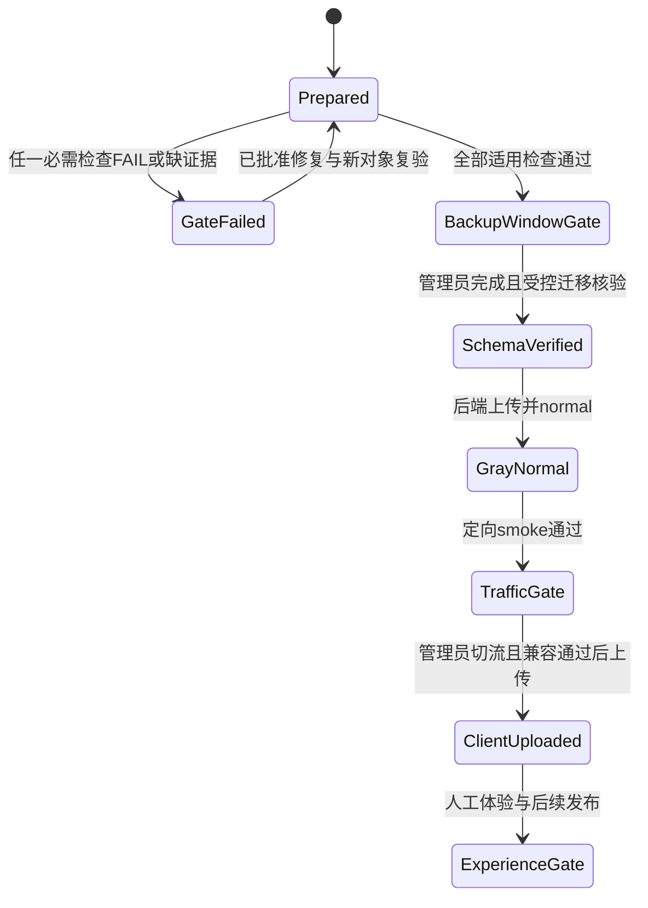
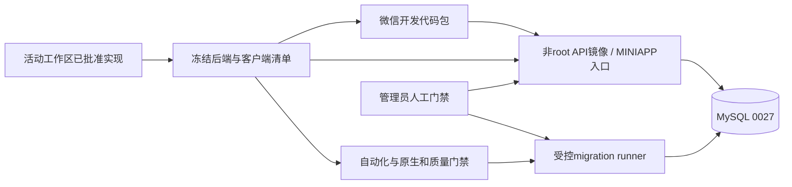

# OPS — 当前服务端与客户端更新交付

- Status: DONE

## 2026-11-06 开发完成与独立验收

- Development completed: 2026-11-06；依据已批准GOV-002的匹配云交付规则，迁入`specs/completed/`。
- Release authorization: 用户已批准OPS Spec01、确认本次备份/受控窗口，并明确“无需灰度账号，直接发布”（原话“不用配置 直接发布”）。原任务本地实施授权与后续发布授权分别保留。
- Delivered scope: 0025→0027生产迁移、040正常100%及0.1.18官方上传均已完成；生产读取和原生主路径独立留证。
- Source / stages: HEAD`0576ac30464908154c624effed41df6dfa3110cc`＋批准差异，冻结manifest SHA`c96b30d102d2fff317865040bd8b65c419bbb1374689199c41bcebcd0b157f60`；后端040 normal/100%、Schema0027，客户端0.1.18开发上传1,200,417字节。
- Acceptance: 已执行范围见[发布报告](../../docs/deploy/releases/20261106-fullstack-040-client-0.1.18.md)和[新EVD](../evidence/EVD-20261106-FULLSTACK-DELIVERY.md)。家长内容PENDING、线上生成成功率NOT_MEASURED、设备/可访问性及其余业务验收缺项保留原状态；开发DONE不等于完整验收PASS。尚未设体验版、提审或正式发布。备份保留数量因站点安全策略阻断NOT_RUN。
- Closure: Feature/Behavior/Architecture/UI/测试策略/发布入口与索引按实际交付同步；批准设计源、历史失败和各阶段manifest保持。

## 原批准设计与实施时点记录

> 以下保留原修订、各历史运行及当时的“本地/未交付/VERIFYING”结论，不作为当前开发状态；当前交付以上节及新EVD为准，原验收失败不追改。
- Risk: R3，生产Schema及版本切换；测试维护不改变产品行为。
- Spec revision: `OPS-SPEC-20261105-FULLSTACK-UPDATE-01`
- Architecture / release revision: `OPS-ARCH-20261105-FULLSTACK-UPDATE-01`
- Created / Last updated: 2026-11-05
- Template: FEATURE-SPEC；发布操作视图及测试维护合并表达。
- Owner / Implementer: 产品负责人 / Codex；Reviewer：独立只读acceptance_review。
- User request: 本聊天2026-11-05“好的，检查本地的服务端和客户端的代码，打包上传 更新”。已授权检查、准备和发布现有已批准实现；不把它追认为下述新测试修订或未展示的停服窗口批准。
- Specific revision approval: APPROVED。批准人为用户，日期2026-11-05，消息引用为本聊天“批准 OPS Spec01”；对应`OPS-SPEC-20261105-FULLSTACK-UPDATE-01`与`OPS-ARCH-20261105-FULLSTACK-UPDATE-01`。批准两项最小测试维护、质量失败诊断、原生证据补验及门禁通过后的受控交付方案；生产窗口、备份、全量切流等人工门禁仍分别执行，不由此推定已完成。
- Affected Features: FEAT-001（工作日、知识生成/辅助验收、报表）、FEAT-005（归档UI）；已发布旅行代码只作兼容回归。
- Baselines: FEAT-001 `FEAT-STATE-20261105-SYSTEM-ONE-14`、FEAT-005 `FEAT-STATE-20261105-CHILD-ARCHIVE-UI-04`；[Feature001](../../docs/domain/features/FEAT-001-push-kids-mvp.md)、[Feature005](../../docs/domain/features/FEAT-005-multi-child-profiles.md)。
- Current delivery: 040 normal/100%、Schema0027，客户端0.1.18官方上传1,200,417字节并bump；尚未设体验版、提审或正式发布。当前证据见[新EVD](../evidence/EVD-20261106-FULLSTACK-DELIVERY.md)。
- Source: HEAD `0576ac30464908154c624effed41df6dfa3110cc` +已列明工作区差异。冻结`dist/fullstack-release-20261105/`，manifest SHA256 `c96b30d102d2fff317865040bd8b65c419bbb1374689199c41bcebcd0b157f60`。
- Evidence / release record: [发布检查](../../docs/deploy/releases/20261105-fullstack-update-preparation.md)。

最终续验：相同冻结源自动化和v2质量门禁通过；93组原生状态节点/PNG保持；320/390确认框CUA视觉和取消已补，430原证据保持。工作日两处实际HTTP保存/回填、摘要及来源跳转经原生AX观察PASS；合成SQLite及私有三文件配置例外独立记录，设备/可访问性仍NOT_RUN。040 normal/100%、Schema0027，客户端0.1.18官方上传1,200,417字节并bump；尚未设体验版、提审或正式发布。具体失败/重试及受控迁移见新EVD；家长内容与设备验收独立，旧40 FAIL保持。

## 1. 范围及发现

目标是交付当前已经批准的实现：BUG-036当前Pro生成/缓存与System One辅助验收，工作日Spec02与文案Spec01，BUG-033归档UI、BUG-037页脚提示。旧Spec05分类/近期池生成实验不恢复；不调整生成成功率分母、科目评分、重试策略或质量阈值。

冻结后端160项白名单、1,607,791字节，客户端168项、1,244,228源字节；相对0.1.17客户端有14份变化。官方preview编译包1,200,319字节。迁移0026是两个默认false列，0027是保留的租户领先索引；应用head为0027。迁移文件单独发布，不混入运行包。

批准前检查发现（历史失败保留；后续修复结果见上文及TP表）：

1. 全Python987PASS/56SKIP/1FAIL，失败是请求字节真实SDK测试的3秒deadline；隔离运行仍FAIL。该测试应核验运输字节，不额外定义冷SDK初始化3秒SLA。生产deadline、两槽、取消及超时测试保持。
2. 迁移回归`test_supersession_mysql.py:281`执行`upgrade head`后仍断言0025；实际head0027。应修正明确预期，不改迁移或删除数据/降级保护断言。
3. 首次MySQL通跑私有harness未满足各文件独立库/迁移/前缀合同，保留首败；第二轮按文件重新迁移独立库，46PASS/1FAIL/1ERROR，ERROR为today基库未创建；独立修正harness后today单项1PASS。十个文件按最终独立对象合计47PASS/1FAIL，不称一次完整PASS、不隐藏前两轮。
4. 原生节点证据已存在，但BUG033和工作日部分截图/实际动作未齐。本次320切换及官方重连后仍RPC超时/连接失败，不以preview代替。
5. 原40条live Ark门禁、每科阈值及内容验收仍适用；43/45真实材料回放不替代。本次原40门禁实际37/40＝92.5% FAIL，语文14/15、数学13/15、英语12/15；两个Pro review1终态拒绝和一个subject.mismatch，正式写0。按评分合同可区分38份非空产物与37份门禁通过，不把漏科目的产物计为门禁PASS。不重跑同源取最好。

## 2. 推荐修正及取舍

| 方案 | 取舍 |
|---|---|
| 推荐：两项必要测试维护、补原生证据、门禁通过后受控迁移发布 | 保留产品代码与验收标准；需确认生产窗口/备份与0027兼容恢复方案 |
| 新增039桥接版以接受0025/26/27 | 可减少启动不兼容窗口，但新增生产Schema接纳行为，且不解决旧代码对workday=true行的业务语义；本修订不实现，需另批准架构修订 |
| 直接迁移后继续将039作为回滚点 | 不可采用：039严格校验0025，0027后ready失败；已有workday=true行时旧业务代码也不安全 |
| 以历史988PASS、39/40或本次43/45代替当前必需门禁 | 不可采用：对象、时点及分母不同 |

已批准的测试维护只涉及：

- 真实SDK字节测试给本地MockTransport序列化足够且有界的30秒预算，保留实际SDK、本地transport、中文/图片以及精确字节断言；不改任何生产预算，也不更改专门的deadline/queue/cancellation测试。
- 将head升级断言改为批准链的明确`20261105_0027`，保留空库、数据、守护降级、重升级和`command.check`验证。
- 私有MySQL Runner按文件独立数据库，预迁移运行库、独立空迁移库，满足grade_/today_learning_test前缀；不放宽测试隔离保护。
- 若新40例或内容仍FAIL，只诊断并提出对应生产修订，不能在此Spec内扩大Prompt/生成策略修复或降低标准。

## 3. 发布设计与恢复边界

沿用[发布入口](../../docs/deploy/README.md)、[后端手册](../../docs/deploy/BACKEND-RELEASE.md)、[前端手册](../../docs/deploy/FRONTEND-RELEASE.md)。本修订不改变模块、依赖方向或扩展点，不新增通用发布框架。

旧039在0027上不能ready，故本次不满足免新增备份的“旧版继续服务”条件。必须先由管理员完成备份，并确认受控迁移窗口及恢复负责人，再执行生产升级；未获具体窗口确认不开始。0027以后以理解workday字段的相同冻结代码/镜像及经验证的配置回退，或前向修复恢复；039不能被称作0027兼容回滚点。System One关闭仅恢复同一Pro生成，不禁用工作日逻辑。

Schema升级后的新版本先GRAY，normal后执行真实微信定向live/ready及业务smoke；全量流量仍由管理员按手册确认。客户端在目标后端稳定且主路径/兼容和原生门禁通过后，按版本工具计算0.1.18并上传；上传成功才bump，后台版本变化时先核实基准。选体验版、提审、正式发布分别人工操作，不由本Spec自动推进。备份清理沿用最新3份规则，未发布前不提前删除备份。

### Link / call graph

```text
批准测试维护 -> 全量与隔离MySQL -> 固定40 / 原生 / 内容门禁
 -> 冻结清单与secret scan -> 备份和窗口人工门禁
 -> 受控migration runner 0025→0026→0027 -> runtime CRUD/strict schema检查
 -> GRAY不可变后端 -> 微信定向smoke -> 人工全量
 -> 版本工具 / frozen client -> official upload -> 人工体验/审核/正式发布
```

### Sequence



### State machine



### Architecture



## 4. 前端影响与预期文件

本Spec新增Frontend impact: no、Frontend engineering impact: no，不改前端源码/工具或可见设计。发布范围已有批准BUG033 DREV01、BUG037 DREV01、工作日DREV02/03及其FEC合同；原生三视口不能豁免。新DREV/设计源N/A，理由是本Spec只验证/交付已有批准设计。

| 路径/对象 | 预期动作与必要性 |
|---|---|
| `tests/unit/test_stage_provider.py` | 仅字节合同测试预算维护；保持超时合同专项 |
| `tests/integration/test_supersession_mysql.py` | 仅head0027断言同步；不删除保护验证 |
| 私有harness、`dist/fullstack-release-20261105/`后续新冻结目录 | 独立MySQL、节点/截图与发布来源绑定，不回写生产数据 |
| `apps/api/src`、小程序、0026/0027迁移、pyproject/uv.lock | 本Spec不再修改；沿用已批准冻结源，实际任何变化重新冻结并验证 |
| 发布/EVD/Review/Feature/UI/Spec/测试策略/ISS索引 | 按结果闭合；未运行不PASS，未云交付不DONE |
| 云端DB/后端版本/微信开发包 | 门禁通过且人工条件满足后受控升级/上传；Git提交推送、正式发布不在范围 |

## 5. 必需测试与完成条件

| TP | 必需条件 | 当前 |
|---|---|---|
| R01 | 范围、批准Spec/DREV、HEAD与逐项SHA，无未授权代码 | 冻结/独立只读核验PASS；用户2026-11-05批准OPS Spec01，两项测试维护已授权 |
| R02 | Python全量、前端、lint/type、DAG/设计/小程序/diff | 批准后Python988PASS/56条件SKIP、专项25、前端359及静态PASS；批准前987/1FAIL及隔离FAIL保留 |
| R03 | 每文件独立MySQL5.7、权限/lease/跨家庭/图片/迁移与规模 | 批准后同一隔离5.7.44运行十文件共48PASS/0FAIL/0SKIP；每文件独立库，容器销毁。不是默认56skip全部覆盖；批准前各轮首败另存 |
| R04 | 新库及0025→0027迁移/current/check | 隔离MySQL两路径PASS；SQLite既有四索引漂移不扩大为云故障 |
| R05 | 当前固定40整体≥38/40、每科≥90%、零空/剩余pending/正式写；内容独立 | v2自动门禁PASS：获批材料Spec07后唯一完整单轮40/40、三科各15/15，empty/pending/formal0，约527.8秒；原37/40 FAIL保持。独立样本供内容review，家长质量PENDING |
| R06 | 相关批准原生三视口节点/PNG、关键动作与适用设备 | 原生状态93组节点/PNG、三视口确认框视觉/取消及实际工作日保存/回填/摘要/来源跳转PASS；设备/大字/读屏NOT_RUN，在体验阶段补验，整体原生验收PARTIAL。 |
| R07 | 最小白名单、secret scan、压缩包≤2MiB、非root8000/live/ready/SIGTERM | dryrun、官方preview和本地test容器合同PASS；云模式不能据此称PASS |
| R08 | 新备份、受控窗口、0027兼容恢复点、秘密/运行配置、真实生产Schema | 用户确认备份/恢复路径/受控窗口；窗口内生产0025→0027/current/check、strict17触发器、双投影及实际040 CRUD无DDL/schema PASS。未执行恢复演练。 |
| R09 | 后端GRAY正常、微信定向smoke、人工全量与稳定兼容 | 040先GRAY normal0%；用户明确跳过测试账号直接发布。助手全量前读已为100%，未重复mutation；最终normal100%、七路真实微信GET200。定向灰度smoke NOT_RUN_USER_SKIPPED，不补记PASS。 |
| R10 | 版本工具、官方upload回执/bump、备份保留、文档闭合 | 官方preview1200319、upload0.1.18/1200417字节及bump PASS；对应Spec归档与文档核对完成。备份保留列表受站点策略拦截NOT_RUN，需管理员核对。 |

完成按实际交付端核对GOV-002：新后端normal/新客户端成功upload覆盖具体Scope后才对应DONE；两端任务核对两端。测试维护、本地build、preview或旧039/0.1.17均不满足云交付。内容/原生/设备/审核缺项如实保留，不借开发DONE消除门禁。
