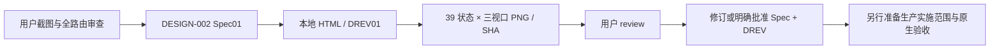
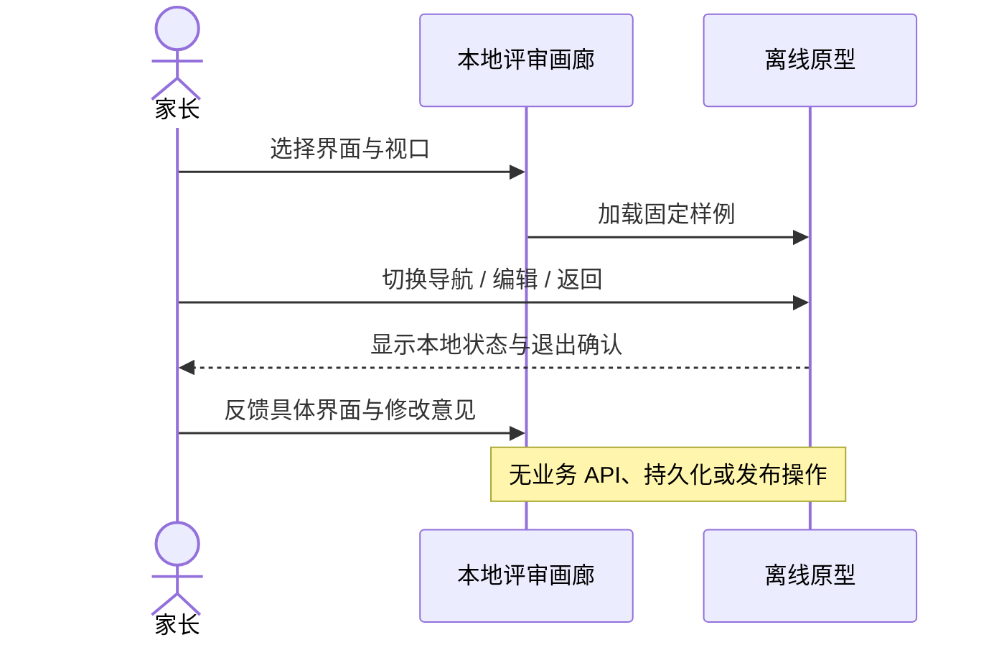
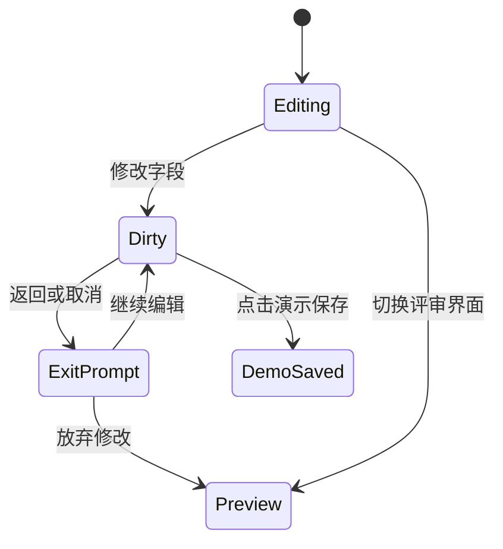

# DESIGN-002 — 全界面 UI 与交互优化评审稿

- Status: READY_FOR_REVIEW
- Risk: R1（仅离线设计产物；不实施业务功能）
- Spec revision: `DESIGN-002-SPEC-01`
- Created / Updated: 2026-11-06
- Owner / Reviewer: 产品负责人（用户）
- Designer / Verifier: Codex
- Target release: N/A — 本轮只交付效果图，未安排发布
- User request: “你来给出需要优化的界面的 预期效果图 我来review”；随后“继续”。授权准备评审稿，未授权生产实施。
- Approved Task Spec revision: PENDING
- Approved Design Revision: PENDING
- Production implementation: NOT_STARTED
- External design dependency: none

## 0. 问题与目标

用户截图中，设置页“添加每日任务”的浅灰底与其他添加入口不一致。此前逐页 review
还发现按钮层级、卡片密度、图标语言、触控区域、弱文字、表单退出与错误定位值得统一。
本轮以可打开、可点击的本地 HTML 和三视口效果图，让用户先评审完整方向。

交付覆盖 app.json 的 17 条路由，使用合成样例；不连接 API、不读写真实家庭资料，
不改小程序、后端、数据库、发布配置或已批准的设计资产。

## 1. 依据、影响与边界

- Frontend impact: yes — 提议统一视觉与交互，当前仅评审设计。
- Frontend engineering impact: yes — 独立 HTML 原型的控件、状态、表单及响应式验证。
- Baseline: `FDB-20260913-04`；沿用暖纸、松绿、衬线标题和系统正文。
- Engineering contract: `FEC-20261007-NATIVE-GEOMETRY-02`，原生产约束继续有效；无例外。
- Proposed DREV: `DREV-20261106-UI-CONSISTENCY-01`。
- Editable source: [index.html](../../docs/design/frontend/prototypes/DREV-20261106-UI-CONSISTENCY-01/index.html)。
- Design contract / route-state map: [FRONTEND-SPEC.md](../../docs/design/frontend/prototypes/DREV-20261106-UI-CONSISTENCY-01/FRONTEND-SPEC.md)。
- Exact viewports: **320×568 / 390×844 / 430×932**，CSS 逻辑像素，导出 DPR=1。
- SHA-256 source/export manifest: [manifest.json](../../docs/design/frontend/snapshots/UI-001/DREV-20261106-UI-CONSISTENCY-01/manifest.json)。
- Approval record: [APPROVAL.md](../../docs/design/frontend/snapshots/UI-001/DREV-20261106-UI-CONSISTENCY-01/APPROVAL.md)，PENDING_REVIEW。
- Affected quality: component/state/form、响应、可访问性、图表口径、隐私、动效。
- Budgets: 所有产品按钮、输入及文本域高度≥44 CSS px；关键说明≥14px；无横向溢出；不加载外部依赖、字体、媒体；仅浮层使用轻阴影。
- Feature merge owner: Codex；仅获批并实施后更新 Feature/UI 当前正文。

### 当前状态来源

| Feature | 当前依据 / 本设计关联 |
|---|---|
| FEAT-001 | [MVP](../../docs/domain/features/FEAT-001-push-kids-mvp.md)，20261106-040-0.1.18 交付；今日、日程、学习、报表、草稿、详情 |
| FEAT-002 | [家庭协作](../../docs/domain/features/FEAT-002-family-collaboration.md)，FAMILY-SCOPE-CLOSURE-03；保留单 active family，六位邀请码与六位申请核验码 |
| FEAT-003 / 011 | [提醒](../../docs/domain/features/FEAT-003-notification-channel.md)、[授权补充](../../docs/domain/features/FEAT-011-notification-auto-renewal.md)；保留 19:00 摘要、真实渠道/授权状态 |
| FEAT-004 | [学习建议](../../docs/domain/features/FEAT-004-daily-learning-suggestions.md)，INCREMENTAL-LEARNING-11；不改变默认关闭或家长确认规则 |
| FEAT-005 / 013 | [多孩子](../../docs/domain/features/FEAT-005-multi-child-profiles.md)、[年级](../../docs/domain/features/FEAT-013-annual-grade-promotion.md)；档案、切换、归档、单 picker 年级确认 |
| FEAT-006 | [资料清理](../../docs/domain/features/FEAT-006-data-cleanup-and-family-reset.md)，DATA-CLEANUP-05；归档与永久清理分别表达 |
| FEAT-007 / 010 | [出行](../../docs/domain/features/FEAT-007-travel-arrangements.md)、[每日任务](../../docs/domain/features/FEAT-010-daily-tasks.md)；保留日程与待办区别、实际时长与目标时长区别 |
| FEAT-012 | [旅行日记](../../docs/domain/features/FEAT-012-child-photo-footprints.md)，TRAVEL-ENTRY-CLEANUP-08；选择→核对→家长确认 |

UI 当前态关联 UI-001、009、010、011、014、015、016、017、018，均位于
`docs/design/frontend/ui/`。本轮不将提案写为 CURRENT，也不修订现有 FDB/FEC 或冻结快照。

## 2. 设计选择与备选

| 方案 | 收益 | 代价 / 结论 |
|---|---|---|
| 只重置每日任务按钮底色 | 变更最小 | 无法解决多页密度、导航强调和表单问题；不作为本轮完整效果图方案 |
| **保留品牌，统一操作体系（推荐）** | 识别延续，控件、字阶、分组和状态一致 | 卡片更紧凑，中心记录入口不再凸起，需要用户确认整体偏好 |
| 全新配色与插画重设计 | 视觉变化明显 | 与现有批准风格差异较大，重设计与验证成本高；不采用 |

主要候选变化：统一透明底添加按钮；五个 Tab 共用选中态；标题简化；孩子选择半屏层统一；
学习/旅行显式切换；输入、固定底部保存、字段错误和未保存退出一致；报表明确实际时间范围。
具体视觉与状态以本轮源文件和导出为准，均待 review。

### 产品合同继续有效

1. AI 是可编辑草稿；家长确认才建立正式事实。不评分、不宣称掌握、不决定复习日期。
2. 手动录入与手动反馈继续可用。照片与文字任一即可开始，学习时间可历史补录。
3. 家庭/孩子权限继续由服务端决定；不恢复已取消的多家庭切换，不改变邀请生命周期。
4. 归档可恢复；永久清理须核对对象且不可恢复。效果图中的清理只改变演示按钮状态。
5. 学习发生时间与提交时间分别表达；不修改确定性规划或产生过去 Todo 债务。

## 3. 页面与状态范围

完整 17 路由映射及 39 个代表性界面/状态见 FRONTEND-SPEC。主页面、草稿/手动确认、
活动与出行表单、档案、加入/邀请/审批、提醒、清理，以及加载、空、失败、只读、
未保存、字段错误、处理中和保存成功均有独立入口。

这不是所有生产数据组合、长文本、系统键盘/系统 picker 或多账号竞态的穷举验收。
实际业务接口与并发状态沿用现有合同，本稿固定样例不能证明服务端行为。

## 4. 关系、调用与状态

架构图：画廊 → iframe 内同一 HTML 场景渲染器；export.py → Playwright Chromium → PNG、几何报告、manifest。
业务调用图、数据库状态机、模块边界变更：N/A，本轮没有产品调用、迁移或生产模块变更。

## 5. 文件与验证计划

预期文件：本 Spec、原型 index.html / FRONTEND-SPEC.md / export.py，DREV01 快照、
APPROVAL / manifest / verification，以及 `specs/STATUS.md` 增量索引。生成文件有源与再生命令。

| TP | 本轮验证 | 实施阶段另外需要 |
|---|---|---|
| D-01 | 39 场景 × 三视口渲染、JS 异常、产品控件高度与溢出 | 原生节点几何、状态全矩阵 |
| D-02 | 13 张评审拼图及关键小屏逐图目视 | iOS/Android、系统大字/读屏/键盘 |
| D-03 | 导航、折叠、时长选择、退出保留、删除确认状态 | 真实 API 保存/失败/冲突/重复与家庭隔离 |
| D-04 | 源文件与全部导出 SHA、链接、17 路由覆盖 | 批准后的冻结与原生对照 |
| D-05 | 不含真实身份/照片，网络请求保持离线 | 微信照片/语音/通知授权与媒体生命周期 |

运行：`python3 docs/design/frontend/prototypes/DREV-20261106-UI-CONSISTENCY-01/export.py`。
本次为新设计产物，生产 Red/Baseline、pytest/npm/mypy、原生发布门禁 N/A/NOT_RUN；
没有生产行为修改，不用旧测试冒充本轮设计或原生验收。

## 6. 生命周期与批准

本 Spec 保持 active / READY_FOR_REVIEW：设计尚未获批，生产开发未开始，也无匹配云交付。
用户按界面提出意见后修订 DREV；只有具体 Spec + Design Revision 获明确批准，才准备生产实施。
现有发布、体验、审核与生产状态保持原记录，不由效果图推进。

## 7. 文档闭环

- 本轮仅新增候选设计与验证记录，并在 STATUS 建立待评审入口。
- 已核对 Feature、Behavior、Architecture、UI 当前态、测试与发布范围：均无本轮生产事实变化，
  不把提案合并到 CURRENT，不追加“已实现/已发布”声明。
- 当前事实校正用于样例：六位申请核验码、19:00 复习摘要、单 active family；不提议改变这些业务规则。
- 独立的原生、真机、可访问性、真实内容与用户批准均 PENDING/NOT_RUN。
