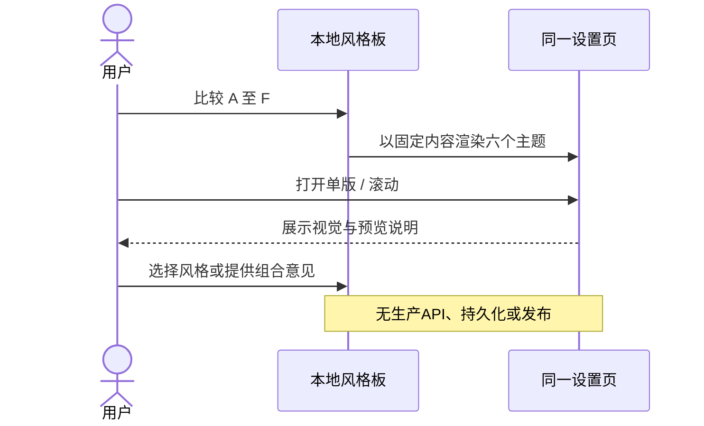
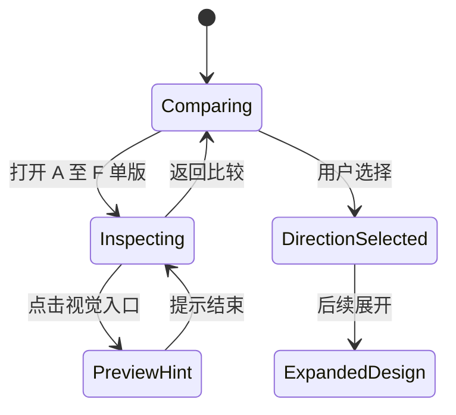
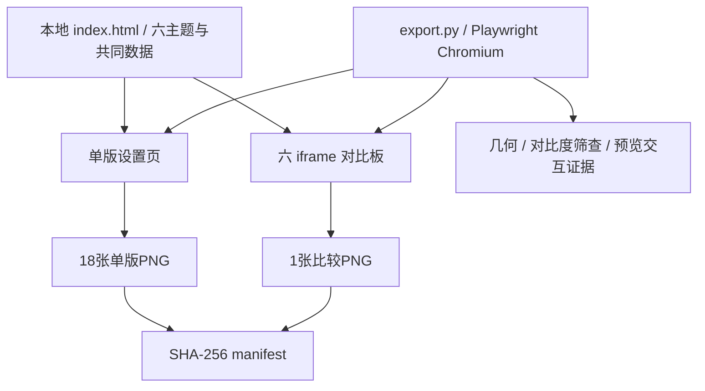

# DESIGN-002 — 全界面 UI 与交互优化评审稿

- Status: READY_FOR_REVIEW
- Risk: R1（仅离线设计产物；不实施业务功能）
- Spec revision: `DESIGN-002-SPEC-03`
- Created / Updated: 2026-11-06
- Owner / Reviewer: 产品负责人（用户）
- Designer / Verifier: Codex
- Target release: N/A — 本轮只交付效果图，未安排发布
- Latest user request: “还是不好看 继续切换，你先生成一个一页的多个版本的 我来选一个风格”
- Approved Task Spec revision: PENDING
- Approved Design Revision: PENDING_STYLE_SELECTION
- Production implementation: NOT_STARTED
- External design dependency: none

## 0. 问题与目标

最初截图指出设置页“添加每日任务”底色与其他添加入口不一致。前两轮已提供全应用效果图；用户认为第一轮整齐但老气，并仍不满意第二轮。因此本轮先收敛到**同一张设置页、六种独立风格、同板比较**，由用户选定方向后再展开其他页面。

本轮只有六版设置页；不把它描述为六套全应用设计。DREV01/02 的17路由、39场景仍为历史参考，不代表新风格已覆盖全部界面。生产代码、API、数据与已批准视觉资产均不变。

## 1. 依据、影响与边界

- Frontend impact: yes — 视觉候选，未生产实施。
- Frontend engineering impact: yes — 独立 HTML 控件、滚动与视口验证，不能替代原生证据。
- Reference production baseline: `FDB-20260913-04`。六种替代视觉均未获批，生产基线未修订。
- Engineering contract: `FEC-20261007-NATIVE-GEOMETRY-02`；原约束继续有效，无豁免。
- Proposed DREV: `DREV-20261106-UI-CONSISTENCY-03`。
- Editable source: [index.html](../../docs/design/frontend/prototypes/DREV-20261106-UI-CONSISTENCY-03/index.html)。
- Design contract: [FRONTEND-SPEC.md](../../docs/design/frontend/prototypes/DREV-20261106-UI-CONSISTENCY-03/FRONTEND-SPEC.md)。
- Exact viewports: **320×568 / 390×844 / 430×932**，CSS逻辑像素，DPR=1。
- Source/export SHA-256: [manifest.json](../../docs/design/frontend/snapshots/UI-001/DREV-20261106-UI-CONSISTENCY-03/manifest.json)。
- Approval: [APPROVAL.md](../../docs/design/frontend/snapshots/UI-001/DREV-20261106-UI-CONSISTENCY-03/APPROVAL.md)，PENDING_STYLE_SELECTION。
- Budget: 页面按钮至少44×44px，条目时间14px，无横向溢出，无外部资源/字体/网络请求，源HTML少于64 KiB。
- UI owner: Codex；选定风格并批准实施后才合并对应 Feature/UI 当前态。

### 受影响 Feature / 当前依据

| Feature / UI | 本轮关系 |
|---|---|
| [FEAT-001](../../docs/domain/features/FEAT-001-push-kids-mvp.md) / UI-001 | 设置页、科目与课外活动、五个Tab；仅候选视觉 |
| [FEAT-005](../../docs/domain/features/FEAT-005-multi-child-profiles.md) | 显示合成孩子小禾及切换入口；不改真实档案 |
| [FEAT-007](../../docs/domain/features/FEAT-007-travel-arrangements.md) | 保留“只显示在日程，不生成待办” |
| [FEAT-010](../../docs/domain/features/FEAT-010-daily-tasks.md) | 同样的每日任务数据和添加入口；不改目标/实际时长口径 |

完整原始审查范围保存在 [Spec02](../evidence/DESIGN-002-SPEC-02.md)。其他功能和UI当前态未因本轮候选发生事实变化。

## 2. 设计选择与取舍

采用单页控制内容、六种视觉变量的比较方法。统一孩子、科目、活动、每日任务和导航，分别改变字体层级、配色、卡片结构、图标容器、按钮形状与材质。

| 方向 | 主要特征 | 取舍 |
|---|---|---|
| A 极简画廊 | 黑白、细线、平面分组、描边按钮 | 克制清晰，趣味较少 |
| B 晴空蓝白 | 连续钴蓝页头、白卡、蓝色按钮 | 鲜明轻快，操作强调较强 |
| C 暖杏日常 | 杏色页头、陶橘、柔软圆角 | 亲切，偏生活感 |
| D 莓紫软糖 | 莓紫浅粉、独立行卡片、小花标记 | 年轻柔和，个性偏柔软 |
| E 青柠俱乐部 | 青柠、墨线、方角、偏移阴影 | 最有活力，存在感较强 |
| F 深海夜色 | 深蓝灰、香槟色、细线 | 安静有质感，暗色原生适配需另验 |

“继续同一套浅绿卡片微调”不足以解决用户不满意；“立即把六种风格扩展到所有页面”会增加无效评审成本。本轮先提供方向选择，不预判用户偏好。

各版本内三种“添加”入口共享相同的底色、文字色、边框与圆角，解决原截图的不一致。已批准基线保持不变；此表是设计选项而非生产规范。

### 不变的产品合同

AI保持可编辑提案，家长确认才形成正式记录；不评分、宣称掌握或决定复习日期。手动路径、确定性计划、单 active family、六位邀请码/核验码、19:00提醒、归档与永久清理边界、发生/创建时间及历史补录合同均不变。

## 3. 本轮页面与状态范围

- 一页：设置。数据为合成样例，六版内容一致。
- 默认视口展示科目、围棋/游泳课外活动、阅读/围棋每日任务；下滚可见出行与管理入口。
- 390/430视口均完整显示前两组添加入口；320视口保持正文大小，通过滚动查看。
- 点击仅提示“本页用于风格预览”，不执行导航、保存、删除或家庭资料操作。
- 其他页、表单、空/加载/失败/权限/未保存状态：本轮 N/A，选定风格后展开。
- 无API或真实数据验收，不把固定样例当作产品功能实现。

## 4. 关系、状态与架构

业务调用图、数据库状态机、模块边界/扩展点变更 N/A：此候选没有业务依赖或生产架构调整。

## 5. 文件与验证计划

预期改动：本 Spec 与 STATUS 索引；归档历史 Spec02；新增 DREV03 的 HTML、导出脚本、设计合同；快照、manifest、批准与验证记录。不覆盖 DREV01/02 或任何已批准资产。

| TP | 本轮验证 | 适用边界 |
|---|---|---|
| D3-01 | 6×3视口导出；无横向溢出；命中区域≥44px；相同添加按钮样式 | HTML设计几何，非原生 |
| D3-02 | 六版同板、代表性320/430单图人工目视 | 非全部真实内容、大字或真机 |
| D3-03 | 六版预览提示、滚动到底部、设置选中态；无JS异常/外网请求 | 不验证真实导航或业务保存 |
| D3-04 | 390视口实色文字对比度筛查 | 排除图标/透明叠色，非完整可访问性验收 |
| D3-05 | 源与19张导出SHA、文档路径、旧DREV完整性 | 候选追溯，非生产发布证据 |

执行：`python3 docs/design/frontend/prototypes/DREV-20261106-UI-CONSISTENCY-03/export.py`。实际结果见 [RESULTS.md](../../docs/design/frontend/snapshots/UI-001/DREV-20261106-UI-CONSISTENCY-03/RESULTS.md)。

Red/Baseline、pytest、npm test、ruff/mypy、原生与发布检查 NOT_RUN/N/A：本轮未改变生产程序，不用历史测试替代当前设计证据。

## 6. 生命周期与批准

历史 [Spec01](../evidence/DESIGN-002-SPEC-01.md)、[Spec02](../evidence/DESIGN-002-SPEC-02.md) 与对应候选源/快照保留。用户过去“继续”不构成此新 revision 或特定设计的批准。

当前 active / READY_FOR_REVIEW。用户选 A–F 仅确定设计方向，不自动批准全应用实施。设计尚待选择与展开，生产开发未开始，无匹配云交付，不能记为 DONE。

## 7. 文档闭环

- 更新为 SPEC-03，同步 STATUS，并新增 DREV03 源、比较图、矩阵与证据。
- 逐项核对当前 Feature、Behavior、Architecture、UI、测试与发布范围：此 diff 没有生产事实变化，没有将候选写入 CURRENT 或修改 FDB/FEC。
- 文档明确本轮仅设置页，原17路由/39状态属于历史候选；消除“六版已覆盖全应用”的误读。
- 尚未完成：用户风格选择、全界面展开、具体基线批准、原生/真机与完整可访问性验收。
