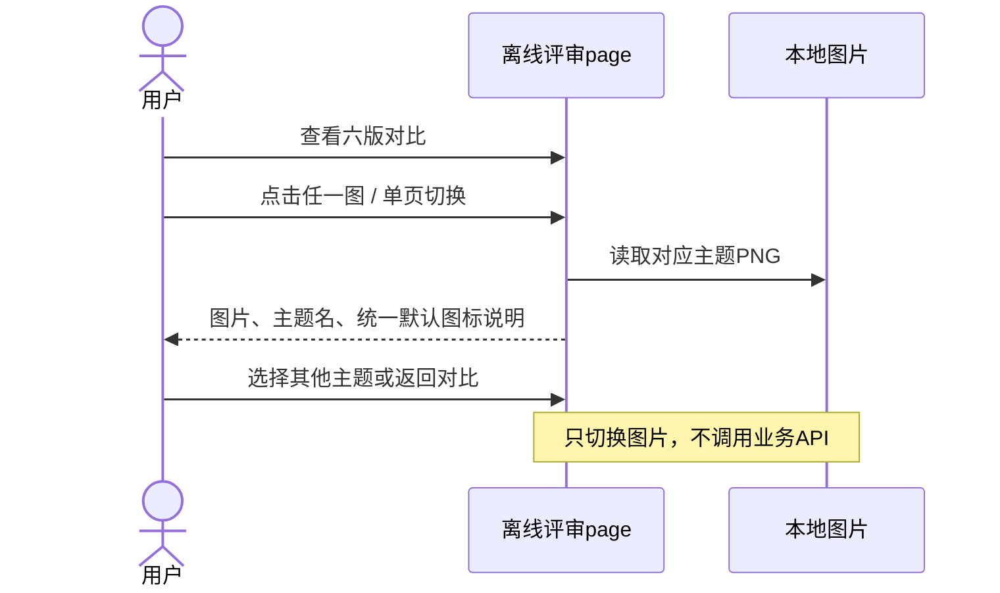
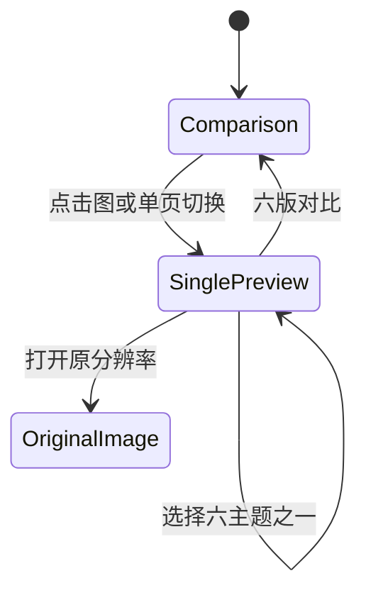
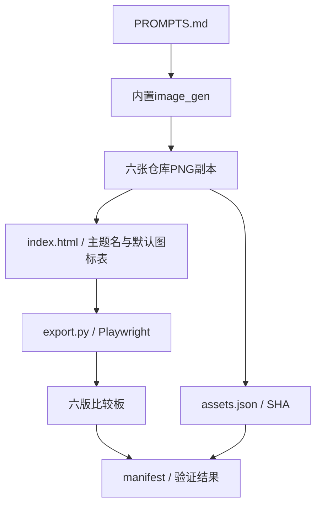

# DESIGN-002 — 六主题设置页与默认图标评审稿

- Status: READY_FOR_REVIEW
- Spec revision: `DESIGN-002-SPEC-05`
- Risk: R1（离线设计与预览，不改生产业务）
- Updated: 2026-11-06
- Owner / Reviewer: 产品负责人（用户）
- Designer / Verifier: Codex
- Theme roster: USER_CONFIRMED_FOR_PREVIEW
- Unknown-icon policy: USER_CONFIRMED
- Specific Spec / DREV implementation approval: PENDING
- Production implementation: NOT_STARTED
- Release: N/A

## 0. 最新要求与确认

用户明确否定按自定义课程补做AI图标的建议，要求“如果是没有预置的，就使用一个默认的好了（每个风格不同）”。同时指定原始风格、成长花园、星际探索、深海夜色、海洋风格、科技风格，要求“先生成以上几个风格的一页page”。

因此本轮保留完整六主题名单，不沿用此前“首期只做两套”的建议；提供同一设置页内容的六图比较，以及页面内单图切换。已确认的是主题名单和默认回退原则，不是本Spec或某个视觉稿的生产实施批准。

## 1. 图标规则与设计范围

- 有预置图标直接使用预置；没有预置时，使用当前主题的一个统一默认图标。
- 每主题默认图标固定，所有未知名称复用；不按用户课程名称实时或批量生成新图标，不增加等待或额外图标选择步骤。
- 本轮image_gen仅用于制作评审效果图，不是产品图标生成服务。
- 默认图形提案：原始=线性书本；花园=嫩芽；星际=小星球；夜色=罗盘星；海洋=贝壳；科技=芯片。具体外观随本轮review确认。
- 用“思维拓展 / 自定义”展示未知科目回退。其他样例一致：小禾；语文/数学；围棋周日14:00–16:00、游泳周日17:00–18:00；阅读每天20分钟、围棋每天30分钟。
- 设置页两类添加按钮在各主题内保持一致；五Tab顺序保留。主题不增加评分、奖励、教学判定或新业务流程。

## 2. 影响、依据与产物

关联[FEAT-001](../../docs/domain/features/FEAT-001-push-kids-mvp.md)、[FEAT-005](../../docs/domain/features/FEAT-005-multi-child-profiles.md)、[FEAT-010](../../docs/domain/features/FEAT-010-daily-tasks.md) / 设置页UI-001。当前业务事实与前轮一致；FEAT-007出行等后续滚动内容未在本轮图片展开。

生产基线FDB-20260913-04与FEC-20261007-NATIVE-GEOMETRY-02继续有效，未修改其正文或批准资产。当前只验证离线画廊，不推定生产资源、缓存、图标映射或主题切换已实现。

- DREV: `DREV-20261106-UI-CONSISTENCY-05`
- [预览page](../../docs/design/frontend/prototypes/DREV-20261106-UI-CONSISTENCY-05/index.html)
- [设计合同与边界](../../docs/design/frontend/prototypes/DREV-20261106-UI-CONSISTENCY-05/FRONTEND-SPEC.md)
- [完整生成提示词](../../docs/design/frontend/prototypes/DREV-20261106-UI-CONSISTENCY-05/PROMPTS.md)
- [manifest](../../docs/design/frontend/snapshots/UI-001/DREV-20261106-UI-CONSISTENCY-05/manifest.json)
- [实际结果](../../docs/design/frontend/snapshots/UI-001/DREV-20261106-UI-CONSISTENCY-05/RESULTS.md)
- [批准记录](../../docs/design/frontend/snapshots/UI-001/DREV-20261106-UI-CONSISTENCY-05/APPROVAL.md)

## 3. 设计方案与取舍

| 主题 | 视觉依据 / 变化 |
|---|---|
| 01 原始风格 | 按用户原截图的暖纸松绿、软卡片、线性图标、圆形记录按钮复绘；仅样例内容重排 |
| 02 成长花园 | 沿用DREV04纸雕花园与嫩芽角色，新增未知科目示例 |
| 03 星际探索 | 沿用DREV04观测站与星球语汇，默认小星球 |
| 04 深海夜色 | 沿用DREV03的深蓝灰与香槟细线；保留安静的深色感 |
| 05 海洋风格 | 新增明亮浅海、鲸鱼、波浪与珊瑚；默认贝壳 |
| 06 科技风格 | 新增白银青蓝实验室、学习机器人与电路模块；默认芯片 |

原始风格是现有视觉复绘，不冒充生产截图。六图的内容对照成立，但位图仍存在构图差异，不能据此宣称布局/组件/几何已统一。后续可编辑产品稿需收敛共有内容布局，保留主题背景、插画与装饰差异。

备选“新增名称时生成图标”已被用户否定，不再作为本轮推荐；统一主题默认图标可避免该等待和维护成本。此前其他主题保留为历史，不覆盖或删除。

## 4. 流程、状态与架构

产品业务调用、数据库状态机、模块依赖与扩展点变更N/A：当前只生成设计及画廊，不修改生产架构。

## 5. 文件与验证

预期文件：Spec05与STATUS更新、Spec04历史副本；DREV05提示词/HTML/导出脚本/设计合同；六图、比较板、来源/SHA、批准与结果。旧DREV01–04不变。

| 检查 | 真实范围 |
|---|---|
| D5-01 | 六图主要中文、时间、主题差异和自定义科目默认图标目视 |
| D5-02 | 1440×1000、390×844画廊的六图加载与横向溢出 |
| D5-03 | 两窗口×六主题单页切换、标题/默认图标说明/选中态/原图链接、返回对比 |
| D5-04 | JS异常、外网请求、源/图片SHA及历史候选完整性 |
| NOT_RUN | 产品三视口原生几何、控件/文字对比度、键盘/读屏/真机、实际主题加载/缓存 |
| N/A | 生产Red/Baseline、pytest/npm/mypy、API/数据库/上传与发布 |

执行 `python3 docs/design/frontend/prototypes/DREV-20261106-UI-CONSISTENCY-05/export.py`。画廊窗口验证不等于小程序320×568/390×844/430×932验收；图片本身没有可交互业务节点。

## 6. 生命周期与文档闭环

Spec保持 `specs/active/` / READY_FOR_REVIEW。六主题与回退规则已确认，具体视觉和实施范围待review；无生产开发或匹配云交付，不设置DONE。完成离线画廊不推定小程序已支持主题切换。

同步Spec05、STATUS、DREV05设计边界、提示词与结果；[Spec04历史副本](../evidence/DESIGN-002-SPEC-04.md)和旧DREV保留。核对本轮未修改生产Feature、Behavior、Architecture、UI CURRENT、FDB/FEC与发布事实，没有把提案写作当前实现。后续仍需可编辑产品源、状态矩阵、资源预算、对应SHA与具体批准。
