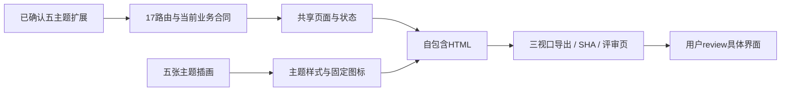
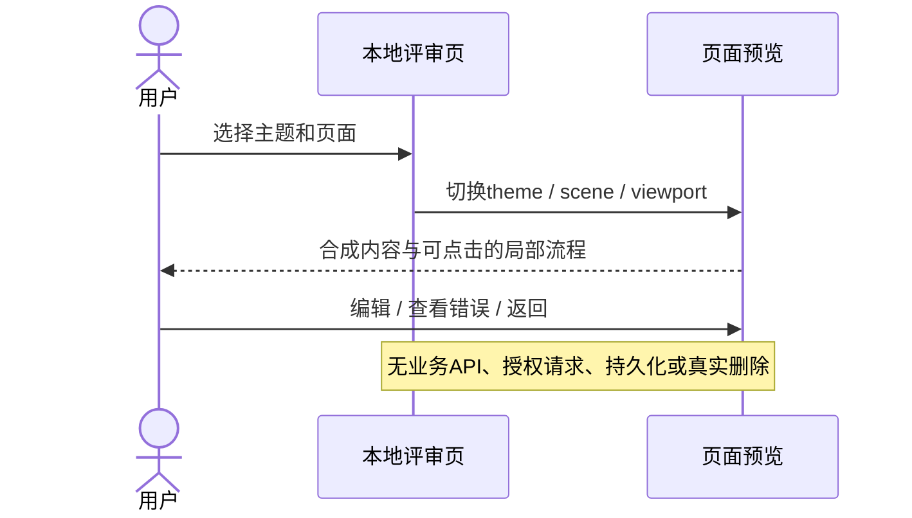
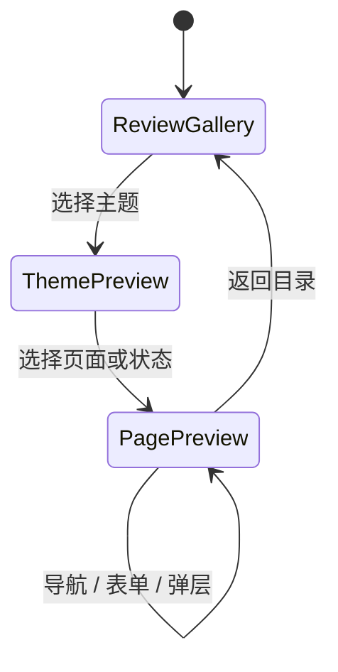
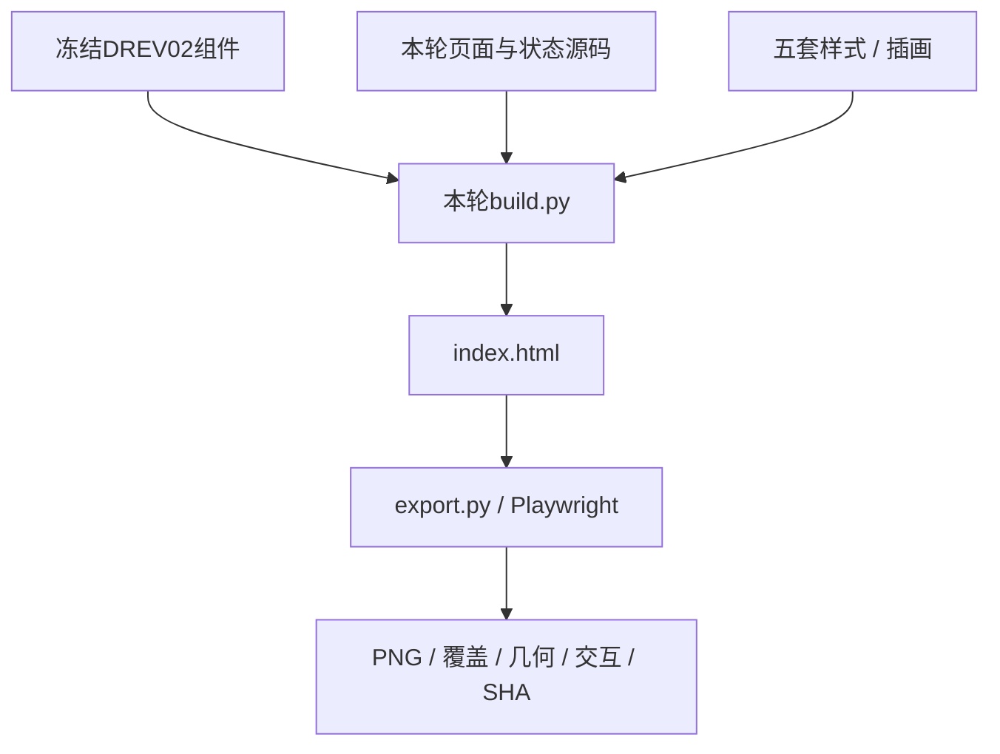

# DESIGN-002 — 五主题全界面设计扩展

- Status: READY_FOR_REVIEW
- Spec revision: `DESIGN-002-SPEC-06`
- Design revision: `DREV-20261106-UI-CONSISTENCY-06`
- Date: 2026-11-06
- Risk: R1（本地设计预览，零业务写入）
- Design expansion authorization: CONFIRMED
- Production implementation approval: PENDING / NOT_STARTED
- Owner / Reviewer: 用户
- Designer / Verifier: Codex

## 1. 用户要求与范围

用户在DREV05六版设置页之后明确要求：“按照以上方案生成6套的全部界面，其中原始的不需要生成了”。本轮沿用已选视觉方向，新增成长花园、星际探索、深海夜色、海洋、科技五套全界面。原始风格保持现有实现和DREV05参考，不重新生成。

该指令批准继续制作设计稿，不等于小程序实现、主题下载服务或上线批准。未预置的自定义课程继续直接复用当前主题的一个默认图标；没有逐课程AI生成或等待流程。

## 2. 当前依据与影响地图

- 17条页面路由以 `apps/miniprogram/app.json` 为准。
- 业务依据：FEAT-001学习/复习/日程、FEAT-002家庭、FEAT-003提醒、FEAT-004建议、FEAT-005档案、FEAT-006清理、FEAT-007出行、FEAT-010每日任务、FEAT-011提醒续订、FEAT-012旅行、FEAT-013年级；当前正文见 [Feature目录](../../docs/domain/features/)。
- UI-001及相关当前UI保持生产事实；FDB-20260913-04和FEC-20261007-NATIVE-GEOMETRY-02不由候选稿覆盖。
- 当前记录页标题切换、报表内历史入口、复习目录参与/已替代、默认复习预算不向家长编辑、旅行导入及确认边界来自现有WXML/UI合同。
- DREV02提供本地设计组件和合成内容基础；本轮替换视觉并校正上述旧稿偏差，不回写历史源。
- 前端可见影响：设计候选YES，生产NO；工程影响仅本地HTML预览/导出，不新增生产依赖。

## 3. 方案与取舍

采用一套可编辑HTML内容与状态，五套主题token、卡片材质、页头插画、导航装饰和固定SVG图标。插画用内置image_gen生成，每主题一张共用静态素材；文字、表单、错误提示和图表保持可编辑与一致。

| 主题 | 视觉规则 | 未预置图标 |
|---|---|---|
| 成长花园 | 纸雕植物、嫩芽角色、奶油纸面、叶片形局部装饰 | 嫩芽 |
| 星际探索 | 观测站、轨道、机器人、深蓝背景与清晰浅色内容面 | 小星球 |
| 深海夜色 | 深蓝绿暗底、香槟细线、克制的海底轮廓 | 罗盘星 |
| 海洋风格 | 明亮浅海、读书鲸鱼、波浪与贝壳、白色内容面 | 贝壳 |
| 科技风格 | 白银青蓝实验室、机器人、细电路与模块边角 | 芯片 |

全界面按实际页面与关键操作状态展开，不把所有排列组合或系统权限弹窗冒充已覆盖。65个场景×5主题=325个设计组合，目标导出三视口320×568/390×844/430×932。含单独的清空家庭确认，避免与清理孩子混淆。精确清单由 [设计合同](../../docs/design/frontend/prototypes/DREV-20261106-UI-CONSISTENCY-06/FRONTEND-SPEC.md) 和生成的覆盖矩阵记录。

备选每页独立生成整张位图容易造成文字、布局和业务状态漂移；本方案让真实中文和控件共用，保留各主题的插画差异。大图和自包含HTML是评审资产，不加入小程序包，也不据此声称生产包体或测试成本已经解决。

## 4. 流程、状态与架构

产品数据库状态机、服务调用与模块扩展点：N/A，本轮不改变生产架构。复用设计底稿只存在于文档目录，不向生产增加包装层或第二套业务实现。

## 5. 验证与验收

- D6-01：17条路由均有对应场景，五主题清单完整；原始风格不生成。
- D6-02：三视口×全部设计组合导出，检查元素几何与可滚动内容；不通过隐藏越界替代修复。
- D6-03：主题/页面/视口切换、五Tab、草稿展开、表单保留输入、危险操作禁用、默认图标与关键弹层。
- D6-04：主页面与表单/弹层/深色状态的实际截图目视；控制台错误与外网请求。
- D6-05：当前资产及历史DREV01–05的SHA，生产apps目录前后摘要一致。
- NOT_RUN：原生节点、真机、微信权限、真实业务、完整读屏/大字、实际包体与主题下载缓存。
- N/A：后端/数据库/生产测试和上传发布；没有生产diff。

真实结果写入 [RESULTS](../../docs/design/frontend/snapshots/UI-001/DREV-20261106-UI-CONSISTENCY-06/RESULTS.md)，未执行不得写PASS。

## 6. 文件、批准与闭环

新增DREV06源码、五张插画、完整提示词、交互评审页、PNG/覆盖矩阵/SHA/结果；保存 [Spec05](../evidence/DESIGN-002-SPEC-05.md)，更新STATUS。旧候选和批准快照不改写。

具体DREV06仍待review。Spec保留 `specs/active/` / READY_FOR_REVIEW，无生产实施或云交付，不设DONE。Feature、Behavior、Architecture、UI current-state、FDB/FEC与发布事实保持当前实现，仅核对有无冲突，不把设计提案写成已上线事实。
