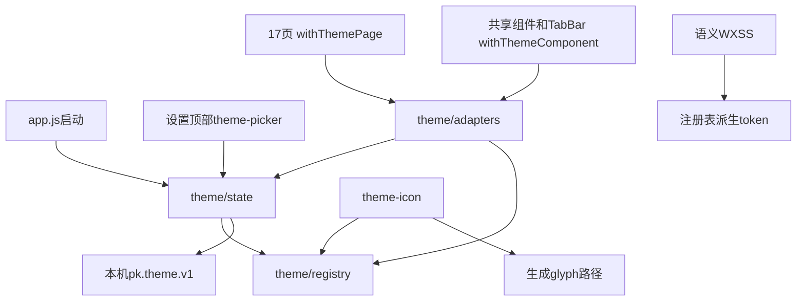
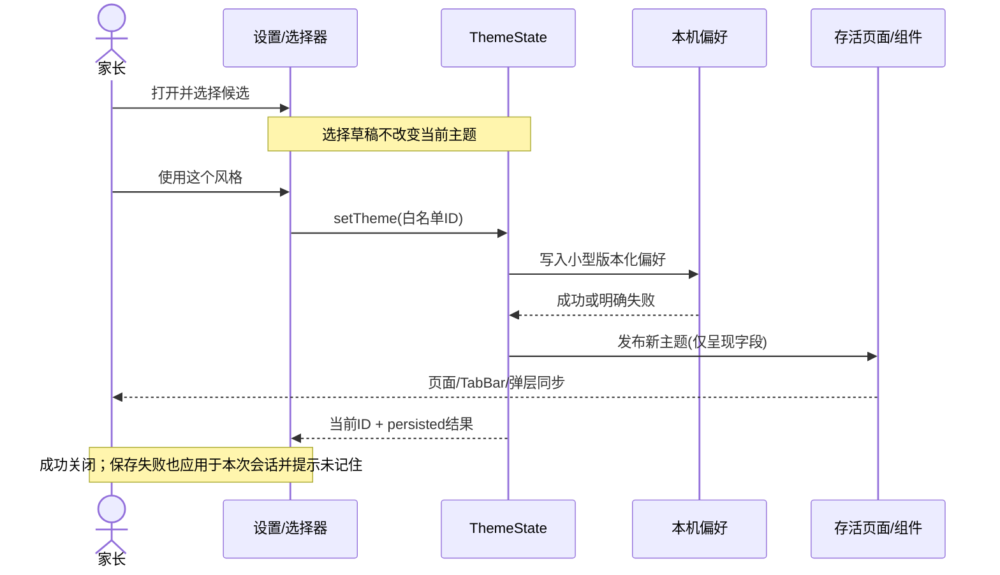
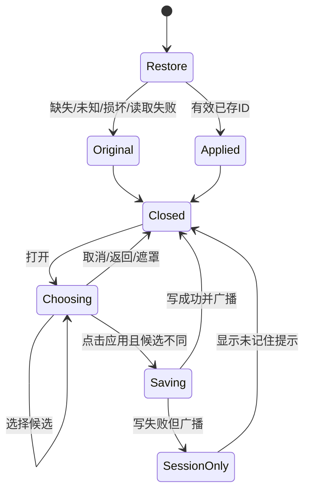

# DESIGN-002 — 六主题原生适配与设置顶部切换

- Status: READY_FOR_REVIEW
- Spec revision: `DESIGN-002-SPEC-07`
- Architecture revision: `ARCH-20261106-MINIAPP-THEMES-01`
- Design revision: `DREV-20261106-UI-CONSISTENCY-07`（设置切换增量）+ `DREV-20261106-UI-CONSISTENCY-06`（五主题全界面）
- Design source SHA-256: `d64412fffaa5f1111d7dc42238fd0a71bba024419d2b4e5335751c6a2f6c3255`（DREV07 index.html；全部源/导出见manifest）
- Date: 2026-11-06
- Risk: R2（跨页面/组件共享呈现机制、本地偏好兼容）
- Owner / approver: 用户；设计、实施准备与验证：Codex；实现后独立评审：待安排
- User confirmation: 上轮五主题视觉方向与六主题落地意图 CONFIRMED；新增 Architecture01 / Spec07 / DREV07 具体实施包 AWAITING_CONFIRMATION
- Production implementation: NOT_STARTED；上传 / 体验 / 审核 / 正式发布：NOT_RUN
- Target release: 本地完整实现与验证；本次未授权上传发布
- Historical Spec06: [只读归档](../evidence/DESIGN-002-SPEC-06.md)，SHA-256 `e99af4d52783308c96b85547215866400fb236498b44d9c81e14d2cedffa79cc`

## 0. 批准边界与本轮已授权工作

用户2026-11-06：“按照以上方案落地，要求在设置前面可以切换。同时减少代码中的硬编码，并在agents.md中约束，如果修改ui需要做到几种风格的适配。”随后明确选择“设置页顶部（推荐）”。因此六主题、上一轮视觉方向、设置顶部入口及AGENTS适配约束已确认，无需重新选择风格。

Spec06仅批准制作设计，生产模块/扩展点为N/A。本revision首次提出主题状态、共享适配器、图标替换和资源上限。按根[AGENTS.md](../../AGENTS.md)要求，在改变“shared abstractions…or extension points”前确认具体架构/Spec revision。本轮先完成可review的方案、设置切换设计及用户明确要求的AGENTS规则，不把新技术设计追记为已批准实施。

| 批准项目 | 状态 | 依据 |
|---|---|---|
| 六主题和DREV06视觉方向 | CONFIRMED | 用户“按照以上方案落地” |
| 入口在设置页顶部 | CONFIRMED | 本轮文字选择回复 |
| AGENTS.md六主题适配规则 | AUTHORIZED / WRITTEN | 本轮明确要求，属于工程政策，不宣称运行时已实现 |
| Spec07 + Architecture01 + DREV07实施方案 | AWAITING_CONFIRMATION | 完成全部准备后提交具体版本 |
| 上传、体验、提审、正式发布 | NOT_REQUESTED | 单独执行发布合同 |

## 1. Frontend impact、依据与文档计划

- Frontend impact: YES；Frontend engineering impact: YES。
- 已批准基线：`FDB-20260913-04`、`FEC-20261007-NATIVE-GEOMETRY-02`。本revision拟以六主题语义配置扩展原始纸面/松绿视觉，几何、字号、触区、平台、安全与资源约束继续执行；没有预算豁免。
- 主要UI：UI-001及其17路由、嵌入式页面、共享组件和自定义TabBar；相关独立UI current-state文件实施时逐项同步，不能用总述覆盖其特有行为。
- Feature基线：FEAT-001当前`FEAT-STATE-20261106-SYSTEM-ONE-15`与工作日04，FEAT-002/003/004/005/006/007/009/010/011/012/013现有合同；见[Feature目录](../../docs/domain/features/)和[UI-001](../../docs/design/frontend/ui/UI-001-parent-miniapp.md)。主题只改变呈现，不新增学习/复习/家庭/提醒/旅行领域状态。
- 重点维度：component/state/form、三视口、a11y、中文长文案、原生WebView与双平台、资源、媒体、隐私、错误与生命周期观测。
- 完成后由Codex将已验证事实合入Feature（跨页本机主题行为归FEAT-001）、Behavior Catalog、Architecture、UI current-state、FDB/FEC相关正文与证据索引。实施前不把提案写成CURRENT或已交付。

## 2. 当前行为、实测与问题

1. 原生代码只有原始风格。`styles/tokens.wxss`已有语义色；`app.wxss`、atoms、年级/提醒弹层、TabBar仍含固定背景、阴影等。
2. `tools/gen_icon_styles.py`把SVG与六种固定色组合输出`icons.wxss`；自定义活动未命中时为star。设置科目写死book，导航使用固定PNG。
3. App无主题状态；页面构造有直接Page、controller及createController三类；有独立组件样式作用域。只给外层view加颜色不能证明全部继承。
4. `2026-11-06`只读测量：小程序168文件、1,244,228字节；检查器实际上限为**1,500,000字节**，余量255,772字节。FEC文案称1.5MiB，本revision执行更严格的现有十进制检查值，不静默提高预算。
5. DREV06五张原图共8,419,871字节，评审HTML约11MB；它们是文档资产，不能整份复制进小程序。
6. 除生成icons外识别到210处颜色字面量，其中token文件56处合法集中值。数量是发现清单，不把210全部当成应删除的坏代码。
7. DREV06是合成预览，并非领域真相。特别是**child-edit当前仍有复习预算字段**，不能把预览中省略该字段解释为删除批准；工作日/逐星期时段、时间不固定、旅行导入、历史分页、归档/清理、年级确认等均以当前原生字段与行为为准。

## 3. 目标行为与验收范围

六个稳定ID：`original / garden / space / midnight / ocean / tech`；中文名和视觉来自上轮，不缩减为两种。

| 主题 | 视觉 | 未知科目/活动固定图标 |
|---|---|---|
| 原始风格 | 保留当前纸面、松绿和原有插画角色 | 书本 |
| 成长花园 | 纸雕花园、嫩芽角色、叶片卡片细节 | 嫩芽 |
| 星际探索 | 观测站、星空轨道、探索机器人 | 小星球 |
| 深海夜色 | 深蓝绿暗底、香槟细线、海底轮廓 | 罗盘星 |
| 海洋风格 | 明亮浅海、读书鲸鱼、波浪 | 贝壳 |
| 科技风格 | 白银青蓝实验室、机器人、电路/模块边角 | 芯片 |

- 设置页标题区之后、业务卡片之前显示“界面风格 / 当前名称”入口。无孩子、加载失败、只读成员也可更改本机显示偏好，不依赖业务API。
- 打开六选一底部面板；选卡仅改变面板草稿，点击“使用这个风格”后统一应用并关闭；关闭/遮罩/返回取消草稿；当前风格按钮禁用并有文字/勾选提示。
- 默认original；重启读取本机已保存ID。同一设备同一小程序实例所有孩子共享显示偏好，不写服务器，不同步给其他家长或设备，不与家庭授权混用。
- 应用后当前页、所有仍存活页面、导航、独立组件与后续打开页同步。只更新主题呈现字段，保留表单、滚动、分页、上传、原有请求世代与业务数据；不使用reLaunch或模拟onShow重载来换肤。
- 已知课程继续命中预置图标；未命中直接使用主题默认图标，无AI、远程请求、等待或强制选图。原始未知活动由star统一到本轮明确要求的书本，是有意的纯视觉变化。
- 所有应用自绘弹层、占位、错误、禁用、图表、照片外框和地图覆盖层适配；系统授权框、微信菜单、原生picker内部和地图服务底图由平台控制，使用可配置接口的语义色，不声称重绘其内部UI。
- 清理孩子/家庭不新增删除主题偏好的副作用；系统清缓存正常回到默认。无服务端API/Schema/排期/权限/AI合同变化。

## 4. 交互设计与精确视口/状态

[可编辑自包含预览](../../docs/design/frontend/prototypes/DREV-20261106-UI-CONSISTENCY-07/index.html) /
[设计合同](../../docs/design/frontend/prototypes/DREV-20261106-UI-CONSISTENCY-07/FRONTEND-SPEC.md) /
[SHA清单与批准记录](../../docs/design/frontend/snapshots/UI-001/DREV-20261106-UI-CONSISTENCY-07/APPROVAL.md)。

- 本增量：6主题 × 320×568/390×844/430×932 × closed/picker/storage-error = **54张状态图**，另有一张总览。
- DREV06：五主题65场景×3视口=975张HTML设计导出继续供视觉参考；原始风格以现有原生基线为准，不把DREV07的简化演示当作替换全部设置业务的批准。
- 拟批准DREV07只增加顶部入口和选择面板；设置内容下方布局、流程沿用DREV06及现有业务。中文文案不暴露token/图标回退等实现细节；真实存储失败例外提示实际后果。
- 触区≥44px，正文≥14px；双列选择卡，小屏面板内部可滚动，应用按钮固定在面板底部；含safe-area。选中有边框+勾选+文字；背景不可操作；关闭后返回入口焦点。原生读屏与返回键须另验。
- 新主题不加载字体包；原始衬线角色保留，五新主题采用系统无衬线角色，标题行高和长名须原生验证。

## 5. 推荐Architecture01与模块职责

**一个主题呈现域、同一套业务页面、显式接入。** 在`apps/miniprogram/presentation/theme/`设明确owner，不能继续往通用utils堆状态。文件名称为实施目标，可做不改变责任的窄化拆分，不新增第二份权威配置。

| 文件/组件 | 唯一职责 | 不拥有 |
|---|---|---|
| `registry.js` | 六ID、label、完整语义token、材质类、插画角色、默认glyph、原生chrome颜色；白名单校验和查找 | 业务字段、wx请求、持久化 |
| `state.js` | 单实例当前主题、小型版本化存储、订阅/取消、幂等切换及持久化结果 | 页面流程、family/child权限 |
| `adapters.js` | withThemePage与withThemeComponent显式组合生命周期，派生根类/样式，原生chrome随当前页更新 | 全局改写Page/Component、调用load或重置表单 |
| `styles/theme.wxss` | 共用角色与有限材质差异；已有tokens迁移/兼容指针，只留一份权威色值 | 六份页面布局/业务控制器 |
| `components/theme-picker/` | 六项展示、候选、取消、应用、关闭、可访问名称 | 自有重复主题表或直接业务API |
| `components/theme-icon/` | 固定glyph路径+语义tone绘制，随主题更新 | 以名称生成图或远程下载 |
| `tools/gen_icon_styles.py` | 继续拥有唯一24×24 SVG路径源，改为生成共享glyph数据和尺寸样式，幂等 | 六主题×全图标×全色重复位图 |
| `app.js` | 首屏前初始化状态；其余App业务保持 | theme业务混入bootstrap响应 |

SVG图标采用现有已使用的WXSS data-URI背景绘制机制，由theme-icon按注册表语义色生成小型样式；路径只生成/打包一次。迁移固定图标类和导航PNG消费后删除被替代生成分支。先进行原生探针确认inline SVG背景、作用域和导航同步，再全面迁移；失败不能宣布兼容或悄悄改成六份大图包。原始线宽/尺寸保持；页头插画另作为静态资源。

现有tokens/atoms是稳定语义，优先替换其硬编码；页面只绑定主题根和业务所需的资源角色。平台规范要求固定黑/白值、原生地图字段及确需固定的素材颜色须有局部命名白名单、理由和测试。保留必要的页面特有布局常量，避免无意义的“大一统配置”。

### 调用/依赖DAG

依赖不得反向：theme不import页面/业务utils/API，registry不importwx或state，theme-icon不调用设置页；现有领域控制器只被适配器包装，保留原调用边。模块图、导入与注册覆盖检查需可自动执行。原生Page/Component使用当前官方构造函数；不全局monkeypatch，不要求页面改用Component构造。

### 切换时序

### 选择与偏好状态机

- 存储键`pk.theme.v1`，值仅`{version:1,id:<白名单>}`；不保存token、base64、孩子/家庭/身份/原图。首屏前同步恢复一次，之后onShow不反复读旧值覆盖会话选择。
- 未知ID/类型/版本或读取失败回original，错误只使用静态码，不输出原始storage；删除/改名主题须显式兼容别名或回退测试。
- 存储写失败仍本次会话应用，所有消费者一致；提示“当前风格已应用，本次未能记住，下次打开可能恢复原始风格。”
- 重复选择当前ID不写入/广播；连续快速应用以最后一次用户确认的ID为准，不发生异步旧值回写。
- onLoad/attached建立订阅，onShow/pageLifetimes.show同步，onUnload/detached移除；包装保留this、实参、异常、Promise返回及已有生命周期顺序。只在当前页面更新chrome；隐藏页不抢写系统导航。
- 只将短token字符串、class和资源路径放入data，图像不进入data/storage；监听器数随存活消费者有界，卸载后不setData。

### 扩展点、替代与取舍

| 变化轴 | 状态 | 规则 |
|---|---|---|
| 主题注册 | open / 有界编译期 | 唯一registry，完整schema+角色；仅仓库静态ID/本地资源；新增仍需Spec/DREV，所有主题合同测试；禁止网络或业务依赖；缺失拒绝构建，运行时安全回退；删除需存储兼容 |
| 课程预置图标 | open / 静态有界 | 现有关键词映射继续单一owner；未知直接主题默认；无AI插件或上传执行 |
| 自定义token/在线主题/账号同步/跟随系统 | deferred | 本轮不增加解析器、下载服务、账户字段或自动切换；需独立需求再审 |
| 页面业务与排期 | closed（对此变更） | 任何新字段/流程/删除需另外明确批准 |

| 方案 | 优点 | 取舍 |
|---|---|---|
| 推荐共享呈现域+单页面业务+本地小插画 | 一次修复同时覆盖，离线可用，无新运行时依赖 | 需完整接入17页/隔离组件及生命周期合同测试 |
| 六套页面/每页if主题 | 首屏上手快 | 重复逻辑、散落硬编码、测试成本随分支增长，拒绝 |
| CDN下载大图/主题包 | 包体低 | 增加网络、白名单、缓存、失败恢复和运维，本轮拒绝 |
| 仅换颜色/删插画 | 接入简单 | 不符合已确认的角色/背景/材质方向，拒绝 |
| 全局覆盖Page/Component或引入主题框架 | 接入代码少 | 隐式副作用和依赖成本，拒绝 |

ADR：完整Architecture01随Spec记录；独立ADR N/A（不改变服务端/部署/信任边界；共享前端扩展合同已在此描述）。批准后将有效摘要合并Architecture正文。Open扩展的owner为前端呈现域维护者，错误码/预算见§6，兼容、隔离、安全、观察及合同测试见§8；新增/删除仍需相应Spec批准，运行时不能动态注入第三方主题。

## 6. 非功能预算与失败边界

| 项目 | 上限/目标 | 验证与失败处理 |
|---|---|---|
| 源码包 | ≤1,500,000字节 | 现有validate_miniprogram真实统计；不能调整阈值让实现过关 |
| 新主题插画总量 | ≤150,000字节，5张，每张目标≤30,000字节 | 构建记录尺寸/编码/字节/来源SHA；压缩前后目视；如不能保留视觉质量，返回评审，不改成无插画或网络加载 |
| 代码与生成资源净增 | 目标≤80,000字节；合计净增≤230,000 | 删除已替代icon色副本计入净值；最终包体硬门禁独立执行，目标不是实测结果 |
| 状态体积 | 单次主题呈现补丁≤32,000字节；存储≤256字节 | 拦截setData/storage载荷测量；不计业务data为主题载荷 |
| 切换 | 不请求API/图片网络、不重启页面、不重复业务请求 | mock契约+原生切换请求计数；点击应用至可见稳定目标≤300ms，保留实际环境和时序；不先声称达标 |
| 对比度 | 普通文字4.5:1、较大文字/控件边界按FEC适用3:1 | 六主题语义对+深色危险/禁用/图表；不可只靠颜色表达 |
| 生命周期 | 同ID幂等；卸载后零通知；反复切换不增长订阅 | 合同测试与原生往返；固定错误码、无敏感原值日志 |

原图压缩、SVG背景和深色原生控件兼容当前均未实测；预算为验收要求，非承诺已实现。无新增npm运行时依赖，无后端/数据库迁移。不能移除现有原始风格资产来掩盖非原始主题资源成本；只删除已确认零消费者的替代资产。

## 7. 预期文件增删与硬编码替换

| 路径 | 动作 | 说明 |
|---|---|---|
| `AGENTS.md` | modify（本轮已写） | 所有UI diff六主题适配，动态注册清单，禁止新散落主题字面量 |
| `presentation/theme/{registry,state,adapters}.js` | add | 上述独占呈现职责，禁止通用utils扩散 |
| `styles/tokens.wxss / atoms.wxss / app.wxss` | modify | 集中品牌色/背景/阴影/状态/字体角色，兼容旧语义名称，删除重复覆盖 |
| `styles/theme.wxss` | add | 共享视觉角色与有限的主题材质装饰，单一几何层 |
| `components/theme-picker/ / theme-icon/` | add | 单一选择交互与glyph渲染 |
| `app.js` | modify | 首屏恢复，保留原bootstrap/grade流程 |
| `pages/`内17路由四件套 | modify | 显式适配、根主题作用域、静态图标/插画角色；不删除业务字段 |
| `pages/footprints/embedded`、共享组件、自定义TabBar | modify | 隔离域、宿主、导航、通知/年级弹层同步；保持五Tab |
| `utils/ui.js` | modify | 课程glyph映射语义化，未知从registry读固定回退；不搬入业务判断 |
| `tools/gen_icon_styles.py` / `styles/icons.wxss` | modify / replace | 唯一路径源生成小型glyph数据；完整迁移后删除旧彩色重复类 |
| `assets/themes/` | add | 五张受预算约束的页头插画；每主题复用一份，不加入评审原图/HTML |
| 旧tab PNG/图标资产 | retain or delete | 逐引用确认零消费者后删除；map marker等仍用者先迁移/保留，不能盲删 |
| `tools/validate_miniprogram.py`或专用theme检查器 | modify/add | 从registry枚举theme/route，schema、scope与字面量白名单、实际包体 |
| `tests/frontend/` | add/modify | store/adapter/icon/selector/跨页集成/业务保留，不新增纯镜像测试 |
| Feature/Behavior/Architecture/UI/FDB/FEC/Spec/证据索引 | modify after implementation | 合并已验证正文；原始全局色规范限于original角色，冲突必须移除；验收缺项如实保留 |
| 后端/API/迁移/发布配置 | retain | 无本轮变更；版本上传不在授权范围 |

临时双路径只允许在迁移中存在于本地工作树；最终一套主题注册、一套图标语义owner及一套业务控制器。删除前以引用检查+测试确认。设计文档中的示例配置不进入生产导入图。

## 8. 验收标准与测试点

| ID | 可观察验收 | 测试与真实证据 |
|---|---|---|
| TP-01 | 设置顶部入口始终可达；六项、当前态、候选、应用/取消、遮罩/返回和年级弹层互斥 | selector单测+原生动作；无孩子/只读/加载/失败宿主 |
| TP-02 | 缺失/损坏/未知版本/无效ID回original；六ID重启恢复；读写失败会话结果；幂等、快速切换最后确认生效 | state边界合同；当前缺主题API应有意义Red，先保留旧suite baseline，不伪造失败 |
| TP-03 | 17路由、嵌入式足迹/复习目录和隔离组件同步；隐藏/返回正确；卸载不泄漏 | 实际导入/注册覆盖+构造器/适配器集成；生命周期实参/返回值/异常合同 |
| TP-04 | 切换保留业务表单/分页/上传/草稿、五Tab/只读/工作日等现有字段 | 现有suite+专项页面控制器；API spy证明切换零业务写入/重复加载 |
| TP-05 | 预置活动匹配不变；未知名称在六主题固定fallback；长名/空名/注入不产生任意URL/AI | glyph语义与生成幂等测试；原生深浅背景清晰 |
| TP-06 | 无新散落主题颜色、资源/字体/圆角角色；矩阵从权威表派生 | 静态命名例外；删除旧引用/重复分支证据；依赖DAG |
| TP-07 | 所有17路由入口六主题三视口几何和截图齐全 | **306组原生**，对应source SHA；不以HTML/overflow hidden/旧截图代替 |
| TP-08 | 共享loading/empty/error/readonly/disabled/sheet/dialog/长文案，在实际宿主适配 | 8类×6×3=**144组原生**；宿主分别today/settings/records/family-members/settings/theme-picker/grade-confirmation/child-edit，可共用截图但逐项映射 |
| TP-09 | 每主题应用/回退/返回、深色危险确认及取消、通知/年级互斥；双平台、大字/读屏/键盘 | 原生动作与设备分开记录；平台窗口边界明确；未跑NOT_RUN |
| TP-10 | 字节/载荷/切换时序/插画质量/六主题对比度满足§6 | 资源清单、压缩视觉对照、validate报告、时序与对比度 |
| TP-11 | 文档/实现一致、旧快照完整、Spec位置正确 | 全diff closure矩阵、引用检查、历史SHA、独立只读review |

完整业务流程不按六主题重跑六遍：业务逻辑只有一份，按真实变更风险执行一次共享业务回归；每主题仍做呈现契约和关键动作。后续局部UI变更只跑实际影响页/共享宿主与六主题三视口，不重跑全部450组；新增主题/全局token/字体/布局则扩至全局矩阵。矩阵自动枚举不能漏项，实测耗时另记，不声称成本为零。

必需命令：`npm test`、`npm run lint:miniapp`、`uv run python tools/validate_miniprogram.py`、`uv run python tools/validate_design_evidence.py --check-current-policy`、`uv run python tools/check_architecture.py`及主题合同/字节/导入检查和原生探针/矩阵。无后端diff时Python全suite/ruff/mypy N/A；若工具新增Python代码则执行对应ruff/format与有意义专项测试。所有命令记录实际结果，不预填PASS。

## 9. 实施步骤、回退和发布

1. 批准Spec07+Architecture01+DREV07，冻结设计SHA。AGENTS规则已由本次明确指令写入。
2. 小纵切：registry/state/adapters+一个页面+theme-icon原生探针，验偏好/作用域/返回值/离线与资源；失败先修复或返回具体设计评审。
3. 六主题token/背景/插画，设置顶部面板；迁移17页/共享组件/导航/嵌入宿主，删除旧字面量和零消费者资源。
4. 执行§8全部必需点，独立review，合并current-state正文和证据。未原生/设备通过不能声称视觉验收。
5. 本地完成仍留active/VERIFYING；未来另获上传授权才执行发布README及人工门禁。匹配范围的官方开发上传可记开发DONE并移completed，体验/审核/正式发布独立。

回退：回退本次前端diff恢复原始风格；旧客户端忽略`pk.theme.v1`，无业务数据迁移或删除。原代码由Git保存，不能保留第二套运行时页面作为回退。original始终可选；图片失败隐藏装饰/用固定glyph，保留选中主题的可读色板和主操作，不联网或触发AI。

## 10. 本轮准备结果与未执行项

- 已完成：本revision方案；DREV07编辑源/自包含HTML、54状态图+1总览、15项局部交互检查；AGENTS六主题约束。
- 设计检查与完整性见[RESULTS](../../docs/design/frontend/snapshots/UI-001/DREV-20261106-UI-CONSISTENCY-07/RESULTS.md)。
- NOT_STARTED：生产主题代码、图标迁移、插画压缩、主题guard；本轮未改apps源文件。
- NOT_RUN：生产合同测试/原生450组/设备/真实持久化/切换时序/生产六主题对比度及包体增量。HTML通过不填成生产PASS。
- 开发/验收/交付均未完成；保持`READY_FOR_REVIEW / specs/active/`，不能DONE。
- 文档冲突核对：Feature/Behavior/Architecture/UI/FDB/FEC仍反映原始生产实现；不改写为已实现。child-edit预算偏差已明确禁止随主题删除。无新上传/部署或平台状态事实。
- 本轮政策diff已落AGENTS，生产代码按§0的具体版本批准门禁继续。

## 11. Revision history

| Revision | 变化 | 状态 |
|---|---|---|
| Spec01–05 | UI review、多方向与六种风格单页 | 历史保留 |
| Spec06 | 五套全界面设计，未实现原生 | 冻结evidence |
| Spec07 / Architecture01 / DREV07 | 六主题实施方案、设置顶部交互、资源/图标/状态合同、AGENTS约束 | 具体实施待确认 |
