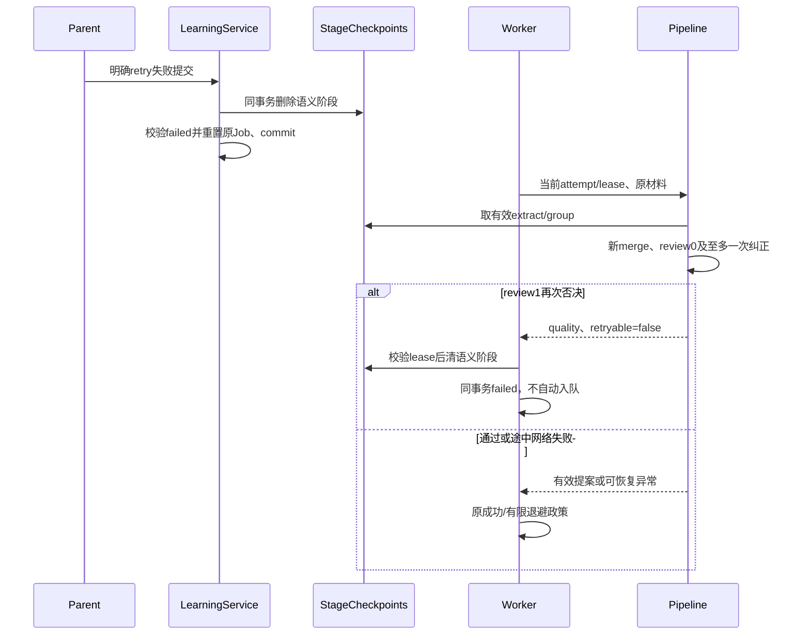
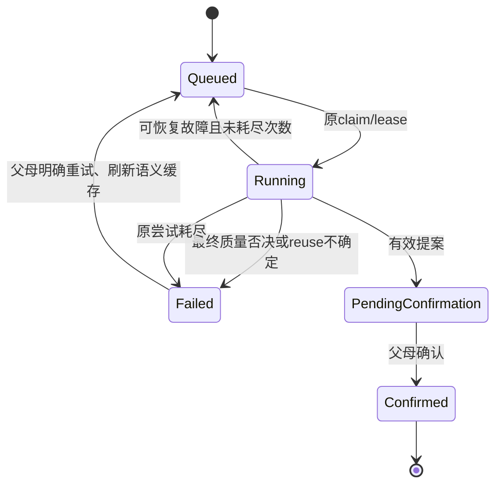
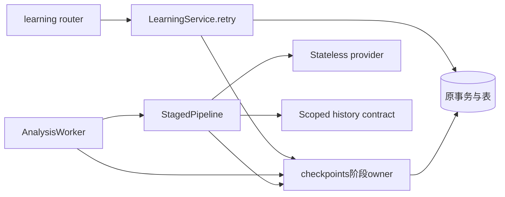

# BUG-036 — 阶段缓存与明确重试策略补充

- Status: VERIFYING
- Spec revision: `BUG-SPEC-20261101-KNOWLEDGE-CACHE-02`
- Architecture revision: `ARCH-20261101-KNOWLEDGE-CACHE-02`
- Latest release gate: OPS发布Spec01已获“批准 OPS 发布 Spec01，开始灰度部署”，完成维护与其他检查后固定40case实测34/40/各科未达90%，发布门禁FAIL，OPS BLOCKED/active。未创建新GRAY、仍039/100%，本缓存Spec仍VERIFYING/active；[停止记录](../../docs/deploy/releases/20261101-knowledge-cache-gray-blocked.md)不重标原机制验证或独立内容03结果。
- Release preparation: 用户本轮“更新版本号及发布记录，将状态正式标记为已部署”后，已冻结10/13候选154payload，857候选全量/52skip与MySQL5.7新库8PASS，干净dry-run通过。实际GRAY未创建、没有新版本；[OPS发布Spec01](OPS-20261101-BUG036-CACHE02-DEPLOYMENT.md)具体维护/部署范围待批准及适用门禁闭合。缓存仍VERIFYING/active，不以准备工作写已部署。
- Deployment verification: `NOT_VERIFIED` — 2026-11-01本轮按用户“将状态更新为已部署，并生成最终验收报告”只读核验。官方当前返回最新039 normal，已有冻结包staged06与缓存10/13五份源不同，缺匹配云交付证据；保留VERIFYING/active，未写已部署或DONE。[最终验收报告](../../docs/quality/evidence/BUG036-CACHE02-FINAL-ACCEPTANCE-20261101.md)分别记录机制PASS、内容失败和部署待核验。
- Severity: MAJOR — 终态质量否决被重复复用，自动和手动重试可能没有新的判断机会。
- Risk: R2 — 改变阶段缓存、后台任务和明确重试的事务语义。
- Owner / Implementer / Feature merge owner: Product owner / TRAE / TRAE
- Reviewer/Verifier: 实施批准后执行独立只读审查；内容由当前会话逐份核对，模型自审不作为内容验收。
- First observed: 2026-11-01，生产阶段 `staged-20261031-06` 的三个真实失败任务。
- Parent Spec: [BUG-036 Spec01](BUG-036-KNOWLEDGE-GENERATION-FINAL-PROPOSAL.md)。
- Affected Feature IDs: `FEAT-001`；[当前事实](../../docs/domain/features/FEAT-001-push-kids-mvp.md)，基线 `FEAT-STATE-20261031-KNOWLEDGE-GENERATION-07`。
- Source baseline: `0576ac304649`＋当前未提交的已批准09/13实现；本补充不覆盖其他工作区变化。
- User confirmation: APPROVED — Product owner，2026-11-01，当前会话用户原话“批准 BUG-036 缓存 Spec02，开始实施”，明确批准`BUG-SPEC-20261101-KNOWLEDGE-CACHE-02`与其`ARCH-20261101-KNOWLEDGE-CACHE-02`。授权本地实现、隔离验证和文档同步；不授权部署、生产数据重置或Git提交。之前策略编写与原三份只读复测授权及实际结果保留。
- Local implementation: `PIPELINE_REVISION=staged-20261101-10`；`PROMPT_REVISION=child-aware-history-agent-20261031-13`保持。仅恢复政策增量，已批准知识粒度规则未改。五个生产文件及四个测试文件本地实施；[版本绑定EVD](../evidence/EVD-20261101-BUG036-CACHE02.md)保留55项基线、12预期Red、最终116专项/857全量与8项隔离MySQL结果和真实首败。未云交付，开发归档条件未满足。
- 本轮授权复测已完成：[原三份/六图报告](../../output/BUG036-20261101-FAILED3-RETEST.md)，09/13为2产出、1严格内容PASS、1内容FAIL、1NO_OUTPUT；61张家庭业务表指纹相同。名称过长和教学角色/韵母归类反证保留；这不证明本缓存增量已实施或通过。

## 1. 范围和前端影响

保留公开DTO、错误码、家长确认、确定性排期、原生页面与数据库Schema。前端设计、组件、状态、表单、视口、FEC和Design Revision均N/A：没有前端代码或视觉合同变更；失败任务出现更及时是后台状态政策变化。

本补充已获具体Spec02/Architecture02实施批准。缓存增量以合成SQLite/MySQL和固定代码快照验证；原三份复测使用09/13、远程Doubao和私有原图，无Worker、持久缓存、业务POST或正式确认。它验证09/13产出和内容，不能替代10/13缓存机制验证或新内容验收。

本轮不重置生产Job、不删除生产缓存、不创建提案/学习/Review、不迁移、不部署、不切流、不提交Git。实施批准后仍仅本地实现和隔离验证；发布与存量数据操作另走既有授权和门禁。

## 2. 现象、因果与来源

| 原任务短引用 | 北京时间 | 原图数 | 首审 | 纠正后复审 |
|---|---|---:|---|---|
| c88cacdd86 | 2026-11-01 09:49:07 | 2 | should_merge | should_merge |
| b3e82df25a | 2026-11-01 09:49:48 | 1 | should_merge | over_merged＋vague_name |
| 31912018e2 | 2026-11-01 09:54:23 | 3 | should_merge | over_merged |

三项均`failed/attempts=3`，无提案；保留的临时阶段属于06。数据库读取事务只读，原记录没有修改。

现有09/13也有相同恢复缺口：`StagedPipeline._call`对结构有效的DTO缓存，不区分最终否决；`review1.passed=false`是结构有效但业务不通过的结果。`StageFailure("quality")`默认可重试，所以后续尝试可能重用同一合并、纠正和否决。`LearningService.retry`只重置状态和次数，没有清理阶段数据；父母明确重试也可能再次命中旧判断。最终历史复用核验的`uncertain`同样可能被缓存后反复失败。

这证明恢复政策不明确。没有逐attempt云日志，不将所有后续attempt均命中缓存写成已经观测到的事实；原09:49至11:16延迟还可能包含排队或实例变化，本修订不将其全部归为缓存。

### Link/call graph

```text
learning/router.retry → LearningService.retry（家庭范围、状态/事务）
  → checkpoints.purge_decision_stages → 同一提交的语义阶段清理
  → 原Job重新排队 → AnalysisWorker → StagedPipeline._call
  → extract/group可恢复 → merge → review0
  → 一次纠正 → review1
  → scoped history → match → reuse → 原可编辑提案装配
终态语义否决 → StageFailure(retryable=False) → 原Worker失败事务
  → 清语义阶段，保留extract/group → failed
```

## 3. 明确缓存政策

### AC-C01 — 区分阶段完成、业务通过和终态否决

缓存用于恢复经过结构和引用验证的工作，不代表材料已通过内容审查或已经形成正式记录。

| 阶段结果 | 缓存/复用 | 结果政策 |
|---|---|---|
| extract/group结构和证据引用有效 | 同Job、家庭、孩子、输入指纹及revision下复用 | 后续网络失败时不重做已成功材料 |
| merge/merge-correction结构、覆盖和改动边界有效 | 可恢复；所有下游输入仍须重新核验指纹 | 不能凭结构通过绕过review |
| review0通过 | 同输入可恢复 | 可以进入历史流程 |
| review0不通过 | 允许作为中间纠正依据恢复 | 必须进入本轮唯一纠正；不可把它当最终成功 |
| review1通过 | 同输入可恢复 | 可以进入历史流程 |
| review1不通过 | 不写可复用checkpoint；读到旧否决亦不作为缓存命中 | 立即本轮终态`quality`，不自动重跑相同语义分支 |
| reuse全部accept或有依据reject | 同输入可恢复 | reject保留已审查的新提案，不能偷偷改历史 |
| reuse含uncertain | 不写可复用checkpoint；旧uncertain不命中 | 本轮终态验证失败，不自动重复同一不确定判断 |
| 网络/限流/超时、非法JSON/Schema/引用 | 错误不是缓存；保留有效兄弟阶段 | 沿用原有次数、退避和deadline，不能无限重试 |

代码确定性检查的是结果类别、引用、输入指纹和预算；“合并粒度是否正确”仍是原内容合同的独立验收项。缓存策略不能把错误合并变成通过。

### AC-C02 — 终态语义拒绝停止自动重试

完成一次允许的语义纠正后，`review1`仍不通过时使用`StageFailure("quality", retryable=False, stage="review", unit="review1")`。最终reuse的uncertain也明确`retryable=False`，保持现有公开错误码及消息。

Worker在当前lease/attempt和家庭/孩子有效性检查通过后的失败事务中清理语义阶段，记录终态失败；不重新排队。中断、取消或SQL错误仍沿原lease恢复机制，不能用本政策掩盖未知提交结果。

review0的否决是一个仍可纠正的中间结果，保留它有助于网络中断后准确续接；不采用“所有passed=false都一律丢弃”的粗策略。

### AC-C03 — 家长明确重试获得新的语义判断

`LearningService.retry`只接受原来允许的failed提交。在同一家庭范围、行锁与状态校验事务中：

1. 清除该提交的全部语义阶段：`merge`、`merge-correction`、`review0`、`review1`、`match`、`reuse`。旧06缓存也按相同unit处理。
2. 保留`m1..m9`、`t`和`group0/group1`的有效提取结果；过期、坏结构、跨revision/输入的提取仍不复用。
3. 原Job次数重置为0并入队，同时清安全错误；不创建新Job身份或自动确认。
4. 事务回滚时阶段删除和状态重置一同回滚；重复/并发重试只有一份有效状态转移，另一份按当前状态冲突返回。

阶段删除通过`checkpoints.py`的目的明确函数进行；仅接受服务端固定语义unit白名单，不接受外部任意unit，不能扩大到其他家庭或提交。遵守已有family→child→job→submission锁顺序；不从learning复制持久化细节或引入通用缓存层。

本次只读复测不会实际调用retry。父母重试才触发新语义判断，不声称缓存策略能保证模型随后内容通过。

### AC-C04 — 指纹和容量不扩张

新pipeline revision使旧运行合同的checkpoint不能复用。指纹继续绑定provider参数、材料字节摘要、payload和冻结上下文；所有影响决策的提示/规则变化必须改变相应指纹revision。当前提示词不变。

继续18个唯一stage key、单行64KiB、每Job512KiB、TTL24小时、最大33次pipeline调用、正常18次及原deadline/请求并发上限。明确重试仍使用原最多3次Job预算；本政策不增加自动语义纠正轮数、长期表或插件。

安全观测只记录`stage/unit/revision/checkpoint_hit/cleanup_count/reason`及已有问题码；依据、词表、图片、提示、raw响应、身份和密钥不进日志。最终否决原因在清缓存前落为安全诊断，不因清理丢失可定位原因。

### AC-C05 — 三份原材料的独立只读复测

固定上表三个source digest和完整6张原图，不用别的成功材料替换。一次09/13 pipeline尝试/素材，2-case并发、2请求槽、270秒总预算、原Doubao参数，冻结同家庭/孩子/科目且提交前已创建的历史。历史当前名称与索引不是时间旅行快照，不重构无版本的当日Todo。

分别记录：原失败原因、新产出/无输出、知识目标完整性、过度/不足合并、来源证据、历史复用、置信度和公开输出合同。当前会话查看原图与验证过的DTO判断内容；Doubao自己的passed不等于验收。真实学习/Job/阶段缓存/Review及家庭业务表的前后摘要核对；并发变化诚实保留。私有原图、身份、历史和阶段DTO评阅后清理，只保存计数、摘要、静态问题类别和人工判定。

## 4. 设计、备选与取舍

推荐以上“自动恢复保留有效工作、最终否决终止、明确重试刷新语义分支”。它不给无效输出放行；网络故障仍可恢复；父母重试不会再复用同一最终否决。代价是明确重试需要新的合并/审查/历史决策请求，最终质量失败更早结束，真实内容质量仍需独立验证。

| 备选 | 收益 | 不选原因 |
|---|---|---|
| 每次自动重试删除全部阶段 | 新模型输出机会更多 | 所有照片重复提取，增加成本和延迟；原3次Job预算变成最多3轮完整语义生成 |
| 每次自动重试只清review | 请求数较少 | 固定错误的merge-correction不变，审查随机通过不能证明正确；容易形成审查抽签 |
| 仅revision升级 | 一次性隔离旧缓存 | 同revision明确重试仍可重复旧否决，不解决长期合同 |

### Sequence diagram



### State machine



### Architecture diagram



保留现有依赖方向和唯一owner，不增加模块、通用抽象、数据库Schema或Provider扩展点。锁策略以现有维护/删除顺序为约束，实施时若发现不同事实须返回本revision。

### Expected file changes

| 文件 | 预期修改 |
|---|---|
| `agent_processing/pipeline.py` | 分类最终否决缓存读写；终态quality/uncertain不自动重试；留安全类别 |
| `agent_processing/checkpoints.py` | 白名单语义阶段删除，复用原事务/家庭边界 |
| `agent_processing/worker.py` | 终态拒绝清理语义分支，原lease/未知SQL结果保护保持 |
| `learning/service.py` | 明确retry事务中刷新语义阶段及一致锁/状态校验 |
| `agent_processing/stage_contracts.py` | pipeline revision升级；共同知识规则与DTO不变 |
| 已有`tests/unit/test_staged_proposal_recovery.py`、`tests/integration/test_analysis_checkpoints.py`及对应learning/worker测试 | 有意义的失败缓存、恢复、事务/租户/并发回归；修改测试时使用规定测试技能 |
| Feature、Behavior、Architecture、测试证据和Spec索引 | 实施后合并实际事实，旧批准/版本/发布证据保留 |

没有新增长期工具或可复用测试harness的要求；临时复测脚本只存私有临时目录。

## 5. 验证、恢复和收尾

| 测试点 | 验证内容 | 当前状态 |
|---|---|---|
| TP-C01 | 两attempt：review1否决不读写可复用缓存、不自动调用第二轮；原版可复用否决的Red | PASS：12参数化缓存分支、两次调用及实际Worker首attempt终态；预期Red保留 |
| TP-C02 | correction网络中断：extract/group和review0纠正依据恢复，不重复提图且不绕过review1 | PASS：中断后提取/首审各一次，纠正后review1；既有18键全阶段续接通过 |
| TP-C03 | 明确retry只删本人本提交语义unit，保留有效提取，旧revision/过期/材料变更仍失效 | PASS：原06语义unit亦刷新，兄弟/跨家庭保留，有效t/group/m保留及指纹/TTL/revision既有回归 |
| TP-C04 | failed并发retry、不同家庭、lease变化及回滚：无越权、无错误删除或未知提交覆盖 | PASS：SQLite晚lease/attempt/cancel/删除与提交故障；真实MySQL并发含缺Job、锁观察、rollback和跨租户 |
| TP-C05 | reuse uncertain终态，明确reject仍可用新提案；已有错误码/确认/取消/删除合同不变 | PASS：unit各verdict缓存分类、原reject保留目标，Worker uncertain首attempt失败/零正式新增 |
| TP-C06 | 原三份/六图真实09/13只读复测与内容逐份判定 | COMPLETE_WITH_FAILURES：2产出/1内容PASS/1FAIL/1NO_OUTPUT，61表一致；不是10/13缓存机制或内容Green |
| TP-C07 | 完整unit/integration/contract、受影响MySQL5.7事务/租户、Ruff/format/mypy/architecture | PARTIAL：857PASS/52默认条件skip，隔离MySQL8PASS无skip，116专项、mypy151/架构4×151/本diff format与Ruff通过；最后全库Ruff7项E501和format1文件FAIL均范围外旅行/并行证据脚本，保留发布阻碍 |
| TP-C08 | 独立只读Review、事实正文/索引/路径和代码冲突核对 | PASS：两代码组及Cross为0代码缺陷；Cross发现1项P2文档日志计数错误CROSS-DOC-001，已按实际10副本/7外部/17总数修正并核验，0未解决发现。最终9份代码/测试哈希一致，Worker import顺序已核验；文档链接/索引/实际状态复核，原发现与处置见EVD |

实施命令使用AGENTS.md规定的完整后端/静态检查，MySQL使用独立utf8mb4临时库；发布门禁另按`docs/deploy/README.md`。原三份内容复测仅用私有脚本和09/13，不运行生产Worker。10/13机制回归新增于已有测试文件，在合成SQLite与独占MySQL执行，不使用生产提交作为Worker夹具。

回退为批准09/13源和原策略；由于没有Schema变化，不做DDL降级。上线新revision前检查冻结源和原有发布门禁；本补充不授权发布。存量失败任务由父母原明确retry路径操作，Agent不批量重置或清理。

本Spec保持`VERIFYING`于`specs/active/`；父Spec保持`VERIFYING/active`。本地实施/机制验证完成，TP-C07全库Ruff缺项及内容/设备验收独立保留；未部署10/13，因此开发云交付条件未满足。后续发布须另获授权、完成发布必需检查并按既有门禁执行；匹配本Spec实际范围的云交付后按AGENTS.md设DONE迁completed，验收缺项保留真实结果，不以已上传旅行0.1.17/039追认本增量。
