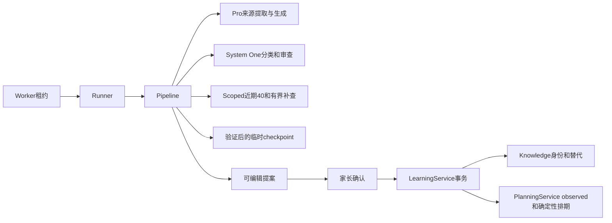
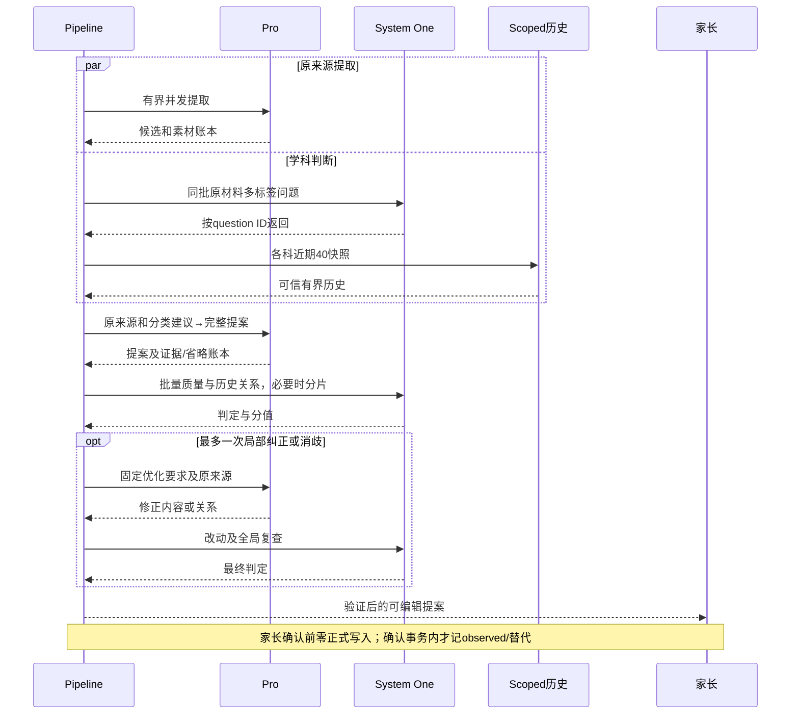
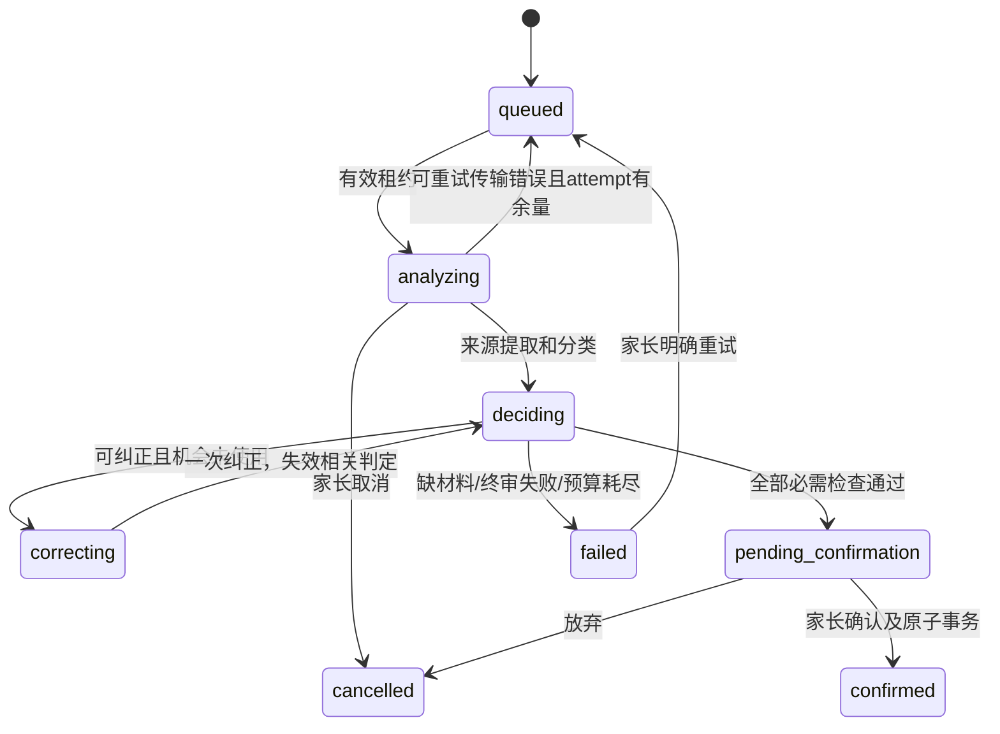
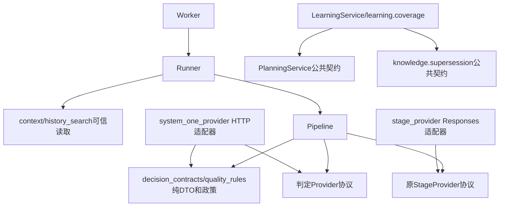

# BUG-036 — System One判定、近期历史匹配与生成质量闭环

- Status: CANCELLED
- Risk: R2（Provider协议、历史读取、缓存及确认事务）
- Spec revision: `BUG-SPEC-20261105-SYSTEM-ONE-05`
- Architecture revision: `ARCH-20261105-SYSTEM-ONE-05`
- Criteria revision: `QUALITY-20261105-SYSTEM-ONE-01`
- Created / Last updated: 2026-11-05
- Spec owner / Implementer / Verifier: 产品负责人 / Codex / 获授权验证者
- Reviewer: 批准后安排独立上下文只读审查，当前NOT_RUN。
- User confirmation / additional R2 approval: APPROVED，产品负责人于2026-11-05在本对话确认“可以，检测标准是，你用这套流程 跑一些全量的case 查看生成时间，效果”。该消息紧接Spec05 / Architecture05及目标流程图，明确批准本修订与全量同源效果/耗时验证；不包含生产部署、写入或Git提交。
- Affected Feature IDs: FEAT-001；FEAT-004仅做已确认学习消费者回归，不改建议规则。
- Feature current-state: [FEAT-001](../../docs/domain/features/FEAT-001-push-kids-mvp.md)，基线`FEAT-STATE-20261105-KNOWLEDGE-SUCCESS-12`。
- Feature merge owner: 获授权实现者，验证后合并当前事实。
- Target release: 本地实现、测试与只读真实回放；不包含部署、生产数据修复、Git提交/推送。
- Template: [FEATURE-SPEC](../_templates/FEATURE-SPEC.md)，以下合并相邻栏目覆盖其设计、验证与完成门禁。

> 2026-11-05取消被替代的未交付实验范围：用户明确批准[Spec06 / Architecture06](../completed/BUG-036-SYSTEM-ONE-ACCEPTANCE.md)“批准，需要给我新版本的成功率”，按其清退设计删除本Spec分类/近期池/历史关系及硬验收纠正运行路径。本Spec从VERIFYING/active迁至CANCELLED/rejected，不标DONE或验收PASS。下文保留原批准意图与实验记录；固定40/关系召回、真实37/45及命名内容FAIL不改标。共享match缓存修复、迁移0027及未证全库草稿清零的只读兼容在Spec06中继续有Owner/退出条件。当前事实和新测试见[Spec06 EVD](../evidence/EVD-20261105-BUG036-SYSTEMONE06.md)，旧实现不再代表当前代码。

## Frontend Design Impact and Repository-native Approval

- Frontend impact / engineering impact: no。继续使用现有可编辑提案、复习匹配与已替代展示，不改控件、布局、交互、前端代码或工具链。
- UI-001仅做兼容核对；FEC/DREV/设计源/视口导出N/A，没有前端实现。若需新增展示，先修订Spec与DREV，不能静默扩展。

## 0. 问题与目标

用户希望整体生成成功率和速度高，同时保持生成效果，提出用System One做分类、同科最近40条相似/覆盖判断、质量检查及失败后优化再生成。

目标是减少慢速生成式判断和无效重试。产出、内容合格、历史关系正确和速度分别验收，不以放宽证据、强行合并或增加重试制造成功率。

## 1. 事实、推荐决定、假设与未知

### 已确认事实

- 当前本地默认`staged-20261101-13`：Pro逐来源提取→合并→质量审查/一次纠正→逐目标关键词检索→match→选中历史的reuse核验→可选coverage；所有阶段共用`ARK_MODEL`。Responses调用`store=false`、思考关闭、strict Schema。
- 当前历史最多20逻辑查询/100不同项，不是每科最新40。确认后完整覆盖已有superseded路径，但该路径本身不写旧项复习反馈。
- [Spec04 EVD](../evidence/EVD-20261105-BUG036-SUCCESS04.md)：15条材料完整的真实提交首轮12/15、最终13/15，中位20.15秒、最大111.79秒；另3条已取消照片提交原图不可用。旧单轮不代替新方案同源配对基线。
- [匹配缓存ISS](../../docs/quality/issues/ISS-20261105-MATCH-UNCERTAINTY-CACHE.md)：match uncertain在缓存写入后抛retryable错误，后续attempt可能反复复用相同失败判定。
- 2026-11-05查阅[System One官方API](https://docs.volcengine.com/docs/ark/system-one-api?lang=zh)：专用`POST /api/v1/systemone`，beta头`ark-beta-systemone-api: true`，模型`doubao-seed-2-1-lite-260915`；共享`state`执行`questions`，支持分类/是非/评分及图片，答案按question ID读取；上下文128k。返回判定而非自由文本优化意见。
- 普通Lite关闭思考的[Responses调用](https://docs.volcengine.com/docs/ark/responses-api-deep-thinking?lang=zh)与专用接口不同；不能将普通调用称为System One接入。

### 已批准设计（本地实现、验证中）

1. 专用System One做分类、质量和历史关系判定；Pro保留原来源提取、生成和一次局部纠正。分类与逐材料提取并行，避免再加独立串行等待。
2. 近期40是主候选池；严格等价、单项完整覆盖、仅相关/部分重叠分别处理，不用一个相似度阈值包办。
3. 质量及历史关系共享材料批量判定，按大小分片；不提高进程并发。静态失败标准映射为优化要求，交Pro纠正后复查。
4. 家长确认后，等价/完整覆盖才记录实际发生日复习；提案阶段零正式写入，覆盖不删除或拼接旧历史。

### 假设和待验证事项

- System One更快、更稳定是待测假设；本账号专用接口合成HTTP200及真实图片判断已验证，多问题完整流程已实际执行。合成探针约0.613秒/图片判断约0.796秒不能代替整单性能；极限9图token预算仍PARTIAL。不要求用户提供聊天凭据。
- 下文0.90/0.95为初始决策阈值，不是已校准准确率；校准集与holdout分离，不按holdout结果调阈值补分。
- 无待决产品Blocker；批准代表接受完整覆盖的确认语义。不接受其中条款则先修订，不能凭旧批准实施。

## 2. 当前与目标行为矩阵

| 场景 | 当前 | 目标 |
|---|---|---|
| 多科图片/文字 | 提取推断科目，后续规范化 | System One多标签分类辅助提取，最终仍按原来源和可信目录核验 |
| 同科历史 | 按最终名称关键词查询 | 最新40主候选，必要时有界补查更早等价知识 |
| 范围/动作等价 | match后reuse | 批量高确定性等价判断；确认复用旧身份并记observed |
| 单项完整覆盖旧知识 | 确认后标已替代 | 确认事务记旧项observed，再标已替代；新项独立入档 |
| 仅相似/部分包含/技能不同 | 不得等价复用 | 不合并、不自动记复习 |
| 质量问题 | issues→一次纠正→复审 | 固定标准→定位目标/标准→静态要求→一次局部纠正→复审 |
| 判定不确定 | 可能重复读失败缓存 | 不复用不确定缓存；一次消歧/fallback预算，仍不明则诚实失败 |
| 人工/取消/补录 | 已有路径 | 保持手动、租约与迟到保护，复习日使用occurred_at |

## 3. 范围、不变量与领域规则

In scope：专用适配器、两角色模型路由、近期历史及索引、判定标准、匹配缓存恢复、确认后覆盖反馈、配对评估和文档闭合。

Out of scope：向量库、全量历史重写、取消记录清理、更换生成主模型、提高并发、掌握评分、模型排期、前端改版及自动发布。

### 历史候选与合并

- 最新40指同family/child/learning subject、`review_status=normal`的正式Knowledge，按`created_at DESC,id DESC`取40；重新复习不伪装新建。
- 首次生成使用固定as-of快照；历史回放只取提交创建前存在的知识，不使用后来新增项或无版本的当前Todo。今日计划/同日上下文不证明本次复习发生。
- 每个最终目标与同科池判关系。主池无等价或等价不确定时，可用既有索引有界补召回：最多20逻辑查询/100额外不同项，不声称全库检索完毕。
- **等价**：对象、范围、条件、检查动作一致，复用旧身份，不再创建同目标新知识。
- **当前完整覆盖旧项**：一个新目标独立包含旧对象/范围/条件，核心技能、复习动作兼容。20以内加法只有材料支持完整范围与技能时才可覆盖10以内加法；仅“20以内进位加法”不能凭数字范围更大就覆盖全部10以内加法。
- **部分重叠/仅相关/旧项包含当前**：不作为当前完整覆盖，不自动合并。识字/写字、认读/拼写、加法/加减法等须有负例。
- 关系choice显式包含等价、当前完整覆盖旧项、旧项包含当前、部分重叠、无关、信息不足；等价/覆盖对应概率≥0.95才提出关联，不把普通相似分当事实。
- 覆盖不确定时不自动替代，保留已经审查的当前独立目标；潜在等价身份不确定则进入一次消歧，仍不明终止，不能猜新造成重复。明确不等价不因“覆盖未知”整单失败。

### 家长确认的正式效果

- 等价沿用`todo_matches`与`PlanningService.record_review_event(action=observed,source=upload)`，不复制Knowledge。
- 完整覆盖：新目标保留自己的LearningRecord/Occurrence/Review；对旧身份、内容和Review状态重新核验，在同一确认事务中记旧项observed，再调用现有supersede与planning reconcile。旧学习/反馈保留，旧项退出自动排期；不合并曲线、热度或掌握结论。
- “今天也复习了”实现为`local_date(submission.occurred_at)`的复习；同日多个目标覆盖同一旧项去重，已复习同日不重复推进。历史补录不倒退当前投影、不产生过去Todo债务。
- 家长删关联/改目标、旧项删除/状态改变、Review版本变化时，不沿用过期覆盖；跳过失效关系，允许其余有效目标确认。未审查关系不能确认。
- 新语义绑定server-owned proposal版本与快照；无新版本的旧草稿保留原确认语义，不补记覆盖反馈。人工路径不自动匹配或覆盖。
- 其他产品不变量保持：只有家长确认写正式事实，AI不评分/判掌握/排日期，服务端family/child隔离，保留occurred_at和created_at。

## 4. 固定质量标准与修正

Schema、长度、别名、来源账本、空提案、科目目录、身份与输出预算先由代码检查。

| 标准 | 判定依据 | 对应静态优化要求 |
|---|---|---|
| Q1 来源真实 | 名称、范围、摘要、证据均来自当前原材料 | 删除无出处题名、字符、条件与答案，保留可辨内容 |
| Q2 学科正确 | 按实际目标分类，允许多科 | 只重查对应目标科目，不丢其他科或新造目录 |
| Q3 范围/技能准确 | 不扩大集合、不替换读写技能 | 收窄到有证据对象与动作，不补缺失实例 |
| Q4 粒度适当 | 同一具体检查整合，独立技能分开 | 定位真实需分合的目标，不对同组同时要求合并和拆分 |
| Q5 可执行复习 | 具体知识动作，符合已有1–5分钟复习合同 | 用原来源支持的知识动作替代活动/情境名 |
| Q6 重要内容完整 | 可读素材目标均有item或合法omission | 恢复错误省略项，不造未给内容 |
| Q7 历史关系准确 | 等价/覆盖有双方范围与技能证据 | 取消不支持关联，仅相似不记复习 |

- Q1/Q3/Q6/Q7为硬标准，noul≥0.95；Q2/Q4/Q5为≥0.90；任一未通过进入唯一纠正/消歧机会，最终未通过不发布。阈值不等于真实准确率。
- 分类使用逐科noul或逐目标choice，保留多标签/不确定；不以整批单选丢其他科。题目instructions明确目标编号与正文，不仅把范围编码在question ID里。
- 每片保留全局Q4/Q6：不能漏跨片重复、分合冲突或素材覆盖。审查使用原图/原文字和完整提案，不能只检查生成摘要。
- System One返回分值/分类，服务端按失败标准与目标产生固定优化要求；如需更细解释，在唯一有界Pro消歧中完成，不伪称System One生成了自由文本建议。
- 最多一次局部纠正→复查改动及全局账本；保护无关目标和evidence编号/内容。改动历史判断输入就失效旧判定。检查器同系列模型的偏差由独立holdout和家长review验证。

## 5. 调用、时序、状态与架构

### Link / call graph

### Sequence diagram

### State machine

deciding/correcting仅为attempt内部阶段，不新增数据库Job状态。

### Architecture diagram / dependency DAG

- pipeline只编排；专用HTTP/认证/响应归`system_one_provider.py`，规则与静态建议归`quality_rules.py`，DTO归`decision_contracts.py`；不把全部新规则继续堆进大pipeline。
- 近期读取归history_search，Provider不查DB。必要时将两Provider共享的请求槽抽为agent_processing内`request_limits.py`，只有同语义消费者，不建通用utils。
- 确认应用归learning/coverage，复习写入只经PlanningService；不新增agent_processing→LearningService、policy→DB/HTTP或Router→Provider依赖，检查间接及test-only循环。
- 扩展政策：两个固定角色为closed；同能力模型版本配置为open，Owner为agent_processing，固定配置注册、版本进入fingerprint，须通过协议/隔离/安全/资源/观测/契约测试才替换。第三Provider/向量库deferred。移除条件由后续明确Spec确定。
- ADR N/A：本完整Spec记录可逆角色分工，未改身份或部署拓扑；Architecture05批准包含模块、文件分解、依赖与取舍。

### 备选与取舍

| 方案 | 收益与限制 |
|---|---|
| 推荐：专用System One批量判定+原Pro生成 | 共享输入、减少生成式判定输出；beta与误判须探针/同源A/B/回退 |
| 全部配置改Lite | 改动小，但混淆生成/判定，未经验证降低原来源生成能力，也未接专用接口 |
| 每问题或每pair一次串行调用 | 容易实现，调用/尾延迟随目标暴涨，不采用 |
| 只用40、不补查 | 便宜但可能漏旧等价知识，保留有界补查 |
| 相似即合并/不限重生成 | 提高表面产出，却可能误记复习、增加尾延迟，不采用 |

## 6. 协议、安全、资源、缓存与数据

- 固定Ark受信host的`/api/v1/systemone`，使用安全配置密钥与专用beta头；不把模型提供的URL当base，不用字符串替换将凭据转发到未知host。测试base显式注入。
- 专用请求只用官方字段，不盲传Responses的store/thinking/text.format。响应问题集合、类型、枚举、有限概率和模型都须验证；缺题/额外题、NaN/Infinity、错类型均失败，不默认通过。
- noul接近0.5是不确定；score只作诊断，不用平均分遮盖硬标准失败。输出分值不能拿来评价孩子掌握。
- 新配置`ARK_SYSTEM_ONE_MODEL`与`PUSH_KIDS_SYSTEM_ONE_ENABLED`；新路径默认关闭供受控评估，`ARK_MODEL`仍只管生成，不影响其他AI消费者。
- 400/401/403为能力/认证错误，不盲重试；429/5xx/网络超时按既有持久Job政策。允许一次Pro结构化判定fallback并执行相同标准，单列效果；不跳过审核、不把fallback当System One成功。
- fallback与语义纠正共用一次逻辑修复机会；SDK重试0、最多3持久attempt、取消/过期停止调用，30秒写回余量保持。
- 最终最多20目标/20实际科目；每科40，近期总上限800，额外补查100。分批每批最多2科/80项、最多10批，数据库有界读取，不按知识点N+1。旧“总100历史项”预算须在实现闭合时明确替换。
- 增加tenant-leading索引`(family_id,child_id,subject_id,review_status,created_at,id)`；migration revision按实施时真实head分配，不覆盖并行0026。MySQL5.7用有界UNION或等价方案，不依赖窗口函数；EXPLAIN/大库存测试验证索引及查询数。无业务列变更/回填。
- 每请求最多128问题、每job最多900关系pair、文本JSON≤512KiB，输入引用账本完整。供应商输入≤120k token保守预检留余量，图像计量/分片须通过能力探针核对；未证明估算正确不能宣称通过。不能删当前目标或漏审满足预算；历史覆盖证据被截断时不确定覆盖。
- 单请求最多9图及原配置上传大小、合并DTO64KiB；同2个进程请求槽。整个attempt≤270秒/租约剩余，提取≤180秒，extract/group≤45秒、其他请求≤30秒；含结构修复/fallback/分片的核心外呼仍最多33，可选coverage最多1次。超限诚实capacity。
- 分类与提取并行；单图单科、问题≤128、无修正时目标4次外呼（分类、提取、生成、批量判定），大材料单列。不在新路径叠加旧match/reuse/coverage全部调用。
- checkpoint仍18键/64KiB每键/512KiB每Job/24h，批判定聚合固定单元，不每问题建行。两个模型、规则、阈值、协议、输入SHA与历史快照进入fingerprint。
- 不确定/终审失败不能写入或读取可复用缓存；中间失败仅服务本attempt唯一纠正。Worker终态/家长retry清相关语义阶段，保留有效提取，原锁序与同事务回滚保持；新单元不得漏清。
- 新覆盖快照只在server-owned proposal元数据中，保存版本、目标fingerprint、旧内容及Review状态；公开确认结果及旧客户端兼容。越权/篡改拒绝，可信但过期关系跳过。
- 所有输入、外部判定不可信；服务端family/child/科目边界重查。日志只记版本、静态失败/标准码、数量、字节/token、排队/执行耗时、fallback计数，不留原响应、儿童材料、关键词或密钥。

## 7. 预期文件变更与替换计划

下列为批准后的范围，当前未实施：

| 路径 | 动作/职责 |
|---|---|
| `apps/api/src/push_kids/platform/config.py` | modify：两角色固定配置及启用开关 |
| `apps/api/src/push_kids/agent_processing/system_one_provider.py` | add：专用HTTP适配/校验/错误/观测 |
| `apps/api/src/push_kids/agent_processing/decision_contracts.py`、`quality_rules.py` | add：关系/质量DTO、版本化问题与静态要求 |
| `apps/api/src/push_kids/agent_processing/request_limits.py`、`stage_provider.py` | add/modify as needed：共享2槽，保持deadline |
| `apps/api/src/push_kids/agent_processing/pipeline.py`、`stage_contracts.py` | modify：并行分类、批判定替代旧默认调用、一次修正 |
| `apps/api/src/push_kids/agent_processing/history_search.py`、`context.py`、`contracts.py` | modify：近期窗口、快照、输入预算与旧DTO兼容 |
| `apps/api/src/push_kids/agent_processing/checkpoints.py`、`worker.py`、`telemetry.py`、`providers.py` | 必需时modify：新单元恢复/指纹/路由；不改锁及租约不变量 |
| `apps/api/src/push_kids/learning/coverage.py`、`learning/service.py` | modify：新版本确认后observed再替代、旧草稿原义 |
| `apps/api/src/push_kids/persistence/models.py`、`apps/api/migrations/versions/` | modify/add：仅近期窗口复合索引与增量迁移 |
| `tests/unit/test_system_one_provider.py`、`test_system_one_decisions.py` | add：协议/概率/问题映射/规则和边界 |
| `tests/integration/test_history_search.py`、`test_analysis_checkpoints.py`、`test_staged_mysql.py`、`test_learning_history.py` | modify：有界历史、恢复/并发、确认及兼容 |
| `tests/performance/test_recent_subject_history.py` | add：规模与查询计划 |
| `tools/benchmark_staged_analysis.py` | modify：同源A/B成功/质量/耗时分报，不改原40 fixture/评分 |
| Feature/Behavior/Architecture/UI current-state/Test/ISS/REG/发布记录 | 实现验证后按实际diff替换冲突正文与预算，历史证据不改标 |

临时共存：关闭开关走原权威路径，开启走新路径；同一提案不同时跑两套默认审查。对照工具可保留两模式。新路径云稳定后另Spec评估旧消费者移除，不删历史证据，不直接切生产。

## 8. 验收标准与必需测试点

| ID | 可观察验收 | 测试点/证据 |
|---|---|---|
| AC01 协议 | 专用路径/头/字段正确；乱序映射正确；缺题/非有限概率拒绝 | TP01 unit真实HTTPX MockTransport及日志隐私；无儿童信息真实能力探针 |
| AC02 分类 | 单科/多科/预设未配置/自定义科目保持；低置信不丢科、不自动建科 | TP02 unit/integration及活动负例 |
| AC03 历史 | 每科40稳定、无未来知识、scope隔离、补查/批次数有界 | TP03 SQLite和独占MySQL5.7，同时间戳、第40/41条、大库存EXPLAIN与query-count |
| AC04 关系 | 等价/完整覆盖/部分/反向/技能差异/未知正确区分 | TP04 unit矩阵及预先标注的独立关系holdout |
| AC05 质量 | Q1–Q7核对原来源和全提案；一次局部修正，保护无关项 | TP05 合成Red/Green及既有真实题名/范围错误回归 |
| AC06 恢复 | uncertain不缓存空转；明确retry同事务清理；取消/租约/SQL回滚保持 | TP06 ISS探针先Red后Green、新调用计数、独占MySQL并发 |
| AC07 确认 | 确认前零正式写；等价/覆盖发生日observed一次；旧历史保留 | TP07 实际服务/路由wiring、同日/补录/父编辑/过期/重复确认/手动/事务回滚 |
| AC08 预算 | 调用/时间/输入/缓存硬限、两个Provider共用2槽、无迟到写/内容泄漏 | TP08 HTTP/SDK边界、队列/慢请求/取消/日志捕获 |
| AC09 固定门禁 | 原40≥38/40、每科≥90%，零空/remaining pending/正式写 | TP09 原fixture/顺序/评分完整运行，失败保留 |
| AC10 效果 | 同源新旧配对，产出/内容/速度分开报告；直接交付结果表 | TP10 下文真实回放、脱敏指标与只读审计，家长review独立PENDING |
| AC11 兼容 | 原API、旧草稿、手动、supersession及FEAT-004消费者保持 | TP11 原专项、全量后端/静态/架构；按影响跑前端合同，不冒充真机 |

### 成功率、速度与内容测量

- 先冻结源码、模型、规则/阈值、fixture及私有来源manifest，新旧两路径同材料/历史截止/资源/attempt交错配对，不拿旧单轮当现测基线。
- 近期固定18条中15条材料完整参与生成，3条已取消原图删除单列UNREPLAYABLE，18条覆盖率仍报告；3条不算模型生成失败。15条中的超时、模型/校验失败全部在分母。
- 15条各3轮，共45次端到端请求：首attempt成功率目标≥90%，最多3attempt最终目标≥95%；每轮单报，不拼接最佳值。首attempt包含内部有限局部修正，另列无需修正成功率；不把小样本当生产SLA。
- 从开始处理到可编辑提案计时，含排队/纠正/重试；下载另列。全部请求终态与成功请求耗时均报p50/p95（nearest-rank）及最大值，不能只筛成功样本声称变快。单图/多图分层，另报调用/token/fallback率。
- 速度目标p50≤15秒、p95≤60秒，且配对p50/p95均降低≥25%；均为待验证目标，未达FAIL，不能通过拉高超时达标。
- 内容匿名对照人工Q1–Q7复核，内容可接受目标≥95%、来源虚构/错误覆盖或复习为0。内置检查passed不代替家长/独立review，未完成PENDING。
- 关系holdout至少40对，覆盖等价/覆盖/部分/反向/技能差异/无关/不足，先固定标签；自动关联precision目标100%（本集合）、明确正例recall≥90%，校准集不混入holdout。
- 主轮直接给15条结果表：别名、科目、生成摘要/知识条目、历史处理、耗时、attempt/修正次数、状态，失败同表；重复轮变化明确列出。不附原始输入或图片，完整重复结果私有留证。
- 费用只按实际token/调用和核实价格计算；System One output_tokens=0不代表免费或无耗时。

### 执行顺序、命令与审查

1. 批准后冻结基线，新行为先诚实Red；先做能力探针与小批校准，关键能力不成立或明显变慢则留FAIL，停止扩大实现。
2. 每片Green跑Provider/历史/确认/缓存专项；独占utf8mb4 MySQL5.7验证迁移、索引及并发，不对生产跑写测试。
3. `uv run pytest tests/unit tests/integration tests/contract -q`、`uv run ruff check .`、`uv run ruff format --check .`、`uv run mypy apps/api/src`、`uv run python tools/check_architecture.py`；`npm test`按实际前端合同影响执行，未运行明示原因。
4. 原40、关系holdout、近期真实A/B、原30+补充3的内容回归分别报告，失败/中断不替换。真实源只读transaction+私有临时生成，零业务POST/草稿/Job/正式写；审计按实际并发差异记录。
5. 独立上下文审查按[REVIEW.md](../../REVIEW.md)，未安排NOT_RUN；不在本草案阶段自行启动多Agent。

## 9. 实施、发布回退与文档闭合

### 实施切片

1. 适配器+纯DTO+共享槽，协议Red/Green及真实能力探针，暂不动正式确认。
2. 索引、近期40与引用账本，先验证scope/查询计划/规模，再接模型。
3. 替换判定、修不确定缓存、一次纠正/fallback；开关可回原路径，零正式副作用。
4. 新版本确认快照、observed后supersede同事务，补录/旧草稿/幂等并发验证。
5. 固定门禁、真实配对、内容review、独立代码审查及文档闭合。

### 发布、迁移、回退

- 本次只到本地验证；后续部署另按[发布手册](../../docs/deploy/README.md)批准冻结版本。索引additive迁移先行、兼容代码后发，核对真实head与混合版本。
- 新路径默认关闭，能力/质量/数据门禁通过且获发布授权才启用；灰度观察成功、误关联、质量拒绝、p95/fallback/429和调用预算。出现错误覆盖、跨scope或重复复习则停止新路径。
- 可关闭开关回旧判定，不跳过检查；回退不撤销或伪造已确认学习/复习事实。未知提交结果按既有事务恢复处理。
- 只有匹配本实现范围的云正常部署满足开发DONE；本地通过仍VERIFYING/active，届时迁completed并修引用。验收缺项独立保留，部署不等于质量PASS。

### 当前实施/验证记录与完成门禁

- 用户已批准本修订并本地实现，默认关闭。新索引0027接并行0026并同步启动guard；MySQL专用hint固定最近40查询的复合索引，隔离5.7.44五万项/20科/同刻排序及迁移/相关并发13项PASS。无生产迁移/配置修改、部署或Git提交。独立Review NOT_RUN。
- [本轮EVD](../evidence/EVD-20261105-BUG036-SYSTEMONE05.md)绑定Red/Baseline/Green、固定40首波36/40 FAIL、关系40召回85% FAIL和真实配对；家长内容review独立PENDING，不覆盖Spec04或旧真实30+3 FAIL。
- 真实同源90次已完整完成：新路径首attempt36/45、最终37/45（旧43/45），全部终态p50 26.640秒/p95 61.361秒，较旧路径降23.41%/21.30%，均未达到批准的成功率/速度目标。3份来源命名内容FAIL，完整家长评分PENDING；零harness错误，无业务写，结果表只含产物。
- Feature/Behavior/Architecture/UI与测试、ISS/REG及本地发布边界同步；原100项/单模型限制明确为默认关闭分支，开启分支采用新目录及新版本覆盖observed语义。其他可选MySQL、原30+3重放和独立审查缺项不预标PASS。
- 生命周期：没有对应云交付，继续VERIFYING并留在本路径active；后续交付与未完成验收分别记录，不能现在迁DONE。
- 完成必须记录批准、真实Red/Green、源码SHA、每TP结果、固定40/同源真实结果、独立审查、资源/隐私证据、实际交付/回退版本及Spec最终位置；未跑检查不能预标PASS。

## 10. 修订历史

| 日期 | 修订 | 状态 |
|---|---|---|
| 2026-11-05 | Spec05 / Architecture05 / Criteria01 | 获用户明确批准，本地实现与当前可执行测试完成；成功率/速度/内容门禁FAIL，完整家长review及其他缺项保留；VERIFYING，未云交付 |
