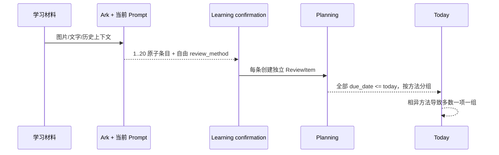
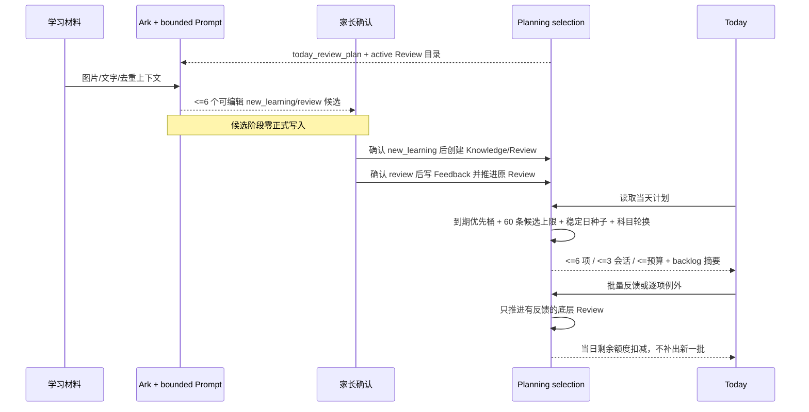
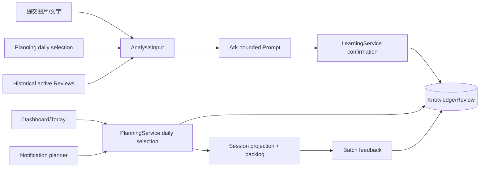
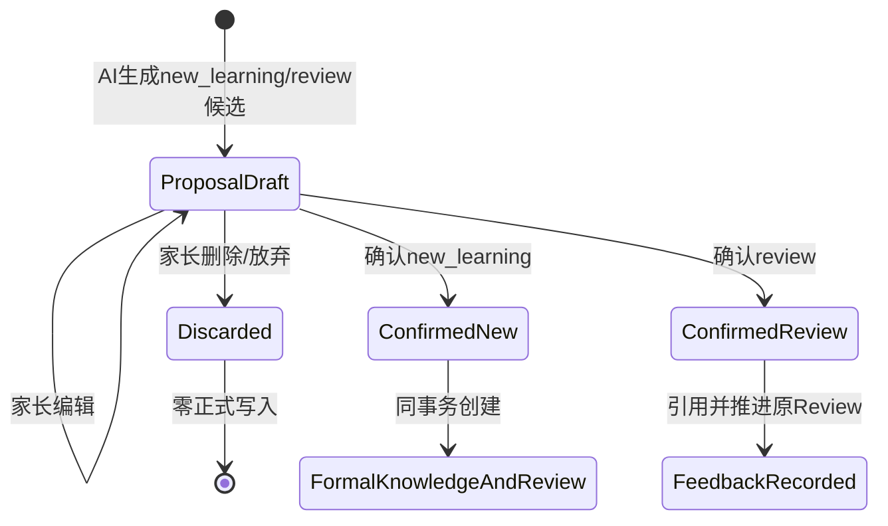
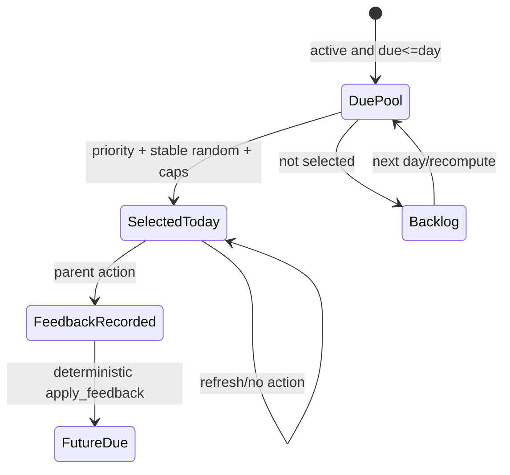
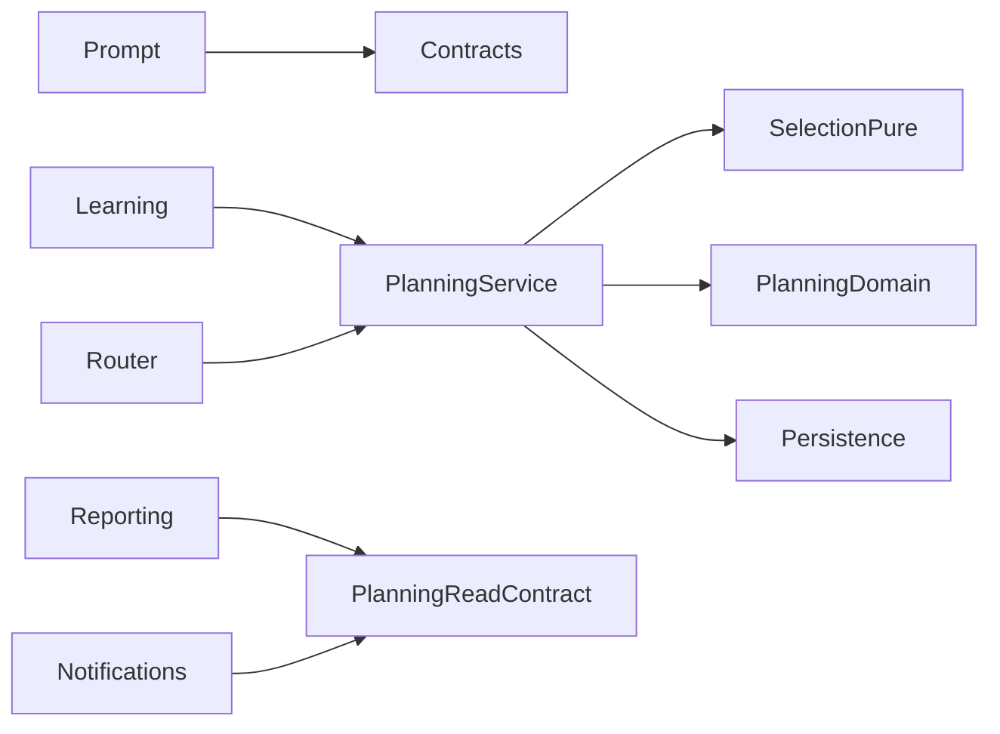
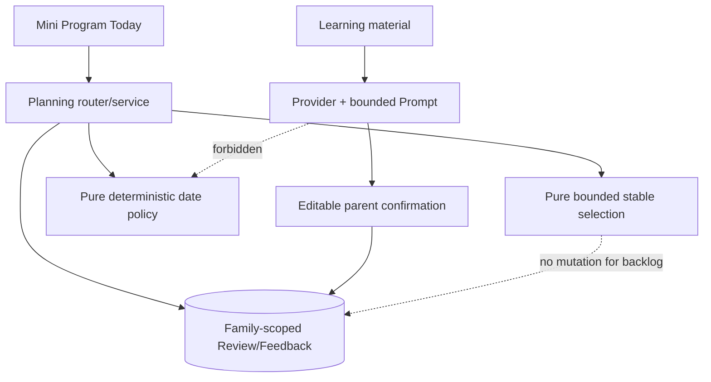

# FEAT-001 — 聚合复习单元与每日稳定随机抽样

- Status: `CANCELLED`
- Risk: `R2`
- Spec owner: 产品负责人（用户）
- Implementer: `Codex（批准后）`
- Reviewer: `TBD（后端、产品、学习体验）`
- Verifier: `Codex + 用户真实体验验收`
- Created: 2026-09-13
- Last updated: 2026-09-13
- Target release: `TBD`
- Spec revision: `SPEC-REVIEW-LOAD-20260913-03`
- Superseded by: `SPEC-UNIFIED-REVIEW-20260913-02；其后端已验证部分作为迁移输入保留，但固定6条/随机selection/one-shot历史上下文不再实施`
- User confirmation: `APPROVED；产品负责人于 2026-09-13 回复“按照这个方案落地”，明确批准 SPEC-REVIEW-LOAD-20260913-03`
- Additional R2/R3 approval: `APPROVED；同一批准覆盖本 Spec 所列 R2 架构、行为、兼容与测试方案；Frontend Design Revision 仍独立待批准`
- Affected Feature IDs: `existing FEAT-001`
- Feature current-state documents: `docs/domain/features/FEAT-001-push-kids-mvp.md`
- Feature baseline revision: `FEAT-STATE-20260912-TODAY-NEXT-REVIEW-01-LOCAL`
- Feature merge owner: `Codex（完成验证后）`

## Frontend Design Impact and Figma Approval

- Frontend impact: `yes — 今日页从全部到期项改为有限的当日抽样复习会话，并显示未入选积压摘要`
- Frontend impact reason: 每日复习列表数量、分组、反馈入口和积压解释发生可见变化
- Frontend engineering impact: `yes — 新增会话投影、抽样元数据、批量反馈与兼容状态`
- Frontend engineering impact reason: Today 数据合同和交互状态变化
- Affected UI IDs: `UI-001（今日）`
- UI current-state documents: `docs/design/frontend/ui/UI-001-parent-miniapp.md`
- Frontend baseline revision: `FDB-20260906-03`
- Frontend engineering constraint revision: `FEC-20260905-02`
- Affected frontend quality dimensions: `component/state/form/responsive/a11y/i18n/browser-device/performance/security/privacy/observability`
- Frontend quality budgets/requirements: `320×568、390×844、430×932；触控目标 >=44px；首屏不得展开全部积压；不得表述为评分或掌握`
- Frontend quality verification plan: `状态/API contract、长知识名、0/1/6/大量积压、刷新稳定、反馈后不补满、三视口原生几何、iOS/Android`
- Approved frontend engineering deviations: `none`
- Current Design Revision(s): `N/A（尚未设计新状态）`
- Figma project/file URL: `PENDING`
- Figma node URL(s): `PENDING`
- Proposed Design Revision: `DREV-20260913-REVIEW-LOAD-01`
- Required viewport/state exports: `三视口；无到期、少量到期、大量积压、3 会话、部分完成、网络失败、旧服务端兼容`
- Prototype status: `AWAITING_DESIGN`
- Approved Task Spec revision: `PENDING`
- Approved Design Revision: `PENDING`
- Design approval evidence: `PENDING`
- Snapshot manifest path: `docs/design/frontend/snapshots/UI-001/DREV-20260913-REVIEW-LOAD-01/APPROVAL.md（待创建）`
- Permitted implementation deviations: `none`
- UI current-state merge owner: `Codex`
- UI current-state merge evidence: `pending`
- Frontend visual/a11y/resolution verification: `pending`
- Frontend engineering verification evidence: `pending`
- Figma waiver: `none；FEAT-001 既有 waiver 不覆盖本次新可见行为`

## 0. Executive summary

### Problem

生产 MySQL 的真实测试数据表明，AI 把一批练习册拆成过多、粒度不一致的知识条目；每条正式知识又各自
创建 ReviewItem。当前 Today 虽按科目和完整 `review_method` 字符串分组，但模型为几乎每条内容生成不同
方法，导致分组失效。到期日读取再把所有逾期项列出，积压会形成不可接受的每日压力。

### Intended outcome

1. Prompt 使用孩子已填写的年级和学习科目限定识别，不发送姓名或复习预算。
2. AI 产出可在一次短复习中完成的“复习单元”，同一目标、同一复习动作的题目/词汇合并，单批最多 6 个。
3. 每个单元明确为 `new_learning` 或 `review`，两类都只是可编辑候选；前者经家长确认后新增正式学习与 Review，后者经家长确认后才更新已有 Review，混合批同时处理。
4. 到期日仍由确定性策略产生；随机只用于从到期池选择“今天展示什么”，不决定学习、掌握或下一到期日。
5. Today 每天稳定展示最多 6 个底层 ReviewItem、最多 3 个科目会话，并受孩子分钟预算约束；刷新不换题。
6. 未入选项不写 defer、不改 due_date、不伪造反馈，只显示数量/最早逾期日，并在后续日期轮换。
7. 当天完成或跳过已展示项后，不继续补出新一批，避免形成无限 Todo。

### Why now

真实数据已出现 25 项/85 分钟在同一天到期，而孩子预算为 15 分钟。继续积累会放大复习债务和放弃风险。

## 1. Facts, decisions, assumptions, questions

### Confirmed facts

| ID | Fact | Evidence |
|---|---|---|
| `F-001` | 生产数据有 15 次提交、53 个正式知识和 53 个 ReviewItem | 2026-09-13 生产 MySQL 只读聚合 |
| `F-002` | 两个孩子预算均为 15 分钟 | 2026-09-13 `children.daily_budget_minutes` 只读聚合 |
| `F-003` | 一个孩子在 2026-09-13 到期 25 项，估算总计 85 分钟 | 生产 MySQL family-scoped Review/Knowledge 聚合 |
| `F-004` | 25 项按当前键形成 25 个分组，因为每项 `review_method` 不同 | 生产 MySQL 按 subject + review_method 聚合 |
| `F-005` | 历史 15 批 AI 输出共 53 项、估算 208 分钟；最大单批为 17 项/50 分钟 | 已保存 proposal 的只读结构化聚合；未持久化原始 payload |
| `F-006` | 当前 Prompt 明确要求“每个条目一个原子内容”，并用单汉字/单单词作为正例 | `agent_processing/prompt.py` revision `subject-grouped-incremental-20260911-04` |
| `F-007` | 当前日期策略为 `1/3/7/14/30/60`；预算只分 required/optional，不限制返回总量 | `planning/domain.py`、`planning/service.py` |
| `F-008` | 本地 SQLite 是空库，真实测试数据只在生产 MySQL | `data/push_kids.db` 只读计数与 Feature current state |
| `F-009` | 当前孩子档案可供分析使用的学习信息只有年级与已配置学习科目；姓名、每日预算不参与内容识别 | `children/schemas.py`、`agent_processing/context.py` |
| `F-010` | 当前模型已输出 `kind=new_learning|review`；确认时新学创建 LearningRecord/KnowledgeOccurrence/ReviewItem，复习只对匹配 Review 写 complete Feedback 并推进状态 | `agent_processing/contracts.py`、`learning/service.py` |
| `F-011` | 当前只有同日分析且已到期/逾期的 Review 会进入 todo candidates；尚未到期的历史知识即使再次练习也不能标记为 review | `agent_processing/context.py`、`contracts.py` |
| `F-012` | 当前 Prompt 已包含 `今日可复习Todo候选`，但它是全部 due/overdue 候选而不是新版 Today 稳定抽样后的当日计划；模型提案本身不会写 Review，正式推进发生在家长确认事务 | `agent_processing/providers.py`、`context.py`、`learning/service.py` |

### Decisions

| ID | Decision | Owner/date | Rationale |
|---|---|---|---|
| `D-001` | 将“识别原子事实”改为“生成适度聚合的复习单元” | proposed / 2026-09-13 | 直接控制 ReviewItem 数量，同时保留可确认性 |
| `D-002` | 单批最多 6 单元、单科最多 4 单元、每单元预计 1–5 分钟 | proposed / 2026-09-13 | 形成硬上限，同时允许单科综合练习保留必要的识写/拼音/表达/阅读边界 |
| `D-003` | `review_method` 收敛为三种规范动作：主动回忆、变式练习、解释应用 | proposed / 2026-09-13 | 让 Today 聚合稳定，不再按自由长句裂成组 |
| `D-004` | 随机只作用于每日选择投影；due_date 与 feedback 转移保持确定性 | proposed / 2026-09-13 | 保留可解释、可测试的记忆计划 |
| `D-005` | 同一孩子/自然日使用稳定种子；刷新、分页和多端看到相同顺序 | proposed / 2026-09-13 | 避免列表抖动和重复争议 |
| `D-006` | 每日最多 6 项、最多 3 个科目会话，同时受 `daily_budget_minutes` 约束 | proposed / 2026-09-13 | 数量和时间双重减负 |
| `D-007` | 当天任何反馈都消耗相应分钟与条目名额；反馈后不补满新任务 | proposed / 2026-09-13 | 防止“做完又出现” |
| `D-008` | 未入选积压不改状态，只暴露聚合摘要 | proposed / 2026-09-13 | 不制造虚假 defer，也不隐藏事实 |
| `D-009` | 先实现本 Spec；未批准的自适应 Policy V2 继续独立评审 | proposed / 2026-09-13 | 减负问题不依赖新反馈语义或复杂迁移 |
| `D-010` | Prompt 首段根据档案中的 `grade + configured learning subjects` 动态限定角色；不传孩子姓名和每日预算 | proposed / 2026-09-13 | 使用已填写信息控制粒度与科目，同时遵守数据最小化 |
| `D-011` | 只要本次直接证据等价于此前已确认知识，就分类为 `review` 并引用其 active ReviewItem；不要求已经到期 | proposed / 2026-09-13 | 真实发生的提前复习也应更新现有计划，不能被丢弃或伪装成新学 |
| `D-012` | 同一自然日刚确认知识再次出现时默认按重复材料省略；只有家长文字明确说明是一次独立复习活动时才允许 review | proposed / 2026-09-13 | 防止重复上传或拆批照片立即把 Review 多推进一轮 |
| `D-013` | 混合材料允许同时返回 new_learning 与 review；确认在同一事务中创建新学习并推进已有 Review | proposed / 2026-09-13 | 一次作业可能同时包含新课和旧知识复习 |
| `D-014` | `new_learning` 与 `review` 都是可编辑提案；分析、展示、编辑或删除候选均不得写正式学习/Review/Feedback，只有家长确认才执行对应事务 | user clarified / 2026-09-13 | 防止模型或计划上下文被误当成家长已完成复习的事实 |
| `D-015` | Prompt 显式注入新版稳定抽样后的 `today_review_plan`（最多 6 项）并优先用于 review 匹配；计划项本身不是直接证据，未在本次材料中实际出现就不得输出 | user clarified / 2026-09-13 | 让模型识别“本次正在做今天计划复习”，同时避免把计划清单自动报成已复习 |
| `D-016` | `today_review_plan` 之外仍提供有界、去重的历史 active Review 目录，用于识别实际发生的提前/计划外复习；两类 review 都须家长确认后推进 | proposed / 2026-09-13 | 不把“今天没抽中”误判为新学，也不让每日随机选择限制真实学习记录 |

### Assumptions

| ID | Assumption | Risk if wrong | Validation | Owner/due |
|---|---|---|---|---|
| `A-001` | 适度聚合后，家长仍能判断单元是否准确 | 过度聚合会失去可编辑性 | 用真实 15 批做 Prompt A/B；用户确认 | 产品负责人 / 批准前 |
| `A-002` | 6 项/3 会话/预算足以形成可持续日常 | 仍过多或过少 | 2 周观察每日展示、完成、积压年龄 | product/data / pilot |
| `A-003` | 稳定随机可增加变化感，但不应压过逾期和失败优先级 | 重要项被稀释 | 单元/性质/公平性测试与 pilot | planning owner / pilot |

### Open questions

| ID | Question | Why it matters | Recommended answer | Owner | Blocking? |
|---|---|---|---|---|---|
| `Q-001` | 是否认可影子实验中的“适度聚合”粒度 | 决定 Prompt 和正式知识粒度 | 已随 `SPEC-REVIEW-LOAD-20260913-03` 批准 | 用户 | resolved |
| `Q-002` | 是否认可每日 6 项/3 会话默认上限 | 决定 API/UI 和测试预言机 | 已随 `SPEC-REVIEW-LOAD-20260913-03` 批准；pilot 后再评估 | 用户 | resolved |

## 2. Current behavior and evidence

### Current flow



### Current evidence

- Code: `agent_processing/prompt.py`、`agent_processing/contracts.py`、`learning/service.py`、`planning/domain.py`、`planning/service.py`
- Tests: `tests/unit/test_agent_processing.py`、`tests/unit/test_planning_domain.py`、`tests/integration/test_learning_flow.py`、`tests/integration/test_bounded_read_apis.py`
- Behavior IDs: `BHV-006`、`BHV-014`、`BHV-025`
- API/schema: `AnalysisProposal.knowledge_points <= 20`；Today snapshot pagination
- Runtime evidence: 仅保存上述聚合计数；不在本 Spec 复制真实图片、数据库 ID 或原始 proposal JSON
- Related specs: `FEAT-001-SUBJECT-GROUPED-INCREMENTAL-AI`、`FEAT-001-ADAPTIVE-REVIEW-POLICY-V2`

## 3. Prompt shadow experiment

### Candidate Prompt revision

候选 revision：`child-aware-review-unit-20260913-03`。生产 `prompt.py` 在批准前保持不变。

Prompt 开头不再使用固定的“你是小学学习内容整理助手”，而改为先注入最小必要档案：

```text
你正在根据孩子的学习档案和本次材料，生成一份由家长编辑确认的学习/复习提案。

孩子学习档案：
- 年级：{{grade_or_未填写}}
- 已配置学习科目：{{existing_subjects_json}}

请使用年级选择合适的概念粒度和表述方式，只能使用已配置学习科目进行归类。
年级未填写时不得推断；孩子姓名和每日复习预算不属于内容识别所需信息，不会提供给你。

今天计划复习（由服务端确定性排期与稳定抽样产生，最多 6 项）：
{{today_review_plan_json}}

已有知识及 active Review 目录（用于识别提前或计划外复习）：
{{existing_knowledge_catalog_json}}

近期已确认学习上下文：
{{recent_learning_json}}

本次发生日已经确认的知识引用（必须去重）：
{{same_day_knowledge_refs_json}}

“今天计划复习”和历史目录都只是匹配上下文，不是本次实际复习的证据，也不是要求输出的任务清单。
只有本次 `occurred_at` 属于今天的自然日时才提供 `today_review_plan`；历史补录时该列表为空，避免用
今天的计划解释过去发生的材料。
只有本次照片或家长文字出现可定位的直接练习证据时，才能生成 review 候选；模型不得据此标记完成、
写反馈或推进计划。
```

替换当前“每个知识点都是最小原子”的规则为：

```text
知识条目代表“家长可以在一次 1–5 分钟短复习中确认的主题单元”，不是每一道题、每一个字、
每一个单词各建一条。先识别整批材料的学习目标，再按“同一科目 + 同一核心目标 + 同一种复习动作”合并。

同一页或同一练习中的例题、同类词汇、同组生字、同篇诗文的题目写进 direct_evidence，不拆成多个条目。
只有需要不同复习动作，或合并后家长无法独立判断是否完成时才拆分。不同科目绝不合并。

每批最多 6 个 new_learning/review 条目，每科最多 4 个；不为达到上限而拆分。
estimated_minutes 表示未来一次短复习所需时间，不是完成原作业的时间；每条只能为 1–5 分钟。

review_method 只允许下列三个规范值之一：
- 主动回忆：遮住答案后说、认或写；适合生字、词汇、诗文、事实；
- 变式练习：换数字或情境做 1–2 道同类题；适合运算和解题方法；
- 解释应用：用自己的话解释、比较或举例；适合概念、阅读和规则。

合并示例：j、juice、jar、jellyfish => “字母 Jj 与 j 开头词汇”，不要输出 4 条。
合并示例：10 以内数的顺序、组成、大小比较、分与合 => “10 以内数的认识与分合”，
但“年龄差应用”需要不同目标和练习方式，应单独保留。
```

新增严格分类顺序：

```text
【先判定新学还是复习，再生成条目】

对每个有本次直接证据的候选复习单元，必须按以下顺序判定：

1. 如果它与本次自然日已经确认的同科目知识等价：
   - 默认视为重复材料并省略；
   - 只有家长补充文字明确说明这是另一次独立复习活动时，才继续按 review 判定；
   - 不得再次输出为 new_learning。

2. 如果它与 `today_review_plan` 中的知识在科目、范围和语义上等价：
   - kind 必须为 review；
   - 必须复制服务端提供的 existing_knowledge_id 和 review_id；
   - 计划项本身不是 direct_evidence，仍必须引用本次照片或家长文字；
   - 未在本次材料出现的计划项不得输出。

3. 如果它未命中今天计划，但与此前自然日已确认且具有 active Review 的知识等价：
   - kind 必须为 review；
   - 必须复制服务端提供的 existing_knowledge_id 和 review_id；
   - 即使当前 due_date 在未来，也仍然是本次真实发生的提前复习；
   - 不得创建同名 new_learning。

4. 如果此前已确认知识中不存在等价项：
   - kind 为 new_learning；
   - review_id 必须为 null；
   - existing_knowledge_id 只有在服务端上下文存在严格等价项时才能填写，否则为 null。

5. 如果无法判断是新学还是复习：
   - 不得猜测；
   - 放入 uncertainties，交给家长确认。

一批材料可以同时包含 new_learning 和 review，两类内容分别输出，不能把整批强制归成一种。

new_learning 与 review 都只是可编辑提案。家长确认前，两类候选都不得创建、更新或推进任何正式记录。
new_learning 经家长确认后：创建正式 LearningRecord、KnowledgeOccurrence 和新的 ReviewItem。
review 经家长确认后：只为引用的已有 ReviewItem 写入一次复习反馈，并由确定性策略更新 step、
due_date 和 active；不得创建新的 LearningRecord、KnowledgeOccurrence 或 ReviewItem。
```

### Shadow evaluation method and limitation

- 输入：生产数据库已保存的 15 份合法 proposal 的条目、类别、证据摘要和预计分钟；仅内存读取。
- 方法：按上述候选规则重新聚合，不改生产 Prompt、数据库或 Review 状态。
- 限制：本机没有 Ark Key，也无法从云托管外取得临时 COS 凭证，因此本轮不是“相同原图 + 相同 Ark
  模型”的完整重跑；它是基于已保存直接证据的 Prompt 粒度影子实验。正式实施前仍需在受控云环境对
  原图跑一次 A/B，并只保留脱敏计数证据。

### Shadow result

| Metric | Current | Candidate shadow | Change |
|---|---:|---:|---:|
| 15 批总条目 | 53 | 26 | `-50.9%` |
| 15 批总预计分钟 | 208 | 约 93 | `-55.3%` |
| 最大单批条目 | 17 | 4 | `-76.5%` |
| 当前 25 项到期批次若按新 Prompt 形成 | 25 / 85 分钟 | 10 / 34 分钟 | 条目 `-60%`、分钟 `-60%` |
| Today 最终展示（叠加抽样） | 25 组 / 85 分钟 | `<=6` 项、`<=3` 会话、`<=15` 分钟 | 满足预算硬上限 |

逐批计数：`4→1, 1→1, 3→2, 1→1, 1→1, 1→1, 1→1, 4→3, 6→3, 17→4,
2→2, 4→1, 5→3, 2→1, 1→1`。

## 4. Target behavior

### Primary sequence diagram



### Daily selection algorithm

1. 到期池仍是 `active=true AND due_date<=target_day` 的 learning Review；活动继续排除。
2. 先计算当天已有 ReviewFeedback 的 `used_minutes` 与 `used_count`，无论 action 是完成、巩固、部分或
   稍后，都占用当天展示额度，防止反馈后补出更多任务。
3. 从索引顺序 `(due_date, review_id)` 读取最多 60 个最早到期候选；数据库返回精确 backlog count 和
   最早 due_date，应用不物化全量积压。
4. 优先桶：`reinforce/未来 V2 relearning` → 逾期 7 天以上 → 其他到期。桶之间不随机。
5. 桶内用 `SHA-256(policy_revision, family_id, child_id, target_day, review_id)` 排序，并按科目轮转。
   同一孩子同一天稳定；换日改变排列。hash 只做排序，不做鉴权或学习判断。
6. 逐项选取，直到任一边界达到：`used_count + selected_count == 6`、有效分钟达到预算、形成 3 个科目
   会话。历史 `estimated_minutes` 在选择投影中夹到 `1..5`，数据库原值不回写；新 Prompt 本身只生成
   `1..5`。
7. 选中项按科目聚合为会话，每会话最多 3 个底层 ReviewItem。会话显示一个短标题、知识 chips 和
   总时间；展开后仍能逐项反馈。
8. 批量“都复习了”通过原子 batch API 一次提交；请求可为个别底层项指定例外 action。服务端先锁定并
   校验全部 Review，再全写或全回滚；任一冲突返回 409，客户端重新读取，不产生部分成功。
9. `backlog_count = current_total_due - selected_count`；当天已反馈项只用于扣除当日分钟/条目额度，
   不再属于当前到期池。积压只显示聚合数字、最早逾期日和
   “会在后续轮换”，默认不展开全量。

### Behavior matrix

| Case | Preconditions/actor | Input/action | Expected result | State/side effects | Forbidden result |
|---|---|---|---|---|---|
| 少量到期 | due <=6 且预算可容纳 | 打开 Today | 全部进入 1–3 会话 | read-only projection | 虚构 backlog |
| 大量积压 | due >6 或超预算 | 打开 Today | 稳定抽样 + backlog 摘要 | 不改未选中项 | 全量展示/自动 defer |
| 刷新/多端 | 同 child/day/事实 | 重复读取 | 顺序和集合相同 | 无写入 | 每次换题 |
| 跨日轮换 | 未选积压仍 due | 次日读取 | 新日种子参与轮换 | due 保持原值 | 把随机当排期 |
| 当天反馈 | 已展示一项 | 任一合法 action | 推进该项并扣当天额度 | 正常 Feedback | 自动补新项 |
| AI 命中今天计划 | 当日选择含某 Review，且本次材料有该知识直接练习证据 | 分析 | 输出可编辑 review 候选并引用原 Review | 确认前零写入 | 仅因计划存在就自动输出/完成 |
| AI 纯复习匹配 | 本次材料匹配历史已确认知识及其 active Review | 家长确认 | 反馈计入当日额度并推进已有 Review，包括提前复习 | 不创建新学习 | Today 再补满/重复建知识 |
| AI 纯新学 | 本次直接证据无历史等价知识 | 家长确认 | 创建 LearningRecord/Occurrence/Review | 新正式知识与计划 | 复用无关 Review |
| AI 混合材料 | 同批包含新目标和历史目标 | 家长确认 | 同事务创建新学并推进已有 Review | 两类结果均可追溯 | 整批强制归为 new/review |
| 家长未确认/删除候选 | AI 已生成任一 kind 候选 | 返回、编辑或删除 | 保持草稿或丢弃候选 | 正式学习/Review/Feedback 零变化 | 模型生成即推进计划 |
| 当日重复材料 | 同自然日已确认同知识且无明确独立复习说明 | 分析/确认 | 省略并提示 | 零重复写入 | 立即多推进 Review |
| 超大积压 | due pool >60 | 读取 | 精确总数 + 最早 60 候选抽样 | O(1) 有界读取 | 全表随机排序 |
| 跨家庭 | wrong family | 读取/反馈 | 404 | 零写入 | 泄露数量/存在性 |
| 并发反馈 | 另一成员已推进项 | batch/单项反馈 | 已成功项可追溯，冲突项刷新 | 幂等/409 | 双推进/假成功 |
| Provider 失败 | Ark/Schema 失败 | 分析 | 既有有界重试与安全错误 | 不保存原始输出 | 空草稿伪成功 |

## 5. Scope

### In scope

- Prompt 粒度、数量、预计分钟和规范复习动作。
- 基于孩子已填写年级/科目的动态 Prompt 角色与数据最小化。
- `today_review_plan` 注入、`new_learning/review` 判定、确认门禁、提前复习、同日重复保护和混合事务语义。
- Today 有界稳定随机选择、科目会话聚合、积压摘要和当天额度。
- 既有 53 个 ReviewItem 的兼容投影；不批量重写历史知识或 due_date。
- batch feedback 原子合同和旧客户端兼容。
- 运行指标：生成条目数、单批预计分钟、due/selected/backlog、会话数、反馈后补出数量。

### Out of scope / non-goals

- 不在本 Spec 启用 `FEAT-001-ADAPTIVE-REVIEW-POLICY-V2` 的 pace、maintenance 或新反馈语义。
- 不使用 AI/随机数决定 due_date、step、掌握或下一课。
- 不自动合并已有 KnowledgeItem，不删除历史 ReviewItem，不伪造迁移反馈。
- 不建立题库、自动出题、评分或孩子能力模型。
- 不允许家长配置任意随机比例或条目上限；pilot 后另行评估。

### Invariants / must not change

- AI 输出仍是可编辑提案，只有家长确认创建正式学习/Review。
- “进入今日计划”与“模型生成 review 候选”都不等于完成；只有家长确认该 review 才写 Feedback 并推进原 Review。
- `planning/domain.py` 继续拥有纯确定性日期策略；Prompt 不生成日期。
- 所有查询、计数、反馈与 batch 都在 server boundary family scoped。
- `occurred_at`、`created_at` 与历史补录无过去债务规则保持。
- 未选中不等于 defer/失败/完成，不写任何 ReviewFeedback。
- 手动录入和单项手动反馈继续是一等路径。

### Affected users, modules, and consumers

| Area/consumer | Current dependency | Change | Compatibility action |
|---|---|---|---|
| agent_processing | 原子条目 + 自由方法 + due-only review candidates | 孩子档案感知、有界复习单元、规范方法、历史 active Review 候选 | 外部 Proposal 结构不变 |
| learning confirmation | 每点建 Knowledge/Review | 继续每确认单元建一项 | 无 schema migration |
| planning read | 全量 due 分页/required optional | 新增 today selection projection | 保留旧分页合同兼容期 |
| planning feedback | 单项 endpoint | 新增原子 batch endpoint | 单项继续支持 |
| reporting/notifications | 全部 due count | 同时读取 selected/backlog 摘要 | 总 due 统计仍可追溯 |
| Today Mini Program | 展示全部 groups | 展示 1–3 sessions + backlog | 缺新字段时走旧合同 |

### Feature current-state impact

- Existing Feature sections affected: AI input/output、Review date/budget、bounded reads、Today contract。
- Final facts to merge after verification: Prompt revision、<=6 输出、stable daily selection、session/backlog/batch 语义。
- Superseded statements to replace/remove: “每个条目原子内容”的 Prompt 事实；“预算不隐藏到期项”的可见合同。
- Related Feature IDs: `FEAT-003` 通知只消费 selection/backlog，不拥有策略。

### Link/call graph



## 6. Domain, state, and data design

### Terms

| Term | Meaning | Do not confuse with |
|---|---|---|
| 复习单元 | 一次 1–5 分钟可确认的主题单元 | 最小题目/字/词 |
| 到期池 | 所有 active 且 due<=day 的 Review | 今天必须全做 |
| 当日选择 | 到期池的有界稳定投影 | 新 due_date 或随机学习计划 |
| 会话 | 1–3 个同科 Review 的 UI/反馈聚合 | 新的知识实体 |
| 积压 | 到期但未进入当日选择的 Review | defer/失败/遗忘 |

### Entities/aggregates

| Entity | Owner | Identity | Lifecycle | Sensitive fields | Invariants |
|---|---|---|---|---|---|
| ReviewItem | planning | review_id | current V1 lifecycle | family/child/knowledge | due/step 只由确定性策略改 |
| DailyReviewSelection | planning read DTO | family+child+day+policy revision | 请求时重算、同事实稳定 | tenant IDs | <=6/<=3/<=budget |
| ReviewSession | planning projection | deterministic session id | request scoped | knowledge names | 只聚合，不拥有状态 |
| ReviewFeedback | planning | feedback id | immutable | family/review/action/time | 未选择项不写 |

### State transitions

AI 候选确认状态机明确区分“生成”和“正式写入”：



底层 Review 日期状态机不变；每日展示新增的是只读选择状态：



### Schema/data changes

- Prompt-only阶段：无数据库变更。
- API阶段：推荐新增 `review_feedback_batches` 幂等请求记录，或扩展既有 request 表保存 batch 结果；
  最终选择须在实现前由 DB/并发测试确认。
- 无 ReviewItem 批量回填；历史分钟只在选择投影中 clamp，不改库。
- 新客户端读新 selection/session 字段，旧 dashboard groups 在兼容窗口保留。
- 删除/恢复继续由现有 planning purge 和反馈审计策略负责。

## 7. Interfaces and errors

### API contract

| ID | Caller | Input | Output | Auth | Idempotency | Errors | Compatibility |
|---|---|---|---|---|---|---|---|
| `API-001` | Today | `GET dashboard?day=` | `review_selection{sessions,selected_count,selected_minutes,total_due,backlog_count,earliest_due,policy_revision}` | family/child | read | 404/422 | 旧字段保留 |
| `API-002` | Today | `POST /review-feedback-batches` + review_ids/action/keys | 每项 replay/result/conflict + aggregate status | family/review ownership | batch key + item keys | 400/404/409 | 单项 endpoint 保留 |
| `JOB-001` | AI worker | AnalysisInput 增加 `today_review_plan` 与去重后的历史 active review_id；grade + subjects 动态注入 | 相同外部 Proposal schema，<=6 个可编辑 points，混合 new/review；确认前零写入 | existing worker | existing job lease | existing safe codes | 无客户端 schema 破坏 |

- 日期按 `Asia/Shanghai` 自然日；分钟为整数。
- sessions 稳定有序，items 每会话最多 3；缺少字段表示旧服务端，空数组表示新服务端无选择。
- `backlog_count` 不可为负；读取时 `current_total_due = selected_count + backlog_count`。另返回
  `today_feedback_count/today_feedback_minutes` 解释当天已消耗额度。
- batch 中重复 review_id、跨 family、非到期/已推进、非法 action 必须拒绝或逐项明确返回；不得静默成功。
- 分页旧合同在观察窗口保留，但新 Today 不自动展开 optional 全量。

## 8. Authorization, security, and privacy

- Authenticated actor: existing trusted family context。
- Resource ownership: child、Review、Knowledge、Subject 全链路 family/child 一致。
- Input trust boundaries: day、review_ids、action、batch key 均不可信。
- Sensitive data: 指标只记录数量、分钟、bucket、revision、耗时；不记录知识名、图片、Prompt 或模型输出。
- Threats: 跨家庭计数泄露、批量注入 review_id、双推进、利用刷新刷题、全表随机排序 DoS。

| Threat/failure | Entry | Impact | Mitigation | Evidence |
|---|---|---|---|---|
| cross-family selection | dashboard | 泄露积压 | family-leading query + 404 | integration |
| crafted batch IDs | batch API | 非法推进 | 全量 ownership/eligibility validation | transaction tests |
| duplicate/concurrent batch | network retry | 双反馈 | batch/item idempotency + row locks | SQLite/MySQL |
| random full-table sort | selection | 延迟/DB 压力 | 索引顺序只取 60，再内存 hash | query-plan tests |
| sensitive logging | worker/planning | 儿童数据泄露 | allowlist metrics only | caplog |

## 9. Architecture and implementation boundaries

### Chosen approach

Prompt 负责控制正式复习单元的输入粒度；planning service 负责到期池、稳定随机、预算与会话投影；
planning domain 只负责日期/反馈转移。随机选择不能进入 domain 日期函数，也不能由 AI 决定。

### Modules and dependency direction

| Module | Responsibility | Public contract | Must not own/do |
|---|---|---|---|
| agent_processing/prompt | 聚合规则和输出上限 | AnalysisProposal compatible | 排期/掌握判断 |
| agent_processing/contracts | deterministic output bounds | validation | 自动合并历史正式数据 |
| planning/selection.py | pure stable ranking/caps/session projection | typed selection function | SQL/FastAPI/AI |
| planning/service.py | family-scoped bounded queries、today usage、batch transaction | selection/batch DTO | Prompt 语义 |
| planning/domain.py | V1 date transition | existing pure contract | random selection |
| reporting/notifications | consume selection/backlog facts | read-only DTO | 直接写 Review |

### Dependency DAG



- Circular dependency check: `tools/check_architecture.py`。
- Forbidden: selection/domain → SQLAlchemy/FastAPI/provider；AI → due_date；reporting/notifications → Review 写。
- Shared abstraction: `DailyReviewSelection` 由 planning 拥有，Today/notification 是同语义消费者，以 contract tests 保证。

### Architecture diagram



### Trade-offs and alternatives rejected

| Alternative | Benefit | Why rejected | Revisit condition |
|---|---|---|---|
| 只改 Prompt | 新数据更少 | 不能立刻解决既有 53 项积压 | 不采用 |
| 只做 UI 折叠 | 改动小 | 仍暗示全量必做，反馈后可能继续补出 | 不采用 |
| 每天真随机 | 变化最大 | 刷新抖动、不可复现、测试困难 | 不采用 |
| 数据库 `ORDER BY RAND()` | 实现短 | 随历史增长全表排序 | 不采用 |
| 自动合并历史知识/Review | 立刻减项 | 语义、反馈、来源和回滚风险高 | 有独立迁移 Spec/人工映射后再审 |
| 详细知识 + 独立 ReviewBundle 新实体 | 最大程度保留粒度 | 本阶段 schema/编辑/迁移复杂度较高 | 家长认为候选聚合过粗时重审 |
| 直接一起实现 Adaptive V2 | 一次到位 | 把减负、反馈语义、迁移和 UI 风险耦合 | 本 Spec pilot 后再评估 |

### Extensibility policy

| Variation axis | Status | Mechanism | Requirements | Revisit |
|---|---|---|---|---|
| Prompt 规则 revision | open, bounded | deployment-owned version constant | strict schema、<=6、metrics、A/B | 真实偏粗/偏细证据 |
| 每日 caps | closed for pilot | code constants 6/3 + child minute budget | new Spec to change | 2 周数据 |
| 随机排序算法 | open, versioned | selection policy revision | deterministic、bounded、fairness tests | starvation evidence |
| AI/外部 scheduler | closed | no contract | N/A | 独立科学/隐私评审 |

### Architecture confirmation

- Recommended technical design: Prompt 有界聚合 + planning 有界稳定随机投影 + 原子 batch feedback。
- Alternatives and trade-offs: 如上。
- Long-term maintainability: 生成粒度、日期策略、每日选择三层单一 owner，避免随机污染 Review 状态机。
- Architecture revision: `ARCH-REVIEW-LOAD-20260913-01 (proposed)`。
- User/architecture-owner confirmation: `APPROVED 2026-09-13；用户消息“按照这个方案落地”`。
- ADR required: `No`；模块 owner 与依赖方向不变。若新增持久化 daily plan 或运行时可插拔算法则重审 ADR。

## 10. Expected file changes, replacement, and deletion plan

| File/path | Action | Expected change | Authority | Why | Removal/evidence |
|---|---|---|---|---|---|
| `agent_processing/prompt.py` | modify | revision + 聚合/上限/规范方法规则 | prompt source | 控制新数据负荷 | Prompt contract tests |
| `agent_processing/contracts.py` | modify | <=6、1..5、规范方法、历史 review_id 与 new/review 引用验证 | model boundary | 防止模型漂移和重复建知识 | unit tests |
| `agent_processing/context.py` | modify | 显式提供最多 6 项 `today_review_plan`，并将去重后的历史 active Review 身份有界提供给模型 | context boundary | 优先识别今日计划，同时支持提前复习且保持服务端引用 | bounded integration tests |
| `learning/service.py` | modify | 候选阶段零写入；确认服务验证 review 引用/快照，并在同事务中区分创建新学习与推进已有 Review | learning transaction | 当前 stale guard 会跳过 future due Review；必须守住家长确认边界 | confirmation/mixed/early-review integration tests |
| `planning/selection.py` | add | pure priority/hash/round-robin/caps/session | planning | 独立测试与无 SQL | unit/property |
| `planning/service.py` | modify | 60 候选、today usage、backlog、batch | use case/transaction | 真实数据与并发 | integration/query plan |
| `planning/schemas.py` | modify | additive selection/session/batch DTO | API | 新合同 | contract |
| `planning/router.py` | modify | batch transport delegation | API | 原子反馈入口 | contract |
| `persistence/models.py` + migration | conditional | 仅在 batch replay 无法复用现表时 additive request table | persistence | byte-equivalent replay | migration tests；实现前确认 |
| `reporting/service.py` | modify | dashboard 消费 selection DTO | reporting | Today data | integration |
| `notifications/*` | modify | 提醒 selected/backlog，不枚举全量 | notification | 同口径 | unit/integration |
| `apps/miniprogram/pages/today/*` | modify after DREV approval | sessions/backlog/batch states | approved UI | 可见减负 | frontend/native |
| tests/docs/spec | modify | required evidence/current-state merge | quality/governance | 完成门禁 | review |

### Temporary coexistence

- Authoritative new path: `review_selection`；旧 `review_groups` 仅兼容。
- Legacy consumers: 旧 Mini Program 继续读取旧 groups，观察窗口后强制升级/删除旧可见全量路径。
- Removal condition: 新版客户端稳定 30 天、无旧字段读取、通知已切同口径。
- Guard: contract/frontend tests 禁止新代码消费 legacy optional 全量。

## 11. Non-functional requirements

| ID | Requirement | Target | Measurement | Failure response |
|---|---|---|---|---|
| `NFR-001` | bounded read | detail candidates <=60；O(1) query count | scale/query-plan tests | block release |
| `NFR-002` | deterministic selection | 同事实/child/day/revision byte-equivalent order | property tests | block release |
| `NFR-003` | load cap | <=6 items、<=3 sessions、<=budget | unit/integration | block release |
| `NFR-004` | no refill | 当天反馈后 displayed+feedbacked 不超过 caps | integration/E2E | block release |
| `NFR-005` | privacy | zero child content/prompt/raw output logs | caplog/release scan | block release |
| `NFR-006` | prompt quality | pilot p95 <=6；人工过粗/过细率可记录 | shadow + controlled A/B | revert prompt revision |

## 12. Acceptance criteria

### AC-001 — Prompt 条目减负

- Given: 一批材料含多个同目标例题、同组字词或同篇阅读题。
- When: 候选 Prompt 分析并通过严格 schema。
- Then: 同科目、同核心目标、同复习动作被合并，总数 <=6、单科 <=4、每项 1–5 分钟。
- And: direct_evidence 保留可定位细节，家长仍可编辑。
- And not: 不跨科、不给每个字/词/题单独建项、不生成日期或掌握结论。

### AC-001A — 孩子档案与新学/复习分流

- Given: 档案有年级和已配置科目，`today_review_plan` 有当日计划，本次材料同时包含一个历史知识和一个新知识。
- When: 候选 Prompt 分析，家长随后选择确认、编辑或删除候选。
- Then: 年级只影响表述粒度；命中今日计划或历史 active Review 的知识输出 review 并引用原 Review，新知识输出 new_learning。
- And: 即使原 Review 尚未到期，明确发生的复习仍由确定性策略从本次反馈日推进。
- And: new_learning/review 在家长确认前均不改变正式数据；确认后才分别创建新知识/Review 或写 Feedback 推进原 Review。
- And not: 不发送姓名/预算；不把计划项本身当作直接证据；不重复创建历史知识；不让模型生成日期或自动完成计划。

### AC-002 — 有界每日选择

- Given: 一个孩子有 25 个到期 Review、85 分钟，预算 15。
- When: 读取 Today。
- Then: 返回 <=6 项、<=3 会话、<=15 分钟和精确 backlog 摘要。
- And: 同日刷新稳定，次日可轮换。
- And not: 未选中项无任何写入或状态变化。

### AC-003 — 完成后不补出更多

- Given: 当日选择已占满预算或条目上限。
- When: 家长逐项或批量反馈并刷新。
- Then: 当天 feedbacked + displayed 仍不超过最初上限；成功项按确定性策略推进。
- And not: 不因完成、部分、巩固或稍后而再补满一批。

### AC-004 — 兼容、安全与性能

- Given: 大积压、旧客户端、重复/并发 batch、跨家庭请求、MySQL 5.7。
- When: 读取或反馈。
- Then: 旧合同兼容；新路径有界；重放一致；冲突明确；跨家庭 404。
- State must remain: 零双推进、零未授权写、零全表随机排序。

## 13. Verification plan

| TP | Acceptance/risk | Level | Case/command | Expected evidence |
|---|---|---|---|---|
| `TP-001` | AC-001/001A | unit/contract | 动态 grade/subjects、禁止姓名预算、7th item、6th minute、free-form method | pre-change fails/new passes |
| `TP-001A` | AC-001A | unit/integration | 今日计划命中/未出现、纯新学、到期复习、未到期提前复习、混合批、同日重复、歧义、删除/未确认候选 | 精确 new/review 分流；计划非证据；确认前零写、确认后单次正确写入 |
| `TP-002` | AC-001 | controlled Ark A/B | 15 个真实 submission 原图在云内重跑 | item/minute diff + parent rubric；无 raw retention |
| `TP-003` | AC-002/NFR-002 | unit/property | same-day stability、cross-day variation、priority/round-robin | exact deterministic fixtures |
| `TP-004` | AC-002/NFR-001 | integration | 10k due、60 candidates、exact count、MySQL 5.7 EXPLAIN | bounded queries/index plan |
| `TP-005` | AC-003 | integration | complete/partial/reinforce/defer/AI match 后刷新 | no refill |
| `TP-006` | AC-004 | integration/contract | batch replay、partial conflict、cross-family、archived child | correct atomic/idempotent result |
| `TP-007` | regression | unit/integration | initial_review_date/apply_feedback/backfill/activity exclusion | dates unchanged |
| `TP-008` | privacy | caplog/release scan | no names/prompt/raw proposal/IDs in metrics | allowlist only |
| `TP-009` | frontend | JS tests | states、fallback、batch exceptions、long names | reducer/render evidence |
| `TP-010` | visible gate | Figma/native | 320/390/430、iOS/Android | approved DREV + screenshots |
| `TP-011` | architecture | static | `tools/check_architecture.py` | no forbidden edge |
| `TP-012` | full regression | repository commands | pytest/ruff/format/mypy/npm/miniapp validation | recorded pass/fail/not-run |

- Pre-change failures: prompt accepts >6/free-form methods and Today returns all due groups。
- Old behavior proof: date/feedback/history/activity/tenant suites。
- Forbidden side effects: provider cannot change due dates；unselected rows remain byte-equivalent。
- Real wiring: SQLite HTTP + isolated MySQL 5.7 + controlled Ark cloud A/B。
- Manual: Prompt 语义是否过粗、Figma/三视口/设备体验不可由自动化替代。

## 14. Rollout, migration, rollback

### Rollout

1. 先仅在受控云环境对旧 submission 原图执行影子 A/B，不写 proposal。
2. 用户批准 Prompt 粒度与本 Spec；完成 DREV/Figma 批准。
3. 发布 additive backend fields/batch API，Today 仍用旧路径；验证 MySQL 5.7。
4. 对一个测试 family 启用新 Prompt + selection UI；观察 7 天。
5. 达标后扩大；30 天无旧消费后删除 legacy Today 全量可见路径。

### Compatibility window

- 新旧 Proposal schema 兼容；不回写 53 条历史。
- dashboard 字段 additive；旧客户端仍可工作但不获得减负 UI。
- feature flags: `bounded_review_units`、`daily_review_selection`，按 family allowlist。

### Observability and release gates

| Signal | Baseline | Success | Abort | Window |
|---|---:|---:|---:|---|
| proposal items/batch | mean 3.53, max 17 | p95 <=6 | any validated >6 | immediate |
| estimated minutes/batch | mean 13.9, max 50 | p95 <=20 | any item >5 | immediate |
| Today displayed | observed 25/85 | <=6/<=budget | any over cap/refill | immediate |
| backlog oldest age | baseline pending | non-divergent after 2 weeks | rises 7 consecutive days | 2 weeks |
| parent over-coarse/over-fine | none | majority accepted | >20% material edits | 15 batches |
| batch double feedback | 0 | 0 | any | immediate |

### Rollback / restore

- Prompt rollback: restore prior revision；已确认新聚合单元保持正式历史，不拆分伪造。
- UI/selection rollback: disable flag，旧 due page仍可读；Review state无迁移可恢复。
- Batch schema additive；不 downgrade 有流量数据库。
- 无不可逆历史合并/删除。

## 15. Implementation plan

### Step 1 — 受控 Prompt A/B

- Implement `today_review_plan` + historical active Review context, exact candidate rules, confirmation-only writes and strict validators behind flag。
- In cloud, replay 15 original submissions without persistence；retain only counts/rubric。
- Stop if user judges aggregation too coarse/fine or any subject crosses boundaries。

### Step 2 — Pure selection and bounded read

- Add selection types/function and family-scoped 60-candidate service query。
- Preserve date policy and old read path；validate SQLite/MySQL 5.7 plans。
- Stop on starvation/query-plan/cap failure。

### Step 3 — Batch feedback vertical slice

- Add atomic idempotent batch contract and no-refill accounting。
- Preserve single-item and archived/family rules。
- Stop on partial commit, replay mismatch or double transition。

### Step 4 — Approved frontend

- Produce DREV/Figma nodes and obtain Spec + Design approval before UI code。
- Implement sessions/backlog/fallback and run automated/native gates。

### Step 5 — Pilot and current-state merge

- Controlled family rollout, observe gates, independent review。
- Merge verified final facts into FEAT/UI/Behavior/Architecture and archive Spec as DONE。

## 16. Review plan

- Product: 聚合单元是否仍可编辑/确认；积压文案是否减压但不隐瞒。
- Learning experience: 随机只提供交错与变化，不声称随机优于间隔策略。
- Backend: 60-candidate fairness、分钟/条目双额度、no-refill、batch atomicity。
- Data/security: family-leading indexes、无历史 rewrite、无儿童内容日志。
- Independent reviewer required after implementation。

## 17. Implementation and verification record

- Changed behavior: 后端已启用 `child-aware-review-unit-20260913-03`；AnalysisInput 注入最多6项
  `today_review_plan` 和历史 active Review；模型边界限制总数6/单科4/分钟1–5/三种方法；确认支持
  future-due active Review。Dashboard additive 返回稳定有界 `review_selection`；新增原子幂等 batch API。
- Deleted/replaced behavior: 未删除 legacy Todo/API；相同材料从“最近100批一律拦截”收窄为同一上海
  自然日拦截。历史 Knowledge/Review/due_date 未重写。
- Files changed: agent_processing、learning confirmation、planning pure/service/router/schema、reporting、
  persistence/Alembic head、backend tests、Feature/Behavior/Architecture current state 和本 Spec。
- Evidence executed: `uv run pytest tests/unit tests/integration tests/contract -q` = 309 passed/4 skipped；
  `uv run pytest tests/performance tests/e2e -q` = 3 passed；`npm test` = 161 passed；Ruff check/format、Mypy
  82 files、architecture checked=3、Mini Program validator 15 pages/656671 bytes 均通过。
- Not run: 受控 Ark 原图 A/B、真实 MySQL 5.7 mutation/EXPLAIN、frontend DREV/Figma/三视口/设备、
  独立 review 和部署；分别因为本机无 Ark/COS/云数据库凭据、可见设计未批准且尚未进入发布阶段。
- Deviations: rollout 中的 family allowlist feature flag 尚未实现；当前只存在本地代码和 additive
  compatibility contract，发布前需选择现有部署开关或新增运行时 allowlist。通知文案/消费路径属于
  可见行为，随 Today UI 一起等待 DREV 批准。

## 18. Completion gate

- [x] Runtime facts、scope、non-goals、invariants、diagrams、trade-offs、expected files、tests documented。
- [x] Shadow experiment has an explicit limitation and stores no raw child payload/image。
- [x] User approves Prompt granularity and `SPEC-REVIEW-LOAD-20260913-03`。
- [x] R2 architecture/implementation approval recorded。
- [ ] DREV/Figma node-specific design approved before frontend code。
- [ ] Controlled Ark original-image A/B passes。
- [ ] Implementation/tests/independent review/release gates pass（本地 backend automation 已通过；其余待办如上）。
- [x] 已验证 backend facts 合并到 FEAT/Behavior/Architecture current state。
- [ ] UI current-state merged and Spec moved to completed。

Final status: `CANCELLED — superseded by approved SPEC-UNIFIED-REVIEW-20260913-02；未发布的前端/通知范围不再按本 Spec 实施`

## 19. Revision history

| Date | Change | Reason | Approved by |
|---|---|---|---|
| 2026-09-13 | `SPEC-REVIEW-LOAD-20260913-01` initial revision with production-data load evidence, candidate Prompt, shadow A/B and complete daily selection mechanism | User reported excessive generated items, asked for aggregation, random sampling and full Review mechanism | N/A |
| 2026-09-13 | `SPEC-REVIEW-LOAD-20260913-02` makes the Prompt child-profile-aware and defines new-learning/review/early-review/mixed-batch write semantics | User corrected the generic role and required explicit new-learning versus review behavior | PENDING |
| 2026-09-13 | `SPEC-REVIEW-LOAD-20260913-03` adds bounded `today_review_plan` context and makes parent confirmation an explicit zero-write gate for both new-learning and review candidates | User clarified that both generated item kinds require confirmation and that today's planned reviews must be included in the Prompt | PENDING |
| 2026-09-13 | `SPEC-REVIEW-LOAD-20260913-03` approved for implementation | User replied “按照这个方案落地”; backend scope authorized, frontend DREV/Figma gate remains independent | 产品负责人（用户） |
| 2026-09-13 | Spec cancelled and superseded | User approved unified Agent/history-search/review strategy and requested only one active related Spec | 产品负责人（用户） |
