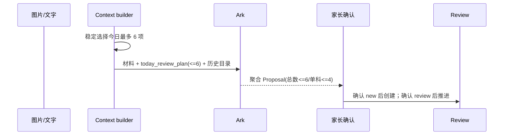
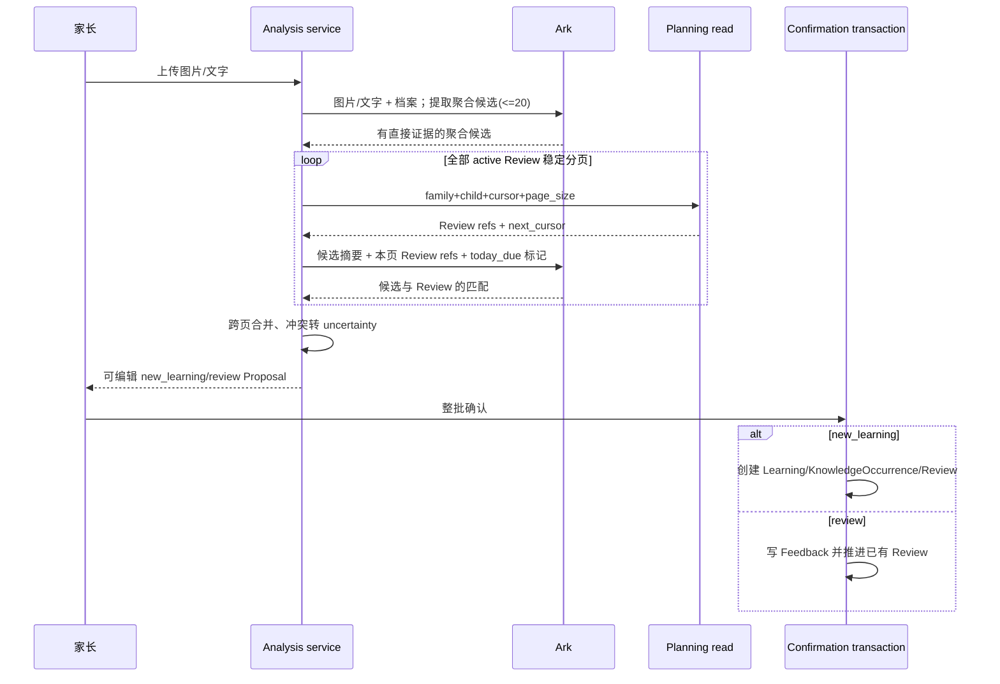
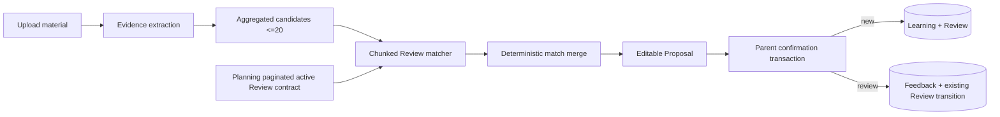
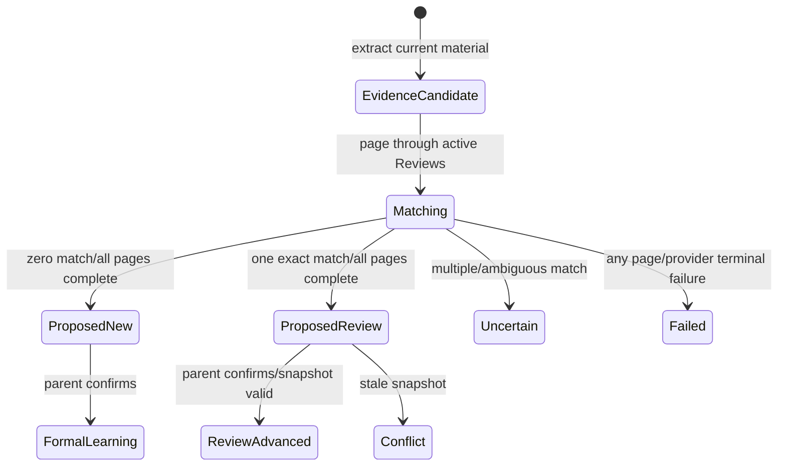
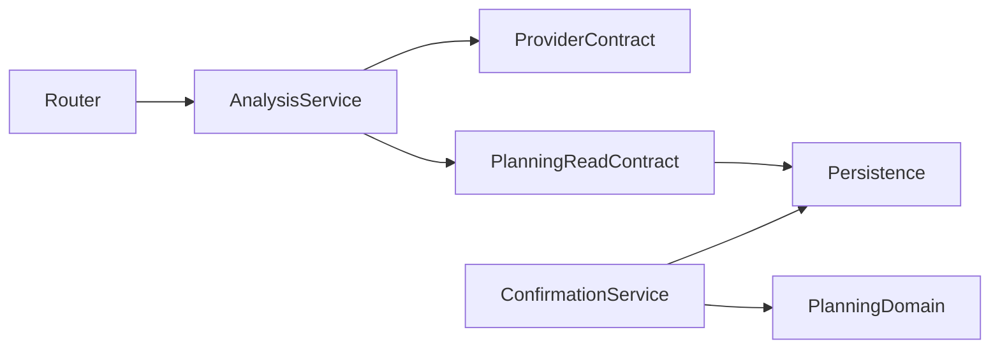
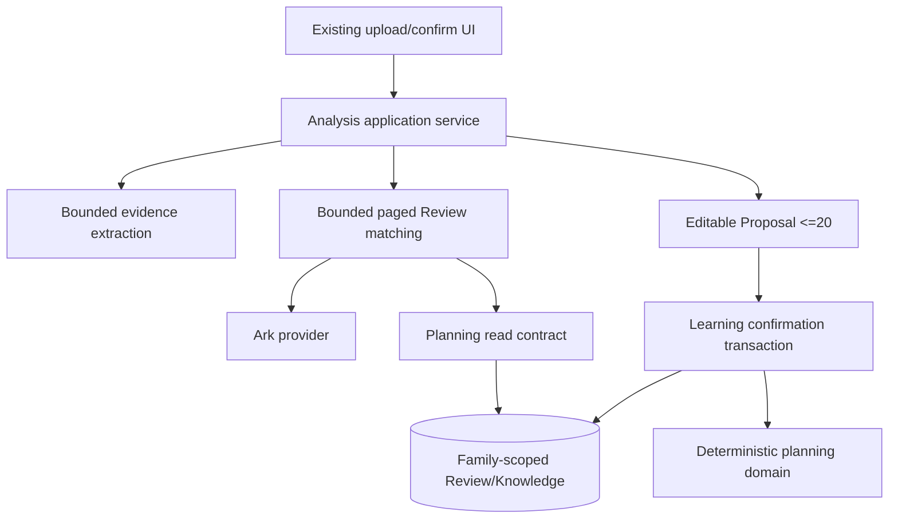

# FEAT-001 — 聚合学习条目、全量当日复习上下文与确认后分流

- Status: `CANCELLED`
- Risk: `R2`
- Spec owner: 产品负责人（用户）
- Implementer: `Codex（批准后）`
- Reviewer: `TBD（后端、产品、AI 质量）`
- Verifier: `Codex + 用户真实材料验收`
- Created: 2026-09-13
- Last updated: 2026-09-13
- Target release: `TBD`
- Spec revision: `SPEC-FULL-DUE-CONTEXT-20260913-01`
- User confirmation: `CANCELLED；2026-09-13 用户要求把 Item 生成、每日复习和复习策略统一整理，本草案由 SPEC-UNIFIED-REVIEW-20260913-01 取代`
- Additional R2/R3 approval: `N/A — 未进入实现审批`
- Affected Feature IDs: `existing FEAT-001`
- Feature current-state documents: `docs/domain/features/FEAT-001-push-kids-mvp.md`
- Feature baseline revision: `FEAT-STATE-20260913-BOUNDED-REVIEW-BACKEND-01-LOCAL`
- Feature merge owner: `Codex（完成验证后）`
- Supersession target after approval: `SPEC-REVIEW-LOAD-20260913-03` 中的“Proposal 最多 6 条、Today 稳定抽样最多 6 条、today_review_plan 只含抽样项”设计；已完成的新学/复习确认分流保留`

## Frontend Design Impact and Figma Approval

- Frontend impact: `no — 保持既有“上传 → 确认 → 复习”页面和交互；不新增复习强度、容量或积压选择`
- Frontend impact reason: Proposal 恢复既有最多 20 条传输能力，Today 保持既有全量到期分页/分组语义；本次不新增可见组件或交互
- Frontend engineering impact: `no — 既有确认页和 Today 合同均可兼容；若实现发现必须调整可见状态，必须另建 DREV 并重新批准`
- Frontend engineering impact reason: 变更限定在 AI 上下文编排、模型验证和确认事务；撤销尚未被前端消费的 additive `review_selection`
- Affected UI IDs: `N/A — 无可见变更`
- UI current-state documents: `docs/design/frontend/ui/UI-001-parent-miniapp.md（仅在实现验证后确认无需改正文）`
- Frontend baseline revision: `FDB-20260906-03`
- Frontend engineering constraint revision: `FEC-20260905-02`
- Affected frontend quality dimensions: `N/A — 无前端代码或合同变更`
- Frontend quality budgets/requirements: `N/A — 继续遵守既有约束`
- Frontend quality verification plan: `npm test + validate_miniprogram，证明现有流程无回归`
- Approved frontend engineering deviations: `none`
- Current Design Revision(s): `N/A`
- Figma project/file URL: `N/A — 无可见设计变更`
- Figma node URL(s): `N/A — 无可见设计变更`
- Proposed Design Revision: `N/A`
- Required viewport/state exports: `N/A — 不改变界面`
- Prototype status: `N/A`
- Approved Task Spec revision: `PENDING`
- Approved Design Revision: `N/A`
- Design approval evidence: `N/A`
- Snapshot manifest path: `N/A`
- Permitted implementation deviations: `none`
- UI current-state merge owner: `N/A`
- UI current-state merge evidence: `N/A`
- Frontend visual/a11y/resolution verification: `N/A — 无可见变更`
- Frontend engineering verification evidence: `pending regression only`
- Figma waiver: `N/A — 无前端变更`

## 0. Executive summary

### Problem

`SPEC-REVIEW-LOAD-20260913-03` 用固定 6 条同时约束模型提案和传入 Prompt 的今日复习计划。该上限会让
模型看不到当天其余到期 Review，从而可能把本次实际复习误判为新知识；每日抽样也把积压问题转化成
“今天未展示”，没有从生成粒度上解决。产品负责人要求保持最短用户路径，不增加家长选择。

### Intended outcome

1. 保留当前已验证的适度聚合方式：同科目、同核心目标、同复习动作合并，不按单题、单字、单词拆项。
2. 每个候选仍明确为 `new_learning` 或 `review`；两类都先进入可编辑提案，只有家长确认后才产生正式写入。
3. 确认 `new_learning` 时创建正式知识和 Review；确认 `review` 时直接写已有 Review 的反馈并推进状态，不重复建知识。
4. 移除“最多 6 条”业务限制。Proposal 保留既有 API 的最多 20 条技术边界，超过时明确失败而不是截断。
5. 本次发生日为今天时，Prompt 的匹配流程逻辑覆盖当天全部到期 Review，而不是只覆盖抽样的 6 条。
6. Today 继续返回全部到期内容的稳定分页/聚合视图；不引入随机抽样、每日 6 条上限或额外家长配置。

### Why now

后端已本地实现 6 条抽样，但尚未发布新的 Today UI。此时修正设计可以保留已完成的聚合与确认分流，
同时删除尚无消费者的抽样复杂度，避免把错误的业务上限带入正式发布。

## 1. Facts, decisions, assumptions, questions

### Confirmed facts

| ID | Fact | Evidence |
|---|---|---|
| `F-001` | 真实数据曾出现当天 25 个到期 Review、估算 85 分钟 | `SPEC-REVIEW-LOAD-20260913-03` 生产只读聚合记录 |
| `F-002` | 收敛规则对历史 15 批已保存提案做影子聚合后，53 条可降为约 26 条 | `SPEC-REVIEW-LOAD-20260913-03` shadow result |
| `F-003` | 本地实现当前只向模型提供最多 6 项 `today_review_plan`，并把 Proposal 限制为总数 6、单科 4 | `agent_processing/context.py`、`contracts.py`、`prompt.py` |
| `F-004` | 当前确认事务已能区分新学和复习，并支持推进尚未到期的 active Review | `learning/service.py` + integration tests |
| `F-005` | 只有家长确认可以创建正式学习或推进 Review | 根 `AGENTS.md` 非协商产品规则 |
| `F-006` | 项目禁止无界 collection/embedded-list 读取 | 根 `AGENTS.md` Architecture rules |
| `F-007` | 既有 Proposal API 技术上限为 20 条，确认页面已有该历史容量 | `AnalysisProposal` 既有 schema/current flow |

### Decisions

| ID | Decision | Owner/date | Rationale |
|---|---|---|---|
| `D-001` | 保留 `child-aware`、适度聚合、1–5 分钟和三种规范 `review_method` | 用户 / 2026-09-13 | 继续从源头控制条目粒度 |
| `D-002` | 删除 Proposal 的 6 条总上限和单科 4 条上限，恢复总数最多 20 的技术边界 | proposed / 2026-09-13 | “不限制 6 条”不等于允许无界响应；复用稳定客户端合同 |
| `D-003` | 今日到期上下文从“选中最多 6 项”改为逻辑上的全部 `active && due_date <= today` | 用户 / 2026-09-13 | 防止实际复习命中未抽中项时被误判为新知识 |
| `D-004` | 全量语义通过稳定游标分页和模型上下文分片实现，不把全部记录一次性无界物化 | proposed / 2026-09-13 | 满足数据库、Token、延迟和架构边界 |
| `D-005` | 分片前先从本次图片/文字提取聚合候选；匹配阶段只携带候选摘要和一页 Review 引用，不重复发送图片 | proposed / 2026-09-13 | 控制图像 Token、费用和重复输出 |
| `D-006` | 所有分片匹配结果由服务端按候选 identity 合并；多 Review 冲突进入 `uncertainties`，不得猜测 | proposed / 2026-09-13 | 保证跨页一致性和可确认性 |
| `D-007` | 家长确认仍是唯一写入门禁；“复习直接修改状态”解释为确认事务中直接推进已有 Review | user clarified + invariant / 2026-09-13 | 不让模型输出或计划上下文自动写正式状态 |
| `D-008` | 移除尚未发布的每日稳定抽样、6 条/3 会话/分钟 cap 和 `review_selection` 消费路径 | proposed / 2026-09-13 | 回到简单的上传→确认→复习路径，删除无必要复杂度 |
| `D-009` | Today 使用既有 family-scoped 稳定分页返回全部到期 Review；复习日期继续由确定性策略产生 | proposed / 2026-09-13 | 不增加家长配置，不引入随机排期 |
| `D-010` | 历史 active 且未来到期的 Review 仍用于识别提前复习，但走相同分页匹配，不与今日到期集合重复 | proposed / 2026-09-13 | 保留已批准的提前复习语义 |

### Assumptions

| ID | Assumption | Risk if wrong | Validation | Owner/due |
|---|---|---|---|---|
| `A-001` | 聚合后正常单批 Proposal 远低于 20 条 | 极端材料会触发明确拆批错误 | 15 批原图 Ark A/B + 20/21 边界测试 | AI owner / rollout 前 |
| `A-002` | 两阶段“提取→分页匹配”与单次全上下文分类结果一致 | 分页可能产生歧义或漏匹配 | 同一 fixture 做单页/多页等价 contract test | backend / implementation |
| `A-003` | 撤销未发布 `review_selection` 没有外部消费者 | 若已有消费者会破坏兼容 | repo 搜索 + 部署/客户端版本核验 | release owner / implementation 前 |

### Open questions

| ID | Question | Why it matters | Recommended answer | Owner | Blocking? |
|---|---|---|---|---|---|
| `Q-001` | “不限制 6 条”是否接受保留既有 Proposal 最多 20 条技术边界，并在 21 条时明确要求拆批 | 保证客户端/API/Token 有界且不静默丢内容 | 接受；6 是被删除的业务上限，20 是既有传输安全边界 | 用户 | yes |
| `Q-002` | “全部今日复习”是否接受服务端分片调用模型，而不是强制塞进一个可能超限的单次请求 | 决定大积压下是否可靠覆盖全部 | 接受；对用户仍是一轮分析，内部页大小和 Token 预算不可见 | 用户 | yes |

## 2. Current behavior and evidence

### Current flow

### Current evidence

- Code: `agent_processing/prompt.py`、`contracts.py`、`context.py`、`providers.py`、`learning/service.py`、`planning/selection.py`、`planning/service.py`
- Tests: `tests/unit/test_analysis_context_contract.py`、`test_normalization_and_provider.py`、`test_review_selection.py`、`tests/integration/test_learning_flow.py`
- Behavior IDs: `BHV-006`、`BHV-014`
- API/event/schema: `AnalysisProposal`；dashboard additive `review_selection`；既有 Todo cursor pagination
- Runtime evidence: 新 6 条策略只有本地验证，未运行受控 Ark 原图 A/B、真实 MySQL 5.7 或部署
- Related specs: `SPEC-REVIEW-LOAD-20260913-03`

## 3. Target behavior

### Primary sequence diagram

### Matching and context algorithm

1. 发生日不是今天：不标记任何 `today_due`；仍可分页匹配历史 active Review 以识别历史/提前复习。
2. 发生日是今天：查询该 child 的全部 active Review，按 `(due_date, review_id)` 稳定分页；
   `due_date <= today` 的每一项都在某个匹配分片中出现并标记 `today_due=true`。
3. 第一阶段只根据图片、文字、grade 和 configured subjects 生成适度聚合的 evidence candidates；不决定日期，
   不写数据库，最多返回既有传输边界 20 条。
4. 第二阶段对候选和 Review refs 分片做等价匹配。分片只含必要字段：`review_id`、`knowledge_id`、subject、
   knowledge name、canonical method、due/step snapshot、`today_due`；不含姓名、预算、图片和原始历史 payload。
5. 同一候选命中唯一 active Review 时输出 `kind=review` 并复制服务端 ID/snapshot；命中多项或语义不足时进入
   `uncertainties`；零命中时输出 `kind=new_learning`。
6. `today_due=true` 只提高精确匹配优先级，不是本次发生证据；未出现在材料中的到期项不得被输出为 review。
7. 同日已确认的等价知识默认去重；只有家长文字明确说明是独立复习时才允许推进。
8. Provider/context 分片失败时整次分析失败或走既有安全重试，不得把未扫描页默认为“无匹配”并输出新知识。

### Behavior matrix

| Case | Preconditions/actor | Input/action | Expected result | State/side effects | Forbidden result |
|---|---|---|---|---|---|
| 新知识 | 全部 Review 页无等价项 | 家长上传并确认 | `new_learning` | 确认事务创建正式知识和 Review | 分析阶段写入 |
| 今日到期复习 | 等价 Review 今日到期 | 家长上传并确认 | `review` 引用原 Review | 确认事务写 Feedback 并推进 | 重复创建知识 |
| 提前复习 | 等价 active Review 尚未到期 | 家长上传并确认 | `review` 引用原 Review | 从确认日确定性推进 | 伪装为 new_learning |
| 混合材料 | 同批既有新知识又有复习 | 整批确认 | 两类逐项分流 | 同一事务原子处理 | 整批强制同类 |
| 超过 6 个聚合候选 | 证据确有 7–20 个独立单元 | 分析 | 全部保留并展示 | 确认前零正式写入 | 截成 6 个 |
| 超过 20 个聚合候选 | 证据确有至少 21 个独立单元 | 分析 | 明确 `proposal_too_large`，提示拆批 | 零正式写入 | 静默截断/无界响应 |
| 今日到期超过单页 | due pool 跨 2+ 页 | 分析 | 每项至少进入一个匹配分片 | 只读 | 只看第一页/前 6 项 |
| 跨页多重匹配 | 候选命中多个 Review | 分析 | uncertainty，不自动选择 | 零正式写入 | 猜测并推进 |
| 分片失败 | 任一页/Provider 失败 | 重试耗尽 | 整次分析安全失败 | 零正式写入 | 把剩余候选当新知识 |
| 重复确认/并发推进 | 相同请求或 Review 已变化 | 确认 | 幂等 replay 或 409 刷新 | 最多推进一次 | 双推进 |
| 跨家庭 | wrong family | 分析/确认 | 404 | 零写入/零存在性泄露 | 返回他人 Review refs |

## 4. Scope

### In scope

- 当前聚合 item Prompt、规范动作和 child-profile 限定。
- 移除 Proposal 6/4 业务上限，恢复既有最多 20 条技术边界。
- 全部 active Review 的有界分页匹配，并标识全部今日到期 Review。
- new/review 分类、提前复习、同日去重、家长确认门禁和原子写入。
- 删除尚未发布且不再需要的每日随机选择、`review_selection`、batch-only 支撑代码和文档事实。
- Today 继续使用既有全量到期分页/聚合合同。

### Out of scope / non-goals

- 不增加“重点/常规/仅记录”等家长选项。
- 不改变 `1/3/7/14/30/60` 确定性日期策略。
- 不由 AI 判断掌握程度、评分或下一课。
- 不自动合并或删除历史正式 Knowledge/Review。
- 不承诺把任意规模数据塞入单个模型请求；全量语义由分片覆盖保证。
- 不修改可见前端；若实现需要 UI 变化，必须暂停并进入 Figma/DREV 门禁。

### Invariants / must not change

- 家长确认前 `new_learning` 和 `review` 均为零正式写入。
- 每个查询和写入都在服务端 family scope 内验证。
- due_date/step/active 只由 planning deterministic policy 转移。
- 计划项不是材料发生证据。
- 不记录图片、Prompt、原始模型 payload、儿童内容或 ID 到日志/指标。
- 手工学习录入和手工 Todo feedback 保持一等路径。

### Affected users, modules, and consumers

| Area/consumer | Current dependency | Change | Compatibility action |
|---|---|---|---|
| AI worker | 单次上下文含最多 6 个今日计划 | 两阶段提取 + 全 active Review 分页匹配 | 外部 Proposal schema 仍最多 20 |
| confirmation | 已支持 new/review 分流 | 保留；接受 7–20 项 | 同一事务/幂等语义不变 |
| planning internal read | 60 候选稳定抽样 | 提供稳定 cursor page 给 AI matcher | 复用 family-leading index |
| dashboard/Today | additive `review_selection` 尚无 UI 消费 | 删除 additive slice，保留 legacy 全量分页 groups | 旧客户端行为不变 |
| reporting/notification | 本地计划消费 selection | 回到全部 due 统计/既有提醒 | 无新可见合同 |

### Feature current-state impact

- Existing Feature sections affected: AI 提案上下文、new/review 确认语义、Today 当前行为、架构/source index、验证状态。
- New Feature document target: `N/A — existing FEAT-001`
- Final facts to merge after verification: 20 条技术边界、全 active Review 分片匹配、全部今日到期覆盖、selection 删除。
- Superseded Feature statements to replace/remove: 最多 6 项 Prompt/Today selection、3 会话、backlog/no-refill additive 行为。
- Related Feature IDs: `FEAT-003` 仅需确认通知无 `review_selection` 消费。

### Link/call graph

## 5. Domain and data design

### Terms

| Term | Meaning | Do not confuse with |
|---|---|---|
| Evidence candidate | 只由本次材料提取的聚合学习单元 | 已分类/已写入的 Knowledge |
| Today due Review | `active=true && due_date<=today` 的 Review 引用 | 本次实际已经复习 |
| Full due context | 所有 Today due Review 都由分片匹配扫描 | 单个无界 Prompt 数组 |
| Review match | 候选与一个 active Review 的等价引用 | 模型完成/掌握判断 |

### Entities/aggregates

| Entity | Owner | Identity | Lifecycle | Sensitive fields | Invariants |
|---|---|---|---|---|---|
| AnalysisProposal | agent_processing | proposal/job | draft→confirmed/failed | child content摘要 | <=20；确认前零正式写入 |
| ReviewMatchPage | planning read contract | family+child+cursor | request scoped | knowledge/ref metadata | stable order；bounded page |
| ReviewItem | planning | review_id | active→transition→inactive | family/child linkage | only deterministic feedback transition |

### State transitions

| From | Command/event | Guard | To | Atomic writes/events | Invalid behavior |
|---|---|---|---|---|---|
| material | extract | valid family/child/material | evidence candidates | none | model writes data |
| evidence candidate | match all pages | every page succeeded | new/review/uncertain proposal | proposal only | partial scan treated complete |
| proposed new | parent confirm | snapshot/request valid | formal new learning | LearningRecord + Occurrence + Review | pre-confirm create |
| proposed review | parent confirm | referenced active Review unchanged | progressed Review | Feedback + Review transition | duplicate Knowledge/Review |
| proposed review | concurrent change | snapshot stale | conflict | none | lost/double update |

### Schema/data changes

- Schema: no database column required；Proposal response stays compatible at max 20；internal `ReviewMatchPage` adds cursor/page metadata.
- Backfill: none；existing Knowledge/Review unchanged.
- Existing data compatibility: all active records participate in matching; no rewrite.
- Read/write deployment order: deploy compatible matcher + validators, then remove unused selection projection only after consumer search.
- Retention/deletion: matching pages/request payloads are transient and never logged or persisted as raw payload.
- Restore/rollback: restore revision 03 single-call context and validators; formal confirmed history remains valid.

## 6. Interfaces and errors

### API/event/job contract

| ID | Caller/producer | Input | Output | Auth | Idempotency | Errors | Compatibility |
|---|---|---|---|---|---|---|---|
| `JOB-001` | analysis worker | material + grade/subjects + same-day refs | Proposal 0..20 aggregated items | existing family/job scope | existing job claim/retry | existing provider/schema errors + `proposal_too_large` | external shape unchanged |
| `INT-001` | agent_processing | family_id, child_id, occurred_day, cursor, page_size | stable active Review refs + next_cursor | server-internal family scope | read-only | 404/invalid cursor | new internal contract |
| `API-001` | Mini Program | existing dashboard/Todo cursor | all due groups/pages | X-Family-ID | read-only | existing errors | remove only unconsumed additive selection field after audit |
| `API-002` | confirmation | proposal edits + snapshot refs | confirmed learning/review results | X-Family-ID | existing request idempotency | 404/409/422 | supports 0..20 items |

- Absent `today_due`: false；historical `occurred_at` never uses current-day label.
- Empty active Review pool: one empty page；all valid candidates become `new_learning` unless same-day duplicate/uncertain.
- Ordering: `(due_date, review_id)` stable cursor；page size fixed by service and not model/user controlled.
- Technical validation: Proposal total `<=20`、item minutes `1..5`、canonical methods only；no 6/4 business validation.
- `proposal_too_large`: safe 422-equivalent job failure with user-facing “材料内容较多，请分批上传”；zero formal writes.
- Retry: any incomplete matching scan retries the whole idempotent analysis job; never emits partial classification.

## 7. Authorization, security, and privacy

- Authenticated actor: existing family header/runtime identity.
- Resource/tenant ownership check: every page query and confirmation lookup checks family + child.
- Administrative override: none.
- Input trust boundaries: images/text, cursors, model JSON and referenced IDs are untrusted.
- Sensitive data handling: send only grade/configured subjects and compact Review refs; no name/budget; no raw logging.
- Audit events: existing job/result/confirmation metadata only, allowlisted counts and latency.
- Abuse/rate controls: existing upload/job controls + fixed page size, provider call count ceiling and total context-token ceiling.
- Threats and mitigations:

| Threat/failure | Entry | Impact | Mitigation | Evidence |
|---|---|---|---|---|
| cross-family Review page | internal cursor/read | child data leak | tenant-leading query + signed/validated cursor | integration |
| malicious model review_id | confirmation | wrong Review advanced | ignore untrusted ownership; reload exact family/child snapshot | integration |
| unbounded due pool | context assembly | memory/Token/latency exhaustion | cursor pages + per-call token cap + total provider-call ceiling; explicit failure, no truncation | scale/performance |
| partial page failure | provider | false new_learning | all-pages-complete guard | unit/integration |
| duplicate match across pages | merge | nondeterministic Review selection | exact merge; ambiguity→uncertainty | contract |
| sensitive logging | worker | privacy leak | allowlist structured metrics only | caplog |

## 8. Architecture and implementation boundaries

### Chosen approach

将 AI 处理拆成“本次材料证据提取”和“对 active Review 的分页匹配”两个有界阶段。Planning 只拥有
family-scoped Review 读取和日期状态机；agent_processing 拥有 Prompt、分页编排和模型结果合并；
learning confirmation 仍拥有事务写入。删除未发布且不再需要的 daily selection 分支。

### Modules and dependency direction

| Module | Responsibility in this change | Public contract | Must not own/do |
|---|---|---|---|
| `agent_processing/prompt.py` | 聚合提取与 Review 匹配 Prompt | versioned instructions | 排期/写入 |
| `agent_processing/contracts.py` | <=20 schema、match/merge validation | strict typed models | tenant DB access |
| `agent_processing/providers.py` | 两阶段 provider 调用 | provider contract | Review SQL/事务 |
| `agent_processing/context.py` | same-day refs、分页编排输入 | bounded context DTO | 无界 materialize |
| `planning/service.py` | stable family-scoped Review pages | internal cursor page | Prompt 语义 |
| `learning/service.py` | confirmation transaction | existing confirm contract | 模型匹配 |

### Purpose/domain and file decomposition

- Module/domain boundaries and owners: `agent_processing` 拥有分析；`planning` 拥有 Review read/state；`learning` 拥有确认 use case.
- File/component responsibilities: Prompt 文本、schema、provider、context orchestration 分开；如分页合并超过 150 行，新增 `agent_processing/review_matching.py`.
- Responsibilities intentionally kept together and why: new/review 合并验证与模型 contract 同变化轴，先放 contracts/service 边界内.
- God-file split candidates and split triggers: `providers.py` 若同时承载 Ark transport 和跨页 merge 超过现有职责，必须抽出 matcher，不得新增 generic utils.

### Dependency DAG

- Circular dependency check/enforcement: `tools/check_architecture.py`.
- Forbidden edges: planning→agent_processing；provider→SQLAlchemy；AI→due_date/state；router→Review table writes.
- Legacy cycle removal plan: none; deletion of selection reduces edges.

### Shared abstractions

| Concept | Owner | Consumers | Shared semantics/change axis | Contract | Why extract/not extract | Contract tests |
|---|---|---|---|---|---|---|
| ReviewMatchPage | planning | agent_processing | stable tenant-scoped active Review scan | typed internal DTO + cursor | stable cross-domain read contract | integration/contract |
| Proposal match merge | agent_processing | analysis worker only | model-page results | private deterministic function | do not place in shared/common | unit/property |

### Architecture diagram

### Trade-offs and alternatives rejected

| Alternative | Benefit | Why rejected | Revisit condition |
|---|---|---|---|
| 单 Prompt 无界塞入全部 due | 实现最直接 | 大积压会超 Token/内存并违反 bounded-read 规则 | 不采用 |
| 仍只给 6 个 due | 成本最低 | 会漏掉本次真实复习的匹配对象 | 用户已拒绝 |
| 本地字符串匹配所有知识 | 无额外模型调用 | 同义表述、年级语言和图片证据容易误判 | 有可信 embedding/规则评估后重审 |
| 给家长选择复习强度/是否入队 | 容量可控 | 增加产品复杂度，违背单一路径 | 用户明确要求后才重审 |
| 保留 daily selection 但仅扩大 cap | 改动较小 | 仍是任意阈值且增加 Today 分支 | 有真实日负荷目标后另建 Spec |
| Proposal 完全无上限 | 不会因数量报错 | API、UI、模型输出和确认事务不可安全有界 | 不采用；保留既有 20 技术边界 |

### Extensibility policy

| Variation axis | Status | Mechanism/contract | Extension requirements | Reopen/revisit condition |
|---|---|---|---|---|
| Prompt revision | open, bounded | deployment-owned constant | strict schema、<=20、privacy metrics、A/B、rollback | 聚合质量变化 |
| Review page size/token budget | closed for pilot | server constants | family-scoped、no user override、scale tests | provider/context window changes |
| Review matching provider | deferred | current provider contract only | future provider需隔离、版本化、限额、contract tests | 成本/准确率证据 |
| date policy | closed | `planning/domain.py` | new approved Spec + regression suite | 独立 Review Policy V2 |
| daily random selection | closed/removed | no public contract | new Spec + UI design + starvation/load evidence | 用户重新要求抽样 |

### Architecture confirmation

- Recommended technical design: 有界证据提取 + 全 active Review 稳定分页匹配 + 服务端确定性合并 + 确认后分流写入.
- Alternatives and trade-offs: 如上；代价是大积压时增加 provider 调用和延迟，换取“不漏今日到期项”与有界可靠性.
- Long-term maintainability rationale: 分析、Review read/state、确认事务各有单一 owner；删除未消费选择分支.
- Architecture revision: `ARCH-FULL-DUE-CONTEXT-20260913-01 (proposed)`.
- User/architecture-owner confirmation: `PENDING SPEC-FULL-DUE-CONTEXT-20260913-01`.

### ADR required?

- No.
- ADR link: `N/A`.
- Reason: 模块边界和依赖方向不变；这是既有分析/Planning 合同的有界编排调整。若后续引入 embedding index 或持久化匹配缓存再建 ADR.

## 9. Expected file changes, replacement, and deletion plan

| File/path | Action | Expected change | Replacement/authority | Why | Removal timing/evidence |
|---|---|---|---|---|---|
| `apps/api/src/push_kids/agent_processing/prompt.py` | modify | 新 revision；保留聚合，删除 6/4；拆分 extract/match 指令 | Prompt authority | 满足 D-001..D-003 | contract tests |
| `apps/api/src/push_kids/agent_processing/contracts.py` | modify | 恢复 Proposal <=20；增加 page match schema/all-pages guard | model boundary | 有界且不截 6 | unit/contract |
| `apps/api/src/push_kids/agent_processing/providers.py` | modify | 两阶段调用，不重复上传图片 | provider implementation | 全量语义与 Token 控制 | provider tests |
| `apps/api/src/push_kids/agent_processing/context.py` | modify | 用 active Review cursor pages 替换 <=6 `today_review_plan` | context boundary | 覆盖全部 due/future active | integration |
| `apps/api/src/push_kids/agent_processing/review_matching.py` | add if split trigger met | 跨页 merge/all-pages-complete | agent_processing private | 防止 providers/context 变成 God file | unit/property |
| `apps/api/src/push_kids/planning/service.py` | modify | stable internal Review page；删除 selection use case | planning authority | bounded cross-domain access | integration/query plan |
| `apps/api/src/push_kids/reporting/service.py` | modify | 删除未消费 `review_selection`，保留 due totals | reporting | 移除废弃分支 | regression |
| `apps/api/src/push_kids/planning/selection.py` | delete | 删除 6/3/分钟抽样 policy | none | 用户取消该机制 | no imports + tests |
| `apps/api/src/push_kids/planning/router.py`、`schemas.py` | modify if consumer audit confirms | 删除仅服务于未发布 batch/selection 的 additive surface | existing single feedback/Todo APIs | 保持最小流程 | contract diff |
| `apps/api/src/push_kids/persistence/models.py`、`20260913_0012_review_feedback_batches.py` | revert/delete if no released dependency | 删除未部署 batch replay schema，恢复 migration head | existing persistence | 新方案不需要 batch-only 复杂度 | empty DB/migration tests |
| `tests/unit/test_review_selection.py`、`tests/integration/test_review_feedback_batch_migration.py` | delete/replace | 改为 full due paging/match tests | new ACs | 删除旧预言机 | suite |
| AI/learning/planning tests | modify/add | 7/20/21、2+ pages、partial failure、match conflict、confirm writes | this Spec | 验收证据 | suite |
| Feature/Behavior/Architecture docs | modify after verified implementation | 合并最终事实，移除 local selection 声明 | sources of truth | 防止文档漂移 | review |

### Temporary coexistence

- Authoritative path: approved implementation后 `ReviewMatchPage + Proposal <=20`.
- Legacy consumers: 当前本地 `review_selection` 无已知前端消费者；实现前必须搜索和部署核验.
- Traffic/data migration: no data migration；未发布 migration 若确认无环境应用则删除，否则改为 additive inert compatibility 并另记退出条件.
- Metrics: proposal count、review pages scanned、provider calls、context tokens、ambiguous matches、scan failures.
- Removal condition: new full-due tests pass、repo/部署无 selection consumer、migration status verified.
- Owner and deadline: Codex / 本 Spec 实现内.
- Guard/test preventing new legacy usage: architecture/source search + contract absence test.

## 10. Non-functional requirements

| ID | Requirement | Target/budget | Measurement | Failure response |
|---|---|---|---|---|
| `NFR-001` | bounded DB read | page size fixed `<=100`；O(pages) queries；tenant-leading index | 10k active fixture + MySQL 5.7 EXPLAIN | block release |
| `NFR-002` | full due coverage | every due Review appears in exactly one scanned page or deterministic duplicate-safe page boundary | property/integration | block release |
| `NFR-003` | bounded model request | each call within configured provider context budget；no image resend in match pages | token estimator/provider spy | block release |
| `NFR-004` | bounded total work | total match calls hard ceiling `100` pages；exceed→explicit safe failure, never truncation | 10,001+ active fixture | block release/operational alert |
| `NFR-005` | classification safety | only all-pages-complete may emit `new_learning` | failure injection | block release |
| `NFR-006` | privacy | zero name/budget/raw prompt/image/model payload logs | caplog/release scan | block release |
| `NFR-007` | Proposal compatibility | 0..20 items；21→explicit error；no 6/4 validator | schema/contract | block release |

The `100 × 100 = 10,000` active Review ceiling is a technical abuse/resource limit, not a daily product limit. Exceeding it
fails visibly and does not classify unmatched candidates as new knowledge. The limit is versioned server configuration and
cannot be controlled by the user or model.

## 11. Acceptance criteria

### AC-001 — 收敛 item 但不截成 6 条

- Given: 材料中存在同目标重复题，以及 7 个确实独立的聚合学习单元.
- When: evidence extraction完成.
- Then: 重复题被合并，7 个独立单元全部进入 Proposal；每项 1–5 分钟且方法规范.
- And: 20 个可返回，21 个明确要求拆批.
- And not: 不按单题拆分、不因达到 6/单科 4 而截断.
- Evidence: unit + provider contract + controlled Ark A/B.

### AC-002 — 全部今日到期 Review 参与匹配

- Given: child 有 125 个 active Review，其中 80 个今日到期；目标匹配第 80 个到期项.
- When: 家长上传包含该目标的直接证据.
- Then: 服务扫描全部相关页并输出引用正确 ID/snapshot 的 `review`.
- And: 未在材料出现的其余 79 个 due 不进入 Proposal.
- And not: 不只扫描前 6/第一页，不把目标建成 new_learning.
- Evidence: integration + provider spy.

### AC-003 — 确认后正确分流

- Given: Proposal 同时包含 new、due review 和 future-due review.
- When: 家长整批确认.
- Then: new 创建正式学习/Review；两个 review 各写一次 Feedback 并推进原 Review.
- And: 确认前、删除候选或取消确认均零正式写入.
- And not: review 不重复建 Knowledge；provider 不写状态.
- Evidence: transaction integration tests.

### AC-004 — 分片失败与歧义安全

- Given: 匹配跨多页，任一中间页失败或同一候选命中多个 Review.
- When: job 重试耗尽或 merge完成.
- Then: 失败返回安全错误；多匹配进入 uncertainty.
- State must remain: 零正式写入，且不得把未完整扫描候选输出为 new_learning.
- Evidence: failure injection + property tests.

### AC-005 — 简单产品路径和兼容性

- Given: 既有小程序客户端.
- When: 用户上传、确认并打开复习页.
- Then: 用户仍只经历上传→确认→复习；Today 继续分页/聚合展示全部到期内容.
- And not: 不出现复习等级、每日数量、积压处置或随机比例选项.
- Evidence: contract + frontend regression.

## 12. Verification plan

| Test point | Acceptance/risk | Test level | Case/command | Fixture/environment | Expected evidence | Owner |
|---|---|---|---|---|---|---|
| `TP-001` | AC-001/NFR-007 | unit/contract | 7、20、21 items；单科>4；规范方法/分钟 | deterministic provider | 7/20 pass、21 explicit fail | backend |
| `TP-002` | AC-002/NFR-001/002 | integration | 125 active/80 due/target at last due page | SQLite HTTP | exact review match/all pages | backend |
| `TP-003` | AC-002/004 | unit/property | cursor boundary、重复键、页重放、跨页冲突 | pure fixtures | deterministic merge | backend |
| `TP-004` | AC-004/NFR-003/004 | integration | page 2 provider failure、10,001 active、token boundary | fake provider | safe failure/no truncation | backend |
| `TP-005` | AC-003 | integration | mixed new/due/future、cancel/delete、stale concurrent | SQLite + transaction | exact atomic writes/409 | backend |
| `TP-006` | tenant/privacy | integration/caplog | wrong family/cursor/ID；logs | SQLite | 404/no leak/allowlist only | security |
| `TP-007` | scale/query plan | performance/integration | 10k active stable pages | SQLite + MySQL 5.7 | bounded memory/index EXPLAIN | backend |
| `TP-008` | real AI quality | controlled A/B | 15 original submissions | Ark cloud | aggregate accuracy + review match rubric | product/AI |
| `TP-009` | AC-005 | frontend regression | `npm test` + Mini Program validator | local | no UI/contract regression | frontend |
| `TP-010` | architecture | static/review | architecture check + import/source audit | repo | no selection consumer/dead code/cycle | reviewer |
| `TP-011` | full regression | repository commands | pytest/ruff/format/mypy/npm/architecture/miniapp | local | recorded exact outcomes | verifier |

- Pre-change failure: 7th Proposal item and Review outside the first six are rejected/omitted.
- Old behavior proof: manual input、Todo feedback、date policy、activity exclusion、family scope suites remain green.
- Forbidden side effects: provider/page failure and unconfirmed/cancelled Proposal leave formal tables byte-equivalent.
- Real wiring: SQLite HTTP、isolated MySQL 5.7 query plan、controlled Ark original-image A/B.
- Cannot automate: 家长对聚合粒度和语义匹配的可理解性，需要真实材料人工 rubric.

## 13. Rollout, migration, rollback

### Rollout

1. 用户批准本 Spec revision/R2 architecture.
2. 在本地替换 6 条实现并删除未消费 selection 分支；运行完整回归.
3. 在受控 Ark 环境用原始 15 批做单页/多页 A/B，不写正式数据.
4. 在真实 MySQL 5.7 验证 10k active 分页 EXPLAIN 和 migration head.
5. 对测试 family 开启两阶段 matcher，观察 provider calls/token/latency/ambiguity 7 天.
6. 达标后扩大；合并 Feature/Behavior/Architecture 当前事实并归档 Spec.

### Compatibility window

- Mixed versions: Proposal public shape和最多20条保持兼容；内部 context revision 不对客户端暴露.
- Old clients/consumers: 继续使用既有 Today/Todo groups；删除 `review_selection` 前核验无消费者.
- Feature flags: `full_due_review_context` family allowlist；旧 matcher 可回退.
- Data backfill: none.

### Observability and release gates

| Signal | Baseline | Success threshold | Abort threshold | Observation window |
|---|---:|---:|---:|---|
| proposal items/batch | old mean 3.53/max17；聚合 shadow max4 | p95 <=10且无语义截断 | >20 或明显恢复逐题拆分 | immediate/15 batches |
| due coverage | current context <=6 | 100% scanned or explicit failure | any silent omission | immediate |
| review false-new | baseline pending | 0 in controlled fixtures | any confirmed duplicate | immediate |
| provider match calls | current 1 analysis call | p95 <=3 total calls | >10 for normal family | 7 days |
| ambiguous match | baseline pending | <=5% candidates | >15% | 15 batches |
| sensitive logs | 0 | 0 | any | immediate |

### Rollback / restore

- Reversible code: disable `full_due_review_context` and restore revision 03 matcher.
- Reversible data: no schema/data rewrite；confirmed records remain valid history.
- Irreversible steps: none planned.
- Restore procedure: feature flag rollback, then redeploy prior prompt/context revision; do not delete confirmed history.
- Owner: backend/release owner.

## 14. Implementation plan

### Step 1 — Proposal 取消 6 条业务限制

- Intent: keep converged units, restore <=20 transport contract.
- Files/boundaries: prompt/contracts/provider tests.
- Modify: remove total6/subject4 instructions and validators; add 7/20/21 tests.
- Delete/replace: old max6 assertions.
- Validation: targeted unit/contract + controlled A/B pending cloud.
- Stop/rollback condition: output returns to per-question atomization or 21 is silently truncated.

### Step 2 — 全 active Review 分页匹配

- Intent: every today-due item participates without unbounded input.
- Files/boundaries: planning internal read + agent_processing matcher/context/provider.
- Modify: two-stage extract/match, stable cursor pages, merge/all-pages guard.
- Delete/replace: `today_review_plan<=6` context assembly.
- Tests: TP-002..TP-007.
- Stop/rollback condition: incomplete scan can emit new_learning, tenant leak, provider budget exceeded without explicit error.

### Step 3 — 保留确认分流并移除未发布选择分支

- Intent: simple upload→confirm→review and minimum necessary code.
- Files/boundaries: learning confirmation, planning/reporting/persistence, tests/docs.
- Modify: allow <=20 mixed confirm; preserve early review/stale guards.
- Delete/replace: selection file/DTO/tests and batch-only additions after consumer/migration audit.
- Validation: full backend/frontend regression + architecture/source audit.
- Stop/rollback condition: any released consumer/schema dependency is discovered; then preserve additive compatibility and revise this Spec before destructive removal.

### Step 4 — Cloud validation and current-state merge

- Intent: prove quality/scale before rollout.
- Files/boundaries: no raw payload retention; docs after verified facts.
- Tests: Ark A/B、MySQL5.7、independent review、all repo commands.
- Validation: observability gates above.
- Stop/rollback condition: false-new, silent due omission, privacy log, excessive provider calls/latency.

## 15. Review plan

- Required reviewers: backend architecture、AI contract、product learning flow.
- Domain questions: all-pages-complete guard、today vs future active semantics、same-day duplicate、stale Review transition.
- Security/data questions: tenant-leading cursor、untrusted IDs、raw content logging、resource ceiling.
- Compatibility questions: Proposal <=20、unreleased selection/batch consumer and migration audit.
- Test validity questions: fixtures must place true match beyond page1/first6 and inject middle-page failure.
- Independent reviewer session/person: required after implementation; must include file necessity/location/redundancy inventory.

## 16. Implementation and verification record

### Changed behavior

- `PENDING implementation approval`.

### Deleted/replaced behavior

- `PENDING implementation approval`.

### Files changed

- This Spec only; production files unchanged in this revision-design turn.

### Evidence

| Command/case | Environment/version | Result | Evidence | Notes |
|---|---|---|---|---|
| Spec content/source review | local repo / 2026-09-13 | pass | this document | no production tests run because no code changed |

### Review

- Review report: pending implementation.
- Blocker/Major status: `Q-001`、`Q-002` require user approval with this revision.
- Re-review: required after implementation.

### Deviations from approved Spec

- None; this revision is not yet approved or implemented.

### Residual risks and follow-up

| Risk/debt | Impact | Owner | Due/removal condition | Tracking |
|---|---|---|---|---|
| provider cost/latency grows with active Review pages | slower analysis | backend/product | pilot gates met or matcher redesigned | this Spec |
| current local selection/migration code may have external environment state unknown | deletion compatibility | release owner | deployment/migration audit | this Spec |
| aggregation shadow was not original-image Ark replay | quality uncertainty | AI/product | controlled cloud A/B | this Spec |

## 17. Completion gate

- [ ] `SPEC-FULL-DUE-CONTEXT-20260913-01` and R2 architecture explicitly approved.
- [x] Scope/non-goals and simple product path documented.
- [x] Link/call graph、sequence、state machine、architecture、trade-offs complete.
- [x] Expected file changes and deletion plan documented.
- [ ] Q-001/Q-002 resolved by approval.
- [ ] Implementation and every required test point completed or explicitly recorded not-run.
- [ ] Independent review has no unresolved Blocker/Major.
- [ ] Verified Feature/Behavior/Architecture facts merged.
- [ ] Spec moved to `specs/completed/` only after rollout completion gates.

Final status: `CANCELLED — superseded before approval by SPEC-UNIFIED-REVIEW-20260913-01`

## 18. Revision history

| Date | Change | Reason | Approved by |
|---|---|---|---|
| 2026-09-13 | `SPEC-FULL-DUE-CONTEXT-20260913-01` initial design | User requested current converged item generation, new/review split with review-state update, removal of six-item limit, and all today-due Reviews in Prompt | PENDING |
| 2026-09-13 | Cancelled and moved to `specs/rejected/` | User requested one unified Item generation, daily review and scheduling Spec | `SPEC-UNIFIED-REVIEW-20260913-01` supersedes this draft |
