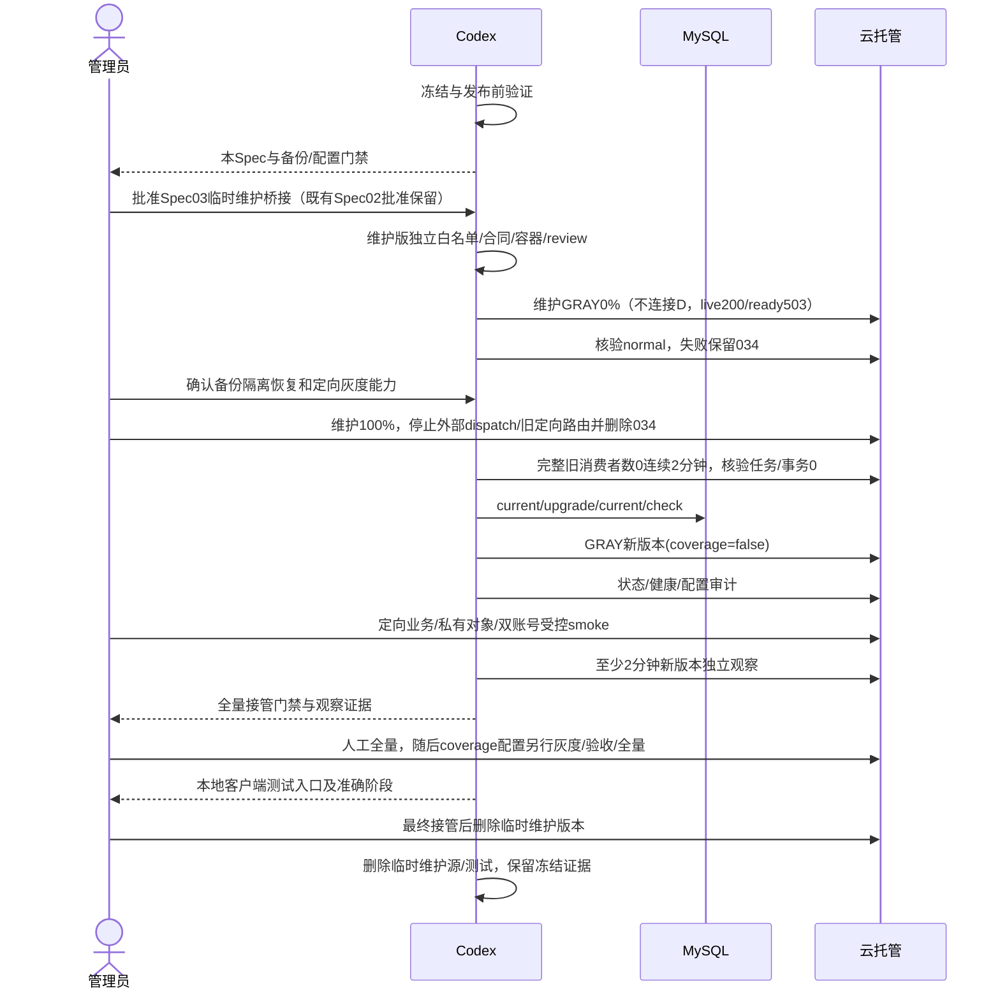
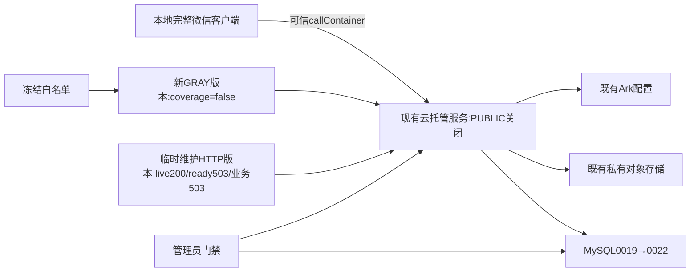

# OPS-20261023 — 当前完整代码的服务端部署与客户端本地测试

- Template: `specs/_templates/BUGFIX-SPEC.md`（运维交付，非产品修复）
- Status: REJECTED
- Disposition: 2026-10-24用户明确选择直接升级当前push_kids库，再启动新版、由其删除034；本临时维护桥接提案撤回，未批准、未实现、未部署。当前执行见[OPS Spec04](../active/OPS-20261023-FULLSTACK-TEST-DEPLOYMENT.md)。以下保留提案历史，不代表当前执行要求。
- Risk: R3（生产 Schema、永久复习状态、后台任务）
- Owner / Reviewer: 产品负责人（用户）
- Implementer: Codex
- Spec revision: OPS-SPEC-20261023-FULLSTACK-TEST-DEPLOYMENT-03
- Proposed operational architecture: OPS-ARCH-20261024-MAINTENANCE-HANDOFF-01；在同一服务新增临时无业务维护版本，不新增云服务/数据库/业务模块，不改变最终应用依赖或Schema合同；本revision待批准。
- Existing authorization: 用户2026-10-23“服务端部署，然后客户端本地部署 我来进行测试”；随后明确选择“部署当前全部代码，包含通知续订和 AI 自动替代复习词条”（`call_b02224e8b3554f359c7b7217af644f98`）。用户2026-10-24确认备份成功并批准Spec02的维护排空顺序及新版本独立观察例外，后续明确允许立即维护。此已有批准继续覆盖已完成的冻结/验证与既有范围，不冒充Spec03临时维护代码的批准。
- Spec03 approval: PENDING。用户确认没有暂停入口，并建议“你可以部署新代码，然后拉起新服务之后我来删除034”（`call_3c0b5e6e0b1b4ea38829ddfb8a8b1797`）。最终应用在0019无法启动，故提出下述独立维护版本桥接；该具体设计此前未呈现，依据AGENTS.md在实现前确认本revision。批准将包含维护版实现/验证/0%灰度创建、管理员维护接管及删除034后的冻结迁移/最终部署；不豁免各步观察、人工全量和真实业务验收。
- Affected Features: [FEAT-001](../../docs/domain/features/FEAT-001-push-kids-mvp.md)、[FEAT-003](../../docs/domain/features/FEAT-003-notification-channel.md)、[FEAT-011](../../docs/domain/features/FEAT-011-notification-auto-renewal.md)、[FEAT-012](../../docs/domain/features/FEAT-012-child-photo-footprints.md)。
- Feature merge owner: Codex。当前业务批准分别沿用永久替代Spec02、通知续订Spec01、足迹Spec04与入口/文案Spec01；不改变这些合同或将尚未验收的产品Spec设DONE。
- Evidence / release: [本次发布记录](../../docs/deploy/releases/20261023-fullstack-test-deployment.md)。

## 1. 现状与交付目标

Git基线`82ca52775bc948f2a963a8f4ed614322d8859de8`，工作区有已批准但未提交的完整业务增量。用户明确要求全部纳入本次范围。首候选因真实MySQL足迹查询超预算停止；用户另行批准BUG-031 Spec01，仅修复派生表JOIN。新运行包`dist/release-20261023-full-bug031-01`为134文件/1406788字节，manifest SHA-256=`001c2e0be2b6f0518b74248e2e2fc2dd54c8ddf100df3fc908732d3e7d67432e`。独立迁移包`dist/migration-20261023-full-bug031-01`为157文件/1528565字节，manifest SHA-256=`39aba303a370e8156fd61b730bb183d0367d8aba39b325bf47d12b0aa0eea31e`，包含完整Alembic链/env.py及queue v1/v2运行依赖；禁止从活动仓库执行生产DDL。未提交或推送。

当前只读核验：目标`wx5d2e0014690bf285 / prod-d2g14rwoycac6b45d / flask-ik19`；2026-10-24 10:35 CST完整8版本清单已无031，配置版本034仍normal/100%/1实例，其镜像此前已核验与031相同。基础配置与034明确coverage=false。此前服务入口核验公网关闭。生产MySQL为5.7.18-cynos，Schema为`20261012_0019`，足迹五表不存在。工作区唯一head和应用expected revision均为`20261020_0022`；新业务代码尚未部署。

维护前只读版本资源为CPU0.25/内存0.5GiB、min0/max5、端口8000，与手册历史示例0.5/1/min1/max1不同；代理未修改资源。2026-10-24首次服务核验normal、031 normal/100%/1实例，服务入口返回MINIAPP/OA且无PUBLIC；随后034配置版承载100%，见上一段。仅MINIAPP是目标约束，不能冒称已满足。运行配置门禁必须据实际预览核对资源/入口差异并由管理员确认，不可声称已符合旧示例或自动改资源/实例数/入口。控制面版本IsPublic字段不替代服务入口判断，PUBLIC关闭以服务级核验为准。

用户已确认034没有暂停入口。目标调整为：先验证并创建独立维护版本，管理员使其接管并删除034；旧代码全部退出后，再执行已经验证的冻结迁移、最终业务灰度与原验收门禁。本地完整客户端保留真实AppID、云入口和语音插件，交由用户测试。不上传客户端、不设置体验版、不提审或发布正式版；不创建生产合成学习/照片/通知记录。维护版本不等于最终功能已部署。

## 2. Frontend Design Impact and Repository-native Approval

- Frontend impact: no；本任务无新视觉或交互实现，仅启动现有批准设计对应的本地源码。
- Frontend engineering impact: no；不改构建链、配置或客户端源码。读取本地运行状态不代替已记录的完整原生/真机门禁。
- Affected UI: UI-001 / UI-011 / UI-018，仅同步实际部署阶段，不改变设计；FDB/FEC、DREV和批准快照沿用各产品Spec。
- New Design Revision / exports: N/A，无设计变更；不重新生成或覆盖已批准导出。
- 本地启动不等于微信上传、体验、审核或正式发布。

## 3. 推荐顺序与备选

1. 先批准Spec03。最终业务运行包/迁移包及其已执行门禁保持原SHA绑定；仅维护版本新增代码和验证，不重新声称旧模型/全套测试为本次新执行。
2. 在`deploy/maintenance/`实现单一目的的临时HTTP进程，仅Python标准库，不导入`push_kids`、Settings或业务依赖，不创建数据库/对象存储/AI客户端，不运行任何worker、scheduler或dispatch，不读写业务数据。监听8000、UID10001；只对GET/HEAD `/health/live`返回200和固定`mode=maintenance`标记，`/health/ready`与所有正常业务方法/路径固定503、`Retry-After: 60`和`Cache-Control: no-store`。不回显路径、Header、请求体、环境值，不记录原始请求；无后台自动升级或恢复逻辑。限制请求头/连接等待与积压，响应固定且<1KiB；SIGTERM在5秒内退出。
3. 从两个源文件（Dockerfile/server.py）生成独立冻结白名单目录和manifest，扫描秘密，执行HTTP合同/日志无泄露/无业务依赖、非root/只读隔离网络容器及SIGTERM门禁、独立只读review。保持最终业务包和迁移包不变。
4. 以唯一备注和GRAY创建维护版本，保持0%流量，继承当前基础配置及coverage=false，保留端口/资源/秘密/入口；不传含秘密的CLI参数，不修改034。官方接口未返回健康探针配置，故“维护版live=200、ready=503时平台仍可达normal”是这一阶段的实测门禁，不能从字段缺失推断平台采用TCP。若维护版无法normal，停止并保留034；不得把ready伪造200或自动切流来过门禁。
5. 在**进入停服前**确认已成功的备份具备隔离恢复路径，并落实最终业务灰度的定向测试能力；这些沿用原门禁，未确认时034继续服务。向管理员输出维护版本号、摘要和0%/normal观察，管理员切维护版100%，先用真实callContainer GET live验证固定维护标记，再验证ready503及GET `/_ops/maintenance-probe`固定503后，删除034并阻止外部dispatch和旧版定向路由。云端不发送业务POST或生产合成材料；各写方法的503合同只在本地隔离容器测试。031已删除，无需重复处理；其他旧版本必须实际0实例/0流量、无定向测试或其他自动唤起来源。代理不自动切100%或删除版本。
6. 完整列举全部版本，确认除维护版外旧代码实例总数0，034已删除/终止、无活动请求/任务/事务；再连续观察至少2分钟，期间保持上述条件，发现旧实例出现则停止。维护版启动不会连接数据库，故能安全跨0019/0022存活。0%或min0本身不算停净，不清lease、不删任务。
7. 只从冻结迁移包注入安全migration账号，复核current仍0019，升级至0022并执行current/check及表/触发器核验。0022会先卸载旧queue触发器，此期间没有业务进程。失败保留维护503并记录部分Schema状态，不自动downgrade或恢复034。已确认0019备份不能直接套回有新写入的库。
8. 从原冻结业务包创建唯一备注的最终GRAY版本，coverage=false，维护版继续承载100%。核验Schema/配置/摘要/服务/入口和真实定向callContainer live/ready；只有新业务版本ready200才进入原业务、身份/私有对象/双账号及至少2分钟新业务独立观察。真实写入由用户受控执行，无法定向或验收缺失时保持维护，不先业务全量后补验收。
9. 管理员根据验收证据切最终业务版100%，维护版0%；所有消费者为新代码后，coverage=true仍是独立配置版本/灰度/验收/人工全量。客户端按原计划本地重开、不上传。确认最终服务持续正常后，由管理员删除维护云版本；维护源和其focused测试在同一交付收尾删除（已冻结产物/SHA/证据保留），避免形成第二套常驻服务。Owner为Codex，退出条件为本次最终版本接管；超过24小时仍未退出必须更新原因与恢复计划，不自动切流/删版本。

**显式维护例外（2026-10-24用户确认）**：发布手册§7要求约2分钟新旧共存；本链无法安全满足，因为031严格校验0019且0022替换queue触发器。用户在本Spec02审批上下文与不兼容解释后批准排空切换，以“全部旧消费者停用、至少2分钟新版本独立灰度观察”替代共存，不豁免任何业务、身份/图片owner或全量人工门禁。若操作能力或其他前置证据不足，则停在该步骤，不先迁移。

| 方案 | 权衡 | 决定 |
|---|---|---|
| 同服务临时维护版本先0%验证，管理员接管/删034，旧消费者退出后迁移与最终部署 | 增加一次临时版本及人工维护切流；无DB依赖、无worker，能在0019运行；维护期间业务503 | Spec03推荐，待批准 |
| 原方案依赖暂停034后直接迁移 | 包更少，但管理员已确认没有暂停入口，执行前提不成立 | Spec02曾批准；该执行路径停用 |
| 直接在0019启动最终业务包，随后删除034 | 最终应用启动严格要求0022，必然拒绝启动；若先迁移又违反停旧消费者约束 | 不采用 |
| 新GRAY一启动即默认覆盖=true，同时031仍服务 | 存量worker可能先产生永久状态，旧消费者不理解 | 不采用 |
| 直接全量、跳过备份和质量门禁 | 缺少安全回滚点，违反当前发布合同 | 不采用 |
| 另建测试环境/数据库/服务 | 可隔离正式数据，但扩大资源、身份及存储配置 | 本次不自动新建；若选择需另明确配置范围 |

## 4. 迁移与回滚合同

- 0020新增通知/完成游标五表，无历史回填。
- 0021新增足迹五表，无历史回填。
- 0022给knowledge_items新增状态/关系字段和索引，新增coverage两表，并以理解状态的queue v2替换触发器。
- 本次**必须新增备份**：0022不满足旧版可继续服务的免备份条件。尤其旧031严格要求0019，且不理解永久替代；不能将保留031误称为0022可用回滚版本。
- coverage=false只停止新标记，不能清除既有永久状态。产生状态后禁止回退忽略它的旧应用，不自动降级或删表。故障优先保留0022并修复向前；若必须恢复0019/031，由管理员按已确认备份在隔离恢复并核对窗口内写入后另行批准执行。
- 备份ID、时间及隔离恢复可用性由管理员确认；秘密不进聊天。公网保持关闭，MINIAPP入口保留。现有通知调度配置不重置，不补发历史失败通知。
- 地图Key目前未配置；人工补地点路径保留，真实地图检索/反解及全球底图不得写成已就绪。无需将可选Key缺失伪装成启动成功证明。

### 临时维护版本的威胁与失败处理

| 情形 | 控制与观察 | 失败处理 |
|---|---|---|
| 上传体、伪造身份Header或URL携带秘密/儿童内容 | 不解析/保存请求体，不记录/回显请求与环境；所有业务请求固定503，无数据查询，固定小响应、连接超时/关闭 | 本地输入/日志合同失败则不发布 |
| 平台将ready503判为未就绪 | 仅0%试部署，要求live200/ready503仍能normal；控制面无探针字段不算通过 | 保留034，停止并报告真实平台限制，不伪造业务ready |
| 切流未生效或命中旧灰度目标 | 先GET live固定维护标记，再GET ready/未注册业务探针；完整版本/流量/实例列表与旧目标路由核对 | 保持0019，不调用业务写入口，不删除034或迁移 |
| 034删除后旧实例/任务仍运行 | 连续2分钟完整旧实例0、无在途/可见事务、外部dispatch和旧定向均禁用 | 不执行DDL，记录实际状态 |
| 迁移部分完成或最终业务版失败 | 维护进程跨Schema无DB依赖，所有业务持续503 | 保留当前Schema和维护版，修复向前；不自动downgrade/恢复旧二进制 |
| 临时版本或源长期遗留 | Owner=Codex，最终接管后删除云维护版及临时源/测试；超过24h必须记录原因/恢复计划 | 不自动恢复旧服务或删除仍承载维护流量的版本 |

## 5. Required design views

### Link/call graph

```text
用户范围确认 -> 冻结白名单 -> 自动/数据库/容器/模型门禁
 -> Spec03批准 -> 维护版实现/验证 -> GRAY0%/normal(live200,ready503)
 -> 人工备份恢复/定向能力核实 -> 人工维护100% -> 删除034/停旧路由
 -> 旧实例0/在途0连续2分钟 -> 冻结Alembic0019→0022
 -> 最终业务GRAY(coverage=false) -> 定向业务/隔离验收/观察
 -> 人工业务全量 -> coverage独立灰度/验收/人工全量 -> 本地客户端测试
 -> 维护云版本及临时源/测试退出
```

### Sequence diagram



### State machine

```text
PREPARING -> CHECKED -> WAIT_SPEC03 -> MAINTENANCE_CHECKED -> MAINTENANCE_GRAY
 -> WAIT_MAINTENANCE_HANDOFF -> OLD_ZERO_OBSERVATION -> MIGRATING
 -> GRAY -> DIRECTED_ACCEPTANCE -> WAIT_CUTOVER -> COVERAGE_GRAY_ACCEPTANCE
 -> WAIT_COVERAGE_CUTOVER -> LOCAL_TEST_READY -> MAINTENANCE_REMOVED
任一必需项失败 -> STOPPED（记录证据；不切流/自动降级）
```

### Architecture diagram



维护进程没有到D/S/A的依赖或出站调用；图中W→D/S/A仅表示最终业务版本。新增扩展轴为**closed**：仅本次维护用途、固定端口/响应，不注册插件/业务路由，不保留动态恢复开关或第二套业务实现。若平台探针、旧版退出或最终定向能力不成立，先停止并修订方案。

## 6. Expected file changes

| 路径 | 动作/目的 |
|---|---|
| 本Spec、specs索引 | Spec03桥接设计/确认历史、准确生命周期 |
| deploy/maintenance/server.py、Dockerfile | 新增临时无业务HTTP进程和最小镜像；最终接管后删除源 |
| tests/unit/test_maintenance_server.py | 新增独立HTTP、无副作用、输入/日志和退出合同；临时源删除时同收尾删除 |
| docs/deploy/releases/20261023-fullstack-test-deployment.md | 新增命令结果、版本、Schema与人工门禁 |
| 相关Feature/UI/Behavior/Architecture/既有发布记录 | 按最终实际到达阶段修正文档；合同未变则记录N/A |
| dist/release-20261023-full-bug031-01及migration同名冻结目录 | 分别冻结运行包和DDL；禁止混用旧失败包或活动源码 |
| dist/maintenance-20261024-ops03-01 | 新增独立两源文件及manifest；不得改原业务/迁移包 |
| /private/tmp/push-kids-release-20261023-* | 本次受控测试工具和脱敏/合成证据；不存凭据 |

产品实现更改仅由另行获批的BUG-031授权。Spec03只新增同服务的临时维护发布物，不授权新业务、Schema设计、前端页面、扩展点或既有业务源码修改。如临时路径需要额外平台拓扑/探针配置或业务合同变化，先修订，不以批准维护版授权静默扩展。

## 7. Required test points / 当前执行

| ID | 必需项 | 当前 |
|---|---|---|
| R01 | 完整后端/前端、lint/type/架构/设计/小程序 | PASS，BUG-031后重跑671 passed/35 MySQL条件skip；275前端与静态通过（客户端源码未变） |
| R02 | 真实MySQL5.7 base→0019→0022、current/check及相关并发合同 | PASS，最终冻结迁移/源码5.7.44，27专项＋4规模=31 passed，No new upgrade operations；独立临时库已删除 |
| R03 | 足迹50k两种倾斜分布、真实MySQL计划/预算 | 首候选FAIL2.255秒；BUG-031获批修复后最终冻结MySQL0.3935/0.1724s、SQLite0.0326/0.1040s及实际key/type/无DEPENDENT通过；首次并行0.543秒/过窄ref断言失败保留，不放宽500ms |
| R04 | 固定40例真实Ark质量及覆盖语义门禁 | PASS 40/40、学科语义各15/15、formal_write_count=0；覆盖语义1项PASS；BUG-031不改模型源码 |
| R05 | 冻结清单/秘密扫描、云dry-run、非root/健康/SIGTERM | PASS；2026-10-24再次核对291项SHA/当前源/已有秘密，冻结包标准构建成功（依赖层缓存）；镜像130源匹配、UID10001、live/ready200、SIGTERM0.414秒退出0/OOM=false、代理未持久化；[证据](../../docs/quality/evidence/fullstack-release-20261024/container.json)。新包dry-run沿用2026-10-23实际执行，不冒称重跑 |
| R06 | 备份、配置与迁移 | 用户确认备份成功；coverage=false已核验，031已删除，034旧代码仍100%/1实例、Schema0019。用户确认没有暂停入口；原直接停实例路径不可执行，WAIT_SPEC03，未DDL |
| R07 | GRAY不可变版本、配置/入口/业务smoke | NOT_RUN，前置门禁未满足 |
| R08 | 本地完整客户端真实AppID/cloud配置启动 | 启动证据PASS，2026-10-24重新islogin/auto，HTTP61088/9465，完整真实项目/AppID/插件，旧031 live/ready各200，无上传；随后为维护排空用官方close关闭本任务项目，部署验证后重新打开 |
| R09 | 用户测试与全量接管 | NOT_RUN；须区分用户验收、管理员流量操作和产品完整门禁 |
| R10 | 维护HTTP/输入/隐私/依赖合同 | NOT_RUN，批准后focused测试：GET/HEAD live200，ready及各业务方法/路径503，Cache-Control=no-store、Retry-After=60、固定<1KiB响应、不回显敏感输入或环境；未初始化任何业务模块/出站连接/业务文件资源。新临时程序无故障旧实现，pre-fix red项N/A，不冒称原应用回归 |
| R11 | 维护包与容器 | NOT_RUN，批准后两源SHA/秘密扫描/dry-run/实际上传清单；UID10001、只读FS、network none、本地真实HTTP、慢连接超时、SIGTERM≤5s/OOM=false；原291文件SHA保持 |
| R12 | 维护灰度0%/normal/配置/平台探针行为 | NOT_RUN；官方状态/完整配置白名单比较，ready503不伪造200；无法normal则保留034且不进入停服 |
| R13 | 人工维护接管/034删除/旧代码退出 | NOT_RUN；真实callContainer live200/ready503/业务503；全版本旧实例0/旧路由与外部dispatch禁用、任务/事务0连续2分钟；任何旧实例再现不得执行DDL |
| R14 | 迁移/最终部署与失败分支 | NOT_RUN，沿用R06/R07/R09；备份隔离恢复与定向能力停服前核实；迁移失败保留维护、不自动downgrade或重启034；0022后最终包ready200及原smoke/人工切流 |
| R15 | 独立review/临时路径退出/文档闭合 | NOT_RUN；R2/R3新上下文只读review覆盖必要性/放置/隐私/失败/探针/租户与测试可信度；最终接管后人工删除维护云版并删除临时源/测试，保留冻结manifest与执行证据，原业务包不变 |

2026-10-24获批后安全预检：031仍normal/100%/1实例，其他列出旧版0实例；分析/删除running和通知sending均0，分析/删除queued均0，innodb_trx可见其他事务0（受账号权限可见性约束）。基础配置无coverage开关，不能按false处理。运行/迁移包291项SHA/源匹配再次PASS。详见[预检摘要](../../docs/quality/evidence/fullstack-release-20261024/maintenance-precheck.json)。浏览器site-safety拒绝控制台页面，未绕过；官方CLI已安装命令未找到暂停/停止能力，不猜测接口、不删除服务、不用0%或min=0代替停止。管理员须先核实隔离恢复/定向灰度/停止能力，预设coverage=false，再排空停止旧消费者。前置能力未确认时保持旧服务，不进入维护停服或DDL。

管理员回复“操作已完成，旧实例为0、coverage=false已设置”（`call_05f94933ce244f0d8c798c163f00157f`），当时10:26/10:27官方复核尚未反映变更，见[历史复核摘要](../../docs/quality/evidence/fullstack-release-20261024/maintenance-recheck.json)。随后用户确认配置已生效并要求据此部署；10:32/10:34官方接口已确认基础配置与034的coverage=false。034从creating/0%转为normal/100%，但沿用031相同镜像；031和034各1实例，仍是旧代码消费者。运行/迁移包291项SHA再次匹配，数据库0019、在途任务及可见其他事务0。见[当前配置证据](../../docs/quality/evidence/fullstack-release-20261024/configuration-confirmed.json)。本任务本地项目保持关闭。恢复条件：全部旧代码实例（包括034）实际为0且不会自动拉起，原有隔离恢复/定向能力落实，再复核任务/事务执行冻结DDL。配置门禁已通过，不重复要求设置或审批；代理未执行生产修改。

## 8. Lifecycle / closure

2026-10-24用户确认“没有暂停入口，你可以部署新代码，然后拉起新服务之后我来删除034”（`call_3c0b5e6e0b1b4ea38829ddfb8a8b1797`）。已停止反复要求查找暂停入口。最终代码严格校验0022，无法直接在0019启动；因此本文件升为Spec03，临时维护桥接设计与其失败/清理合同待确认，当前READY_FOR_REVIEW。维护源、测试、镜像、云版本均未创建；生产仍034/0019，未DDL。官方配置/版本接口未返回探针字段，不能推断TCP；将维护ready503下的normal实测作为0%阶段门禁。

用户随后回复“没事 现在没有人使用 可以直接更新”（`call_9be285385fbf4942af0b3efdc6330ead`），记录为允许立即维护的继续指令，无需重复批准Spec。10:29:38 CST第三次官方复核仍为031 1实例/100%、基础及运行配置无coverage开关；无人交互使用不能证明进程内worker/scheduler已停用。受保护控制台不能代操作，仍需管理员实际暂停旧消费者并保存启动配置；没有据此跳过触发器替换前的停净核验。

批准历史：Spec02于2026-10-24获用户批准，coverage=false和031删除已经核验；暂停入口不存在使旧路径前提失效，该批准不倒退为未批准，也不自动扩大为新增维护实现。当前Spec03保留active/READY_FOR_REVIEW，批准后才能新增临时代码并运行R10–R15；既有已验证业务包继续冻结，各产品Spec仍VERIFYING。完成本次目标及维护临时路径退出后才迁入completed；未满足时记录恢复条件，不提前归档。

本地启动仅证明当时客户端能连接旧031，不表示新功能服务端已经部署。管理员已创建配置版本034并切至100%，随后删除031，仍为旧镜像/0019；代理未创建代码版本、升级生产库、改云配置、切流、上传小程序或写生产合成记录。BUG-031自身P01–P05已于2026-10-24完成并迁至[completed](../completed/BUG-031-FOOTPRINT-PREVIEW-MYSQL57.md)；维护与最终业务的人工门禁独立保留，不把修复DONE当作迁移授权。
